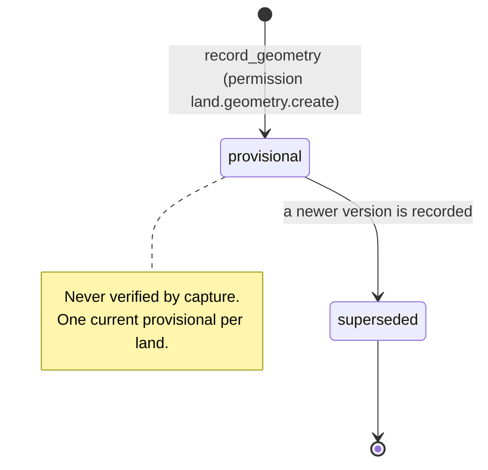
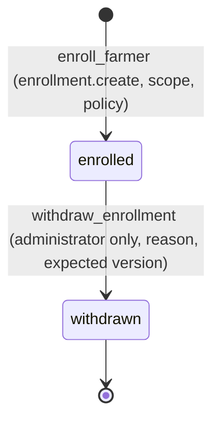
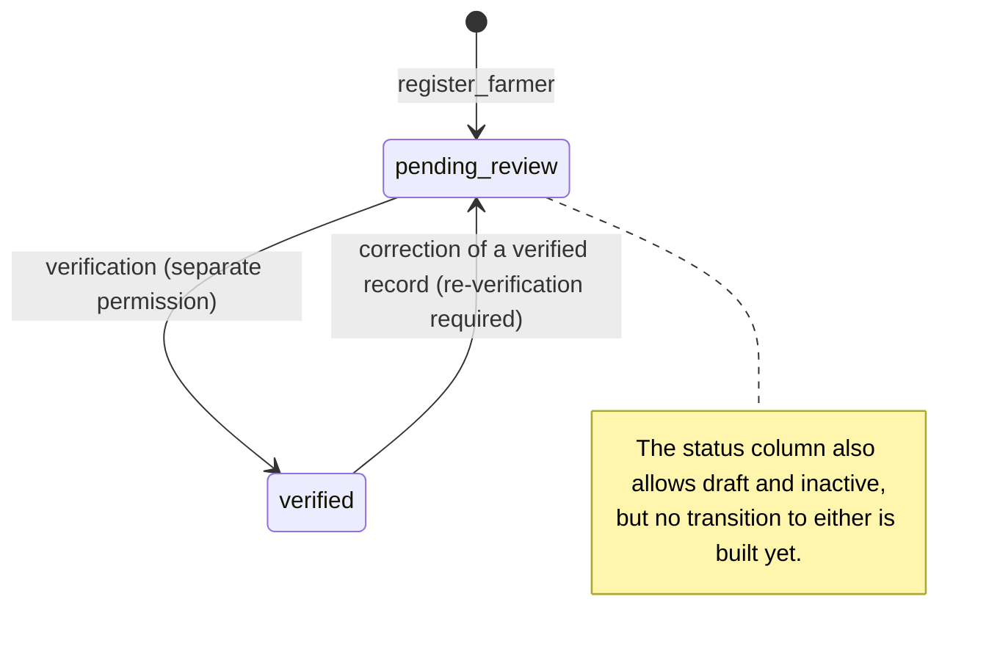

# Cross-domain invariants and additive migration plan (P1-02)

**Status: proposed working record (17 Nov 2026), not an ADR and not an approval.** It records the invariants the delivered code already enforces across schemas, the invariants the planned domains must keep, and an additive migration order. It changes **no** accepted architecture, so no ADR is proposed: PostgreSQL/PostGIS stays authoritative, and the accepted [data/state/cache ADR](decisions/ADR-data-state-cache.md) is untouched. Where a later domain would need a different rule, that domain's own ADR (0022 IAM, 0023 maps, 0024 overlap, 0021 offline enrollment) is where it is decided. Provisional owner choices (Q1–Q71) are not treated as approved.

## 1. Domain map (what each schema owns today)

| Schema       | Tables                                                                                                                                                                                        | Notes                                                                                 |
| ------------ | --------------------------------------------------------------------------------------------------------------------------------------------------------------------------------------------- | ------------------------------------------------------------------------------------- |
| `authn`      | `account`, `device`, `device_key`, `device_assertion`, `device_key_event`, `login_session`, `mfa_factor`, `revocation_event`, `session_issuance_event`, `login_attempt_bucket`                | Identity, devices, sessions, throttle. No `person` table yet (ADR 0022 proposes one). |
| `authz`      | `permission_grant`, `assignment`, `project_permission_grant`, `project_assignment`, `context_key`                                                                                             | Grant rows are read directly by the three predicates; no role catalog yet.            |
| `farm`       | `organization`, `organizational_unit`, `geography`, `farmer`, `farmer_change`, `farmer_audit`, `registration_mutation`, `registration_risk`                                                   | Reference hierarchy and the farmer registry.                                          |
| `land`       | `identification`, `registration_mutation`, `audit`, `geometry_version`, `geometry_mutation`, `geometry_audit`                                                                                 | Reported land identity, provisional polygons.                                         |
| `operations` | `project`, `project_change`, `project_mutation`, `audit`, `enrollment`, `enrollment_mutation`, `enrollment_audit`, `enrollment_policy`, `enrollment_policy_change`, `enrollment_policy_audit` | Project catalog and enrollment.                                                       |

No schema exists yet for people/roles, documents, parcel–person relations, resources and inventory, reporting views or imports.

## 2. Invariants the delivered code already enforces

| #   | Invariant                                                                                                                                                                                         | Enforced by                                                                                                                                                             | Evidence                                                  |
| --- | ------------------------------------------------------------------------------------------------------------------------------------------------------------------------------------------------- | ----------------------------------------------------------------------------------------------------------------------------------------------------------------------- | --------------------------------------------------------- |
| I1  | A row never references another organization's data: children carry `organization_id` and use composite foreign keys such as `(geography_id, organization_id)` or `(project_id, organization_id)`. | Composite FKs in PostgreSQL                                                                                                                                             | migrations 15–22; native migration tests                  |
| I2  | A device or session always belongs to the account it names: `(device_id, account_id)`, `(session_id, account_id)`, `(key_id, device_id, account_id)`.                                             | Composite FKs                                                                                                                                                           | `authn` migrations; session and device tests              |
| I3  | A polygon belongs to the geography of its land: `(land_id, geography_id)` references `land.identification(id, geography_id)`.                                                                     | Composite FK                                                                                                                                                            | migration 25; `land-geometry-integration.ts` step 10      |
| I4  | Access is decided in PostgreSQL: `authz.allowed`, `authz.allowed_project_geography`, `operations.allowed_organization` plus FORCE RLS; the UI and BFF never decide.                               | RLS policies and fixed `SECURITY DEFINER` functions; signed per-transaction actor context that fails closed                                                             | `docs/security/ABAC_GATE.md`; isolation integration tests |
| I5  | Every protected mutation is one fixed function that authorizes first, validates, writes, journals and audits in the same transaction.                                                             | Fixed functions with HMAC idempotency journals (`*_mutation`) and atomic `*_audit` rows; replay returns the first result; a changed payload with the same id is refused | farmer, land, geometry, project, enrollment tests         |
| I6  | Concurrency is optimistic: every mutable record has a `version`, writes state the expected version, a stale write is refused and never overwrites.                                                | `expected_version` checks; `40001` mapped to 409                                                                                                                        | project, enrollment, geometry tests                       |
| I7  | History is append-only: changes and audits are rows, not edits; a boundary is superseded, never rewritten.                                                                                        | Triggers (`geometry_transition_guard`), change/audit tables, no `UPDATE` grants to runtime roles                                                                        | geometry and project tests                                |
| I8  | At most one current provisional polygon per land; geometry is never `verified` by a capture permission; clients cannot submit `official_survey`.                                                  | Partial unique index, status `CHECK`, strict schema                                                                                                                     | migration 25; validation tests                            |
| I9  | Enrollment has at most one current row per farmer and project (`enrollment_one_current_idx`), only `enrolled` or `withdrawn`, and withdrawal is administrator-only in the database.               | Unique index, status `CHECK`, `enrollment_permitted` (ENR-AUTH-01)                                                                                                      | migration 24; enrollment tests                            |
| I10 | Runtime logins cannot read journals or audit tables or write core tables directly; function owners are `NOLOGIN`.                                                                                 | Column-level grants, restricted owners, runtime probes                                                                                                                  | "direct writes denied" steps in each integration test     |
| I11 | Real farmer data, NICs and secrets are never in code, fixtures or logs; only synthetic data exists.                                                                                               | Policy (`AGENTS.md`) and review                                                                                                                                         | all fixtures                                              |

## 3. Invariants every planned domain must keep (before any code)

1. **Organization binding.** Every new table has `organization_id` and composite foreign keys to its parents; no single-column cross-organization reference.
2. **One mutation shape.** Every write goes through a fixed function with authorization first, an HMAC idempotency journal, an atomic audit row and an expected version. No runtime role gets table `INSERT`, `UPDATE` or `DELETE`, and every table is `FORCE ROW LEVEL SECURITY` with a column-scoped `SELECT` grant.
3. **Permissions are named, scoped and separate.** A new action gets its own permission (reads and writes separate, as for `land.geometry.read` and `land.geometry.create`); a permission that confers authority needs an entry in the catalog ADR 0022 proposes before real roles exist.
4. **Identity separation.** A person, a login account, a staff position and a farmer are different records (FR-ORG-003). Adding `iam.person` links an existing `authn.account` without changing it.
5. **Provisional is not verified.** Area, boundary, overlap and eligibility results are estimates until a separately authorized, evidenced transition; reports and quotas must name which kind they use (FR-RPT-008, FR-LAND-016).
6. **Stock and quota are derived from an append-only ledger.** Balances come from signed ledger rows under database constraints and locking (NFR-PERF-04); distribution rechecks the current farmer, project, cycle and any hold (FR-PROJ-020); a disputed or overlapping area never raises an entitlement.
7. **Historic rows keep their meaning.** A new version is a new row; a reassignment or correction recomputes current access but never rewrites what an actor could do or did at the time.
8. **No destructive production change.** Schema changes are additive and versioned (section 4); retention and erasure (FR-DATA-002) are deliberate, audited procedures, not migrations.
9. **Offline never widens authority.** Anything queued offline is re-authorized, re-validated and version-checked when it syncs; queued data is the minimum set the device is allowed to hold (FR-OFF-001).

## 4. Migration rules

- One directory per migration under `database/migrations/` named `YYYYMMDD_description/up.sql`, listed in `manifest.json`, applied by the checksummed native runner; a changed applied file is refused.
- **Expand, then contract.** Add nullable columns, new tables, new functions or new permissions first; switch callers; only a later, separately reviewed migration may tighten a constraint (use `NOT VALID` then validate) or drop something deprecated. A function replaced in the same release keeps its owner, `SECURITY DEFINER`, fixed `search_path` and grants (as migration 24 did); a retired function is dropped in the migration that retires its last caller (as migration 26 did).
- Every migration ships with a native test that applies it on a fresh database, probes each new grant and denial, includes an Officer A/B isolation scenario where scope matters, and has mutation checks showing the denials fail when removed.
- Backfills run in bounded batches inside their own migration or a documented operator procedure, never inside a long lock on a hot table.
- Production never receives a draft reference SQL file; a failed migration is fixed forward.

## 5. Planned additive order (each item waits on the decision or review shown)

| Order | Migration (additive)                                                                                      | Depends on                                                                               |
| ----- | --------------------------------------------------------------------------------------------------------- | ---------------------------------------------------------------------------------------- |
| 1     | `iam` permission catalog, `person`, nullable `account.person_id` (read-only first, P1-03a)                | DEC-02 role matrix; independent review of ADR 0022                                       |
| 2     | Roles, role versions, bindings materialized into the existing grant tables; access requests and approvals | Step 1; ADR 0022 acceptance                                                              |
| 3     | Project cycles, closure and eligibility policy versions (P1-15 remainder)                                 | DEC-04 enrollment lifecycle                                                              |
| 4     | Parcel–person relations and land evidence metadata                                                        | DEC-09 and Q17–Q20 decisions; step 1                                                     |
| 5     | `land.geometry_overlap`, resolutions and `allocatable_m2` function (ADR 0024)                             | Owner disclosure decision; DEC-09 tolerance; step 2 reviewer roles                       |
| 6     | Document metadata and encrypted object references                                                         | DEC-06 retention and consent; storage choice                                             |
| 7     | Resource catalog, units, locations, append-only ledger core (ADR 0026), then quota policy versions        | Ledger core: DEC-05 and independent review. Quotas and allocations: DEC-05 and steps 3–5 |
| 8     | Reporting views and scheduled report definitions                                                          | Steps 5 and 7; export permissions                                                        |
| 9     | Import staging, mapping and approved commit with provenance                                               | DEC-10; DEC-06                                                                           |
| 10    | Offline enrollment support tables (only if ADR 0021 is Accepted)                                          | ADR 0021 A1–A4 and Gate E                                                                |

## 6. State diagrams for the lifecycles that exist

## 7. Not decided here

Retention periods, the role matrix, overlap tolerance and disclosure, quota and unit rules, the hosting provider and the 2,700 versus 2,760 planning figure remain owner or client decisions (see the [conflict register](../requirements/PHASE_1_SOURCE_CONFLICTS.md)). Nothing in this document authorizes offline enrollment (ADR 0021 is not accepted) or any Phase 2 farmer portal work.
