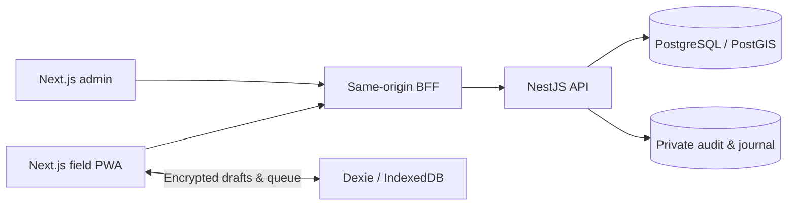

# AGRICULTURAL OPERATIONS PLATFORM

# PHASE 1 — AI CODING AGENT IMPLEMENTATION PLAN

**Document:** `AGRI_PHASE_1_AGENT_DEVELOPMENT_PLAN.md`  
**Version:** 1.0 | **Prepared:** 16 November 2026  
**Target repository:** `https://github.com/SandaruWithanage/agri-operations-platform` | **Baseline branch:** `main`  
**Delivery stage:** P1 — Foundation and Farmer-Management Pilot  
**Calendar estimate:** **18–20 weeks (at least four calendar months)**  
**Engineering allowance:** **160 hours** (part-time effort; review and waiting time are not engineering hours)  
**Proposed development fee:** **LKR 250,000** (the total Stage 1 fee, not an up-front deposit)  
**Status:** **Proposed, NOT CLIENT-APPROVED.** No production release or use of identifiable farmer data is authorized by this plan.

> **Important scope rule:** This is the **lean P1 scope of the revised budget proposal v0.3**, not the comprehensive 71-decision SRS v0.9. The comprehensive owner-selected first-release scope included full GIS and comprehensive reporting. The lean four-stage proposal is a _proposed change_ requiring **dated owner and client written approval**. Until that approval, build/test only already-authorized bounded technical work with synthetic data. Do not quietly delete the original SRS features or declare them completed.

---

## 0. START HERE — MANDATORY INSTRUCTIONS FOR THE AGENT

You are a software engineering agent working in the **existing** codebase, not creating a replacement application. Your assignment is to bring the already implemented farmer-management foundations to a demonstrable, secure, bilingual **Phase 1 pilot** within the stated time and scope.

**Before writing code:**

1. Open the repository and record current commit SHA and branch. Do not rely on the historical snapshot or on this document for exact current implementation status.
2. Read, in this order:
   - `AGENTS.md`
   - `docs/CODEX_START_HERE.md`
   - `docs/development/PROJECT_HANDOVER.md`
   - `docs/development/PHASE_1_STATUS.md`
   - `docs/development/ROADMAP.md`
   - `docs/requirements/OPEN_DECISIONS.md`
   - `docs/architecture/decisions/ADR-data-state-cache.md` (**Accepted**)
   - `docs/decisions/ADR-0003-provisional-farmer-registration.md`
   - `docs/decisions/ADR-0004-pilot-authentication.md`
   - `docs/decisions/ADR-0005-provisional-farmer-authorization.md`
   - `docs/decisions/ADR-0006-approved-device-possession.md`
   - `docs/decisions/ADR-0007-offline-drafting-and-sync.md`
   - `docs/decisions/ADR-0008-authenticated-archive-recovery.md`
   - `docs/decisions/ADR-0011-reported-land-identification.md`
   - `docs/decisions/ADR-0015-online-land-capture.md`
   - `docs/decisions/ADR-0021-offline-enrollment-design.md` (**NOT Accepted**)
   - Relevant `docs/testing/*` results and domain implementation guides.
3. Read the **external project planning documents** supplied with the job, if accessible: `AOP_SRS_v0.9_REVIEW.md`, `AOP_ARCHITECTURE_v0.9_REVIEW.md`, `AOP_BUDGET_PROPOSAL_EN_v0.3.md`, the 71-owner-decision register and GitHub reconciliation. These are owner-proposed references, **not automatically authorized implementation scope**.
4. Run a _read-only_ code and documentation audit. Identify what is actually implemented, what tests demonstrate, what needs hardening, and the smallest fixes necessary for the P1 acceptance tests below.
5. Propose a **PR-by-PR execution plan** showing task ID, affected modules, tests, hour allowance, risk and evidence. Then implement in small, reviewable feature branches under repository governance.
6. **Never** push straight to `main`, force-push, merge a PR, accept an ADR, grant real users access, enable production flags, or deploy to a live environment without the required owner approval.
7. Never use real farmer data, NICs, bank details or production secrets in prompts, source, logs, fixtures, screenshots, public artifacts or tests. Use synthetic fixtures.
8. If a requested feature conflicts with an accepted ADR, record the conflict and propose a superseding ADR. Do not override existing security protections just to achieve a demo.
9. **Do not implement or enable offline project enrollment in P1. ADR 0021 remains NOT Accepted.** Offline dependency-aware farmer-to-enrollment sync belongs to later approved work, despite its provisional owner selection in the comprehensive SRS.
10. For each PR: report precise changes, tests actually run, tests not run, remaining risks, documentation changes, and evidence. Never claim end-to-end completion because a unit test passes.

### One-line mission

> Deliver a reviewed, bilingual, access-scoped **farmer registration pilot** with reliable **encrypted offline farmer drafts/sync**, **basic online reported land-point capture**, a **hardened staging environment** and **documented UAT**, while preserving existing database security and the comprehensive project's future options.

---

## 1. SOURCE OF TRUTH AND APPROVAL PRECEDENCE

1. **Implemented code + actual test evidence** establishes what exists, not what the client approved.
2. **Accepted technical ADRs** govern architecture unless an explicitly reviewed successor changes them.
3. **Existing `AGENTS.md` and `PROJECT_HANDOVER.md`** govern repository process and stable task IDs.
4. **P1 v0.3 proposal** governs this document's **proposed** scope, timeline, effort and fee, _only after_ a signed P1 change/baseline approval.
5. **71-decision register and comprehensive SRS** remain the **proposed long-term requirements register**; the earlier full-GIS/reporting commitments are not silently withdrawn.
6. **Client policy, identity, retention, pilot devices, hosting charges and UAT sign-off** require actual authorized client decisions. No agent may infer approval from the conversation.

If two sources conflict: capture the exact file/section, cite the conflict in the PR, leave the stronger current security control in place, and obtain a decision before modifying the behavior.

### Approval checkpoints

| Gate                               | Timing                                                      | Required evidence                                                                                                                              | Permits                                                         |
| ---------------------------------- | ----------------------------------------------------------- | ---------------------------------------------------------------------------------------------------------------------------------------------- | --------------------------------------------------------------- |
| G0 — P1 scope approval             | Before treating P1 as a client delivery contract            | Signed client+owner P1 feature list, deferrals, fee, acceptance and named approvers                                                            | Contracted P1 delivery                                          |
| G1 — Architecture/security review  | Before changing auth, data grants, vault schema or recovery | Reviewed change description, threat cases, migrations and test plan                                                                            | Controlled engineering PR                                       |
| G2 — Staging readiness             | Before deployed staging pilot                               | Passing CI, sanitized config, synthetic data, HTTPS/network and restore proof                                                                  | Restricted staging demo                                         |
| G3 — Real-data pilot authorization | Before **any** real farmer data                             | Legal/privacy review and notices, client approvals, named users/scopes, device review, independent security review, backup/recovery acceptance | Narrow approved real-data pilot, not blanket production release |
| G4 — P1 UAT/sign-off               | Weeks 15–20                                                 | Client UAT evidence, unresolved defect register, bilingual handover, recovery runbooks and written acceptance                                  | P1 stage completion/payment acceptance                          |

**If G0 is missing**, the agent may audit and draft design/tests, but must not represent the lean P1 as an approved replacement for the comprehensive SRS. **If G3 is missing**, a synthetic-data staging demonstration is permissible after G2; a real-data pilot is not.

---

## 2. PHASE 1 FUNCTIONAL BOUNDARY

### 2.1 In scope — required P1 outcomes

**P1-F01 — Staff authentication, scoped authorization and controlled access:** keep and harden existing hybrid sessions, privileged MFA, approved browser-device possession, BFF CSRF/session isolation, PostgreSQL scope checks/RLS and audit. Verify that creating a farmer does not automatically grant the creator subsequent read, correction or enrollment rights. Improve the agreed pilot's recovery/user guidance and negative tests _within the 35-hour allowance_; do not promise an entire IAM platform.

**P1-F02 — Minimal bilingual farmer registration:** authorized admin/field officer can create a farmer with name in English **or** Sinhala, configured GN/village, UUID, trusted source/time and approved bilingual privacy-notice delivery confirmation. NIC, phone, land, enrollment, identity document and medical data must **not** be mandatory. Duplicate candidates are **flagged for review, never auto-merged**. Current `draft`, `pending-review`, `verified`, `inactive` states remain policy-governed.

**P1-F03 — Encrypted offline farmer workspace:** approved field devices can save unfinished minimal farmer drafts and final queued intents in the current per-account/per-device encrypted Dexie vault. Data survive ordinary offline reload/restart within existing security constraints. The UI shows distinct `saved-on-device`, `pending-sync`, `syncing`, `synced`, `conflict`, `rejected` outcomes as supported by the existing domain. Retain stable farmer/mutation IDs across retries, detect duplicate risks, reauthorize at server sync, and never silently discard unsent work.

**P1-F04 — Online land identification (point only):** in the admin workflow, capture a reported location using **an explicit user-requested GPS action** or valid manual WGS84 coordinate entry, optional reported accuracy and optional reported area; provide scoped bilingual land list/detail. Persist via existing PostgreSQL/PostGIS authorization, idempotency, audit and BFF rules. Location is _reported identification_, **not a verified boundary, surveyed area, evidence of legal ownership or automatic GN containment**. Do not infer farmer-land relationships.

**P1-F05 — Demonstrable staging/backup setup:** a cost-conscious containerized **staging** deployment of admin, field and API with TLS, private PostgreSQL, restricted role/key provisioning, migration discipline, health/readiness, minimally useful monitoring and encrypted offsite backup/restore **rehearsal with synthetic data**. Runtime configuration and keys must not be checked into GitHub.

**P1-F06 — Testing, bilingual operator handover and acceptance:** execute negative authorization tests, offline interruption tests, synthetic migration/recovery and real-device field smoke tests where approved hardware is available; document bilingual quick-start and limitation notices, UAT evidence, initial training and the release decision.

### 2.2 Explicitly **not promised** in P1 / do not implement to satisfy P1 sign-off

- **Phase 2 / later:** full project enrollment workflows, offline enrollment, complex enrollment/cycle rules, farmer-land legal relationships, stock ledger/issue/returns, CSV mass migration, broader staff administration.
- **Phase 3 / later:** interactive parcel/polygon GIS, walking entire perimeter to record a boundary, polygon area/overlap/verification, offline map tiles, background GPS, offline land survey sync. An optional WGS84 **point** is all P1 budgets.
- **Phase 4 / later:** offline polygon synchronization, expanded KPIs/custom reporting, resource allocation refinements, comprehensive security/recovery enhancements beyond P1 proof.
- **Outside lean package:** full original comprehensive SRS, unlimited report builder, advanced scheduled reporting, production-grade locked-screen GPS, legal survey/title, finance/procurement/harvest/transport/insurance, farmer self-service, unrestricted data import, vendor-specific map integration, multi-tenant SaaS.
- **Do not advertise** secure lost-passphrase recovery or key escrow as delivered merely because ordinary same-account archive recovery works. Optional recovery-key design is a separate reviewed item.
- **Do not implement** a seven-day offline configuration by simply increasing `PILOT_OFFLINE_SECONDS`; the older browser/clock/storage controls need reviewed design and real-device tests first. The comprehensive decision is provisional, and P1's task is to document the gap, not weaken existing safeguards.

A feature from the full SRS can enter P1 **only through a dated change request** with added hours, cost, dependencies, security work and owner/client approval. No silent additions or reductions.

---

## 3. EXISTING REPOSITORY BASELINE — INSPECT AND REUSE

**Snapshot read on 16 Nov 2026; refresh at execution time.** These are bounded implementation claims, not production certification:

| Existing capability                                                                        | Observed documentation/evidence                                         | P1 agent action                                                                                                |
| ------------------------------------------------------------------------------------------ | ----------------------------------------------------------------------- | -------------------------------------------------------------------------------------------------------------- |
| Monorepo, Next.js admin and field PWA, NestJS API, shared packages, PostGIS Compose and CI | `README.md`; M0 status                                                  | Reuse, run baseline quality gates; **do not scaffold a new repository**                                        |
| Hybrid Argon2id/MFA/session/BFF authentication                                             | `docs/decisions/ADR-0004-*`; `PILOT_AUTH_RUNTIME.md`                    | Negative security checks; account/device access walkthrough; preserve disabled-by-default auth                 |
| Scoped create/read/verify/correct, RLS and atomic audit                                    | Farmer domain guides, `PROJECT_HANDOVER.md`                             | Regression tests including two different officers; distinguish implemented limited powers from full role admin |
| Approved browser-key registration and operator provisioning                                | `DEVICE_ENROLLMENT.md`                                                  | Validate approval and revocation; never claim hardware attestation from WebCrypto key                          |
| Encrypted Dexie minimal farmer drafts/sync, authenticated archives                         | `OFFLINE_WORKSPACE.md`; `ADR-0007/0008`; vault tests                    | Stabilize recoverability, multi-tab/interruptions and refusal UX; do not replace queue                         |
| English/Sinhala staff screens                                                              | Existing UI/packages and locale tests                                   | Terminology QA with fluent reviewers; accessible forms and errors                                              |
| Admin farmer list/detail, review, correction and audit                                     | Existing farmer screens and API                                         | Regression check; avoid exposing hidden rows/aggregates                                                        |
| Reported land PostGIS API, bilingual directory and online GPS/point capture                | `LAND_IDENTIFICATION.md`; `ONLINE_LAND_CAPTURE.md`; `LAND_DIRECTORY.md` | Ensure proper point/accuracy/area semantics, authorization and failure states                                  |
| Project catalog and some enrollment APIs/BFF/UI                                            | Project/enrollment guides                                               | **Preserve existing functionality**; not new P1 acceptance promises, no offline-enrollment enablement          |
| `ADR-0021` offline enrollment technical proposal                                           | `docs/decisions/ADR-0021-offline-enrollment-design.md`                  | **Remain NOT Accepted**; no OFF-04A–D implementation/flag/real-officer access under P1                         |

**Known high-risk gaps:** full IAM admin and key recovery are incomplete, actual field devices unapproved, production hosting/backup/restores unproven, some online drafts are tab-memory only, complete GIS is not implemented, `docs/security/ABAC_GATE.md` may contain an out-of-date blanket status. Resolve documentation conflicts by citing actual current tests/code; do not assert that they are finished.

### Technical stack and ownership rules



- **PostgreSQL/PostGIS:** authoritative data, constraints, RLS/ABAC permissions, audit, idempotent mutations.
- **NestJS:** trusted server-side policies, DTO validation and domain services; never accept browser-supplied actor role as authority.
- **Next.js BFF:** secure session/cookie boundary and explicitly allowlisted DTOs; no JWTs or refresh tokens to browser storage.
- **TanStack Query:** online authenticated server-state reads/mutations, isolated per principal/session/scope; abort/clear protected caches upon context changes.
- **Zustand:** non-sensitive shared UI state, currently locale preference; never an authorization source or farmer data store.
- **Dexie/IndexedDB:** **one existing encrypted vault** for minimal authorized offline data, original stable IDs and pending intent; no second queue/replacement storage.
- **Redis:** not required; do not add without measured need and separate ADR.
- **Database:** migrations are versioned, reviewed, applied by appropriate migration identity; application connections never inherit elevated owner/admin rights.

---

## 4. WORK BREAKDOWN, BUDGET AND DEFINITIONS OF DONE

Every row is **the maximum planning allowance for the bounded P1 task**, not an invitation to implement the entire associated repository backlog. In particular, `IAM-01/02/03`, `REC-03`, `SEC-03`, `OPS-03/04` and full `ACC-01` contain large work beyond P1.

| WP      | Work package                                            |   Hours | P1 fee (LKR) | Related repo task IDs                          | Required result                                                                      |
| ------- | ------------------------------------------------------- | ------: | -----------: | ---------------------------------------------- | ------------------------------------------------------------------------------------ |
| P1-WP01 | Requirements freeze, repo inventory and P1 UAT baseline |  **12** |   **20,000** | ACC-03, MAINT-02                               | Signed/acknowledged scope draft; gap/test checklist; no false completion claims      |
| P1-WP02 | Existing login/MFA/scoped access hardening              |  **35** |   **55,000** | SEC-01/02, IAM-02/03 (bounded), SEC-04 (tests) | Audited negative auth tests; secure session/device walkthrough                       |
| P1-WP03 | Farmer capture, encrypted offline sync and recovery QA  |  **45** |   **70,000** | FAR-01, OFF-01/02, REC-01, ACC-02 (bounded)    | Tested minimal record, encrypted restart/retry/conflict/revoke, safe recovery states |
| P1-WP04 | Online land point/area and directory pilot              |  **20** |   **30,000** | LAND-01, bounded LAND-03                       | Tested WGS84 point/accuracy/reported-area and scoped list/detail, no polygon         |
| P1-WP05 | Single VPS staging, TLS, basic offsite backup rehearsal |  **25** |   **40,000** | OPS-03/04/05 (bounded), SEC-03 (review)        | Synthetic-data staging + evidence of restore and basic security boundaries           |
| P1-WP06 | Pilot UAT, bilingual quick guides and initial training  |  **23** |   **35,000** | ACC-01/02/03 (bounded)                         | UAT record, defects/risks, short EN/SI guide and go/no-go sign-off                   |
|         | **TOTAL P1**                                            | **160** |  **250,000** |                                                | **18–20 weeks**                                                                      |

No extra hours are implied for contingency weeks 19–20. Any additional engineering effort or external independent audit/travel costs require a quotation or approved reprioritization.

### P1-WP01 — Scope and baseline (12 h)

**Steps**

- Create `docs/requirements/PHASE_1_LEAN_SCOPE_PROPOSED.md` as an **additive** proposal: features P1-F01…F06, exclusions, named approver blanks, conflicts against Decision 29 (comprehensive reporting) and Decision 48 (full GIS), acceptance and support boundaries. Do not overwrite the full SRS.
- Log current commit/migrations/CI; check existing code and tests for already shipped paths.
- Create `docs/development/PHASE_1_EXECUTION_BOARD.md` with statuses `Pending / In Progress / Verified / Blocked / Client Accepted` and hours consumed vs allowance for each WP. This is a **proposed new tracking file**, not an existing contract.
- Map each P1 test scenario below to current code/test file, and record missing proofs.
- List client inputs: authorized approver, organization branding, named pilot officer(s), scopes, test devices/OS/browser, approved EN/SI notice, hosting destination, support contacts and sample synthetic geographies. Flag the unresolved 2,700 vs 2,760 source-plan total, but **do not import or fix the numbers**.

**Acceptance:** an independently reviewable scope table, current baseline SHA and gap list; no code rewrite, no approval invented.

### P1-WP02 — Auth/MFA, session and scoped access (35 h)

**Steps**

- Reproduce existing auth flow using the documented `ENABLE_PILOT_AUTH` and **synthetic** test accounts. Runtime is disabled by default unless keys, restricted runtime DB roles, MFA and approved device provisioning are correctly configured.
- Confirm `Secure`, `HttpOnly`, `SameSite` cookie and same-origin BFF protections; CSRF for mutation routes; no browser JWT, refresh secret or sensitive authenticated API cache persistence.
- Validate MFA for privileged users and the current conservative requirement for other pilot accounts. **Do not loosen the requirement** solely because the provisional long-term choice is risk-based MFA.
- Audit current account/device binding and revocation, sign-in throttling, failed login/error messages and privileged event logging. Enhance **bounded** user/operator guidance or tests, not complete IAM management.
- Verify scoped create/read/correct separation: a field officer with `farmer.create` cannot read an unassigned farmer; wrong organization/geography and revoked assignments must deny; missing signed actor context must fail closed in PostgreSQL.
- Repeat two-officer negative tests and client isolation after logout/session change; ensure user-entered roles, actor IDs or headers are ignored at the BFF/API boundary.
- Record outstanding dynamic-role admin, MFA self-service recovery, robust lost-device recovery and cryptographic rotation as **future design/security work**, not falsely delivered by this WP.

**Acceptance:** real code/tests show no cross-user/cross-geography disclosure, correct privileged MFA, current-scope checks, revocation and CSRF/session protections. If there is a material vulnerability, treat it as release-blocking and escalate; **do not bypass it to meet the hour budget**.

### P1-WP03 — Farmer capture and encrypted offline QA (45 h)

**Steps**

- Preserve the existing minimal farmer input contract: English **or** Sinhala name, configured geography, notice confirmation, stable UUID and trusted source/time. Ensure NIC/phone optionality; flag potential duplicates for review without merge.
- Trace a farmer draft through **form → encrypted Dexie write → restart → unlock → pending queue → reconnect → BFF → NestJS → PostgreSQL RLS/idempotency/audit → server acknowledgment**.
- Exercise failure boundaries: kill/reload before save, before/after send, lost response after DB commit, duplicate submission using same mutation ID, modified payload using same ID, expired/revoked session, loss of scope, admin refusal and business conflict. No duplicate farmer creation or data loss from ambiguous network outcomes.
- Keep encrypted rows partitioned by account and approved browser-device context; verify ciphertext is not exposed by logs, localStorage, TanStack Query persistence, service-worker caches or public URLs.
- Test tab interactions, local lock and outbox consistency. Cross-tab/schema migration handling not delivered should be explicitly called out; do not assume it exists because Web Locks are used for editing.
- Verify current authenticated same-account/same-approved-device archive export/restore on a **synthetic empty target vault**. Destructive import/mismatched account, wrong passphrase, tampered envelope and partial archive must fail safely. Do not build unreviewed escrow/recovery keys.
- Show separate `saved`, `pending`, `syncing`, `conflict`, `rejected`, `synced` states with accurate bilingual instructions. A failed send must not be represented as definitely rejected if it could have committed.
- Test real-device behavior (when test phones provided): app restart, airplane mode, low-storage warnings, session renewal and recoverability. Mark browser/storage/OS guarantees not verified on untested platforms.

**Acceptance:** acceptance cases UAT-03…08 below pass using synthetic records and capture exact test data, device/build version and limitations. If a real device cannot retain drafts or fails local locking, prohibit that device's real-data use.

### P1-WP04 — Bounded reported land-point pilot (20 h)

**Steps**

- Reuse existing land creation API, BFF, PostGIS geometry and admin directory; verify current screen and tests before changing it.
- Require an **explicit click** before requesting browser geolocation. Capture optional WGS84 longitude/latitude and measured browser accuracy, or accept strictly validated manual coordinates. Handle permission denied, timeout, malformed/out-of-range coordinates and absence of GPS.
- Keep `reported_area_ha` distinctly labelled **reported**, not GIS measured/surveyed. Confirm numeric validation and no invented polygon area calculation.
- Validate independent `land.create` and `land.read` permissions, geography organization consistency, current actor session, atomic audit and stable mutation retry. Permission to create farmer or land **does not** imply permission to link them or see hidden locations.
- Verify bounded, scoped list/detail and cancellation on identity/scope changes; ensure no hidden land point or unauthorized aggregate leaks.
- Display bilingual note: **GPS points are identification only; not official surveyed boundaries, title, verified acreage or GN containment.**

**Acceptance:** happy/negative paths including unauthorized read, denied GPS, wrong organization and malformed coordinates pass; **no** polygon editor, walk-the-boundary flow, farmer-parcel tenure, or offline land cache is claimed.

### P1-WP05 — Staging and recoverability rehearsal (25 h)

**Steps**

- Review current infrastructure and migration operations, then draft minimal **staging-only** Docker Compose/reverse-proxy deployment steps for admin, field, Nest API and PostgreSQL/PostGIS. Keep API/DB on private network, serve TLS for public BFFs, protect volumes, and maintain liveness/readiness semantics.
- Use an approved VPS/provider **only after the owner selects it**; do not provision paid services or production domains without approval. Use `*.env.example` for schema only, protect actual server `.env` files, exclude them from backups/commits/logs, and document operator custody.
- Use the existing manifest/checksum-based migration runner with separate migration identity. No direct SQL changes to shared/production DB, no reset/drop volumes to resolve mismatches, no fabricated migration history.
- Verify all runtime login identities and NOLOGIN function owners remain separated; deny privileged database credentials to public web/BFF processes.
- Produce backup and restore rehearsal using **synthetic records**: encrypted offsite copy, key access test, consistent restore to a separate test DB, application functionality and audit/data checks. Distinguish a written procedure from a **measured** RPO/RTO.
- Define minimally useful sanitized logs, health/readiness, service restart and backup failure signals; write restart/backup/restore/rollback runbooks and emergency contacts.
- Provide a release runbook: preflight, backup, migrations, rollout, smoke tests, rollback/forward-fix, no loss of queued offline drafts. Do not add unreviewed cron key rotation: some retained MAC/encryption keys cannot be rotated blindly.

**Acceptance:** synthetic staging site reachable via intended TLS route, API/DB not publicly accessible, user/session flow works with approved test accounts, staging restore passes, no leaked keys, rollback limits recorded. This is **not** proof of production high availability, RPO ≤1 h or RTO ≤8 h.

### P1-WP06 — UAT, language, training, sign-off (23 h)

**Steps**

- Prepare a reusable EN/SI quick-start for officers (sign-in, approved device, create/sync, understand statuses, recover/review unsent drafts, sign out) and admins (scope-controlled registry, land point, incident escalation).
- Validate all visible text including denial/privacy warnings with fluent Sinhala speakers and at least one field officer. Do not auto-translate names, farmer-entered data or legal statements.
- Run UAT matrix below: authorized vs unauthorized accounts, online/offline flows, land point, deliberate errors and key/backup failure handling. Capture actual devices/OS/browser/network conditions.
- Run keyboard, touch, contrast and essential screen-reader checks. **WCAG 2.2 AA is the proposed comprehensive target**, not achieved by assertion; record any remaining defects and user-agreed disposition.
- Perform pilot security walkthrough and commission an independent security review **if G3 real-data use is requested**; external specialist charges are not in the LKR 250k fee unless separately approved.
- Create a severity-ranked defect register, training attendance/evidence, support contact list and concise staged-deployment/rollback plan.
- Record explicit outcomes: `Synthetic demo accepted`, `Real-data pilot blocked`, `Real-data pilot approved with named scope`, or `Not accepted`. G4 stage sign-off must not imply G3 security/legal approval.

**Acceptance:** signed/dated UAT matrix and deliverables, severity-1/2 findings resolved or formally blocking release, handover guides reviewed, no invented client acceptance.

---

## 5. WEEK-BY-WEEK CALENDAR (18–20 WEEKS)

This schedule respects a **minimum four-month calendar** for P1, but the active coding estimate is only **160 hours**. Reviews, waiting for devices or approvals and contingency do not increase the included fee or hours.

| Week  | Focus and planned checkpoint                                         | Output / completion signal                     |
| ----- | -------------------------------------------------------------------- | ---------------------------------------------- |
| 1     | Repository audit, current SHA, dependency/install review             | Baseline report, build/test inventory          |
| 2     | Trace P1 scope to owner decisions and previous SRS; approval gap log | Proposed P1 baseline and exclusions            |
| 3     | Auth/session/MFA boundary walkthrough and threat checklist           | Security risk list and negative-test map       |
| 4     | Secure P1 scope and staged UAT approval; freeze PR sequence          | **M1: planning gate**, G0 or recorded blocker  |
| 5     | Existing auth/session test fixes                                     | Privileged MFA/CSRF/revocation regressions     |
| 6     | BFF, database RLS, officer A/B isolation                             | Scoped denial evidence                         |
| 7     | Existing farmer input and duplicate-risk QA                          | Minimal registration contract proof            |
| 8     | Encrypted Dexie restart and lock recovery                            | Offline preservation tests                     |
| 9     | Lost-response idempotency and conflict states                        | **M2: farmer pilot flow demonstrated**         |
| 10    | Offline device/partition/replay/revocation negative cases            | Recovery and fail-closed results               |
| 11    | Bilingual field UX/offline instructions                              | Field usability walkthrough                    |
| 12    | Online reported land point and permission cases                      | GPS/point and error-state tests                |
| 13    | Land directory, reported area labels, bilingual accuracy caveats     | **M3: bounded land pilot demonstrated**        |
| 14    | Staging HTTPS/network/migration/restore rehearsal                    | **M4: staging proof**, G2 or blocker           |
| 15    | Synthetic end-to-end UAT, initial device/field trials                | Executed cases, defects and device log         |
| 16    | Defect repair, independent review if real data is proposed           | Release blocker status                         |
| 17    | Sinhala/English quick guides, training and support runbooks          | Documentation and training evidence            |
| 18    | Pilot go/no-go and client acceptance                                 | **M5: P1 UAT decision**, G4                    |
| 19–20 | Contingency for client review or unresolved defects                  | Closure only; **no new automatic scope/hours** |

**Dependencies:** WP02 and approved devices protect WP03; WP01 must identify approval boundary before demos; WP05 staging cannot use real records before G3; WP06 depends on tested WPs 02–05. Reorder work only when documented in the execution board.

### Stage 1 proposed payment checkpoints (not assumed approved)

- **40% / LKR 100,000** on signed P1 start and baseline acceptance.
- **30% / LKR 75,000** after intermediate demonstration and agreed milestone evidence (suggest M2 + M3).
- **30% / LKR 75,000** following agreed UAT and handover (G4).

Hosting, domain, backup storage, messaging, testing devices, travel, independent audits and tax are **outside** this development fee unless the agreement expressly includes them.

---

## 6. EXECUTION ORDER — RECOMMENDED PULL REQUESTS

Use a branch per bounded change. These PR identifiers are **planning labels**, **not claims that PRs currently exist**. An agent may split an item further to minimize regression risk, but must account for hours.

| PR planning label           | Scope                                                                     | Prerequisite                              | Required tests/evidence                                                                   |
| --------------------------- | ------------------------------------------------------------------------- | ----------------------------------------- | ----------------------------------------------------------------------------------------- |
| `P1-PR01-baseline`          | Proposed signed-scope template, current SHA, gap analysis and UAT matrix  | Read mandatory docs                       | No changed security assertion; markdown links/format; approvals pending clearly indicated |
| `P1-PR02-auth-regression`   | Add/fix auth, MFA, BFF and cross-scope negative tests; minimal bugs only  | PR01 + security review for policy changes | CSRF, wrong actor/device, role/source spoof, officer A/B, revocation                      |
| `P1-PR03-offline-stability` | Minimal encrypted farmer vault/outbox reliability, recovery and status UX | PR02 / existing vault                     | Encrypted restart, stable IDs, lost response, denial vs conflict, partition/multi-tab     |
| `P1-PR04-land-point-pilot`  | Bounded online point capture/directory hardening and labelling            | PR02 scope checks                         | GPS-denied, invalid coords, accurate **reported** labels, hidden-data denial              |
| `P1-PR05-staging-runbooks`  | Containerized HTTPS staging and synthetic restore proof                   | PR02–04 stable tests, VPS approval        | Migration rehearsal, secrets check, restore smoke and rollback evidence                   |
| `P1-PR06-uat-handover`      | Tested EN/SI operator docs, evidence matrix, defects, pilot gates         | PR02–05                                   | Client/device checklists, actual results, G3/G4 status                                    |

Each PR must update `docs/development/PROJECT_HANDOVER.md` in the same PR **if an existing stable task has materially changed**, plus relevant `PHASE_1_STATUS.md`, `ROADMAP.md`, domain/test docs and new P1 execution board. Do not overwrite historical result reports or change `ADR-0021` status.

### Agent PR write-up template

```md
## Task / scope

- P1 package:
- Repository stable task IDs:
- Source/approval status:

## Existing behavior reused

- ...

## Change summary

- ...

## Authorization / data / offline impact

- ...

## Evidence

- Commit SHA:
- `pnpm lint`:
- `pnpm format:check`:
- `pnpm typecheck`:
- `pnpm test` (DATABASE_TEST_URL isolated?):
- `pnpm db:validate`:
- `pnpm build`:
- `pnpm test:browser` (compiled build?):
- Real device / UAT evidence (if any):

## Unresolved limitations and approval gates

- ...

## Hours used / work package

- Planned:
- Used:
- Remaining:
```

---

## 7. LOCAL ENGINEERING ENVIRONMENT AND VERIFICATION

Check exact versions from the current repository files before installing, and follow the repository's dependency policy. At the documented snapshot: **Node.js 26.13.1**, **pnpm 12.21.0**, **Docker Compose v2**, **PostgreSQL 17/PostGIS 3.5 baseline**.

**Documented starting commands** (run from repo root; use local synthetic credentials only):

```bash
npm install --global pnpm@12.21.0
pnpm install --frozen-lockfile
cp .env.example .env
cp apps/api/.env.example apps/api/.env
cp apps/admin-web/.env.example apps/admin-web/.env.local
cp apps/field-pwa/.env.example apps/field-pwa/.env.local
cp database/.env.example database/.env
# Edit only untracked local environment files with test credentials.
pnpm db:up
pnpm dev
```

Documented local endpoints (may differ when configured): admin `http://localhost:3000`, field `http://localhost:3001`, API liveness `http://localhost:4000/health`, readiness `http://localhost:4000/ready`. Auth normally **starts disabled** until configured per `docs/development/PILOT_AUTH_RUNTIME.md`. Do not “fix” a disabled runtime by weakening the configuration check.

**Baseline/PR quality gates:**

```bash
pnpm lint
pnpm format:check
pnpm typecheck
pnpm test
pnpm db:validate
pnpm build
pnpm test:browser
```

**Important:** Database integration tests require `DATABASE_TEST_URL` pointing to a **fresh, isolated, disposable** `agri_test` PostgreSQL/PostGIS instance and may be skipped without it. A plain `pnpm test` success with skipped database tests is **not** evidence of native RLS/authorization acceptance. `pnpm test:browser` requires the compiled browser-test setup documented in the repository. Record actual skips and environment. Do **not** run test harnesses or migrations against a shared or production database.

Migrations must use the documented plan/review process (`pnpm db:migrate:plan`, `pnpm db:migrate`) with the dedicated migration identity and verified target database name. Do not run untracked SQL or repair schema issues by deleting persisted volumes. Check package scripts before invoking any destructive command.

### Required test layers

1. **Validation/unit:** names/locations/optional values, stable mutation contracts, GPS ranges and UI error states.
2. **Native PostgreSQL/PostGIS:** RLS and grants, wrong source/actor, scoped reads, concurrency, audit rollback, journal idempotency and invalid points; only on disposable DB.
3. **NestJS+BFF integration:** real trusted actor context, session revocation, CSRF, no forwarding of user-controlled identity, no hidden-data disclosure.
4. **Dexie/offline:** ciphertext/partition integrity, save+restart, app lock, exact retry, conflict/rejection and recovery without deleting pending edits.
5. **Compiled Chromium:** sign-in/session, bilingual accessible forms, offline/reconnect, denied location, logout/account-switch clearing.
6. **Physical device/outdoor:** real phone OS/browser/storage behavior and useful warnings; do not substitute simulated browser geolocation for acceptance.
7. **Staging/restore:** HTTPS, isolation, restart, encrypted offsite backup and restoration with synthetic data; log objective evidence.

---

## 8. P1 USER ACCEPTANCE MATRIX — EXECUTE, DO NOT ASSUME PASS

The expected outcomes below are acceptance design criteria, **not currently tested evidence**. For each row attach test date, app build SHA, actor/account, device/OS/browser, steps, actual result, log/test evidence, defect and client reviewer.

| ID     | Scenario                                                                                       | Expected result                                                                                                               | Priority |
| ------ | ---------------------------------------------------------------------------------------------- | ----------------------------------------------------------------------------------------------------------------------------- | -------- |
| UAT-01 | Privileged admin authenticates with approved device and required MFA                           | Only current approved account/device/session permitted; audit generated                                                       | Blocker  |
| UAT-02 | Officer A tries to read/change Officer B's restricted farmer, including crafted API/direct SQL | 403/404 or indistinguishable denial; no row/aggregate leakage; no mutation                                                    | Blocker  |
| UAT-03 | Field officer registers minimal farmer with EN or SI name, configured area and notice          | Valid draft persisted; optional NIC/phone/land/enrollment omitted; authoritative server receipt after sync                    | Blocker  |
| UAT-04 | Offline officer saves unfinished draft, closes app, restarts offline and unlocks same vault    | Original draft/ciphertext remains recoverable on an approved supported device                                                 | Blocker  |
| UAT-05 | Network cuts after server commits but before acknowledgment; same intent retried               | One farmer / one authoritative mutation result, no duplicate audit or ID replacement                                          | Blocker  |
| UAT-06 | Scope or approved device revoked before pending farmer sync                                    | Denied on server; local data not falsely shown as synced or silently erased                                                   | Blocker  |
| UAT-07 | Potential duplicate farmer submitted                                                           | Flag review; no unauthorized matching data exposed; no automatic merge                                                        | High     |
| UAT-08 | Password/archive tampered, wrong-account vault, local lock and restore failure                 | Fail closed; existing ciphertext/IDs not silently overwritten or lost                                                         | Blocker  |
| UAT-09 | Admin requests land point with GPS allowed or enters valid manual coordinates                  | Accurate handling of optional point, browser accuracy and **reported area**; no polygon claim                                 | High     |
| UAT-10 | GPS denied, unavailable, timed out or invalid/out-of-range                                     | Clear bilingual warning; safe manual/retry path; no bogus coordinates                                                         | High     |
| UAT-11 | Unauthorized user requests land directory, coordinate or map-like aggregate                    | No hidden coordinates/record IDs/counts disclosed                                                                             | Blocker  |
| UAT-12 | Account logout/switch during pending authorized reads                                          | Protected cache canceled/cleared; late response cannot repopulate different user's UI                                         | Blocker  |
| UAT-13 | Staging migration/restart; backup restore into disposable environment                          | Data+audit preserved; secrets private; restore and smoke tests documented                                                     | Blocker  |
| UAT-14 | Field UX English/Sinhala, touch and offline/error labels                                       | Native speaker understands each action/status and risks; essential navigation usable                                          | High     |
| UAT-15 | Unsupported/unapproved physical device or absent recovery evidence                             | Do not authorize for real data; demo remains synthetic or device excluded                                                     | Blocker  |
| UAT-16 | P1 sign-off and scope review                                                                   | Client confirms what P1 delivered, deferred features, remaining defects, support/hosting charges and next-stage prerequisites | Blocker  |

**Severity policy:**

- **S1 / Blocker:** cross-scope disclosure, authentication bypass, unencrypted sensitive offline data, unrecoverable pending farmer work, duplicate side effects on retry, destructive migration, missing approved device/real-data basis. **No real-data pilot**.
- **S2 / High:** broken core workflow, misleading sync or GPS accuracy label, missing critical bilingual errors or inaccessible essential field flow. Fix before stage acceptance unless formally scoped out from a synthetic demo.
- **S3 / Medium and S4 / Low:** minor formatting or noncritical usability defects may be scheduled after documented acceptance if client explicitly agrees.

Even with an approved UAT report, unresolved independent security, device, legal/privacy and hosting gates can still prohibit a live release.

---

## 9. SECURITY, PRIVACY, OFFLINE AND RECOVERY GUARDRAILS

### Access control

- Only server-validated, current active accounts, sessions, approved devices, grants, assignments and allowed scopes may write/read. All grants enforced by the API **and** relevant PostgreSQL RLS/functions.
- Creating a farmer does not imply `farmer.read`, `farmer.update`, `enrollment.create` or ownership; organization hierarchy, project membership and geography must be checked as **intersections** where specified, not widened with accidental OR.
- Roles and project/geography catalogs must stay data-configurable. Do not hardcode new business titles, count of zones, GN names, project types or coordinator access.
- Sensitive fields/coordinates and audits have separate scope; errors, counts and exports must not bypass these scopes.

### Offline data and device policy

- The current field vault is **encrypted** and account/device-partitioned. Browser device possession proof is **not** hardware attestation or proof of whole-device security.
- Keep offline minimum necessary; no whole farmer database snapshots, identity scans, sensitive financial documents, secrets or unrestricted GIS data on devices.
- A vault's local unlock is different from server authentication and cannot authorize a server write. Resync must always recheck current permissions and policy.
- Do not silently delete pending drafts because of age or failed sync. Document what the user must do when offline access locks, revocation occurs or the phone is lost.
- The provisional 7-day offline choice, secure recovery keys, approved BYOD and advanced policy need separate threat modeling, physical-device evidence and client approval; **do not blindly activate them under a 160-hour P1 task**.
- Same-device/same-account archive recovery is **not** proof of cross-device or lost-key recovery. If a key is irretrievably lost without an approved recovery route, unsynced data may be unrecoverable; communicate this fact clearly.

### GIS and evidence accuracy

- In P1, GPS is **one optional WGS84 point**, not a parcel polygon. Report accuracy as reported metadata only, never guarantee centimeter-level/land-survey accuracy.
- Legal ownership, parcel boundary, surveyed hectares, title and compliance verification are not inferred from a phone location or from the recorded `reported_area_ha`.
- P3 walking-GPS requires foreground usage trials, pause/resume, accuracy and topology proofs; it is not a P1 feature and cannot be substituted with fabricated map demos.

### Hosting/recovery

- VPS stage is a **staging pilot**, not production certification. Use separate restricted runtime DB credentials, minimum inbound ports, TLS, protected environment files, external backup encryption and test restoration.
- Prior aspirational **RPO 1 hour / RTO 8 hours** must not be promised for this lean deployment unless measured and priced. Cron-based automatic key rotation must preserve old MAC/key versions and survive backup restores; defer implementation pending design/security review.
- Use administrative security reviews and named approvals before introducing production accounts or live identifying records.

### ADR 0021 explicit restriction

`docs/decisions/ADR-0021-offline-enrollment-design.md` remains **NOT Accepted**. No implementing OFF-04A…D, no field officer `enrollment.*` grant provisioning, no offline enrollment feature flag, no offline sync of enrollment, and no rewording the design as accepted. The ADR mandates A1 client decision, A2 independent security review, A3 prerequisite design approval and A4 explicit owner decision before implementation; then a _separate_ Gate E before real-officer enablement. A future owner decision to support farmer→enrollment dependency requires revised approved design, not an implicit P1 shortcut.

---

## 10. RELEASE, OPERATIONS AND SIGN-OFF DELIVERABLES

The Phase 1 agent must hand over **files and evidence**, not merely say "done".

| Artifact                                 | Suggested repository location                                                             | Notes                                                                        |
| ---------------------------------------- | ----------------------------------------------------------------------------------------- | ---------------------------------------------------------------------------- |
| Phase 1 scope change/baseline proposal   | `docs/requirements/PHASE_1_LEAN_SCOPE_PROPOSED.md`                                        | Signed customer approval tracked separately; full SRS remains intact         |
| Execution board and hours                | `docs/development/PHASE_1_EXECUTION_BOARD.md`                                             | Task/status/date/evidence/actual hours, future changes explicit              |
| Current implementation status & handover | Existing `PROJECT_HANDOVER.md`, `PHASE_1_STATUS.md`, `ROADMAP.md`                         | Update in each relevant PR, not as an unreviewed rewrite                     |
| Specific implementation guides           | Existing auth, offline, farmer and land guides                                            | Exact commands/current behavior/limitations                                  |
| Security and UAT results                 | Dated `docs/testing/PHASE_1_*.md`                                                         | Separate synthetic/browser/physical/device/client evidence                   |
| Pilot staging guide                      | `docs/development/PHASE_1_STAGING_RUNBOOK.md`                                             | Setup, nonsecret env spec, HTTPS, migrations, backups, rollback              |
| EN/SI operator quick guides              | `docs/user-guides/PHASE_1_GUIDE_EN.md`, `PHASE_1_GUIDE_SI.md` (create folder if approved) | Plain language, screenshots if available, privacy/offline caveats            |
| Handover and signed acceptance           | `docs/development/PHASE_1_HANDOVER_AND_ACCEPTANCE.md`                                     | Names/roles/dates, unresolved defects, support owner, explicit release class |

### Release-readiness checklist

- [ ] P1 stage scope/change order signed or explicitly labelled internal synthetic demo only.
- [ ] Current repository baseline SHA and tested CI run linked.
- [ ] All scoped auth, farmer/offline and point-land functional tests completed; actual skips identified.
- [ ] No outstanding S1/S2 security/data-integrity defect in the candidate pilot.
- [ ] Real pilot-device/OS/browser/locale evidence attached, if any real pilot is contemplated.
- [ ] Privacy collection notice, data controller/operator roles and lawful processing reviewed before live records.
- [ ] Independent security review complete if handling real farmer information; scope and findings recorded.
- [ ] Staging HTTPS, DB network isolation, key custody and synthetic offsite restore evidenced.
- [ ] Backups and rollback do not destroy local pending farmer drafts.
- [ ] EN/SI language and accessible field flows reviewed with real users.
- [ ] Client approves functionality, exclusions, limitations, support and UAT acceptance in writing.
- [ ] **No offline project enrollment activation; ADR 0021 remains NOT Accepted.**

### Client approval form (leave blank until real sign-off)

| Item                                    | Record                                      |
| --------------------------------------- | ------------------------------------------- |
| Client legal entity                     | __________________________                  |
| Authorized client signatory / role      | __________________________                  |
| Project owner / delivery signatory      | __________________________                  |
| Approved P1 scope reference and version | __________________________                  |
| P1 fee                                  | LKR 250,000 **proposed**                    |
| Calendar window                         | 18–20 weeks **proposed**                    |
| UAT date and build SHA                  | __________________________                  |
| Open high-risk defects                  | __________________________                  |
| Real-data pilot allowed?                | **No, until explicit separate G3 approval** |
| Approved devices/users/scopes           | __________________________                  |
| Hosting and ongoing support price/owner | __________________________                  |
| Client sign/date                        | __________________________                  |
| Developer sign/date                     | __________________________                  |

---

## 11. RISK REGISTER AND ESCALATION

| Risk                                                                    | Impact                            | Agent response                                                                                      |
| ----------------------------------------------------------------------- | --------------------------------- | --------------------------------------------------------------------------------------------------- |
| Comprehensive first-release SRS conflicts with lean P1 schedule         | Contract/scope disagreement       | **Block G0** until explicit signed change; preserve 71-decision backlog                             |
| Repo features/test status may differ from this 16-Nov snapshot          | Rework/inaccurate status          | Audit code, migrations, current CI and stable task IDs before editing                               |
| MFA/approved-device access and dynamic role admin not fully operational | Incorrect authorization           | Keep current conservative controls; synthetic demonstration until reviewed real pilot               |
| Encrypted vault interrupted writes, lost passphrase, storage eviction   | Permanent loss of unsynced drafts | Fail closed; recovery rehearsals; document unrecoverable states; never claim universal recovery     |
| Officer transfers/revocation occur while device is offline              | Authorization delay               | Enforce server reauthorization at sync, bounded local unlock, explicit user warnings                |
| GPS location can be inaccurate, denied or unavailable                   | Wrong land-identification record  | Clear accuracy/reporting labels, validation and manual fallback; never claim legal survey           |
| Single-VPS failure and incomplete backup testing                        | Service/data outage               | Restore rehearsals, offsite encryption, recovery documentation; no unmeasured SLA promises          |
| Inadequate external review budget                                       | No real-data approval             | Deliver synthetic pilot only or secure a separately funded independent review                       |
| Insufficient 160 engineering hours                                      | Undelivered features              | Report hour burn weekly; propose timeboxed task reprioritization or change quote **before** overrun |
| Unresolved operational source discrepancy (2,700 vs 2,760)              | Misleading import/report          | Keep untouched pending client source validation; no Phase 1 bulk import                             |

**Escalation rule:** Stop the affected activity and provide a short decision note with (a) observed evidence, (b) security/data impact, (c) recommended fix, (d) added hours/cost/time, and (e) approver required. Continue unrelated safe work only if it cannot prejudice the decision.

---

## 12. AGENT'S FIRST RESPONSE / FIRST EXECUTION CHECKLIST

The implementing agent should **begin with these exact outputs, without immediately adding a new framework or speculative feature**:

1. **Baseline:** branch/commit SHA; Node/pnpm/DB versions; status of migrations and runtime switches; current CI outcome.
2. **Existing P1 routes/screens:** paths for auth, farmer form/offline vault/sync, admin registry and online land point; cite implementation files.
3. **Gap matrix:** P1-F01…F06 → existing code/tests → missing evidence → affected security boundary → PR plan.
4. **Approval blockers:** G0 scope sign-off, client notice/identity, real pilot devices, independent security review, approved VPS/backup ownership; distinguish items needed for synthetic staging only from real-data use.
5. **First PR:** a minimal documentation/test-baseline PR (`P1-PR01`) in a feature branch, with no production setting or enrollment status changes.
6. **Next work:** implement bounded PR02…PR06 according to dependencies, updating the handover and reporting exact verified results. Recheck owner approvals at every gate.

### Agent instruction to copy/paste

> Read `AGENTS.md` and `docs/development/PROJECT_HANDOVER.md`, then follow this `AGRI_PHASE_1_AGENT_DEVELOPMENT_PLAN.md` for the _lean P1_ stage. Inspect the actual code and CI first and reuse existing implementations. Target 18–20 weeks of calendar delivery and a 160-hour / LKR 250,000 bounded engineering plan. Do not turn the 71-decision comprehensive SRS into implied Stage 1 scope, do not enable ADR 0021, do not weaken auth/offline encryption for a demo, and do not use real farmer data. Provide a current baseline, P1 gap matrix, evidence-based work plan and first reviewable PR; maintain stable task IDs and document actual test results and unresolved approval gates. All repository writes remain subject to normal branch/PR/owner approval rules.

---

## 13. SOURCE REFERENCES (READ THE ACTUAL DOCUMENTS)

**Commercial and owner-planning sources (separate files, supplied by owner):**

- `AOP_BUDGET_PROPOSAL_EN_v0.3.md` — P1 18–20 weeks, 160 h, LKR 250,000 and six-item work breakdown.
- `AOP_BUDGET_PROPOSAL_SI_v0.3.md` — matching Sinhala client proposal.
- `AOP_SRS_v0.9_REVIEW.md` — comprehensive, proposed _larger_ first-release requirements.
- `AOP_ARCHITECTURE_v0.9_REVIEW.md` — comprehensive proposed technical design, feasibility and security risks.
- `AGRI_71_PROVISIONAL_DECISION_REGISTER.md` — owner discussion decisions; **client approval pending**.
- `AGRI_GITHUB_RECONCILIATION.md` — dated differences between discussed decisions and repo docs.

**Repository authority and implementation references:**

- [`AGENTS.md`](https://github.com/SandaruWithanage/agri-operations-platform/blob/main/AGENTS.md)
- [`docs/development/PROJECT_HANDOVER.md`](https://github.com/SandaruWithanage/agri-operations-platform/blob/main/docs/development/PROJECT_HANDOVER.md)
- [`docs/development/PHASE_1_STATUS.md`](https://github.com/SandaruWithanage/agri-operations-platform/blob/main/docs/development/PHASE_1_STATUS.md)
- [`docs/development/ROADMAP.md`](https://github.com/SandaruWithanage/agri-operations-platform/blob/main/docs/development/ROADMAP.md)
- [`docs/requirements/OPEN_DECISIONS.md`](https://github.com/SandaruWithanage/agri-operations-platform/blob/main/docs/requirements/OPEN_DECISIONS.md)
- [`docs/architecture/decisions/ADR-data-state-cache.md`](https://github.com/SandaruWithanage/agri-operations-platform/blob/main/docs/architecture/decisions/ADR-data-state-cache.md)
- [`docs/decisions/ADR-0021-offline-enrollment-design.md`](https://github.com/SandaruWithanage/agri-operations-platform/blob/main/docs/decisions/ADR-0021-offline-enrollment-design.md)
- [`README.md`](https://github.com/SandaruWithanage/agri-operations-platform/blob/main/README.md)

**END — PHASE 1 AGENT DEVELOPMENT PLAN v1.0.**
