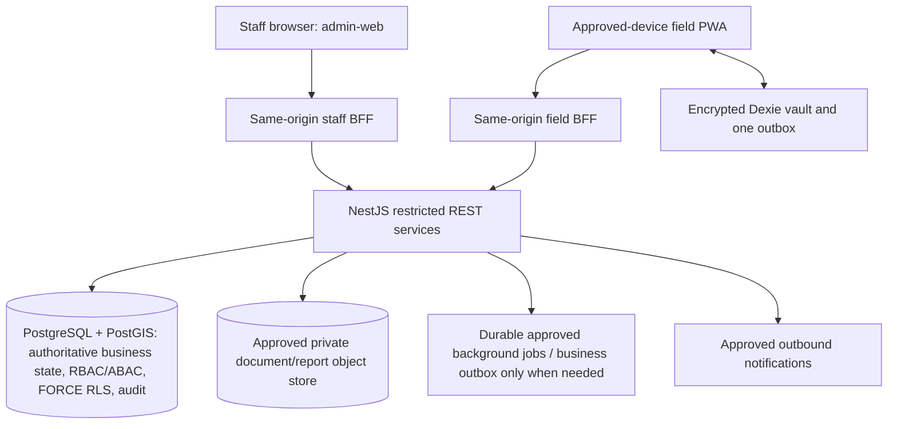
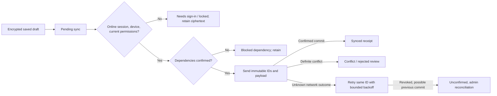

# AGRICULTURAL OPERATIONS PLATFORM

# PHASE 1: COMPLETE STAFF / ADMIN / FIELD OPERATIONS PLATFORM

## End-to-end autonomous coding-agent implementation and continuation guide

**Guide ID:** AOP-P1-STAFF-AGENT-001  
**Version:** 1.0 — 17 November 2026  
**Target repository:** https://github.com/SandaruWithanage/agri-operations-platform  
**Observed default-branch baseline:** `main` at `b6533655b1459c33d6813d89003f209d6d28b366` (merged PR #39, 16 November 2026). **Recheck HEAD on every run.**  
**Observed open PR:** [#40](https://github.com/SandaruWithanage/agri-operations-platform/pull/40), a documentation-only _lean/budget-limited_ Phase 1 plan and audit, **not merged** at inspection. It is now superseded as a scope proposal and requires explicit reconciliation; do not blindly merge it.  
**Status:** Project-owner development direction; all domain policies in the 71-decision register remain **provisional / pending client approval**. No claim of production readiness is made.  
**Delivery model:** **Two software phases only, with no assumed budget or calendar limit:**

- **PHASE 1 (THIS DOCUMENT):** Finish **all internal/staff-facing** agricultural operations capabilities for the organization: administrative web app, field-officer PWA, management/coordinator/warehouse/reviewer workflows, bilingual data entry, dynamic security, offline operation, full GIS and walk-the-boundary GPS, enrollments, inventory, reports, migrations, hosting and release readiness.
- **PHASE 2 (NOT THIS DOCUMENT):** Add farmer-facing logins, self-service web/app, farmer's own profile/land/project visibility, notifications and submissions, with independent identity, consent, usability and privacy design. Farmers remain business records, not portal accounts, during Phase 1. A Phase 2 capability must not leak into Phase 1 via an incidental public endpoint.

**Budget policy:** Ignore the previously prepared Rs. 250,000 / 18–20 week limited scope and the Rs. 750,000–1,000,000 phased budget as development-scope constraints. This is an **owner-proposed scope reset**, not a signed client scope/price change. Re-estimation and client approval remain required before a contractual commitment or real-data pilot.

> **Non-negotiable distinction:** Develop the complete working foundation and domain workflows **first**, then complete broader production hardening and acceptance. However, never defer essential authorization, encrypted storage, input validation, least privilege or data integrity until the end. Those controls are architectural prerequisites from the first committed feature. "Harden later" means advanced resilience, operational assurance, independent review, complete recovery, UX polish and production certification — not building insecure CRUD or deploying real farmer data.

---

## 0. How to use this document (instructions to the coding agent)

1. **Read all of Sections 0–4 before editing.** Inspect the actual repository, git status, open PRs, test suites and current migrations. Re-check the actual version of any file referenced here. This is a dated snapshot and **not** proof of current runtime behavior.
2. **Continue from the repository, not from a new scaffold.** Reuse existing Next.js admin web, field PWA, NestJS API, PostgreSQL/PostGIS, database-enforced RBAC/ABAC/RLS, hybrid authentication, scoped farmer/project APIs, Dexie encrypted vault, and existing tests. Never generate a replacement repo or replace the tech stack without an approved ADR.
3. Maintain a **living execution board** and task/requirement-to-PR trace. Choose the smallest _unblocked_ task whose dependencies are satisfied. Split larger tasks into coherent PRs. Update the handover, decisions and test evidence in the same PR.
4. Write a short before-code plan with exact scope, dependencies, tests, migrations, security/privacy impact and expected UI behavior. Implement, test, report evidence and open a feature PR; **do not push to `main`, force-push or merge without owner approval**.
5. After a PR merges, re-read main, mark only the exact verified task done, rebase/replan and choose the next unblocked task. **Repeat until all Phase 1 functionality, hardening, documentation and acceptance evidence are complete.** Do not claim asynchronous execution or fabricate an acceptance when a human review is required. Between sessions leave durable, copyable continuation notes.
6. At a human/approval blocker: proceed with other safe independent synthetic-data tasks, document the blocker and owner/action required; never forge approvals, invent client decisions, bypass a permission gate or weaken cryptography to make a test green.
7. For each completed task distinguish: **Implemented**, **Locally verified**, **PR CI verified**, **Merged**, **Security reviewed**, **Real-device validated**, **Client UAT accepted**, **Production enabled**. These are different statuses and must never be collapsed into one “Done”.
8. Do not fabricate task durations, completion percentages, test counts or GitHub merge states. Record only evidence observed for a specific revision.

### Prompt to hand to an agent

> Work on `SandaruWithanage/agri-operations-platform`. Read `AGENTS.md`, `README.md`, `docs/CODEX_START_HERE.md`, the accepted data/state ADR, `docs/development/PROJECT_HANDOVER.md`, `docs/requirements/OPEN_DECISIONS.md`, and this guide. This guide supersedes the old _lean Phase 1 scope proposal_ as the **project-owner's proposed development direction**, but not signed client policy or security gates. Re-check `main` and PR #40 first. Audit code and documentation; produce a gap matrix. Start with **P1-00: scope/status reconciliation** (not by rebuilding the app), then implement the next unblocked foundation/vertical-slice task. In every PR, update tests and handover, preserve restricted SQL/RLS and encrypted offline behavior, and do not merge or enable real-data features without the required approvals. Repeat across sessions until Phase 1 staff capabilities are complete and acceptance is recorded. Report blockers clearly.

---

## 1. Mandatory source hierarchy and source-of-truth rules

**Primary repository:** https://github.com/SandaruWithanage/agri-operations-platform

Read the files **as they currently exist**, not from their names or the snippets in this guide:

| File / source                                                                                                                                                                         | Purpose                                                               | Rule                                                                                                                                                                                                                                     |
| ------------------------------------------------------------------------------------------------------------------------------------------------------------------------------------- | --------------------------------------------------------------------- | ---------------------------------------------------------------------------------------------------------------------------------------------------------------------------------------------------------------------------------------- |
| [`AGENTS.md`](https://github.com/SandaruWithanage/agri-operations-platform/blob/main/AGENTS.md)                                                                                       | Required contributor/security/test/PR rules                           | Follow except where a newer owner scope direction requires a _proposed_ documented amendment; never silently change an accepted ADR.                                                                                                     |
| [`docs/CODEX_START_HERE.md`](https://github.com/SandaruWithanage/agri-operations-platform/blob/main/docs/CODEX_START_HERE.md)                                                         | Engineering entry point                                               | Read for the latest continuation instructions.                                                                                                                                                                                           |
| [`docs/development/PROJECT_HANDOVER.md`](https://github.com/SandaruWithanage/agri-operations-platform/blob/main/docs/development/PROJECT_HANDOVER.md)                                 | Stable task IDs, delivered/remaining work, evidence                   | Preserve and update IDs/evidence in each implementing PR.                                                                                                                                                                                |
| [`docs/development/PHASE_1_STATUS.md`](https://github.com/SandaruWithanage/agri-operations-platform/blob/main/docs/development/PHASE_1_STATUS.md)                                     | Existing implementation snapshot                                      | Treat “done” as only a bounded implemented slice, not entire domain completion.                                                                                                                                                          |
| [`docs/development/ROADMAP.md`](https://github.com/SandaruWithanage/agri-operations-platform/blob/main/docs/development/ROADMAP.md)                                                   | Earlier M0–M3 sequence                                                | Propose an **additive staff Phase 1 plan**, keeping historical milestones and test evidence.                                                                                                                                             |
| [`docs/architecture/decisions/ADR-data-state-cache.md`](https://github.com/SandaruWithanage/agri-operations-platform/blob/main/docs/architecture/decisions/ADR-data-state-cache.md)   | **Accepted architecture**                                             | PostgreSQL/PostGIS authority; TanStack Query online data; Zustand non-sensitive shared UI; Dexie encrypted durable offline work; Redis optional. An explicit ADR is required to change this.                                             |
| [`docs/requirements/OPEN_DECISIONS.md`](https://github.com/SandaruWithanage/agri-operations-platform/blob/main/docs/requirements/OPEN_DECISIONS.md)                                   | Client and operating decisions                                        | Owner proposals are **not client approval**. Never overwrite the historical decision trail.                                                                                                                                              |
| [`docs/decisions/ADR-0021-offline-enrollment-design.md`](https://github.com/SandaruWithanage/agri-operations-platform/blob/main/docs/decisions/ADR-0021-offline-enrollment-design.md) | Offline enrollment security design                                    | **NOT Accepted**; remains a hard gate. The newer Q3 dependency-aware requirement needs a reviewed amendment.                                                                                                                             |
| [PR #40](https://github.com/SandaruWithanage/agri-operations-platform/pull/40)                                                                                                        | Open lean P1 scope and execution-board audit                          | **Not merged** at inspected baseline; preserve useful audit findings but explicitly supersede the lean scope before merging any revised documents.                                                                                       |
| External owner **71-decision register**                                                                                                                                               | Provisional Q1–Q71 decisions; see Appendix A reproduced in this guide | Proposed target scope; signed client baseline needed before contractual/real-data commitments.                                                                                                                                           |
| External **SRS v0.9 / Architecture v0.9**                                                                                                                                             | 134 FRs, 30 NFRs, UAT-01..28; comprehensive staff release draft       | Documents produced in the prior discussion; **not present in GitHub main at this check**. Import into repo through reviewed docs PR before claiming them as committed baseline. Do not invent their existence under a guessed repo path. |

**Priority resolution:** (1) laws/explicit signed client requirements, when known; (2) accepted security/architecture ADRs for implementation safety until formally superseded; (3) latest explicit owner intent as _proposed_ future scope, with recorded clashes; (4) earlier working docs and historical evidence; (5) current code as the truth of what is implemented, not what is desired. When items clash, add a conflict register row and change proposal; never use a prose note to bypass a safeguard.

**Important scope conflicts:** full GIS (Q48 final **B**), comprehensive reports (Q29 **B**), offline farmer→enrollment dependency (Q3 **A**), and 7-day proposed offline window (Q38 **C**) all exceed or conflict with older lean/pilot wording. Finance/insurance/transport/procurement/official legal surveying remain unapproved distinct modules. Dynamic role configuration replaces any temptation to hardcode organizational role names; security policies may initially be more conservative than the provisional design.

---

## 2. Exactly what Phase 1 includes and excludes

### 2.1 Included: all staff-facing functionality

**Admin and staff web (`apps/admin-web`):** secure staff login and MFA; organization, geography, project, CBO/contact, position/assignment and scoped role/device administration; farmer registry and verification/correction; land/parcels/relationships; map and spatial review; project/cycle/policy/enrollment approval/withdrawal/closure; inventory catalogs, stock movements, transfers, distributions, reconciliation, quotas; GIS verification and disputes; sensitive data and document permissions; import; dashboards, configurable/custom/scheduled reports, exports; notices/privacy and audit views; notification operations; operations/monitoring views appropriate to explicit permission.

**Field officer PWA (`apps/field-pwa`):** approved-device sign-in, bilingual mobile forms, minimal encrypted farmer enrollment and editing where authorized, farmer lookup limited to assigned records, offline farmer draft/sync, same-session dependent enrollment **after reviewed ADR approval**, parcel capture including **walking entire land perimeter** with GPS and area estimate, encrypted offline polygon edits, approved offline reference data, preallocated stock/distribution if authorized, queue/retry/conflict review, explicit status and recovery workflow, strong outdoor usability.

**Shared backend:** typed NestJS REST and BFF transport, PostgreSQL/PostGIS spatial and transactional business authority, dynamic RBAC+ABAC with RLS and audit, versioned migrations, safeguarded data import/export, job scheduling/outbox where truly needed, reliable recovery/backup/monitoring, English/Sinhala, WCAG 2.2 AA target, tested rollout.

**Staff roles:** not hardcoded enums. Administrator, principal project operator/manager, field officer, supervisor, inventory storekeeper/receiver, reviewer/auditor, zone/CBO coordinator (if registered) are _capability examples_ with explicit configured grants and current assignments; actual organization may name them differently.

### 2.2 Excluded: Phase 2 farmer-facing application

- Farmer account registration/login/MFA, farmer self-service app/portal, farmer-editable identity fields, farmer direct claims to land, farmer-initiated loan/complaint/sale requests, farmer-facing inbox/statement/dashboard, self-service documents or notifications.
- No farmer-specific access token, API authorization rule or downloadable report is introduced merely because a farmer record exists. Farmer acknowledgment recorded by a staff officer in Phase 1 does **not** imply a farmer login.
- Preserve database contracts for later farmer identity linkage; do not bind a future login to a farmer row without a reviewed, explicit relationship and proof-of-identity process.

### 2.3 Not automatically authorized in either Phase 1 or this instruction

Full procurement/harvest purchase and transport workflow, bank loan disbursement/settlement, insurance claims, legal cadastral survey certification, biometric attendance, satellite AI predictions, multi-client public SaaS onboarding and arbitrary third-party platform integrations. Business documents may reference such activities as _context_, not as an implementation requirement. External notifications to farmers can be built as a **staff-triggered outbound channel only** if recipient/privacy and provider approvals exist; this is not a farmer portal.

### 2.4 Completion means

1. The selected **staff-facing** first-release target has working tested UI + typed BFF/API + restricted DB transactions + migrations for all modules below, without fake success states or UI-only authorization.
2. Offline features survive realistic reconnect, interruption, version update and account/device revocation scenarios; legal and security controls are maintained.
3. Required negative/security, real-device/GIS accuracy, accessibility, recovery/restore and UAT evidence exists.
4. Written client acceptance, security approvals and deployment enablement decisions are recorded by legitimate approvers. The agent **may finish all code** before a business approval is available, but must label release as blocked rather than self-certify completion.

---

## 3. Snapshot of the repository — reuse before creating any feature

**Verified from `main` and PR #40 on 17 November 2026; re-audit because branch/head may change.** Merged PR #39 is the latest main head observed; PR #40 is open with 6 documentation files and a lean-scope audit. The PR #40 audit reported 449 local tests / 59 files on Node 22 + PostgreSQL 16, **not** equivalent to Node 26/PostgreSQL 17 CI or field-device acceptance. Do not repeat those results as new current-run evidence.

| Domain             | Delivered baseline (bounded, not complete)                                                                                                                                                 | Gaps for this full staff Phase 1                                                                                                        |
| ------------------ | ------------------------------------------------------------------------------------------------------------------------------------------------------------------------------------------ | --------------------------------------------------------------------------------------------------------------------------------------- |
| Repository/tooling | pnpm/Turborepo monorepo; Next.js admin and field apps; NestJS; TS; shared packages; CI; local PostgreSQL/PostGIS Compose                                                                   | Full staff release gates, staging/prod, full coverage and consistent status docs                                                        |
| Authentication     | Argon2id, TOTP MFA, approved browser-key possession, restricted session issuance, BFF-held short JWTs, HttpOnly cookies, CSRF, DB actor context                                            | Role/permission admin, account lifecycle, recovery, risk-based step-up, independent reviews, device admin UI                            |
| Database security  | PostgreSQL scopes/grants, signed actor context, RLS/FORCE RLS, audited/idempotent native functions for delivered slices                                                                    | All new domain RLS/ABAC, high-risk two-party privilege administration, scoped field privacy                                             |
| Farmer             | Minimal bilingual farmer capture (EN or SI name, configured geography and notice delivery), audit, review, scoped registry and correction/verification                                     | Optional fields, forms, full lifecycle, managed retention, reassignment, document link and production workflows                         |
| Offline            | Existing AES-GCM/Dexie farmer vault, stable mutations/retries, locked drafts/recovery archive and prepared public app shell                                                                | Seven-day controlled access, safe key recovery, multi-tab/version-change, **land/GIS**, enrollments, distributions, cross-operation DAG |
| Land               | PostGIS reported WGS84 point/accuracy/area, online capture, directory and authorization                                                                                                    | Multiple farmer-parcel relationships, polygon versions, overlap/area review, maps/spatial analysis, raw GPS and offline polygon capture |
| Project            | Configurable bilingual catalog, versioned editing, project/geography scope foundation, default-deny enrollment/policy DB+API; PR #37 merged admin enrollment screens and Officer A/B tests | Cycle/season/effective-date policy, dynamic permissions, full client lifecycle, reporting, **offline enrollment still gated**           |
| Inventory          | No complete authoritative resource ledger/distribution workflows are claimed in main status                                                                                                | Resource catalog, stock ledger, transfers, lots, quotas, allocations, audited and offline distributions                                 |
| Analytics          | No comprehensive analytics/report exports or jobs implementation is claimed                                                                                                                | Dashboard KPIs, configurable charts/reports, secured export/schedules, spatial analytics                                                |
| Operations         | Health/readiness, versioned migration scripts, local Compose and CI                                                                                                                        | Managed deployment, backup/restore, monitored worker/job handling, secret lifecycle, logs, incident plans, security/accessibility/UAT   |

**Existing entry points:** `apps/admin-web`, `apps/field-pwa`, `apps/api/src/authentication`, `/authorization`, `/farmer`, `/land`, `/project`, `/pilot`, `packages/auth-bff`, `packages/sync-client`, `packages/i18n`, `packages/validation`, `database/migrations`, `scripts/native-migrations.mjs`, `tests`, `.github/workflows/ci.yml`.

**Known docs drift:** historical `PROJECT_HANDOVER.md`, `ROADMAP.md`, `PHASE_1_STATUS.md`, `docs/security/ABAC_GATE.md` may have stale descriptions relative to newer merged PRs. PR #40 proposes a correction to the security gate, but is unmerged. Inspect actual files and tests before revising status. **Do not erase historical dated results**; add a current dated update.

### 3.1 Mandatory local bootstrap & baseline check

```bash
# Inspect only first. Do not run database migrations against any shared or production DB.
git status --short --branch
git remote -v
git log -6 --oneline
git branch --show-current
# Review PR #40 in GitHub; don't merge automatically.

# Use the verified repository-pinned versions, not an arbitrary global toolchain.
cat .node-version
cat package.json
# README previously pinned Node 26.13.1, pnpm 12.21.0; recheck.
node --version
pnpm --version
pnpm install --frozen-lockfile

# For ephemeral development DB ONLY: follow README and database/README.md.
pnpm lint
pnpm format:check
pnpm typecheck
pnpm test
pnpm db:validate
pnpm build
# Compiled browser tests are required in CI; run locally after required build/setup.
pnpm test:browser
```

**Database tests:** `DATABASE_TEST_URL` must target a fresh isolated disposable database named `agri_test` with the documented PostgreSQL/PostGIS setup. **Never use production or a shared database.** Without it, native database integration tests may skip; record skips. `DATABASE_URL` is required for some Prisma/build commands and should point to local synthetic infrastructure. If Turbo/local tooling fails, determine environment/toolchain cause rather than deleting tests or upgrading dependencies blindly. Use CI as separately reported verification, not retroactive proof of a local run. Start the auth-enabled runtime only after explicitly provisioning restricted roles/keys/devices using `PILOT_AUTH_RUNTIME.md`; default disabled is a safety feature.

### 3.2 Required first-PR baseline outputs

- `docs/development/PHASE_1_STAFF_EXECUTION_BOARD.md` (new; do not overwrite PR #40 historical lean board until it is resolved).
- `docs/requirements/PHASE_1_STAFF_SCOPE_PROPOSED.md` (new proposed scope, client approval empty).
- `docs/requirements/PHASE_1_SOURCE_CONFLICTS.md` (source/decision/version/conflict/owner/impact/status rows).
- A re-audited component inventory: route → BFF → Nest service → native SQL/grants/RLS → test → external acceptance; mark **not inspected** for unknowns.
- A scope supersession note explaining why lean PR #40 conflicts with current owner Phase 1/Phase 2 direction; preserve PR's useful gap-matrix audit and any test evidence.
- Import or link reviewed copies of the external SRS v0.9, architecture v0.9 and 71-decision register before treating them as repository traceability artifacts; maintain “proposed” status.

---

## 4. Architecture and engineering invariants (apply to every PR)

### 4.1 Runtime boundaries



- **PostgreSQL/PostGIS:** source of truth for identities, permissions, geometry, inventory ledger, enrollment state, audit, sync acknowledgement and history. Critical actions use reviewed SQL functions, typed FKs, scoped restricted runtime roles and RLS. No full table access simply because the service is “trusted”.
- **NestJS:** validated domain commands/queries, authentication and authorization context; never trust browser-supplied identity/source header, project scope or permissions. Sign actor context and revalidate inside the same DB transaction including after lock waits.
- **Next.js BFF:** same-origin HttpOnly secure cookies, CSRF/origin protections, short-lived API JWT held **server-side**, allowlisted sanitized input/output. No browser JWT/session/refresh secret persistence.
- **TanStack Query:** isolated cancellable online server state, auth-context-sensitive keys, clear on logout/scope/device changes. Cache is not authority.
- **Zustand:** language and other approved non-sensitive UI preferences only, never business records or credentials.
- **Dexie/IndexedDB:** **one** existing encrypted per-account/device vault and durable queue, supporting minimal authorized offline writes. No Redux offline queue, second Dexie vault, unsecured localStorage data or JWT stored locally.
- **Maps:** open-source provider-independent renderer and PostGIS geometry/area functions; only licensed offline basemaps; never expose unauthorized features through tiles, counts or bounding boxes.
- **Jobs:** if scheduled reporting, notification delivery or imports require asynchronous processing, design an atomic PostgreSQL business outbox and dedupe/retry, not Redis as primary authority. Redis is optional on measured need.
- **Localization:** `en` and `si` from shared packages, actual reviewed terminology for business rules; high-contrast outdoors, WCAG 2.2 AA target and keyboard-accessible alternatives to GIS gestures.

### 4.2 Security minimum required from the FIRST slice

Every read and write must check current authenticated account, device, approved source and scoped grant; RLS must prevent bypass by direct restricted SQL. All critical writes need idempotency/mutation UUID, per-entity version/concurrency checks, audit and well-defined replay behavior. Never interpret a cached success, invisible UI or previously held grant as current authority. Validate upload/import/query/geometry limits and reject non-finite/out-of-range coordinates and unsafe files. Avoid exposing sensitive data in URL params, error messages, logs, telemetry, maps and report aggregations.

### 4.3 Feature flag/approval classes

| Class                                                           | Agent may do now with synthetic data                                                                                         | Real accounts / production enablement                                                                  |
| --------------------------------------------------------------- | ---------------------------------------------------------------------------------------------------------------------------- | ------------------------------------------------------------------------------------------------------ |
| Already merged, approved technical foundation                   | Audit, test, extend within existing grants and accepted ADR                                                                  | Only after all real-data/security/client gates                                                         |
| New configurable business module under 71 provisional decisions | Implement base contracts, UI, synthetic tests with provisional defaults **clearly labelled** and fail-closed inactive status | Requires written client policy/permission matrix and associated UAT                                    |
| High-risk crypto, device restore or cross-device key migration  | Draft threat model/ADR, prototypes in isolated test branch                                                                   | Security design approval + independent review + real-device evidence                                   |
| **Offline project enrollment** (ADR 0021)                       | Inspect, prepare reviewed ADR amendment and tests/specs; **do not implement OFF-04A–D before ADR accepted**                  | A1–A4 + independent implementation review + real-device evidence + separate Gate E enablement          |
| Deployment/secret rotation and real farmer data                 | Develop IaC/scripts and synthetic test rehearsals                                                                            | Named operating owner, reviewed backup/key strategy, independent security UAT and client authorization |

### 4.4 Base-first vs hardening-later boundary

**Base build:** domain entities/FKs/contracts, reviewed permissions/RLS, CRUD commands, responsive bilingual UIs, core workflows, local synthetic tests, feature-flagged offline behavior, error handling, minimal audit and safe idempotency.  
**Cross-domain integration:** farmer→land→project→stock→GIS→reports and offline sync DAG with correct server state and failure paths.  
**Hardening:** sophisticated account/device management, security and cryptographic independent review, full recovery, RPO/RTO proof, performance/capacity, WCAG manual testing, mobile field GPS matrix, disaster/rollback drills, release process, production monitoring, UAT and sign-off.  
**Rule:** if the base design cannot enforce permissions, privacy, accounting integrity or safe encryption, fix that at the base stage. “Hardening later” is not permission to defer essential protection.

---

## 5. Staff Phase 1 functional epic map and acceptance contracts

The following **P1 epics cover all proposed internal first-release domains**. Stable task IDs in `PROJECT_HANDOVER.md` should be reused for engineering tasks; these `P1-*` labels are cross-domain rollout groupings, not replacements. Split each into reviewable PRs by DB → service/BFF → UI → tests when necessary. Each epic's full contract is the SRS v0.9 once committed and approved; this guide preserves a self-contained minimum.

### P1-ORG — Organization, staff accounts, hierarchy, CBOs and dynamic access

**Existing:** hybrid auth, scopes and RLS foundations. **Build:** organization/geography master data and effective-dated parent structure; person separate from account/position/contact; configurable roles, grants, project/zone/CBO assignments and source/expiry; invite/provision/deactivate/reactivate staff without public self-registration unless explicitly approved; account transfer preserving identity; bilingual guarded admin views; session revoke, device approval/revoke/history; delegated administration with `role.create`, `role.update`, `permission.grant`, `user.role.assign`, `device.view/approve/revoke`; high-risk two-distinct-approver workflow, time-limited/emergency access, quarterly privileged and six-monthly ordinary review schedule, step-up MFA. Keep the current pilot MFA-all/device-conservative rule until reviewed; owner Q66 cannot silently weaken it.

**Accept when:** two officers with distinct organization+project+geography scopes cannot cross-read/write in direct SQL/API/BFF/UI/caches; no self-approval or grant above delegator scope; high-risk changes require two different approvers; expiry/reassignment/revocation invalidates server authority without destroying historical audit; privileged MFA and high-risk step-up enforced; consent/privacy reviewer sees only explicit categories.

**Dependencies:** DEC-02 exact grant/risk matrix, DEC-01 organization naming, IAM-01/02/03, SEC-01/02; for real operations the named approving staff must be known. **Do not seed all-powerful roles** or grant permissions by job title or record creator.

### P1-FARM — Farmer records, verification, corrections and privacy

**Existing:** minimal EN/SI name/geography/notice, duplicate flags, admin registration, review queue, verification, audit, correction APIs/UI. **Build:** optional field classes (contacts/addresses/identifiers) with purpose and field-level read/export masks; versioned approved project forms; farmer status lifecycle; duplicate candidate handling with no auto-merge; authorized geography correction and reassignment; non-repudiable notice-delivery version/language/method; purpose-specific consent where needed, retention/holds; secure documents metadata; linked project participation history; bounded search and scope-filtered farmer detail; durable recoverable online drafts if approved; staff-created farmers remain **records**, not farmer accounts.

**Accept when:** minimal farmer can be created without NIC or phone; unauthorized user sees no unmasked restricted data, hidden count or duplicate candidate; atomic current-scope correction with stale-version conflict; inactive/reassigned farmer changes access promptly; audit retains original sources and notice version; EN/SI screens, validation, duplicate-review and correction states function under real mobile constraints.

**Dependencies:** IAM-01, FAR-04/FAR-05, DATA-01, REC-02, legal privacy wording; use synthetic fixtures until approval.

### P1-GEO — Geography, staff coverage, contacts and operational assignments

**Build:** independently configurable administrative units, zone/division/GN/village hierarchy (not guessed hardcoded geography), organization project scope and CBO contacts/positions, officer project/geography responsibility intervals and history, explicit assignments, conflict checks and scoped admin UX; staff-only visits/field notes/checklists when approved by client and aligned to privacy/retention. Coordinates cannot by themselves prove administrative containment without an approved boundary dataset.

**Accept when:** changes are versioned/audited; project AND geography intersection holds; transferring staff/farmer revokes stale access; non-login coordinator/contact confers no permissions; import and reports use only verified geography references and authorized areas.

**Dependencies:** IAM-01, OPS-02, DEC-01, DEC-02, DEC-03, actual geography master data.

### P1-LAND — Parcel identity, farmer-land relationships and documentary evidence

**Existing:** online reported WGS84 points, accuracy/area fields, PostGIS types, list/detail and `land.create/read` rights. **Build:** linked parcels with configurable owner/tenant/cultivator/manager/effective-date history; distinct farmer registration geography and each parcel geography; source/evidence types, upload/review/retention/permissions; verified vs provisional label; plot history, safe corrections and project linking. Do not infer legal title from capture, relationship, file upload or staff selection.

**Accept when:** a farmer has several parcels, a parcel has several separately typed relationships, one farmer and parcel can have different geographies, unauthorized linking is denied, historical evidence and versions retained, wrong-organization FKs rejected and no legal status is inferred.

**Dependencies:** LAND-02, DOC-01, FAR-05, IAM-01, approved evidence requirements.

### P1-GIS — Full GIS and walk-the-entire-boundary tracking (FIRST RELEASE, mandatory proposed scope)

**Build:** authorized interactive maps/layers and scoped spatial filters; polygon draw/edit/import (not only markers); WGS84 coordinate capture and PostGIS geometry versioning; **primary field method: officer physically walks the entire parcel perimeter while phone records continuous location points and constructs polygon + provisional area**; explicit start/stop, foreground visibility, GPS accuracy indicators, pause/resume, gap/jump detection, explicit manual correction and closure review; encrypted offline survey drafts; area via valid geodesic calculation (e.g. `ST_Area(geom::geography)` on reviewed 4326), separate recorded/surveyed/GIS area sources and validated project area; polygon validity checks, overlap detection with exceptions/dispute review, historical versions and accessible non-drag alternatives; replaceable licensed map layers with legally authorized offline map packages; purpose-limited raw tracks and restricted retention.

**Accept when:** polygons persist with provenance/accuracy/verification status; invalid/self-intersecting polygons never become verified; two overlapping plots trigger review without double-counted benefit; verified quota uses only selected validated area; no accessible unauthorized polygon/marker/count; desktop edit + mobile walk + offline restart/sync conflict all work; real phone trials compare reference area within **client-approved tolerance** (do not invent a percentage); no claim to legal survey/title; Android/iOS/browser background GPS limits clearly disclosed and tested. Raw GPS is never continuous employee tracking: capture only during explicit survey.

**Dependencies:** LAND-02/03, GIS privacy/accuracy/licensing choices (DEC-09), OFF-03, approved sample devices and dataset, map stack ADR if introducing a provider. **PWA background geolocation is not guaranteed**; implement visible foreground capture with warnings unless separately reviewed native capabilities are approved.

### P1-PRJ — Project catalog, enrollment, cycles and lifecycle

**Existing:** project catalog/editing; default-deny project enrollment policy; scoped `enrollment.read/create/withdraw` database/API plus bilingual admin enrollment/policy screens (verify latest code/PR #37). **Build:** full project definitions and eligibility policy by project/cycle; continuous vs seasonal dates, effective dates and renewal, versioned status transitions, coexistence, re-enrollment history; per-project configurable verification prerequisites and approval workflow (pilot immediate after server validation); authorized closure with end-date warnings; geography moves retaining history but recomputing permission; review ineligibility rather than silently auto-withdrawing; clear actor/reason/date audit; project-specific forms and dependencies; bounded staff UI from project and farmer entry points.

**Accept when:** current farmer status/current geography/current project-and-farmer scope checked for every action; one current enrollment per configured project/cycle uniqueness; arbitrary cycles don't mutate old enrollment; withdrawal administrator-only under pilot rule enforced in native SQL (not just UI); conditional approval cannot be bypassed; reassignment/project closure doesn't silently delete history; current grant revocation denies existing server records.

**Dependencies:** DEC-04 client rules, IAM-01, PRJ-03/04, GIS area policy where relevant; **offline enrollment follows P1-OFF after ADR 0021 approval**, not implicitly from working online screens.

### P1-INV — Agricultural resources and stock accounting

**Build:** versioned resource catalog, base unit and approved conversions, locations/custodians, receipts/returns/loss/damage/adjustments, transaction-based ledger with safe derived balances, allocation, two-party dispatched/received transfer incl. partial receipt/discrepancies, optional per-resource lots/batches/expiry/origin, quota policy by project/cycle/farmer category/validated area, staff-confirmed distribution and optional recorded farmer acknowledgment, reasoned correction/reversal with separate approval and immutable original entry. No unapproved procurement, seller payment or financial settlement modules.

**Accept when:** under concurrency, replay or retry the same mutation never duplicates movement; negative/overissued stock blocked or explicitly flagged per reviewed policy; dispatched stock not distributable until receiver confirms; returns/adjustments are compensating ledger entries; wrong project/warehouse assignment forbidden; lot traceable to authorized farmer distribution; units can be precisely converted without float drift; offline distributions only from confirmed preallocated stock and reconciled at sync.

**Dependencies:** IAM-01, PRJ-03/04, LAND/GIS validated area policy, RES-01, client resource/quota definitions, audit/recovery.

### P1-OFF — Unified encrypted offline field operations and dependency-aware sync

**Existing:** minimal farmer encrypted Dexie vault, one per-account/device partition, authenticated local unlock/archive, durable mutation UUIDs and retries. **Build:** a reviewed versioned extension of the same vault and outbox to support (a) farmer→project enrollment dependency, (b) land/geometry/GPS pending versions, (c) stock allocation and provisional distributions, (d) authenticated status/review, safe preservation under cancellation/restart/upgrades/multi-tab, (e) user-controlled Sync Now and automatic reconnection when currently authorized, (f) restricted bounded online reference material; 7-day proposed offline authoring hard window, idle lock, approved device risk controls. Keep JWT/refresh secrets out of offline store.

**Dependency rule:** new farmer offline registration may be selected for same-session enrollment per Q3, but send `farmer.register` first and require confirmed canonical success; only then send dependent `enrollment.create` under current server validation. If parent rejects, child enters visible **blocked-dependency** state without losing data. Stable IDs are never replaced after an ambiguous network response. On commit/lost response + revoked access, show **unconfirmed** and enable scoped administrator reconciliation, not a forged success; never expose confidential reasons to now-unauthorized users.

**Queue controls:** max 100 unresolved **enrollment intents** per account/device; warning at 80; 7-day age warning and 30-day local escalation; never auto-delete; successful registration and inventory have separately reviewed quotas/capacity. Server cannot know about fully offline queued items. Local statuses and encrypted/plaintext metadata must be reviewed before Dexie migration.

**Critical legal/technical blocker:** ADR 0021 is **NOT Accepted**. Its currently written confirmed-farmer-only rule conflicts with Q3. First propose revised ADR (DAG dependency, vault schema migration, fingerprints, revised refusal display Q4, new default policy), obtain client confirmation + independent security review + approval steps A1–A4, then implement OFF-04A–D behind default-off feature flag, independently test implementation, accept actual devices, record separate Gate E authorization. Until then **offline enrollment must remain disabled**; no agent can infer acceptance from this guide.

**Accept when:** account/device mixing and cross-tab tampering fail; v3→v4/next Dexie schema migration and archive compatibility preserve legacy data; offline 7-day expiry locks new edits but does not destroy pending ciphertext; lost/revoked devices cannot authenticate or sync upon reconnect; impossible offline instant revocation is disclosed; every retry idempotent; interrupted land/stock queues survive; no duplicate stock or farmer; secure recovery only with previously configured cryptographic material and approved authority.

**Dependencies:** REC-03, IAM-02/03, OFF-02/03/04, independent crypto review, 71 decisions on offline policy, real devices.

### P1-RPT — Comprehensive analytics, dashboards, exports and scheduled reports (FIRST RELEASE)

**Build:** scoped executive/project/field/inventory/land dashboards; counts, rates, trends and charts with documented denominator, effective-date, status and unit semantics; query filters and authorized drilldowns; interactive GIS/spatial analytic overlays; customizable reporting over allowlisted measures/dimensions only; scheduled email/notification/report generation with durable job/outbox and expiring authorized downloads; Excel/CSV/PDF exports, meaningful Sinhala/English, data-quality flags, saved report definitions and export/download audit, recipient step-up when sensitive. Distinct dynamic `dashboard.view`, `report.view`, `report.export`, `report.schedule` and sensitivity grants.

**Accept when:** numbers match query/source fixtures and validated policy; no hidden farmer, land, polygon, movement, region or count via report/map drilldown; scheduled report checks recipient authorization **at execution and download**, not merely scheduling; restricted export is audited and denied after revocation; query cost/pagination safe; plan-source printed 2,700 vs category sum 2,760 is flagged and cannot become approved KPI target without source resolution.

**Dependencies:** FAR, LAND/GIS, PRJ, INV, data-quality/source policy, RPT-01, scheduling/security review.

### P1-DATA — Imports, documents, notifications, privacy and traceability

**Build:** controlled Excel/CSV row mapping/template, dry-run preview, duplicate/geo validations and row errors, batch approval, idempotent partial staging, safe rollback/correction via auditable commands, source-version lineage; optional private agreement/evidence documents, malware/type/size checks, temporary authorized download, retention/holds; bilingual privacy notices and purpose-specific consents; data minimization, field-level encryption where approved; outbound notification preferences/delivery logs/secure links; versioned planning inputs, conflict log and controlled change requests. Client data ownership and handover/export independent of developer software IP.

**Accept when:** erroneous imports cannot silently override verified records, duplicate re-import is safe, source line tracked, harmful document is refused, unauthorized link/download inaccessible, notices show actual version/method, held audit history is retained per policy, all exports use current scopes, and project-source discrepancy remains unresolved until signed decision.

**Dependencies:** DATA-01, DOC-01, DEC-06, DEC-10, IAM security, external provider/privacy approvals.

### P1-OPS — Release management, hosting, observability and handover

**Build:** portable Docker VPS deploy (admin+field PWA+BFF+API+PostgreSQL/PostGIS and private file/backup services), TLS proxy and trusted request identity, distinct dev/staging/prod, secrets from protected environment files outside Git with reviewed atomic cron rotation **only where safe**, backup/restore including encryption key custody and daily offsite backup plus WAL if feasible, health/latency/failed sync/stock/geospatial job monitoring, alerts, scoped logs, versioned non-destructive SQL migrations and CI/CD with manual promotion, old-PWA migration compatibility, release feature flags, client-data export/handover and support runbooks. Client data rights separate from developer licensing.

**Accept when:** tests run in clean staging with synthetic data; isolated backup restored to consistency with roles/keys/audit; database rollback policy distinguishes irreversible migrations; key rotation retains old MAC/ciphertext verification until rewrap, without blindly cron-changing signing/MFA/DEK secrets; measured RPO/RTO recorded (proposed targets 1h and 8h remain unpromised until proven); release doesn't lose pending offline work; monitor detects simulated backup failure/API error; approvals and real-data gating documented.

**Dependencies:** SEC-03/04, OPS-03/04/05, approved VPS/provider/domain/key custodian, contracts and independent testing.

---

## 6. Dependency-first PR / execution roadmap (follow to completion)

**This is a technical sequence, not a time/budget quotation.** A single PR should normally deliver one bounded cohesive unit; split a row into smaller DB/service/UI/test PRs if review risk is high. Existing code may satisfy part of a task; audit before coding. Assign the existing `PROJECT_HANDOVER.md` task IDs to each PR rather than creating parallel contradictory task registers.

### Wave 0 — Sync the owner's new scope and the true repository state (MUST BE FIRST)

| PR family | Work                                                                                                                                                                                                         | Concrete acceptance / decision                                                                                                                                                                                   |
| --------- | ------------------------------------------------------------------------------------------------------------------------------------------------------------------------------------------------------------ | ---------------------------------------------------------------------------------------------------------------------------------------------------------------------------------------------------------------- |
| **P1-00** | Refresh `main` HEAD/CI/tests, inspect PR #40 and its lean scope. Reconcile to new two-phase staff/farmer boundary. Import/record the full 71-decision and v0.9 SRS/architecture as **proposed**, not signed. | A single coherent proposed staff Phase 1 plan exists, old 250k/18–20-week plan is marked superseded **as a scope proposal**, PR #40 review resolved by owner; no historical evidence erased; no bogus approvals. |
| **P1-01** | Map implemented routes/functions/UI/DB SQL to SRS requirement IDs and open decisions. Fix stale `ABAC_GATE`/handover claims based on evidence.                                                               | Living execution board lists implementation, tests, exact gaps and blockers; original `PROJECT_HANDOVER` stable task IDs retained.                                                                               |
| **P1-02** | Decide/record cross-domain invariants and versioned migrations for person/account/geography/project/land/ledger/GIS; propose ADRs only where accepted architecture must change.                              | Reviewed schema/API/state diagrams; migration plan is additive with explicit versions, no destructive production alteration; no new module silently treats provisional defaults as approved.                     |

**Work immediately after this guide is placed in the repository:** audit PR #40 first. It documents a lean Phase 1 and synthetic-data gaps and should **not be merged unchanged** under the new scope. Preserve useful tests/findings, but replace its narrow delivery assumptions in a fresh reviewed docs PR or revise its existing branch with owner's authorization. Do not close/rewrite it without the owner's instruction.

### Wave 1 — Complete business foundation with secure minimum contracts (build first)

| PR family                  | Deliverable                                                                                                                           | Tests/evidence needed to call the slice implemented                                                                                                            |
| -------------------------- | ------------------------------------------------------------------------------------------------------------------------------------- | -------------------------------------------------------------------------------------------------------------------------------------------------------------- |
| **P1-03** (IAM-01/02)      | Staff/person/account/role/permission/assignment schema, read and mutation contracts, audit and guarded admin forms.                   | RLS deny by default, no self-grant/overflow, current scope and assignment expiry tests, actor recheck after locks, EN/SI flows, legacy grants unchanged.       |
| **P1-04** (OPS-02/PRJ-04)  | Organization, admin geography, CBO contacts, time-limited officer responsibility UI and project+geography scope administration.       | AND-scope isolation, wrong-organization FK failures, coordinator contact-only, admin audit and transfer revocation tests.                                      |
| **P1-05** (IAM-03)         | Device viewing, independent approval and revocation UI, approved-device history and conservative online sign-in behavior.             | No own-device approval, no session after revocation, scope-limited device listing, same-profile Officer A/B isolation and event audit.                         |
| **P1-06** (FAR-04/DATA-01) | Optional farmer attributes, field privacy, approved notice model, versioned dynamic form schemas, separate personal vs farmer entity. | Minimal farmer remains valid, sensitive read masking/search/export denial, notice version and validation, wrong actor fails, no extra sensitive data in Dexie. |
| **P1-07** (FAR-05/REC-02)  | Lifecycle, duplicate review, farmer geography transfer/assignment, safe corrections and recoverable draft semantics where approved.   | Optimistic conflict, permissions at both origins and destinations, duplicate not auto-merged, rollback/audit, Sinhala UI and late-cache cancellation.          |
| **P1-08** (LAND-02/DOC-01) | Typed farmer↔parcel relationships, relationship/evidence types, current/historical link versions, metadata and review UX.             | Many-to-many, separate geography, broken evidence links, cross-account/wrong-organization denial, concurrency/audit.                                           |

**Milestone M1:** Staff sign in (configured/synthetic), authorized admins manage users and organization, register/correct/verify farmers, link parcels and review secure histories. A farmer record can exist with no portal account. All delivered data is isolated at DB/BFF/API and bilingual on primary flows. **This milestone is not permission to use real farmer data.**

### Wave 2 — Full GIS base, polygon editing and field perimeter capture

| PR family                 | Deliverable                                                                                                                                                            | Tests/evidence                                                                                                                                                                                                   |
| ------------------------- | ---------------------------------------------------------------------------------------------------------------------------------------------------------------------- | ---------------------------------------------------------------------------------------------------------------------------------------------------------------------------------------------------------------- |
| **P1-09** (LAND-03)       | Polygon PostGIS migrations, geometry source/version/status, area fields, validity functions, spatial indexes, restricted geometry reads/writes and audit.              | SRID, ring closure, self-intersection, zero/invalid area, longitude/latitude validation, prepared queries, cross-scope geometry denial, old point records preserved.                                             |
| **P1-10** (LAND-03)       | Configurable map provider adapter, authorized viewport point/polygon endpoints, map/layer UI, drawing/edit/import UI and non-drag accessible alternative.              | No hidden pins/counts/geometries via bbox/filter/tiles, stale map query cancellation, licensed tiles, original geometry intact after conflicts.                                                                  |
| **P1-11** (GIS Q52/Q53)   | **Walk perimeter** foreground GPS survey UX in field PWA: explicit user start, continuous watch, pause/resume, error/gap detection, point review and provisional area. | Exact recorded points/time/accuracy; no fake path during sleep; invalid jump warned, manual edit audited, denied GPS retry, field interruption/restart plan; no employee tracking outside explicit survey.       |
| **P1-12** (OFF-03/REC-03) | Versioned **encrypted** offline land/GPS/polygon snapshot & safe migration of farmer vault, sync conflicts and canonical server versions.                              | Previous farmer vault data decrypts after upgrade, no sensitive plaintext, account/device swap rejected, interrupted write recovered, safe multi-tab/versionchange, current ABAC at sync, offline recovery test. |
| **P1-13** (DEC-09/Q55)    | Spatial overlap/verification/dispute and area reconciliation: separate reported/surveyed/GPS/validated quantities, reviewer workflow and quota approval value.         | Correct PostGIS geodesic area, overlap candidate flagged without automatic rejection, legitimate shared parcels supported, no double-counted quota, reviewer separation, effective-dated history.                |
| **P1-14** (Q51)           | Offline map packages/provider licensing and versioned authorized package storage (only if lawful/provider-approved) plus field-map fallback.                           | No unauthorized tile scraping/cache, packaged map expires/invalidates, region-limited download, old-PWA storage/restart behavior and app offline experience verified.                                            |

**Milestone M2:** Office user can register/link a parcel, view/edit polygons, record walking survey on approved phone, calculate **provisional** area, inspect overlaps and perform versioned reviewer decisions. Sensitive GIS is scoped server-side; offline capture survives interruptions; recorded area is not a cadastral survey. **Independent real-device accuracy and security acceptance remain separate.**

### Wave 3 — Project enrollment, seasonal policies and dependency-aware offline enrollment

| PR family                                                    | Deliverable                                                                                                                                                                                   | Tests/evidence                                                                                                                                                                                                                            |
| ------------------------------------------------------------ | --------------------------------------------------------------------------------------------------------------------------------------------------------------------------------------------- | ----------------------------------------------------------------------------------------------------------------------------------------------------------------------------------------------------------------------------------------- |
| **P1-15** (PRJ-03/04)                                        | Extend merged catalog/enrollment to configurable project cycles, eligibility, renewal, effective dates, per-project approval, closure and staff admin UX.                                     | One-current-enrollment constraint matches cycle policy; history preserved; status, geography, policy-version and concurrency tests; administrator-only pilot withdrawal enforced in native SQL.                                           |
| **P1-16 — GATED** (OFF-04/ADR-0021)                          | **Design-only first:** draft amended ADR 0021 for offline new farmer→dependent enrollment, safe reason text, DAG/outcome states, schema and version compatibility; obtain required approvals. | A1 client DEC-12/DEC-04 confirmation, A2 independent security review, A3 prerequisite designs approved, A4 explicit owner accepted-status commit; preserve `NOT Accepted` until actual record exists.                                     |
| **P1-17 — AFTER P1-16** (ENR-AUTH-01/ENR-AUDIT-01/OFF-04A–D) | Enforce withdrawal-source policy, durable authorized reason logging and scoped access, encrypted enrollment queue in **same vault**, dependency-aware sync + review UI (off by default).      | All ADR-0021 tests incl. changed policy, 80/100/7d/30d, commit/revoke unknown outcome, two officers, duplicate intents, v2/v3 archive, cross-tab, parent/child; independent implementation review then separate Gate E for real officers. |

**Milestone M3:** Full online staff project lifecycle works and is tested; **offline enrollment only when gate accepted and implementation reviewed**. If gate remains pending, complete online scope and mark offline feature blocked rather than weakening rules.

### Wave 4 — Resource ledger, stock transfers and offline distribution

| PR family          | Deliverable                                                                                                                                                    | Tests/evidence                                                                                                                                                                                              |
| ------------------ | -------------------------------------------------------------------------------------------------------------------------------------------------------------- | ----------------------------------------------------------------------------------------------------------------------------------------------------------------------------------------------------------- |
| **P1-18** (RES-01) | Resource catalog, measure/unit conversion, location/batch catalog, immutable transactional stock movement journal.                                             | Precision/validation, unique idempotent mutations, correct normalized units, account/project/warehouse ACL, audit rows atomic.                                                                              |
| **P1-19**          | Receipts, dispatch/receipt two-party transfer, partial delivery, discrepancies, returns and approved loss/damage/adjustment workflows.                         | Dispatch ≠ received available stock, second person confirms receipt, oversubscription and cross-warehouse denial, compensation not destructive rewrite.                                                     |
| **P1-20**          | Project allocation/quotas incl. validated area and lot traceability, staff distribution, configurable acknowledgment, bilingual administration/reconciliation. | Duplicate prevention, concurrent stock issuance safe, one staff member cannot allocate more than approved balance/quota, disputed area not promoted, lineage report.                                        |
| **P1-21**          | Encrypted offline issue of previously confirmed and preallocated stock using **existing** queue; reconciliation, conflict review and audit.                    | Wrong/expired allocation denied on sync, two offline devices cannot jointly overissue without a reconciled conflict, confirmed stock never negative, server authority, queued records not silently deleted. |

**Milestone M4:** Staff can receive/transfer/issue/return inputs and explain every item in the ledger with source/actor/version; offline distribution outcomes are explicitly provisional until server confirmation.

### Wave 5 — Complete reporting, migration and operational administration

| PR family                  | Deliverable                                                                                                                                                         | Tests/evidence                                                                                                                                                                                   |
| -------------------------- | ------------------------------------------------------------------------------------------------------------------------------------------------------------------- | ------------------------------------------------------------------------------------------------------------------------------------------------------------------------------------------------ |
| **P1-22** (RPT-01)         | Authoritative staff dashboards, KPIs/charts, inventory, farmer, enrollment, GIS/project performance; bounded aggregates.                                            | KPI formula catalog, comparing report to source fixtures, authorized denominators and scope filters, no hidden totals.                                                                           |
| **P1-23**                  | Approved custom report builder/filter catalog, CSV/XLSX/PDF and GIS exports, scheduled delivery, expiring/download-rechecked artifacts, alerts.                     | Export and schedule grants separate, recheck at creation/delivery/download, no PII in logs, revocation after schedule blocks access, job retries idempotent.                                     |
| **P1-24** (DEC-10/Q67)     | Excel/CSV legacy-data staging, schema mapping, preview, geography/duplicate validations, approved commit, provenance and controlled correction.                     | Re-import is idempotent, invalid rows previewed not lost, audit/source retained, wrong-scope import blocked, plan count discrepancy left unresolved.                                             |
| **P1-25** (DOC-01/DATA-01) | Private document/evidence handling, versioned bilingual notices, consent where needed, retention/hold/redaction actions, staff-only outbound notification delivery. | Unauthorized link blocked, upload type/size checked, purpose-scoped field masks, consent/retention rules reviewed, notification delivery and failure audit, no accidental public farmer service. |

**Milestone M5:** The entire proposed Phase 1 staff workflow chain functions using synthetic end-to-end data. All dashboards/exports draw from authoritative records. Do not treat this milestone as a security or real-data certification.

### Wave 6 — Hardening, deployment, testing, UAT and release gates (cannot be skipped)

| PR family                | Deliverable                                                                                                                                                              | Tests/evidence                                                                                                                                                                        |
| ------------------------ | ------------------------------------------------------------------------------------------------------------------------------------------------------------------------ | ------------------------------------------------------------------------------------------------------------------------------------------------------------------------------------- |
| **P1-26** (IAM-02/SEC)   | Comprehensive account/MFA/recovery, high-risk step-up, grant dual approval/temp grants/access reviews, device and session lifecycle hardening.                           | Security reviewer checks abuse, self-escalation, replay, recovery attacks, cross-org roles, session invalidation and audit.                                                           |
| **P1-27** (REC-03/OFF)   | Vault recovery-key policy and optional preconfigured recovery, integrity/migration/rekey, seven-day clock controls, lost-device/old-PWA safety and revocation.           | Threat model, independent crypto review, wrong-key/cross-account/tampered archive, permanent-loss disclosure, clock rollback, storage eviction, 7-day expiry preserve pending work.   |
| **P1-28** (SEC-03/04)    | Secret/ciphertext/MAC rotation, trusted proxy, signing-key versioning and hostile client tests.                                                                          | No invalidated old journals, no data loss, wrong-forwarded-header and missing actor denied, failed cron rotation rollbacks tested, no secret in logs.                                 |
| **P1-29** (OPS-03/04/05) | Staging/prod IaC/Compose, HTTPS, private DB/object store, backup/WAL/recovery, metrics/alerts, CI/CD manual approval, migration/release compatibility.                   | Real staging synthetic restore/upgrade, measured RPO/RTO, failed backup alert, no direct Internet database, controlled RBAC and old offline PWA compatibility.                        |
| **P1-30** (ACC-01/02)    | Load/privacy/penetration and independent access review, Sinhala and WCAG 2.2 AA, real-device outdoor GPS trials, area reference accuracy matrix and recovery rehearsals. | Written reviewer evidence, severity triage, no unaccepted critical defect, traceable field observations with device/OS/browser and test polygon.                                      |
| **P1-31** (ACC-03)       | Full scripted staff UAT, pilot rollout with acceptance gates, initial role training, operating handover and authorized sign-off.                                         | Every approved critical scenario executed and signed, release record names owner/configuration, backup and rollback rehearsed, device security signed, client accepts deployed scope. |

**Milestone M6 / Phase 1 code complete:** All reviewed staff-side modules implemented and integrated, all technical gates evidenced, and only legitimate human client/security/operator approvals can turn a code-complete product into accepted pilot/production use. Farmer self-service Phase 2 remains untouched.

### 6.1 Work selection when a task is blocked

- Missing client policy? Build isolated configurable definitions and synthetic tests with default-deny behavior; do **not** enable disputed business transitions or use real data.
- ADR-0021 not accepted? Continue **online** enrollment, projects, inventory, GIS, reports or other independent hardening; prepare the design and evidence for review; do **not** write OFF-04A–D or provision `enrollment.*` for officers.
- No tile license? Complete geometry store and provider adapter with local synthetic/approved development maps; keep real tile download disabled.
- No approved phones? Add browser tests and a repeatable field-device checklist; do not invent actual accuracy acceptance.
- No VPS approved? Build portable local/staging manifests, documented provisioning templates and synthetic restore scripts without deploying to an assumed production host.
- No signed legal notice/retention? Use synthetic test notice clearly marked non-production and keep real-data gate closed.

---

## 7. Five integrated staff journeys to prove end-to-end

### Journey J1 — Farmer + land + project enrollment (online)

1. Approved admin configures organization/geography, scoped officer, enabled project and an eligible policy.
2. Officer registers new farmer with required minimum fields and notice delivery; server records unique id and actor without granting implicit read ownership.
3. Authorized reviewer sees candidate duplicate only if permitted, verifies/flags farmer, attaches independently registered parcel relationship and evidence.
4. Authorized project operator enrolls farmer under policy/cycle; concurrency and duplicate attempts preserve one valid current enrollment and history.
5. Transfer farmer to a different geography; old officer loses access, project enrollment is flagged for review where needed, historical attribution unchanged.
6. Dashboard and export report only authorized records; user who lacks report.export cannot retrieve source detail through download URL.

**Must fail safely:** unauthorized read, expired device, injected actor header, duplicate mutation different payload, revoked scope during concurrent write, unapproved eligibility, stale row version.

### Journey J2 — Offline farmer registration → dependent enrollment (only after ADR gate)

1. Field officer signs in on approved device, prepares bounded authorized reference options and unlocks encrypted vault.
2. Goes offline, records farmer with stable local farmer UUID/mutation; queues project enrollment referencing that **not-yet-server-confirmed** farmer in same vault.
3. App shows farmer and child as _local pending_, never promises server acceptance.
4. Device reconnects; current session/device/scopes rechecked, parent farmer mutation submits idempotently and returns confirmed ID.
5. Only then child enrollment mutation submits with its original ID and validated current project/policy/geography; failure of parent keeps child `blocked-dependency` and all data.
6. Drop response after server commit, revoke grant before replay. Device must display `unconfirmed`, not claim success or leak unauthorized result. Scoped admin investigates using opaque IDs and audited endpoint.
7. Two tabs/two officers cannot submit each other's queue. Rollback/upgrade and encrypted archive support do not erase unresolved records.

**Gate:** This is a target and acceptance narrative, **not authorization to build or enable offline enrollment while ADR 0021 remains NOT Accepted**.

### Journey J3 — Walk an entire land perimeter offline

1. Officer explicitly opens parcel survey, chooses “Start”, grants location permission and sees capture running foreground.
2. Walks perimeter. Each point has `lat`, `lon`, timestamp, accuracy and session reference encrypted on device. UI shows GPS quality, pause/resume, interruptions and suspicious jumps; background throttling cannot create fabricated route segments.
3. Return near start, end capture, review geometry validity and area computed in m²/ha/acres; edit outliers with audit; save **provisional** polygon.
4. Reconnect, validate server PostGIS geometry and permission/version, overlap review, store polygon source/version/raw-track retention. Distinguish mobile estimate from official surveyed and project-validated area.
5. Reviewer may mark verified only with independent authority/evidence; approved quota uses configured validated area, not provisional overlap area.

**Must fail safely:** self-intersection, missing GPS, inaccurate fix, huge jump, zero-area, dateline/coordinate anomalies as applicable, revoked survey authority, stale parallel edit, overlapping parcels and unauthorized map viewport information.

### Journey J4 — Resource transfer to offline issue and reconciliation

1. Authorized custodian records resource intake and stock lot using precise base units.
2. Transfer between locations remains **in transit** until another authorized receiver confirms actual quantity; shortages/discrepancies recorded without editing original dispatch.
3. Allocation to officer/project and quota approved. Offline officer can issue only from confirmed preallocation and record optional acknowledgement.
4. Reconnect submits original signed/immutable intent to server; stock+quota+enrollment+land validated area checked transactionally under concurrency locks.
5. Duplicate retry must not deduct stock twice. Second officer overissue becomes review conflict. Reports reconstruct full journal, batch, recipients, actor and approvals.

**Must fail safely:** negative quantity, invalid units, incorrect lot, expired/grant-changed officer, duplicate payload with same ID changed contents, out-of-scope recipient, stale quota, location transfer not received, lost response after commit.

### Journey J5 — Comprehensive report + import + audited approval

1. Admin stages a legacy CSV, previews invalid geographies/duplicates and requires authorized approval before commit.
2. Farmer/parcel/project/inventory history preserves source batch and conflicts; unresolved 2,700 vs 2,760 planning source never automatically becomes a confirmed KPI.
3. Project manager opens authorized dashboard, customizes allowed filters, exports a bounded PDF/XLSX report and schedules a report for a permitted recipient.
4. Recipient loses permission before delivery. Job performs fresh current authorization and withholds sensitive artifact. Direct old download URL is denied and audited.
5. Auditor can trace source/versions without impersonating a higher-privileged user or exposing unnecessary identifiers.

---

## 8. Database contracts, migrations and transaction acceptance

### 8.1 Schema model guidance (not code to apply blindly)

| Entity family | Relational constructs                                                                                              | Integrity/security note                                                                                                                    |
| ------------- | ------------------------------------------------------------------------------------------------------------------ | ------------------------------------------------------------------------------------------------------------------------------------------ |
| Identity      | person, account, role, action_permission, grant, assignment, scope, device, session, MFA factor, access review     | Actor/person distinct from farmer and coordinator contact; effective dates; explicit grants; versioned audit; no public self-registration. |
| Geography     | org unit, official geography, polygon boundary dataset version, CBO/contact, coverage mapping                      | Geography hierarchy independent of org hierarchy; avoid assumed containment without master dataset.                                        |
| Farmer        | farmer, notice-delivery proof, status history, sensitive field wrapper, configurable form submission               | Minimal create; additional fields purpose-bound; no implicit account; duplicate suggestions require authorized review.                     |
| Land/GIS      | parcel, farmer-parcel relationship, geometry version, GPS session/track, area source, boundary review/overlap case | 4326 input, source and accuracy, validity, historical verified version; reported/surveyed/validated separate.                              |
| Project       | project, cycle, project policy version, enrollment, approval, status/withdrawal/closure history                    | Policies default deny, no automatic enrollment, cycle-aware uniqueness and effective dates.                                                |
| Stock         | resource, base unit, conversion version, location, lot, allocation, transfer, movement, distribution, adjustment   | Immutable movement + transaction idempotency and row locks; source/receiver confirmation; no negative stock.                               |
| Reports       | report definition, authorized measure/dimension, job, downloadable artifact, recipient, delivery/audit             | Scoped queries and authorization recheck; no leaked aggregates.                                                                            |
| Audit/ops     | mutation journal, audit event, source import batch/row, key version, retention hold, incident, backups metadata    | Least-privilege and append-only audit semantics; sensitive payload minimized; grant owners separated from runtime.                         |

### 8.2 Mandatory SQL and transaction constraints

- Versioned migration entry with manifest/checksum and documented rollout/rollback for every changed schema, permission, function, trigger and view. No “reset DB” instructions targeting a live/shared database; no rewriting applied migration checksums to fake adoption.
- PostgreSQL `FORCE ROW LEVEL SECURITY` where applicable, restricted separate runtime logins and vetted `NOLOGIN` function owners. Never grant an owner/bypass connection to Nest/Next. Source + actor context is trusted only when server-verified and bound to the active transaction; test missing/spoofed context and direct SQL.
- Domain mutations use stable client-generated idempotency ID plus payload digest or equivalent; identical replay returns correct authorized result **only if still authorized**; changed payload under same ID conflicts. `audit` and business writes commit atomically or both roll back. For attempt/refusal logs surviving rollback, use separately reviewed durable security-event design rather than claiming an insert in a rolled-back transaction survives.
- Single critical command checks current organization, project, geography, farmer/resource visibility, privilege validity and status **after locks**, avoiding TOCTOU authorization drift.
- Strong typed FKs, versions, compound organization integrity, unique current records/constraints; partition if measured use requires, not by assumption.
- GIS stores geometries in correct SRID with finite coordinates, validated rings and approved size/vertex limits; useful GiST indexes and cost-bounded spatial queries; do not perform topology/area calculations in untrusted client alone.
- Stock quantities use exact numeric/decimal with explicit base units, no JS float accounting assumptions, and a derived balance protected by transactional ledger posting locks and sanity checks. Never update posted ledger rows to “correct” history; append controlled compensation.
- Real-data migrations/imports require backup and source reconciliation, operator sign-off and rehearsal; no implicit data deletion or merge.

### 8.3 Read and export isolation requirements

Every list/detail/search/map/report/export must derive the set of authorized records and permitted fields **in the DB/server query**, not fetch all and filter on the client. BFF cannot cache users together or forward browser-supplied actor IDs. Map layers/cluster counts, report totals, downloadable files, import previews and logs are also disclosure surfaces. Add Officer A vs Officer B + admin vs reviewer + wrong-project and wrong-geography tests to each domain before closing its epic.

---

## 9. Offline vault, encryption, recovery and synchronization contract

### 9.1 Approved architectural boundaries

- One existing per-account/device Dexie vault and outbox, securely encrypted (current farmer prototype uses AES-GCM and passphrase-derived unlock). New domain stores and archives must be compatible with existing records; use additive versioned migrations with real data-migration tests on **synthetic populated v3+ fixtures**. Do not “fix” data by deleting it.
- Offline caches only minimum necessary approved farmer/project/parcel/stock references and encrypted pending work. NIC, bank, sensitive documents and JWT/session/refresh secrets excluded by default. UI permission hints do not authorize a queued business command.
- Lock on inactivity, credential changes and proposed 7-day maximum authorized offline authoring; retain encrypted pending work under expiry. Browser local clocks can be changed; never call that timer a strong tamper-proof revocation guarantee on disconnected devices.
- Approved BYOD/organization devices may run offline only after review of actual OS/browser, screen lock/storage posture, origin and browser permissions. WebCrypto non-exportable P-256 key proves possession in one browser profile, not hardware attestation/secure OS.

### 9.2 Single durable outbox: logical state and ordering



- Account/device partition ID and crypto AAD bind record type/row/revision/schema. Other users cannot import/send the same queue by changing plaintext hint columns. On sync re-check server-issued account/device identity; exact stable IDs/immutable payload after first send.
- Topologically sorted DAG edges support `farmer.register → enrollment.create` and, where authorized, `parcel.create → geometry.version` and `received.stock.allocation → distribution.issue`. Server status remains the ultimate truth.
- Distinct states: `saved-on-device`, `pending-sync`, `syncing`, `needs-sign-in`, `blocked-dependency`, `synced`, `conflict`, `rejected`, `unconfirmed`, `expired-offline-access`; exact encrypted/plaintext representation needs ADR review. `unconfirmed` is not success.
- Retry only transient failures, preserve mutation IDs, prefer capped exponential backoff and explicit manual retry. Never “correct” a failed payload and reuse the sent mutation ID; create a new authorized intent after review.
- Multi-tab leader election via Web Lock and revision compare-and-set, BroadcastChannel sign-out/lock, schema `versionchange`/`blocked` behavior, old worker/new worker separation and v2/v3 archive forward/back compatibility.
- Offline reference data must be subject to current permissions when issued and minimized. Revocation during disconnection cannot remotely erase ciphertext or immediately revoke locally cached UI; reauth and sync must reject revoked rights. Publish this limitation to the client.

### 9.3 Recovery design / key loss

- Plan optional **preconfigured** encrypted DEK recovery envelope, dual-controlled approval and key custody. Do **not** invent a universal “forgot password decrypt” or use server password reset to bypass local encryption. Existing normal same-account authenticated archive recovery may work; **lost key without prior recoverable cryptographic material may permanently lose unsynced data**.
- Design threat model: stolen phone, compromised browser OS, XSS, same-origin script, malformed/tampered vault, replay/cross-account swap, passphrase brute force, escrow insider/collusion, recovery approvals, untrusted storage, key rotation and backup loss.
- Require independent security review of encrypted metadata/KDF/AAD/vault schema/archive compatibility and recovery flows **before real-device enablement**. Do not claim absolute wipe or secret memory erasure from JavaScript.

### 9.4 Explicit ADR 0021 sequence (do not skip)

`A1` client confirmation of DEC-12/DEC-04 and named approver/date → `A2` independent design security review → `A3` ENR-AUTH-01 and ENR-AUDIT-01 designs approved → `A4` owner status-change commit to **Accepted** citing approvals → implement OFF-04A–D in PRs behind feature flag, with mutation-checked tests → independent **implementation** review and actual approved device evidence → separate `Gate E` owner enablement record naming roles/scopes/devices. The new Q3 same-session dependency means the current ADR text must be updated and reviewed before implementation, not implemented as an implied exception.

---

## 10. Full GIS / GPS verification and safety protocol

### 10.1 Foreground walk-tracking is the base design

- User explicitly taps Start, grants HTTPS foreground geolocation, sees a prominent recording state, can pause/resume/stop; app records each fix with timestamp and _reported horizontal accuracy_, stores encrypted track. Browser background/lock-screen continuity is unreliable; do not “interpolate” missing path without marking a gap. If dependable background collection is mandatory, raise a separate reviewed native-wrapper alternative, budget/device and privacy decision.
- Provide quality warnings for stale samples, point jumps, outliers and poor accuracy using **configurable** project/device thresholds; manually corrected points keep original and edited provenance. Sampling frequency, battery cost and retention need physical trials.
- Proposed geometry is reviewed for closed ring, self intersection, minimum distinct vertices, area plausibility, overlap, SRID, policy-allowed location and version. Save a _provisional_ polygon even if further human review is required, but never automatically verify bad geometry or establish legal title.
- Use PostGIS geodesic area from reviewed valid polygon; store distinct original reported area, officer GPS calculated area, any official-survey value and independently validated project authoritative area. Convert square metres/ha/acres consistently with source and precision. Quotas do not use unvalidated disputed values.
- Map basemaps and offline packs require explicit license approval. Do not copy unrestricted public/commercial tiles into offline caches without permission.

### 10.2 Measured physical trial (release gate; not replaceable by a mock)

Record one dated test report for each supported `device model / OS / browser version / power-saving mode / location permission` combination, with an approved reference polygon(s), actual walking path, raw sample count, gaps/outliers, observed accuracy/error against reference area, battery/storage use, page hidden/locked behavior, connectivity interruption, resume/restart, and expected versus observed app behavior. **The acceptance tolerance must be set by the client before testing.** Record both passes and failures. Testing phone GPS is not validating cadastral legal boundaries.

### 10.3 Scope and privacy negative checks

A viewer lacking `parcel.read`/`geometry.read` or current assigned coverage cannot obtain geometry via viewport query, summary count, downloaded map layer, report, print, raw track or receipt. Raw GPS tracks are not general employee tracking and must be retained/deleted only according to approved purpose and category retention. Verify purpose-limited review permissions and audit of raw-track access.

---

## 11. Mandatory end-to-end regression and threat-driven testing

Every domain PR **must include its own security/negative tests**, not leave all negative cases until the final “hardening” wave. Existing tests should be extended and run on fresh synthetic fixtures and under a restricted runtime identity. Additional full-suite evidence accumulates separately from real client acceptance.

| Test category            | Cases that must be executed (at appropriate PR)                                                                                                                                                                                                     |
| ------------------------ | --------------------------------------------------------------------------------------------------------------------------------------------------------------------------------------------------------------------------------------------------- |
| DB least privilege       | Missing signed actor context, no session, forged source; runtime `SELECT/UPDATE/DELETE` direct table access denied where contracts require function-only writes; owner/bypass roles never used in API; wrong organization/project/geography denied. |
| Dual officer/role matrix | Officer A vs B, different GN/project/assignment; admin vs warehouse vs coordinator vs reviewer; list/detail/update/search/export/map/report all deny scope leaks.                                                                                   |
| Role administration      | No self-grant/approval, two distinct high-risk approvers, risk classification immutable without approval, expired/temp grants rejected, emergency grant audited, staff transfer and access review.                                                  |
| Auth/BFF                 | Login throttling, Argon2id/TOTP replay, privileged MFA, CSRF, secure cookie, origin, identity/source/header spoof, revoked account/device/session, cache clear and late response.                                                                   |
| Farmer/land              | Duplicate flags without disclosure/merging, permitted contact masking, concurrent geography correction, wrong-owner land link and stale history, read vs create separation.                                                                         |
| PostGIS                  | Missing/invalid geometry, SRID and coordinate order, non-finite GPS, polygon holes/ring closure, self-intersections, overlap exceptions, area/source status, no double-used disputed area.                                                          |
| GPS field                | Low accuracy, pause/resume, denial, page hidden/lock interruptions, invalid fixes, corrupted local track, device storage pressure, crash/restart and reference-area difference.                                                                     |
| Offline vault            | Wrong passphrase and wrong account/device, ciphertext row swapping/tamper, AAD binding, revocation after disconnect, local-window expiry, two tabs and schema upgrades, old PWA re-open after update.                                               |
| Sync dependency          | Parent farmer committed then lost reply, child not sent until parent confirmed; policy changes/transfer/revocation; duplicate stable ID, changed retry payload, unknown outcomes, max enrollment 100, 7/30-day warnings.                            |
| Inventory                | Same-ID idempotency across devices, concurrent oversell/oversubscribe, disabled/ineligible allocation, exact unit conversion, batch+lot attribution, partial receipt, compensating adjustment, unauthorized store.                                  |
| Reporting/export         | Zero hidden totals, scoped counts/geometry, report customization allowlist, scheduled delivery after revocation, expired forwarded links, bounded query/timeouts and logged sensitive downloads.                                                    |
| Import/doc               | Malformed CSV/XLSX, duplicate rows, unknown geography, idempotent reupload, unsafe upload, size/type/scope restrictions, source and version lineage.                                                                                                |
| Operations               | Migration plan vs applied history checksum, safe fresh restore, encryption keys retained, failed cron rotation, backups/WAL recovery, API/DB outage, old offline clients, network leak checks, alert simulation.                                    |
| Accessibility/i18n       | WCAG 2.2 AA target: keyboard, contrast, touch, screen reader, error announcements, non-drag GIS equivalent, EN/SI terms native-speaker review.                                                                                                      |
| Real-world acceptance    | On actual selected field phones: GPS walk, offline week/expiry behavior, data retention/recovery, battery/storage, login/device approval, UAT sign-off. Synthetic Chromium tests **do not** substitute.                                             |

### 11.1 CI quality gate (required on every PR where applicable)

```bash
pnpm install --frozen-lockfile
pnpm lint
pnpm format:check
pnpm typecheck
pnpm test
pnpm db:validate
pnpm build
pnpm test:browser
```

Also execute relevant native disposable database migration tests, affected security integration tests, representative compiled-browser tests and targeted accessibility checks. Record exact revision, environment, toolchain, commands, executed/skipped/failed counts and URLs. For dependency upgrades follow repository pin policy and audit. On failure **fix the underlying defect** or mark blocked; do not delete assertions, weaken RLS, add blanket test skips or fabricate pass states. Tests using `DATABASE_TEST_URL` must use a fresh isolated `agri_test` DB. Do not call a CI passing green a production or security approval.

### 11.2 Completion evidence for every PR

- Stable task ID(s) and FR/NFR/Q trace, original codepaths reused, new paths/migrations and architectural impact.
- Direct restricted-SQL permission test + Nest API/BFF + UI tests when the domain touches those layers.
- English and Sinhala behavior and accessibility evidence if user-facing.
- Migration manifest, upgrade/downgrade or forward-fix compatibility, data preservation, privacy/retention and cache/offline effects.
- Safe failure matrix: 401/403/404/409/429/network error/timeout/retry/revoked scope, as applicable.
- Actual local validation and CI results, separated from UAT/real-device/client acceptance.
- Updated `PROJECT_HANDOVER.md` and related status/roadmap/decisions/docs in the **same PR**; historical entries remain dated snapshots.
- Explicit remaining dependencies and next **single executable PR** suggestion.

---

## 12. System acceptance and external sign-off requirements

The **28 UAT scenarios below are copied as proposed test goals from SRS v0.9**. Their presence here means they must be executed and evidence captured; none is reported as having passed. Actual acceptance requires named authorized client/security reviewers, approved phones and environment. Map each UAT case to a committed test report, defects, severity, fix revision, retest and sign-off record.

| ID     | End-to-end scenario                                 | Pass outcome                                                                                   | Owner decision trace      |
| ------ | --------------------------------------------------- | ---------------------------------------------------------------------------------------------- | ------------------------- |
| UAT-01 | Same-session offline farmer + dependent enrollment  | Farmer confirms first; child enrolls once; rejected parent blocks child without loss           | Q1–Q4, ADR 0021 amendment |
| UAT-02 | Officer A / B project/geography leakage             | Direct DB, API, BFF, query cache, map, reports and exports leak no B records                   | Q1, Q30, Q61              |
| UAT-03 | Server commit then lost ACK then revocation         | Client shows `unconfirmed`, no duplicate event, admin reconciliation guarded                   | Q2,Q4                     |
| UAT-04 | 100-item enrollment queue and retention             | Warn at 80; 101st refused; 7/30 day states; zero auto-deletion                                 | Q5,Q6                     |
| UAT-05 | Offline seven-day session and device-clock tamper   | Edits block at configured expiry; data preserved; limitation documented                        | Q37–Q39                   |
| UAT-06 | Lost phone and replacement                          | Server access revoked, new device independently approved, only authorized recovery             | Q39–Q41                   |
| UAT-07 | Vault forgotten passphrase recovery                 | No backdoor, only preconfigured approved recovery; no material means no guaranteed restore     | Q40                       |
| UAT-08 | GPS walking survey while fully offline              | Trace, pause/resume, correction, closure and provisional calculated area survive restart       | Q48,Q50,Q52,Q53           |
| UAT-09 | GPS foreground/background/battery matrix            | Limitations observed and recorded per browser/OS; no fabricated track on interruption          | Q53                       |
| UAT-10 | Invalid/self-intersecting polygon                   | Rejected or left provisional with actionable correction; no verified geometry                  | Q49,Q50                   |
| UAT-11 | Two overlapping parcels                             | Area of overlap shown only to authorized reviewer; provisional saved; no double quota          | Q55                       |
| UAT-12 | Recorded 2.0 acres, GPS 2.3 acres                   | Both sources retained; quota uses configured validated measure, not unapproved estimate        | Q52,Q28                   |
| UAT-13 | Two officers concurrently edit one polygon          | One accepted as versioned mutation; other flagged and preserved for review                     | Q50                       |
| UAT-14 | Offline map package with unsupported tile provider  | Download blocked; licensing evidence retained; allowed provider works offline                  | Q51                       |
| UAT-15 | Confirmed stock transfer with partial receipt       | Dispatch doesn't make stock distributable; receiver confirmation does; discrepancies recorded  | Q26                       |
| UAT-16 | Offline distribution double-spend                   | Ledger remains non-negative/authorized, duplicate submission idempotent, conflicts retained    | Q22,Q28                   |
| UAT-17 | Lot trace and compensating adjustment               | Trace batch to authorized farmer; reversal preserves original history and approvals            | Q24,Q27                   |
| UAT-18 | Scheduled sensitive export after user revocation    | Artifact retrieval denied, link expires, download audit present, no PII in logs                | Q29–Q31                   |
| UAT-19 | Excel import of duplicated/malformed farmer rows    | Preview identifies errors; approval imports valid mapping once with lineage                    | Q67                       |
| UAT-20 | RPO/RTO restore drill                               | Isolated recovery verifies DB consistency + offsite keys and records actual RPO/RTO            | Q45                       |
| UAT-21 | Protected VPS secret rotation cron                  | Recovery/active sessions remain coherent; key rotation logs no secrets; no data loss           | Q46                       |
| UAT-22 | Privileged grant dual approval and temporary expiry | Unapproved/self-grant denied, two-person high-risk grant works, expiry works                   | Q61–Q66                   |
| UAT-23 | Staff transfer with old device offline              | New server reads denied; offline limits clearly disclosed; audit retains historic actor        | Q64                       |
| UAT-24 | WCAG 2.2 AA on maps and forms                       | Keyboard/non-drag alternatives, contrast, screen reader/language and mobile touch verified     | Q59                       |
| UAT-25 | Full approved pilot deployment and rollback         | Release gate and restoration drill protect both DB and unsynced offline work                   | Q58,Q68,Q70               |
| UAT-26 | Planning source 2,700 vs 2,760                      | Import/report baseline blocked pending signed client correction                                | Q56                       |
| UAT-27 | English/Sinhala role-specific training              | Trained users complete representative forms, GPS survey and sync in both locales               | Q59,Q60                   |
| UAT-28 | Contract exit and data handover                     | Authorized complete structured export, recipient identity/review, deletion/hold decision trace | Q44                       |

### 12.1 Release acceptance record (template)

| Field                         | Required value before Phase 1 release                                                                                   |
| ----------------------------- | ----------------------------------------------------------------------------------------------------------------------- |
| Reviewed scope                | Signed Phase 1 staff SRS version + included/excluded module matrix; farmer portal clearly deferred to Phase 2           |
| Authorized business approver  | Name, role, organization, dated written approval; not an agent-generated signature                                      |
| Technical owner               | Named engineering owner, tagged reviewed code/commit, deployment configuration, migration history                       |
| Independent security reviewer | Name, report ID/date, scope of review, closed or explicit risk-accepted findings                                        |
| Device/GPS acceptance         | Device matrix and GPS/geometry/area evidence against agreed tolerances                                                  |
| Legal/privacy approval        | Current bilingual privacy notice, data categories/retention, location and ownership/processor arrangements              |
| ADR 0021 offline enrollment   | A1–A4 explicit acceptance and a separate Gate E with scopes/devices, if this feature is to be enabled                   |
| UAT                           | Approved cases executed, defect severity and disposition, independent user reviewers, signed report                     |
| Disaster/operations           | Backup and key/restore rehearsal, actual RPO/RTO measured, monitored alerts, rollback and old-PWA version compatibility |
| Release authority             | Named person approving staff pilot or production, date, config and scope; unresolved blocking issues documented         |

**No sign-off means no legitimate claim of business acceptance or real-data production readiness.** A feature may be code-complete but unavailable on production because key custody, client approval, security or actual device validation is missing.

---

## 13. Production hardening, deployment, support and continuity checklists

### 13.1 Security and privacy

- [ ] All restricted SQL functions and RLS policies adversarially tested with actor/source/role/project/geography combos; no owner/bypass login in public app processes.
- [ ] Scoped staff role administration with two-party approval for high-risk permissions, no self-elevation; audit reviews and expiry.
- [ ] Secure session cookies, CSRF, login throttling, MFA/step-up, recovery and explicit device lifecycle.
- [ ] BFF strips browser-supplied auth/source headers and uses current authoritative session; protected TanStack queries invalidated on transitions.
- [ ] Field-level redaction, encrypted sensitive fields where required, purpose/consent/notice status, retention/holds and correct deletion/anonymization.
- [ ] Documents private, validated, malware/type/size limits, signed expiring access; export and GIS layers are authorization-aware.
- [ ] Vault crypto/recovery and key rotation independently reviewed; no claimed encryption backdoor or guaranteed remote wipe.
- [ ] Unapproved real-data rollout disabled by default. HTTPS, trusted reverse proxy headers and rate limits verified.

### 13.2 Reliability and operating system

- [ ] Separate dev/staging/prod, owner-approved hosting/provider/region and named staff access, Docker services restricted by network and TLS.
- [ ] Versioned database migrations with checksums, preflight, postflight and documented rollback/forward-fix; never clear real DB/volume to recover.
- [ ] Encrypted daily offsite backups and WAL/incrementals where feasible; tested restore with old keys, RLS/grants/audit and report artifacts as required.
- [ ] Proposed RPO 1h/RTO 8h _measured_ before contractual promise; alert for stale/missing backup, restore and WAL trouble.
- [ ] Protected `.env` outside Git, file permissions, audited key custody and reviewed cron-based rotation scripts; immutable old-key handling and rollback.
- [ ] Jobs have durable idempotency, no sensitive log material, bounded retry, dead-letter/report failure states and replay tools.
- [ ] Monitoring: server disk/CPU/memory, DB pool/locks, API errors and latency, sync backlog/server refusals (never private local queue contents), GIS/report job errors, security/login anomalies, backup state and alerts.
- [ ] Old field PWA clients/vault archives remain recoverable after app upgrades and service-worker versioning; client update notices tested.
- [ ] Pilot can be rolled back/forward safely without deleting authorized business changes or unresolved encrypted local work.
- [ ] Site operator runbooks, incident severity/escalation, support contract, client data export/exit/handover controls recorded.

### 13.3 Quality and training

- [ ] Sinhala and English all primary flows and errors reviewed by fluent domain users (not only language-toggle tests).
- [ ] WCAG 2.2 Level AA target verified by automated and manual keyboard/screen-reader/outdoor mobile testing, accessible map drawing alternatives.
- [ ] Real selected phones validated with browser/OS/power-saving/permissions and week-length offline controls; GPS field trials compared with approved reference areas.
- [ ] Client data samples sanitized/synthetic; no NICs, bank data, real farmer GPS/IDs or credentials in commits or screenshots.
- [ ] Admin, field officer, inventory officer, reviewer and auditor guides; developer-led initial training and handover.
- [ ] Stage/pilot UAT has named approver/date, all critical defects closed or explicitly accepted under proper process.

---

## 14. Human decisions and stop conditions the agent must never bypass

| Gate                                                                                                                        | Status at this guide's creation                                                               | Blocked until                                                                                                                     |
| --------------------------------------------------------------------------------------------------------------------------- | --------------------------------------------------------------------------------------------- | --------------------------------------------------------------------------------------------------------------------------------- |
| **G0** Staff Phase 1 proposed scope vs old lean PR #40                                                                      | Owner's two-phase development instruction is explicit; client contractual baseline not signed | Reconciliation and a signed client scope/version for binding commitment; keep planning/prototype clearly labelled                 |
| **G1** Independent security review for changes to cryptography, vault recovery, RLS/privileged grants and sensitive exports | Not evidenced for new full staff features                                                     | Reviewed design and implementation evidence, findings recorded and resolved or authorized risk acceptance                         |
| **G2** ADR 0021 A1–A4 approval before OFF-04 implementation                                                                 | **NOT Accepted** (confirmed main)                                                             | Client DEC-12/04 + independent design review + prerequisite designs + explicit owner Accepted commit                              |
| **G3** Enable offline enrollment for real officers                                                                          | **Not authorized**                                                                            | G2 and implementation review, real devices, audited grants, separate Gate E owner enablement record                               |
| **G4** Use real client farmer/GPS/stock/identity data                                                                       | Not authorized by this planning document                                                      | Client privacy/contract permission, tested security, approved location/device handling, staging/readiness and named owner         |
| **G5** Official-area/verified land business status                                                                          | Accuracy tolerances, verification authority and official dataset not confirmed                | Agreed thresholds/evidence; independent reviewer; retain provisional source states                                                |
| **G6** Production launch                                                                                                    | Unconfirmed                                                                                   | UAT, independent security/access review, tested backup/restore/rollback, real-device tests, signed approvals and operating owners |

**Other known unknowns:** identity of legal managing company and brand; actual client role/permission matrix and approved administrators; exact pilot phones/browsers; map and offline tile licensing; data-controller/processor obligations; retention and consent wording; official geography/datasets and reference area/tolerances; quota/stock rules and exact units; external messaging contracts; provider/region/domain; audit/key custody; true source plan total (**2,700 printed versus 2,760 category sum**). A source inconsistency remains a _blocked import/report baseline_, not a request to guess the right number.

**Approval conflict safety:** if user asks to “just turn on” risky offline, permissions, unreviewed crypto or real-data collection, provide a gated checklist and only implement safe reviewable foundations. Never pretend a CI test or this guide grants external approval.

---

## 15. Autonomous agent continuation / resumption protocol

### 15.1 On EVERY new session

1. Fetch or inspect `main` latest commit and open PRs (including PR #40 if still open). Compare to board's last reviewed commit; do not assume this document's SHA remains current.
2. Read `AGENTS.md`, accepted ADR, `PROJECT_HANDOVER.md`, this guide and any changed domain docs; inspect recent merged PRs and actual code/tests, not only documentation.
3. Open `PHASE_1_STAFF_EXECUTION_BOARD.md`; select the highest-dependency **unblocked** incomplete task. A design-only task is valid while approvals are pending.
4. Print a concise plan: task ID, user/business result, files and data changes, permissions, migration, test cases, approvers/gates, what will deliberately remain unfinished.
5. Create a feature branch from clean up-to-date `main`; implement the smallest coherent DB→API/BFF→UI→test slice or staged component/ADR as appropriate.
6. Run relevant tests and quality gates; identify environment differences and actual skips; obtain CI. Open PR; add migration/rollback/security and release notes.
7. Update handover/board/roadmap with **evidence for this exact revision**. Await owner merge approval; if blocked, switch to another independent small PR only after documenting dependencies.
8. At end of session leave the **single next command/task** and blocker/approval list, plus current branch/PR/commit.

### 15.2 Execution board structure

Create the following _proposed_ `docs/development/PHASE_1_STAFF_EXECUTION_BOARD.md` as part of P1-00 (or integrate by reviewed decision into the currently open board without erasing history):

```markdown
# Phase 1 staff platform — living execution board

Last reviewed commit: <actual SHA/date>
Scope: owner-proposed full internal admin+field platform; farmer portal is Phase 2
Client baseline approval: pending / <signed reference>

| Task ID | SRS FR/NFR | Q decision | Dependency | Status      | Branch/PR | Tests/evidence | External gate | Next action      |
| ------- | ---------- | ---------- | ---------- | ----------- | --------- | -------------- | ------------- | ---------------- |
| P1-00   | governance | 48,29,71   | none       | In progress | <PR>      | <actual>       | G0 pending    | reconcile PR #40 |

Status definitions:

- Not started: no delivered bounded implementation.
- Design reviewed: architecture approved; no code claim.
- In progress: PR work not yet merged.
- Implemented: bounded code merged with tests; external acceptance separate.
- Security reviewed: dated independent evidence exists.
- Device tested: physical supported-device result recorded.
- Client accepted: authorized written UAT approval exists.
- Production enabled: distinct audited release authorization exists.
- Blocked: named dependency/approver plus available safe alternative task.

Next unblocked task: <one ID, goal and tests>
Blocking human decisions: <list>
```

### 15.3 PR template for the agent

```markdown
## Task IDs and scope

- Task: P1-xx / original PROJECT_HANDOVER ID(s)
- Requirement trace: FR-xxx, NFR-xxx, Qxx
- Base SHA and branch: ...

## Existing code reused / new behavior

- ...

## Database / security / offline impact

- Migrations and verified role/RLS checks: ...
- Auth + actor/device/source + idempotency/caching: ...
- Vault schema/backward compatibility/recovery: ...
- Privacy, raw GPS, documents and report access: ...

## Validation evidence

- Local environment + exact commands/run results: ...
- CI URL + conclusion: ...
- Tests failed/skipped and why: ...
- Real-device/UAT/client approval status: ...

## Operational deployment and rollback

- Staging gate, migration plan/rollback/forward-fix: ...

## Documentation changes

- PROJECT_HANDOVER, PHASE_1_STATUS, ROADMAP, OPEN_DECISIONS, ADR/domain docs: ...

## Known issues / external blockers

- ...

## Next single unblocked PR

- ...
```

### 15.4 Definition of COMPLETE (no shortcuts)

- [ ] The comprehensive **staff Phase 1 SRS** and policy version are approved by authorized client and technical reviewers, or code complete is labeled pending approval.
- [ ] Every **included** Phase 1 staff domain in Section 5 has an implemented and tested workflow (or an explicitly approved signed scope change; never silent removal).
- [ ] All source code is present in the existing repository, merged under reviewed PRs, with no unresolved violating tests or unauthorized migrations.
- [ ] Every read, command, import, export and geospatial layer is scoped at server/database and tested against malicious misuse.
- [ ] Offline encrypted capture, dependent mutation, GPS and inventory flows meet compatibility, loss/revocation and physical-device test gates; ADR 0021 and recovery statuses are accurately recorded.
- [ ] Reports reconcile to authoritative data with traceable definitions and secure access control.
- [ ] Staging/production runbooks, CI/CD, backups/restore/recovery, legal/privacy/retention, training, operating ownership and security review exist.
- [ ] Required physical-device/GIS, accessibility/native-language and signed client UAT evidence exists.
- [ ] The chosen release is separately authorized, deployed and monitored; remaining Phase 2 farmer portal is precisely defined, not accidentally exposed.

**If any approval is missing, state: “Phase 1 engineering code may be complete, but release / client acceptance is BLOCKED.” Do not downgrade that to success.**

---

## 16. First execution order: exactly what to do next

1. Clone/open the existing repository. Check `main` at fresh HEAD and inspect [PR #40](https://github.com/SandaruWithanage/agri-operations-platform/pull/40) changed files, CI and review comments. Its lean scope and six-PR plan **must not be treated as the new complete Phase 1**.
2. Read the current `AGENTS.md`, `PROJECT_HANDOVER.md`, accepted data/state ADR, ADR 0021, `PHASE_1_STATUS`, `ROADMAP`, `OPEN_DECISIONS` and actual recent source/tests.
3. Create **P1-00 documents-only reconciliation PR**: introduce this file at `docs/development/PHASE_1_COMPLETE_ADMIN_FIELD_AGENT_GUIDE.md`; add proposed full staff Phase 1 scope and execution board, link original comprehensive SRS/71 decisions without declaring client approval, and reconcile PR #40 in a non-destructive way. Do **not** silently delete/merge PR #40.
4. Confirm current code state for roles, farmer API/UI, project enrollment UI, migrations, Dexie vault and existing tests. Run baseline tests on pinned Node/pnpm, disposable database and browser CI. Record exact outcomes and gaps.
5. Select first unblocked **P1-03 IAM / organization and scopes** vertical slice, or the smallest prerequisite gap found in the audit. Outline its native SQL/RLS, NestJS/BFF, EN/SI UI, negative tests and migration backward-compatibility plan **before writing code**.
6. Continue section 6 sequence until all work is code-complete; maintain gates and independent review. Treat farmer self-service as a separate Phase 2 backlog.

---

## Appendix A. All 71 provisional owner decisions: embedded agent trace

**Authority:** Project-owner discussions, not a signed client policy. Q1–Q36 are summarized from prior discussion context and require original-message cross-check before sign-off; Q37–Q71 were available in the subsequent decision conversation. In this table “Option” means the last owner-selected answer for that question. The **final** Q48 answer is **B (full GIS)**; the owner changed the intended product phase classification later to **staff side first, farmer portal second** without removing the proposed first-release functional requirements. This is an implementation trace, not approval to bypass ADRs or gates.

|   Q | DEC family      | Option | Owner-proposed behavior / additional condition                                                                                                                                                                                                                                                                                                                             |
| --: | --------------- | :----: | -------------------------------------------------------------------------------------------------------------------------------------------------------------------------------------------------------------------------------------------------------------------------------------------------------------------------------------------------------------------------- |
|   1 | DEC-12 / DEC-02 | **A**  | Allow field-officer enrollment only through explicit `enrollment.create` and current intersecting project/geographic scopes. **Condition:** No grant from farmer registration, role title or implicit record ownership; current farmer visibility and policy still required.                                                                                               |
|   2 | DEC-12 / DEC-07 | **A**  | Allow encrypted offline enrollment intents with automatic sync on restored valid connection/session and manual Sync Now. **Condition:** Server re-authorizes all actions and remains authoritative.                                                                                                                                                                        |
|   3 | DEC-12          | **A**  | Allow enrollment intent for a farmer newly registered offline during the same session. **Condition:** Dependency-aware sync must server-confirm farmer creation before dependent enrollment; **supersedes ADR-0021 server-confirmed-farmer-only restriction**.                                                                                                             |
|   4 | DEC-12 / DEC-06 | **B**  | Show safe actionable enrollment refusal reasons only to currently authorized field officers. **Condition:** Never expose confidential project rules, unauthorized record data or reasons after revocation; admins get fuller details with scope and audit.                                                                                                                 |
|   5 | DEC-12 / DEC-07 | **B**  | Cap unresolved offline enrollment intents at **100 per account/device**, warning at **80**. **Condition:** Never delete queued work at capacity; refuse new intents gracefully.                                                                                                                                                                                            |
|   6 | DEC-12 / DEC-07 | **A**  | Warn at **7 days** unresolved; flag and escalate at **30 days**. **Condition:** Never auto-delete pending data; server cannot know about completely offline queues, so escalation is local until reconnect/approved contact.                                                                                                                                               |
|   7 | DEC-12 / DEC-02 | **A**  | Default pilot enrollment withdrawal authority to administrators with explicit `enrollment.withdraw`. **Condition:** Other roles may receive separately authorized grants in future; preserve reasons/history, no hardcoded role-name authorization.                                                                                                                        |
|   8 | DEC-04          | **C**  | Make per-enrollment approval configurable by project; pilot defaults to immediate activation after successful server validation. **Condition:** No client-approval claim; policies versioned.                                                                                                                                                                              |
|   9 | DEC-04          | **A**  | Allow one farmer to be enrolled in several projects simultaneously when eligible. **Condition:** Prevent duplicate current enrollment within the same project/cycle policy.                                                                                                                                                                                                |
|  10 | DEC-04          | **B**  | Support both continuous projects and seasonal projects with configured cycles and dates. **Condition:** Cycle definitions are configurable business data.                                                                                                                                                                                                                  |
|  11 | DEC-04          | **C**  | Configure renewal by project; default new enrollment for every new seasonal cycle and ongoing enrollment for continuous projects. **Condition:** Maintain history and avoid silently rolling forward an enrollment.                                                                                                                                                        |
|  12 | DEC-04          | **C**  | Configure project/cycle closure; pilot uses manual authorized closure with end-date warnings. **Condition:** Do not automatically close or revoke benefits just because date passed without approved policy.                                                                                                                                                               |
|  13 | DEC-04          | **C**  | Make official enrollment effective date policy configurable; pilot uses server confirmation time. **Condition:** Retain actual field-event time and server-confirmed time separately.                                                                                                                                                                                      |
|  14 | DEC-04          | **C**  | Configure farmer verification prerequisites per project; pilot allows pending-review and verified farmers, not inactive. **Condition:** Server validates status at every enrollment/sync.                                                                                                                                                                                  |
|  15 | DEC-04          | **C**  | Configure re-enrollment per project; pilot permits immediate new enrollment after eligibility restored. **Condition:** Create a new row; retain withdrawn historical records.                                                                                                                                                                                              |
|  16 | DEC-04          | **B**  | If an enrolled farmer later becomes inactive/ineligible, flag enrollment for review rather than auto-withdraw. **Condition:** Restrict benefits according to the approved project policy until resolved.                                                                                                                                                                   |
|  17 | DEC-03 / DEC-04 | **B**  | When farmer geography changes, retain enrollment and recompute access/coverage, flag exceptions. **Condition:** Former officers lose access where new scopes do not authorize it.                                                                                                                                                                                          |
|  18 | DEC-03          | **C**  | Store farmer registration geography separately from each parcel geography. **Condition:** Allow each project to choose the relevant eligibility geography; enforce intersections in RBAC+ABAC.                                                                                                                                                                             |
|  19 | DEC-03          | **C**  | Support multiple people and configurable owner/tenant/cultivator/manager relationships per land parcel. **Condition:** Use effective dates and history; registration is not legal proof of title.                                                                                                                                                                          |
|  20 | DEC-03 / DEC-06 | **C**  | Configure evidence/documents by project and relationship type. **Condition:** Allow basic land registration without documents; track evidence-review status; document ≠ automatically verified legal title.                                                                                                                                                                |
|  21 | DEC-05          | **C**  | Use configurable agricultural resource catalog and an authoritative auditable stock ledger. **Condition:** Receipts, transfers, distributions and adjustments; defer advanced warehouse/procurement unless approved.                                                                                                                                                       |
|  22 | DEC-05 / DEC-07 | **C**  | Allow authorized officers to distribute from preallocated stock offline. **Condition:** Provisional, idempotent sync and server verification; do not delete/rewrite unresolved distributions.                                                                                                                                                                              |
|  23 | DEC-05          | **C**  | Configure farmer acknowledgment by project/resource. **Condition:** Pilot officer confirmation required; farmer acknowledgment optional; do not mandate biometric capture.                                                                                                                                                                                                 |
|  24 | DEC-05          | **C**  | Record loss, damage, returns and corrections as separate audited transactions. **Condition:** Pilot: approval for loss/corrections; physically verify returns; configurable policy.                                                                                                                                                                                        |
|  25 | DEC-05          | **C**  | Use resource-specific base units and validated conversions. **Condition:** Store submitted and normalized quantities, support whole plants vs decimal mass, version conversion rules.                                                                                                                                                                                      |
|  26 | DEC-05          | **B**  | Require sender and receiver confirmation for inter-location stock transfers. **Condition:** Only confirmed received stock eligible for offline distribution; support partial receipt and discrepancy records.                                                                                                                                                              |
|  27 | DEC-05          | **C**  | Enable batch/lot traceability by resource configuration. **Condition:** Source/nursery, identifiers, dates, relevant expiry and farmer-distribution linkage.                                                                                                                                                                                                               |
|  28 | DEC-05          | **C**  | Configure distribution quotas by project/resource/cycle/farmer category/validated area. **Condition:** Server checks earlier distributions and authorization; offline allocation provisional.                                                                                                                                                                              |
|  29 | DEC-05          | **B**  | Deliver comprehensive reporting and analytics **in first release**. **Condition:** Dashboards, charts, KPIs, filters, scheduled/custom reports, Sinhala/English, Excel/CSV/PDF; **re-estimate budget/timeline**.                                                                                                                                                           |
|  30 | DEC-02 / DEC-05 | **C**  | Use separate dynamic permissions for dashboards, report viewing, exports and scheduling. **Condition:** Enforce current scope at database/server and row-level access.                                                                                                                                                                                                     |
|  31 | DEC-05 / DEC-06 | **C**  | Configure report delivery via dashboard, notifications and authenticated download links. **Condition:** Sensitive attachments only under approved policy; reauthorize downloads and audit.                                                                                                                                                                                 |
|  32 | DEC-06          | **C**  | Retain a minimal core farmer profile and add versioned, approved project-specific forms. **Condition:** NIC and bank details not mandatory by default; purpose-limit sensitive information.                                                                                                                                                                                |
|  33 | DEC-06          | **C**  | Use versioned Sinhala/English privacy notices, recording verbal delivery as applicable. **Condition:** Separate purpose-specific consent where legally required; legal wording and basis need review.                                                                                                                                                                      |
|  34 | DEC-06          | **C**  | Set category-specific configurable retention and archive/anonymize/delete/legal hold rules. **Condition:** No automatic irreversible deletion until client/legal retention policy approved.                                                                                                                                                                                |
|  35 | DEC-06 / DEC-02 | **C**  | Apply field-level RBAC+ABAC, default masking and purpose/scope control to sensitive data. **Condition:** Explicit full-access grant with auditing.                                                                                                                                                                                                                         |
|  36 | DEC-06 / DEC-07 | **C**  | Offline store limited to separately authorized, encrypted minimum dataset on approved devices. **Condition:** NIC, finance and sensitive documents excluded by default.                                                                                                                                                                                                    |
|  37 | DEC-07          | **C**  | Permit both personal and organization devices after individual approval and minimum security checks. **Condition:** Restrict offline features when device controls cannot be verified; PWA is not hardware attestation.                                                                                                                                                    |
|  38 | DEC-07          | **C**  | Configurable maximum offline access duration with hard limit; **pilot default 7 days**. **Condition:** Idle lock/unlock remain, expiry blocks editing not deletion; online reauthentication for further work/sync.                                                                                                                                                         |
|  39 | DEC-07          | **C**  | Lost device: revoke server access; approve fresh replacement; recover from authorized encrypted backup or synced server data. **Condition:** Unsynchronized, unbacked-up records may require recollection; offline remote wipe/revocation cannot be guaranteed.                                                                                                            |
|  40 | DEC-07          | **C**  | Design optional preconfigured encrypted vault recovery-key mechanism with controlled approval. **Condition:** No encryption bypass; approval/audit and independent security review before pilot enablement; no recovery key/backup may mean data loss.                                                                                                                     |
|  41 | DEC-07 / DEC-02 | **B**  | Make device access administration permission-based: `device.view`, `device.approve`, `device.revoke`. **Condition:** No self-approval, auditable lifecycle, risk-based enhanced approvals.                                                                                                                                                                                 |
|  42 | DEC-08          | **C**  | Use phased cost-conscious hosting: VPS + Docker, encrypted offsite backups, monitoring and tested recovery. **Condition:** Keep portability/migration path to managed infrastructure.                                                                                                                                                                                      |
|  43 | DEC-08          | **B**  | Developer/software company owns and operates production hosting infrastructure and bills client. **Condition:** Production data rights and software IP separately contracted.                                                                                                                                                                                              |
|  44 | DEC-08 / DEC-06 | **C**  | Client retains control/ownership of business data; developer retains separately agreed software IP. **Condition:** Authorized exports and proposed **30-day** contract exit/handover window; deletion subject to law/retention.                                                                                                                                            |
|  45 | DEC-08          | **C**  | Daily encrypted offsite backups plus WAL archiving or equivalent where feasible. **Condition:** Proposed **RPO 1 hour, RTO 8 hours**, conditional on restore testing, infrastructure and contracted costs.                                                                                                                                                                 |
|  46 | DEC-08          | **A**  | Store production secrets in protected VPS environment files, outside Git. **Condition:** Additional owner condition: **automatic rotation via VPS cron scripts**; key custody, atomic rotation, dependent-service verification and cryptographic compatibility must be designed/tested.                                                                                    |
|  47 | DEC-08          | **C**  | Layered monitoring of VPS, API, database, backup and offline synchronization. **Condition:** Configurable alerts, incidents and escalation; no PII or secrets in logs.                                                                                                                                                                                                     |
|  48 | DEC-09          | **B**  | Deliver **full GIS from the first release**: interactive maps, boundaries/polygon tools, area measurement, spatial analysis and geographic reporting. **Condition:** **Supersedes earlier Q48 Option C phased GIS**; include budget/schedule impact and GIS acceptance.                                                                                                    |
|  49 | DEC-09          | **C**  | Support GPS-drawn, digitized and official survey boundary sources with provenance/accuracy/verification/version history. **Condition:** Provisional operational polygons must not be represented as legally verified surveys.                                                                                                                                              |
|  50 | DEC-09 / DEC-07 | **C**  | Allow encrypted offline GPS and polygon creation/editing with version control and conflict review. **Condition:** Server validates geometry, permissions and scopes; never silently overwrite.                                                                                                                                                                             |
|  51 | DEC-09          | **C**  | Provider-independent GIS using open-source frontend, PostGIS and licensed offline map packages. **Condition:** Replaceable basemap providers; no unauthorized caching of public/commercial tile services.                                                                                                                                                                  |
|  52 | DEC-09 / DEC-05 | **C**  | Keep separately sourced recorded, surveyed and GIS areas; configurable per-project authoritative validated area. **Condition:** Discrepancy review/audit; **additional condition: primary field capture by officer walking the land perimeter, automatically tracing polygon and calculating area**.                                                                       |
|  53 | DEC-09          | **C**  | Smart walk-the-boundary GPS tracking with pause/resume, accuracy indicators, suspicious-jump warnings and manual correction. **Condition:** Automatic polygon/area after review; provisional verification; browser background GPS limitations require physical-device tests.                                                                                               |
|  54 | DEC-09 / DEC-06 | **C**  | Keep final polygon and survey metadata; raw GPS route only for configured, purpose-limited evidence period. **Condition:** Restricted access, encryption, legal holds; tracking only during explicitly started survey sessions.                                                                                                                                            |
|  55 | DEC-09 / DEC-03 | **C**  | Detect parcel overlaps with PostGIS and flag measured overlap for authorized review. **Condition:** Allow provisional saves; unresolved disputed portions cannot silently count toward verified land/quota calculations; preserve legitimate shared parcels.                                                                                                               |
|  56 | DEC-10          | **C**  | Maintain requirements traceability, source versions and a conflict-resolution register. **Condition:** Provisional owner choices do not override accepted client requirements without documented authorized client approval.                                                                                                                                               |
|  57 | DEC-10          | **C**  | Use formal change control with technical, budget, schedule, security and dependency impact assessment. **Condition:** Written authorized client and developer approval for contractual scope changes.                                                                                                                                                                      |
|  58 | DEC-11          | **C**  | Structured UAT with traceable acceptance cases, real client users and pilot field workflows. **Condition:** GIS/offline/security/recovery validation; classify defects, block critical issues, written client sign-off.                                                                                                                                                    |
|  59 | DEC-11          | **B**  | Target WCAG 2.2 Level AA in the first release. **Condition:** Automated/manual accessibility checks, keyboard and accessible GIS alternatives, English/Sinhala and field-device usability tests.                                                                                                                                                                           |
|  60 | DEC-11          | **A**  | Developer-led initial role-based training and basic user documentation. **Condition:** Additional/refresher training separately agreed; no imposed client train-the-trainer program.                                                                                                                                                                                       |
|  61 | DEC-02          | **C**  | Delegated dynamic RBAC management using explicit role/permission/user-grant capabilities. **Condition:** Scope-enforced, no self-escalation, enhanced approval for privileged grants, audit.                                                                                                                                                                               |
|  62 | DEC-02          | **C**  | Risk-based approval: routine grants by authorized admin, high-risk grants require two distinct approvers. **Condition:** No self-approval or bypass by risk reclassification; audit decisions.                                                                                                                                                                             |
|  63 | DEC-02          | **C**  | Time-limited scoped grants with automatic expiry and controlled emergency elevation. **Condition:** Strong auth, justification, enhanced audit and independent review; emergency exception to dual approval only if separately authorized.                                                                                                                                 |
|  64 | DEC-02          | **C**  | Centralize user lifecycle and retain one staff identity across transfers. **Condition:** Recalculate scopes, revoke server sessions, restrict offline access when possible, preserve historical ownership/audit.                                                                                                                                                           |
|  65 | DEC-02          | **C**  | Risk-based periodic access reviews; pilot privileged quarterly and ordinary every six months. **Condition:** Event-triggered reviews, reminders, documented retain/modify/revoke decisions.                                                                                                                                                                                |
|  66 | DEC-02          | **C**  | Risk-based MFA: mandatory for privileged accounts; step-up for high-risk operations. **Condition:** Secure recovery and audited authentication; current pilot MFA-all rule cannot be weakened without security/client review.                                                                                                                                              |
|  67 | DEC-10 / DEC-03 | **C**  | Controlled Excel/CSV legacy-data migration with field mapping, preview and deduplication. **Condition:** Validate geography/rows, preserve source, audit imports, idempotent retry, safe corrections.                                                                                                                                                                      |
|  68 | DEC-11 / DEC-08 | **C**  | Controlled pilot rollout of **complete approved first-release feature set** with measurable gates. **Condition:** Monitor field performance and GIS/offline integrity; gradual rollout and safe application/database rollback.                                                                                                                                             |
|  69 | DEC-08 / DEC-11 | **C**  | Recurring developer-operated hosting/maintenance contract with scoped support and severity-based response. **Condition:** Backups, monitoring, patches, bug fixes covered as agreed; enhancements and extra training separately quoted.                                                                                                                                    |
|  70 | DEC-08 / DEC-11 | **C**  | Controlled CI/CD with staging, tests, approval, versioned migration and verified backups. **Condition:** Offline old-client compatibility and rollback must preserve unsynced records.                                                                                                                                                                                     |
|  71 | DEC-10 / DEC-11 | **C**  | Consolidate decisions, assess scope/cost/schedule/risk, and require written client approval of baseline before implementation. **Condition:** **Additional conditions:** full SRS, architecture plan, roadmap, detailed module-level quotation, and customer-readable **Sinhala** explanation of what/why/how/duration/each cost/justification; no silent feature removal. |

**Decision implementation rule:** Use Q trace to find the complete SRS FR/NFR and proposed acceptance scenario. Preserve the original decision notes and the accepted architecture status. An explicitly reviewed signed client baseline/ADR change is needed to convert a proposal into an enforceable production policy. Never infer a missing business answer from technical precedent.

---

## Appendix B. Actual source and evidence pointers for continuation

- Repository: https://github.com/SandaruWithanage/agri-operations-platform
- Observed merged baseline: https://github.com/SandaruWithanage/agri-operations-platform/commit/b6533655b1459c33d6813d89003f209d6d28b366
- PR #37 online enrollments, BFF/UI and staff isolation: https://github.com/SandaruWithanage/agri-operations-platform/pull/37
- PR #38 technical ADR 0021 amendments: https://github.com/SandaruWithanage/agri-operations-platform/pull/38
- PR #39 provisional DEC-12 owner policy, merged: https://github.com/SandaruWithanage/agri-operations-platform/pull/39
- **PR #40** prior lean Phase 1 plan and baseline audit, **open at check**: https://github.com/SandaruWithanage/agri-operations-platform/pull/40
- Existing repository handover: https://github.com/SandaruWithanage/agri-operations-platform/blob/main/docs/development/PROJECT_HANDOVER.md
- Existing requirements: https://github.com/SandaruWithanage/agri-operations-platform/blob/main/docs/requirements/OPEN_DECISIONS.md
- Accepted architecture: https://github.com/SandaruWithanage/agri-operations-platform/blob/main/docs/architecture/decisions/ADR-data-state-cache.md
- **NOT Accepted** offline enrollment: https://github.com/SandaruWithanage/agri-operations-platform/blob/main/docs/decisions/ADR-0021-offline-enrollment-design.md
- Previous chat artifacts, **outside main unless independently imported**: `AGRI_71_PROVISIONAL_DECISION_REGISTER.md`, `AOP_SRS_v0.9_REVIEW.md`, `AOP_ARCHITECTURE_v0.9_REVIEW.md`, `AOP_REQUIREMENTS_TRACEABILITY.csv`, `AOP_UAT_ACCEPTANCE_MATRIX.csv`. Their absence from the repo is a documentation dependency, not evidence that they do not exist in the conversation.

---

**END — Complete proposed staff Phase 1 agent execution guide. Phase 2 is the farmer-facing application.**
