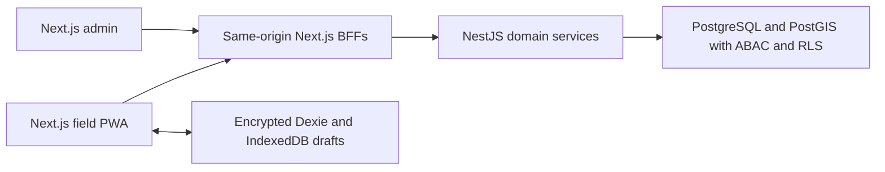

# Living project delivery and implementation handover

Last reviewed: **16 November 2026**. Feature baseline: explicit provisional enrollment slice (migration 22) on the project/geography scope foundation (migration 21), building on [PR #31](https://github.com/SandaruWithanage/agri-operations-platform/pull/31). See [current enrollment verification](../testing/PROJECT_ENROLLMENT_RESULTS.md) and [scope verification](../testing/PROJECT_SCOPE_RESULTS.md). Historical project-editing merged-main CI [passed](https://github.com/SandaruWithanage/agri-operations-platform/actions/runs/43825806378). Documentation-only revisions do not imply new application functionality.

This is the central working handover: what exists, how it works, evidence, remaining tasks and how to finish them. It follows direct project-owner decisions and reviewed implementation. Uploaded planning packages are references, not an approved final SRS or executable deployment instructions. Provisional pilot rules must not be presented as client-approved requirements.

**The platform is not production-ready.** M0 is complete; substantial security/M2 implementation and a bounded M3 project catalog exist. A provisional explicit enrollment API slice (PRJ-03A) exists without UI/BFF/offline. Enrollment UX, approved eligibility rules, responsibilities, resources/reports, administration/recovery and production acceptance remain. The [engineering estimate](DELIVERY_ESTIMATE.md) is roughly 55% complete, with a broad 50–60% range; it is judgment, not measured requirement coverage or a production-readiness percentage. Do not derive a percentage from test counts, files, PRs or the number of rows below.

## 1. How to maintain this document

For every completed or materially changed pending task, update this document **in the same PR**:

1. Keep its stable task ID. Update status, bounded scope and dependencies; split a task if only one part is complete.
2. Explain what was implemented and how, link the relevant code/guide/ADR and record actual verification with its revision or PR. Distinguish local checks, branch/PR CI, merged-main CI and external acceptance.
3. Record limitations and unresolved decisions. Do not mark a whole domain complete because one endpoint or screen works.
4. Update the remaining task's implementation steps and acceptance criteria, then append a dated completion-log entry. Move the completed bounded item into the delivered register without reusing its ID.
5. Synchronize [delivery status](PHASE_1_STATUS.md), [roadmap](ROADMAP.md), [open decisions](../requirements/OPEN_DECISIONS.md), setup and relevant domain guides when their claims change. Keep historical test reports/ADRs identifiable as snapshots instead of rewriting old results as new evidence.

Status meanings: **Done** = the bounded engineering capability listed is implemented and verified; **Partial** = some prerequisites exist but the listed outcome is incomplete; **Pending** = not implemented; **Conditional** = introduce only after an identified need/decision; **Excluded** = outside current Phase 1. External client/device/operational acceptance is tracked separately. A green CI run never supplies that acceptance automatically.

Use [AGENTS.md](../../AGENTS.md) and [the continuation entry](../CODEX_START_HERE.md) before implementation. The [PR template](../../.github/PULL_REQUEST_TEMPLATE.md) prompts contributors to record task IDs and evidence.

## 2. Current architecture and data flow



- Admin and field apps deploy independently and share presentation, validation, localization and transport packages. Domain services own their contracts/transactions; no organizations, zones, projects or business roles are seeded in code.
- Browser sessions use opaque Secure/HttpOnly/SameSite cookies. BFFs retain short-lived signed API JWTs server-side. NestJS verifies tokens/current sessions/CSRF; PostgreSQL verifies signed transaction actor context and current scopes. JWT role claims and UI capabilities do not grant authority.
- Argon2id, PostgreSQL sessions, revocation, MFA and approved browser-key possession are integrated. The pilot currently conservatively requires MFA and approved devices on its accounts. Actual device/OS security and recovery acceptance remain separate.
- Ten separate restricted LOGIN connections inherit one technical runtime group each: credential reader, MFA verifier, login throttle, session issuer, session executor, session reader, farmer runtime, device verifier, land runtime and project runtime. NOLOGIN function owners/migration identities never become API logins. These are technical database roles, not hardcoded organizational roles.
- PostgreSQL/PostGIS owns records, integrity, permissions, audit and reconciliation. TanStack Query owns isolated online server state; it is not a durable offline queue. Zustand persists locale only. Dexie owns minimal encrypted field drafts/pending mutations. Admin edit/create drafts are tab-memory only. Redis is optional and absent; no general worker/event outbox is implemented.
- GPS is reported identification, not legal boundaries, ownership, verified acreage or proof of containment in the chosen geography.

See [current architecture](../architecture/README.md), [accepted state ADR](../architecture/decisions/ADR-data-state-cache.md), [project context](../PROJECT_CONTEXT.md) and [provisional security/business decisions](../decisions/).

## 3. Delivered engineering register — what and how

These bounded items are **Done**. The remaining register prevents these labels from implying complete IAM, offline GIS, operational domains or production readiness.

| Task ID  | Delivered capability                                            | How it was implemented                                                                                                                                                                                                                                                                                                                                                                                                                                                                                                                       | Evidence / detailed handover                                                                                                                                                                                                                                                  |
| -------- | --------------------------------------------------------------- | -------------------------------------------------------------------------------------------------------------------------------------------------------------------------------------------------------------------------------------------------------------------------------------------------------------------------------------------------------------------------------------------------------------------------------------------------------------------------------------------------------------------------------------------- | ----------------------------------------------------------------------------------------------------------------------------------------------------------------------------------------------------------------------------------------------------------------------------- |
| FND-01   | Monorepo and independent app foundations                        | pnpm workspaces/Turborepo; Next.js admin/PWA, NestJS API; shared UI/tokens/types/validation/i18n/sync packages; TypeScript, lint, formatting, tests, builds, Compose and GitHub Actions                                                                                                                                                                                                                                                                                                                                                      | [README](../../README.md), [M0 results](../testing/M0_RESULTS.md), [PR #1](https://github.com/SandaruWithanage/agri-operations-platform/pull/1)                                                                                                                               |
| SEC-01   | Hybrid pilot authentication runtime                             | Argon2id, encrypted MFA factors, PostgreSQL sessions/revocation/throttling, short-lived validated JWTs, cookie BFF boundary, CSRF and signed database actor context; disabled unless configured                                                                                                                                                                                                                                                                                                                                              | [Runtime setup](PILOT_AUTH_RUNTIME.md), [authentication ADR](../decisions/ADR-0004-pilot-authentication.md), [API auth components](../../apps/api/src/authentication)                                                                                                         |
| SEC-02   | Scoped farmer authorization foundation                          | Current permission/assignment/time/source checks in NestJS and native SQL, dynamic configured organization/geography coverage, compound scope checks, FORCE RLS and restrictive connection identities                                                                                                                                                                                                                                                                                                                                        | [ABAC gate](../security/ABAC_GATE.md), [authorization ADR](../decisions/ADR-0005-provisional-farmer-authorization.md), [native migrations](../../database/migrations)                                                                                                         |
| DEV-01   | Approved browser-key enrollment/proof and operator revocation   | Non-exportable browser keys, public enrollment requests, independent fingerprint checking, single-use signed challenge/session proof and controlled CLI provisioning                                                                                                                                                                                                                                                                                                                                                                         | [Device guide](DEVICE_ENROLLMENT.md), [proof evidence](../testing/DEVICE_PROOF_RESULTS.md), [PR #8](https://github.com/SandaruWithanage/agri-operations-platform/pull/8)                                                                                                      |
| FAR-01   | Minimal field/admin farmer registration                         | Name in either language, authorized configured location and privacy-notice delivery confirmation; generated IDs and trusted creator/source/time; exact replay and duplicate risk without merging; no phone/NIC/land/project prerequisite                                                                                                                                                                                                                                                                                                     | [Pilot rules](../decisions/ADR-0003-provisional-farmer-registration.md), [admin workflow](ADMIN_FARMER_REGISTRATION.md), [PR #28](https://github.com/SandaruWithanage/agri-operations-platform/pull/28)                                                                       |
| OFF-01   | Durable minimal field drafting and synchronization              | Encrypted Dexie incomplete drafts/outbox, account/device partitions, local unlock/lock, prepared public shell, stable entity/mutation IDs, current server authorization and visible saved/pending/syncing/synced/conflict/rejected states                                                                                                                                                                                                                                                                                                    | [Offline guide](OFFLINE_WORKSPACE.md), [session/sync guide](FIELD_SESSION_SYNC.md), [browser results](../testing/OFFLINE_WORKSPACE_RESULTS.md)                                                                                                                                |
| REC-01   | Authenticated archive recovery, bounded normal case             | Versioned encrypted archives restore saved/incomplete versions and stable IDs into an empty same-account approved-device vault; normal prepared-browser restart is tested                                                                                                                                                                                                                                                                                                                                                                    | [Archive decision](../decisions/ADR-0008-authenticated-archive-recovery.md), [recovery results](../testing/ARCHIVE_RECOVERY_RESULTS.md); lost-passphrase/legacy-only recovery is REC-03 below                                                                                 |
| FAR-02   | Farmer registry/detail, review queue and audit view             | Scoped bounded keyset reads, explicit read/audit permissions, status/reviewability filters, microsecond audit cursors and no hidden totals; identity-bound cancellable queries                                                                                                                                                                                                                                                                                                                                                               | [Registry](FARMER_REGISTRY.md), [queue](FARMER_REVIEW_QUEUE.md), [audit](FARMER_AUDIT_HISTORY.md), [PR #13](https://github.com/SandaruWithanage/agri-operations-platform/pull/13) and [#21](https://github.com/SandaruWithanage/agri-operations-platform/pull/21)             |
| FAR-03   | Verification and bounded correction                             | Separate permissions, row versions, atomic audit, original/destination coverage, immutable retries, explicit review and locked tab drafts; actor-bound verification/correction receipts recover server outcomes                                                                                                                                                                                                                                                                                                                              | [Verification](FARMER_VERIFICATION.md), [correction](FARMER_CORRECTION_EDITOR.md), [receipts](FARMER_CORRECTION_RECEIPTS.md), [PR #27](https://github.com/SandaruWithanage/agri-operations-platform/pull/27)                                                                  |
| LAND-01  | Reported PostGIS identification and online GPS capture          | Separate land create/read, optional WGS84 point/accuracy/reported area, geometry checks/GiST index, bounded directory, explicit cancellable browser GPS, private journal/audit and exact retry                                                                                                                                                                                                                                                                                                                                               | [Land API](LAND_IDENTIFICATION.md), [online capture](ONLINE_LAND_CAPTURE.md), [PR #29](https://github.com/SandaruWithanage/agri-operations-platform/pull/29); relationships/offline land remain below                                                                         |
| PRJ-01   | Configurable organization-wide catalog                          | Entered project names and configurable organizations; disabled-by-default catalog flag; separate source-aware create/read grants, FORCE RLS, tenth runtime identity, private replay journal/audit and bilingual create/list/detail                                                                                                                                                                                                                                                                                                           | [Catalog](PROJECT_CATALOG.md), [results](../testing/PROJECT_CATALOG_RESULTS.md), [PR #30](https://github.com/SandaruWithanage/agri-operations-platform/pull/30)                                                                                                               |
| PRJ-02   | Versioned name/catalog-flag editing                             | Separate read/update grants, immutable organization/creator/time, original-version checks, row/mutation locks, private before/after journal and version-linked audit; retained bilingual tab intent and fresh detail reload                                                                                                                                                                                                                                                                                                                  | [Editing](PROJECT_EDITING.md), [results](../testing/PROJECT_EDITING_RESULTS.md), [PR #31](https://github.com/SandaruWithanage/agri-operations-platform/pull/31)                                                                                                               |
| STA-01   | Online state isolation and shared locale                        | Isolated TanStack Query clients/keys, no persistent sensitive cache, abort/clear/late-response protections, explicit network retries; component-local drafts; shared Zustand English/Sinhala preference only                                                                                                                                                                                                                                                                                                                                 | [Online boundaries](PROTECTED_ONLINE_QUERIES.md), [locale](SHARED_LOCALE.md), [PR #16](https://github.com/SandaruWithanage/agri-operations-platform/pull/16), [#19](https://github.com/SandaruWithanage/agri-operations-platform/pull/19)                                     |
| OPS-01   | Migration and readiness tooling                                 | Append-only checksum/history manifest, one transaction per file, concurrent-run lock, refusal of untracked adoption, separated liveness/readiness, bounded primary probes for all ten runtime pools and shutdown hooks                                                                                                                                                                                                                                                                                                                       | [Database guide](../../database/README.md), [readiness](API_READINESS.md), [PR #24](https://github.com/SandaruWithanage/agri-operations-platform/pull/24), tracked rehearsals through entry 21                                                                                |
| MAINT-01 | Stable dependency and CI policy                                 | Exact stable pins, lockfile, strict peers, production/full-tree audit gates, grouped maintenance and documented compiler/tool compatibility; no prerelease promotion as stable                                                                                                                                                                                                                                                                                                                                                               | [Dependency policy](DEPENDENCY_POLICY.md), [toolchain results](../testing/LATEST_STABLE_TOOLCHAIN_RESULTS.md), [PR #25](https://github.com/SandaruWithanage/agri-operations-platform/pull/25) and [#26](https://github.com/SandaruWithanage/agri-operations-platform/pull/26) |
| PRJ-04A  | Project/geography scope prerequisite                            | Typed project grants plus assignments, compound organization FKs, geography/unit AND matching, locked current actor/time checks and internal NestJS transaction policy; no enrollment endpoint or administration                                                                                                                                                                                                                                                                                                                             | [Scope guide](PROJECT_SCOPES.md), [ADR 0018](../decisions/ADR-0018-project-geography-scope-foundation.md), [verification](../testing/PROJECT_SCOPE_RESULTS.md)                                                                                                                |
| PRJ-04B  | Officer A/B enrollment isolation matrix                         | Native two-officer scenarios (own project grant, project/geography assignment and geography-assigned `farmer.read` per officer): all six cross enroll combinations denied without writes, own-rows-only lists and filters, indistinguishable 404 detail, cross-officer withdraw denied and unchanged, another officer's mutation ID unusable, farmer geography move removes access immediately, one officer's session revocation leaves the other unaffected, audit actors correct; mutation-checked (leaking B's scope makes the test fail) | [Results](../testing/PROJECT_ENROLLMENT_RESULTS.md); BFF and admin-shell coverage added (see PRJ-04C); no sync-reauthorization or Chromium coverage yet                                                                                                                       |
| PRJ-04C  | Two-account enrollment isolation through the BFF                | Synthetic approved-device sessions exercise the same-origin handler, NestJS and PostgreSQL. Each account can create, list and open its enrollment. Cross-project and cross-geography writes are denied without a journal entry. Revocation hides records and denies replay during the same session.                                                                                                                                                                                                                                          | [Native integration suite](../../tests/authn-migration.test.ts), [BFF fixture](../../tests/support/enrollment-bff-isolation.ts). Chromium enrollment coverage remains pending.                                                                                                |
| PRJ-04C  | BFF and admin-shell Officer A/B coverage                        | BFF never forwards browser-supplied authorization, source, key, session or actor headers on enrollment routes; two officers' sequential and concurrent requests keep separate server-issued tokens (mutation-checked: a cached token makes the test fail); the admin shell refuses and renders nothing from a list or detail that belongs to another account                                                                                                                                                                                 | [Results](../testing/PROJECT_ENROLLMENT_RESULTS.md); unit/component level, no Chromium shared-profile journey, no sync-reauthorization yet                                                                                                                                    |
| PRJ-03D  | Bilingual enrollment admin screens                              | English/Sinhala "Manage enrollment policy" on project detail, an Enrollments tab (keyset list, detail, withdraw) and an "Enroll in a project" action on farmer detail, all on the existing online-draft boundary (`OnlineCreation`): fresh authorized reads, explicit review, one fixed retry request, no browser persistence of records. The enroll form is opened from a farmer (fixed) and picks from the caller's own bounded project catalog (max 4 pages, refused if larger); list/detail show record references only; component tests | [Enrollment guide](PROJECT_ENROLLMENT.md); **pending:** project-side enroll entry with farmer search, name resolution in the enrollment list, Chromium journey, offline outbox                                                                                                |
| PRJ-03C  | Enrollment/policy BFF routes and typed client transport         | Strict allowlisted `enrollments/enroll`, `enrollments/withdraw`, `enrollment-policies/set` (CSRF, origin, bounded bodies) and reads (`enrollments`, `enrollments/detail`, `enrollment-policies`) that re-validate every response against the request identifiers, filters, limits and versions, plus account/device-bound `PilotClient` methods; extra fields are stripped                                                                                                                                                                   | [Enrollment guide](PROJECT_ENROLLMENT.md); no admin/field screens, no offline outbox                                                                                                                                                                                          |
| PRJ-03B  | Audited enrollment-policy administration (database + API)       | Dedicated organization `enrollment.policy` administrator grant (never implied by `project.update`/enrollment grants), fixed idempotent `set_enrollment_policy` with version/replay/post-wait reauthorization, private change history + audit, transition guard, admin-only RLS read, NestJS `enrollment-policies` endpoints and startup gate                                                                                                                                                                                                 | [Policy guide](PROJECT_ENROLLMENT.md), [ADR 0020](../decisions/ADR-0020-enrollment-policy-administration.md), [results](../testing/PROJECT_ENROLLMENT_RESULTS.md); no BFF/UI, no seeded grant, rules remain DEC-04-provisional                                                |
| PRJ-03A  | Provisional explicit farmer/project enrollment (database + API) | Versioned `operations.enrollment` (FORCE RLS), separate `enrollment.read/create/withdraw` project scopes ANDed with current `farmer.read`, fixed idempotent enroll/withdraw functions with farmer/enrollment locks and post-wait reauthorization, private journal/audit, transition trigger, NestJS service/endpoints and startup privilege gate; defaults labelled provisional                                                                                                                                                              | [Enrollment guide](PROJECT_ENROLLMENT.md), [ADR 0019](../decisions/ADR-0019-provisional-project-enrollment.md), [results](../testing/PROJECT_ENROLLMENT_RESULTS.md); no BFF/UI/offline, no client-approved rules                                                              |
| MAINT-02 | Living delivery/continuation documentation                      | Central stable task register with implementation methods, evidence, remaining steps/acceptance, a completion log and same-PR maintenance instructions in AGENTS/continuation entry/PR template                                                                                                                                                                                                                                                                                                                                               | This document, [AGENTS](../../AGENTS.md), [PR template](../../.github/PULL_REQUEST_TEMPLATE.md) and [file history](https://github.com/SandaruWithanage/agri-operations-platform/commits/main/docs/development/PROJECT_HANDOVER.md); formatting/link checks                    |

## 4. Latest verification and its limits

Current enrollment-slice local gate: **424 tests across 55 files** (PostgreSQL 16/PostGIS locally, lint/format/structure/typecheck and API build passed; Next.js builds/Chromium not rerun, CI not claimed). [Enrollment evidence](../testing/PROJECT_ENROLLMENT_RESULTS.md) records the scenarios and limits.

Previous scope-foundation local gate: **413 tests across 54 files**, production builds and both Chromium scenarios passed. The focused policy/native group passed 54 tests across 3 files. A tracked 20→21 migration rehearsal preserved prior history/timestamps and repeated unchanged; its disposable fixture was cleaned. [Scope evidence](../testing/PROJECT_SCOPE_RESULTS.md) distinguishes this foundation from future enrollment/administration and external acceptance. GitHub CI outcomes belong to the revision workflow history.

Historical project-editing baseline PR #31: **401 tests across 53 files**, production builds and both Chromium scenarios passed locally and in CI. Its merged-main run is linked at the top. The focused edit/contracts/catalog group passed 27 tests; native/migration checks passed 42 tests, including expiry behind row and replay locks. [Detailed evidence](../testing/PROJECT_EDITING_RESULTS.md) records the actual scope.

A separate pristine disposable database rehearsal applied all 20 tracked migrations, repeated with unchanged history/timestamps, checked project FORCE RLS/no direct runtime UPDATE and restored the fixture. An upgrade fixture preserved pre-edit project creation/audit fields. Neither is production backup/restore, manual-schema adoption or real-device certification.

Production dependency audit reported no known findings at this baseline. The full development tree retains one documented unpatched low-severity `deepmerge` advisory; it is not suppressed. TypeScript 7 project checks coexist with a TS 6 tooling API dependency because current tools require it. Prisma's Node 26 support-list warning remains documented. PostgreSQL/PostGIS are pinned at the tested 17/3.5 baseline; a major upgrade requires OPS-03, not a volume-destructive image replacement. Audits/version availability must be checked again when dependencies change.

Passing tests establishes the tested behaviors, not client requirements acceptance, complete role administration, legal/privacy approval, physical-device encryption, operating capacity or production readiness.

## 5. Remaining task register and implementation plan

Order work by dependencies and the next safe vertical workflow. Each item below states how to finish it and what evidence is required. Engineering can prepare configurable contracts while client decisions are pending, but must label defaults provisional rather than invent approved requirements.

### IAM-01 — Configurable role/permission/assignment administration — Partial

Existing direct account grants, organization/geography records and scoped checks are foundations, not complete configurable-role administration. Add typed person/account separation, configurable role/permission catalogs and scoped role bindings; preserve dynamic hierarchy and explicit validity windows. Build restricted native mutation/read contracts and audited NestJS/BFF administration before screens. Never expose an owner/provisioner connection through the API or infer access from a coordinator position.

**Dependencies:** SEC-01/02 and the client permission matrix. **Done when:** authorized admins can manage permitted scopes without self-escalation, cross-organization leakage or Zone OR Project broadening; direct restricted SQL, source/expiry/revocation, version/idempotency and audit rollback tests pass. Role names/counts stay database-configurable.

**Design (17 Nov 2026):** [ADR 0022](../decisions/ADR-0022-dynamic-role-and-assignment-administration.md) proposes roles as versioned data that materialize into the existing grant tables, delegation ceilings, no self-grant and dual approval for high-risk changes. It is a design proposal only: nothing is implemented, no role or grant is seeded, and implementation needs independent security review (G1) and the DEC-02 decisions. An internal engineering threat review (ADR section 11, not independent) added fourteen binding requirements.

### IAM-02 — Account and MFA enrollment/recovery administration — Pending

Use the existing authentication interfaces to implement controlled account/MFA enrollment, privileged-account requirements, factor recovery and session revocation with audit. Define identity-proof/recovery procedures before granting reset authority; retain stable account identity referenced by records. Add bilingual administration and failure/recovery states. Do not introduce an external IdP by default or store browser JWT/session/refresh secrets.

**Dependencies:** IAM-01 and recovery/operating policy. **Done when:** unauthorized resets are denied, factor/session revocation takes effect, replay/rate-limit/concurrent recovery cases pass, and operators can rehearse the approved recovery procedure without losing unsynchronized work.

### IAM-03 — Approved-device administration and deauthorization — Partial

The CLI/proof path exists. Add scoped device approval/revocation/history screens with independent key-fingerprint verification and audited authority. Connect deauthorization to local locking and an approved recovery/erasure process. Preserve unsynchronized data through explicit recovery or data-loss safeguards; successful synchronization/removal must be distinguishable from unsent work.

**Dependencies:** IAM-01/02, REC-03 and pilot-device policy. **Done when:** wrong-account/device approval fails, revoked devices cannot sync/sign in, synchronized cleanup works, and pending drafts have a tested recovery/retention path rather than silent deletion.

### FAR-04 — Optional fields and configurable forms — Pending

Add approved optional identity/contact/address/DOB/language/CBO/document fields with strict core validation, field-level access and retention rules. Keep NIC, phone, land and project enrollment optional for farmer creation. Add versioned optional form definitions where useful; do not replace typed core identity/FKs with arbitrary JSON or SQL policy text. Extend duplicate risk using permitted identifiers without automatic merging or leaking hidden records.

**Dependencies:** privacy/field definitions and IAM-01. **Done when:** minimal registration still works, unauthorized sensitive fields are absent from API/database projections, schema/form migrations preserve old records, and duplicate checks disclose only allowed information.

### FAR-05 — Full farmer lifecycle and reassignment — Partial

Draft/pending-review/verified/inactive storage and bounded correction/verification exist. Implement agreed lifecycle/reassignment commands with explicit permissions, original/destination coverage, original versions and atomic audit. Keep responsibility separate from creation; a registering officer does not permanently own the farmer. Add review UX for duplicate risks and approved verification criteria.

**Dependencies:** IAM-01, OPS-02 and client review rules. **Done when:** concurrent/stale/revoked changes fail safely, reassignment cannot broaden access, histories preserve attribution, and transitions/review procedures pass client UAT without making optional fields mandatory.

### REC-02 — Durable online drafts and outcome discovery — Partial

Admin creation/correction/edit values survive locking only in the current tab. Add a separately reviewed minimal encrypted/server-side recovery design consistent with the accepted state ADR; do not introduce a query persister as a second durable queue. Preserve original entity/mutation IDs and versions. Farmer receipts exist; project own-edit/registration outcome discovery still needs current/historical scope checks and metadata-only responses. Missing receipts never prove failure.

**Dependencies:** privacy/retention policy and current domain contracts. **Done when:** tab/browser termination, interrupted writes, wrong account/device, permission changes and uncertain server commits recover without duplicate intent, unauthorized disclosure, silent overwrite or discarded unsent data.

### REC-03 — Legacy-only/lost-passphrase archive recovery — Partial

Normal encrypted restart and authenticated empty-vault archive recovery are delivered as REC-01. Decide recovery-key/wrapping/escrow and lost-passphrase policy explicitly, then implement versioned recovery/migration without weakening encryption or replacing an account's stable IDs. Preserve original archives and incomplete versions through failed restore.

**Dependencies:** IAM-02/03 and approved key custody. **Done when:** legacy-only, corrupted/partial archive, lost unlock, account/device mismatch, interrupted upgrade and failed-write recovery cases are rehearsed with documented operator/data-loss safeguards.

### OFF-02 — Conflict/rejection review and recovery UX — Partial

Visible states and safe replay exist. Complete per-record review for conflicts/rejections, fresh authorization/reference checks and explicit new-intent creation only after outcome review. Preserve the original queued payload/IDs until reconciliation/recovery is explicit; never silently change a retry into another mutation or overwrite newer records. Keep online status in TanStack and durable work in Dexie.

**Dependencies:** domain conflict rules and REC-02/03. **Done when:** interruption/restart, scope revocation, changed required fields, duplicate risks, manual Sync Now and repeated reconnects leave every pending item recoverable and correctly classified.

### LAND-02 — Configurable farmer/land relationships — Pending

Agree ownership/tenant/cultivator/manager semantics, cardinalities and evidence requirements, then model typed configurable relationships with organization-consistent FKs and explicit permissions on both ends. Farmer/land creation remains independent and does not infer legal ownership. Implement versioned/audited APIs and bilingual workflows before offline expansion.

**Dependencies:** land relationship decisions, IAM-01 and FAR-05. **Done when:** shared/multiple parcels work according to approved rules, wrong-organization/unauthorized links fail, and concurrent updates/reassignment retain integrity without survey/title claims.

### LAND-03 — Authorized maps and spatial search — Pending

Choose an approved map/boundary-data/hosting approach. Add bounded viewport/search contracts over PostGIS, current scoped point/field visibility and query cancellation. Apply the same authorization to map features and aggregates; do not download all farmers/points or expose hidden totals. Treat point accuracy and reported area as reported metadata, not surveyed acreage.

**Dependencies:** map/data-egress decisions and current land scopes; relationships where needed. **Done when:** bounded queries/index use, pan/zoom cancellation, wrong-scope points/counts and provider/privacy behavior are tested, including authorized/no-coordinate records.

### LAND-03a — Provisional polygon store (P1-09a) — Implemented (awaiting merge and independent review)

Migration 25 adds `land.land_geometry_version`: PostGIS `geometry(Polygon,4326)` with a GiST index, immutable versions, one current provisional version per land, FORCE RLS and separate `land.geometry.read` / `land.geometry.create` permissions (read also needs `land.read`). The fixed `land.record_geometry` function authorizes before validating shape, then enforces a closed ring, `ST_IsValid`, positive geodesic area (at most 1e9 m², computed through `geography`), counter-clockwise normalization, optimistic version checks, an HMAC idempotency journal and atomic audit. Geometry is provisional or superseded only, never verified, and is a location identification aid, not a surveyed boundary or verified acreage.

Evidence: native PostgreSQL scenarios in `tests/support/land-geometry-integration.ts` (area against an independent recomputation, 14+ invalid-geometry cases, replay and changed-payload, version conflicts and concurrency, Officer A/B isolation, direct writes denied, revocation, audit attribution). Mutation-checked: removing the permission from both the function and the RLS policy fails the tests; either alone does not, because they are independent layers (defense in depth), so a regression in one layer alone is not caught by these tests. **P1-09b (implemented, awaiting merge and review):** `LandGeometryService` plus internal API routes `POST /pilot/land/geometry` (internal key, verified actor, CSRF, source header) and `GET /pilot/land/geometry` (current version, optional history). Strict validation in `@agri/validation`: closed `[lon,lat]` ring of 4–5000 points, sources limited to `gps_walk` and `digitized` (clients cannot submit `official_survey`), history flag parsed explicitly. The database remains the authority; its 42501/22023/40001/23505 codes map to 403/400/409 without leaking details; reads of another officer's or a missing land are both 404. Service steps are in the native scenario and mutation-checked (403 mapping, history flag). **P1-09c (implemented, awaiting merge and review):** BFF routes `POST`/`GET /api/pilot/land/geometry` for both field and administrator BFFs (the database permissions decide access; nothing is hidden at the BFF), strict request schemas with unknown-field, official-survey-source, unclosed-ring and query-scope rejection, CSRF on writes, results bound to the requested land and stripped of extra fields, and `PilotClient.recordLandGeometry`/`landGeometry` with account-session binding. The spoof matrix covers the new write route. Mutation-checked (result binding on both routes, allow-list). **P1-10a (merged; independent review pending):** authorized viewport read `GET /api/pilot/land/viewport` (bounding box capped at 5° and never crossing the antimeridian, at most 200 features per kind, default 100) returning current provisional polygons and reported points, API/BFF/`PilotClient` with an `AbortSignal` for stale-request cancellation. Visibility comes from PostgreSQL (RLS on geometry versions; the `land.read` predicate and policy on points), the `truncated` flag is computed only over visible features so it reveals nothing hidden, and the BFF binds each response to the requested box and strips extras. Native Officer A/B scenarios, mutation-checked for truncation and superseded-version exclusion; the explicit point predicate is redundant with the RLS policy (defense in depth), so removing it alone is not detected. Existing GiST indexes serve the queries; no migration. **P1-10b (design proposed):** [ADR 0023](../decisions/ADR-0023-map-stack-and-provider-adapter.md) proposes a replaceable provider adapter (local synthetic style by default, MapLibre GL JS as proposed renderer), no tile endpoint for farm data, privacy/egress and caching rules, stale-request and logout clearing rules and non-drag alternatives. It selects no tile vendor (DEC-09 unresolved) and is not accepted. **P1-11a (implemented, awaiting merge and review):** `apps/field-pwa/lib/walk-survey.ts`, a pure, deterministic walk-the-perimeter engine with no UI, clock, storage, network or geolocation access. Nothing is recorded unless the officer explicitly started and the session is recording; pausing never fabricates points and a resumed session starts a new segment; poor or unknown accuracy, invalid and out-of-order fixes are rejected and counted; jitter is dropped; implausible jumps and long silences are flagged; manual point removal and jump acceptance need a reason and leave audit events; a denied location read keeps the session open for retry. Review computes a local preview area (spherical, not authoritative), closure gap, segments and self-intersection, and `toGeometryInput` refuses an unreviewed, too-short, unclosed, self-intersecting or jump-flagged survey and otherwise builds the strictly validated closed ring for `recordLandGeometry` (worst fix accuracy, source `gps_walk`). 12 unit tests, mutation-checked on nine rules. **P1-11b (implemented, awaiting merge and review):** `WalkSurveyScreen` in the field PWA (English and Sinhala): location is watched only while recording and released on pause, finish, discard and unmount; the page auto-pauses with a visible notice when hidden; weak readings, jumps and gaps are shown as text; denied/unavailable/timeout location shows a retry; review lists points with reason-required removal and jump acceptance; save is blocked with a stated reason until the survey is ready, uses one idempotency id per review (a retry is a replay), and maps 401/403/409/400 to clear messages. 8 component tests with a fake geolocation, mutation-checked on seven behaviors. **Save integrity (issue #60):** the first save attempt freezes the exact request (mutation id, land, version, ring, source, accuracy) and every retry resends it unchanged; editing, discard (while in flight) and host land switching are locked while a save is pending or its outcome is unknown (timeout, network loss, 5xx); an unknown outcome offers only "Retry the same save" (and a discard that warns an earlier save may be recorded); 400/403 need an explicit "correct and save again" that draws a new id; 409 is final (reload the land); 401 means the request never ran, so the next save is a fresh request. The snapshot is in memory, so a page reload loses the walk and its snapshot; keeping it across reloads belongs to the encrypted offline draft (P1-12), and a server receipt lookup for unknown outcomes is a follow-up. **P1-11c (implemented, awaiting merge and review):** the screen is reachable at the online-only route `/land-survey` (linked from the field workspace): `LandSurveyWorkspace` lists the officer's assigned lands (`PilotClient.land`, cursor paging), reads the current geometry version (`landGeometry`; 404 means version 0, any other failure blocks the survey rather than guessing a version), discards responses for a land the officer has moved away from, shows existing-version/history wording, and mounts the survey with the account from the verified session. The service worker caches only the public offline shell and static assets, so this route and its API responses are never cached and fall back to the offline page when offline. **Account isolation (issue #59):** every load and geometry response is applied only within the current session epoch and only if it names the signed-in account; the page re-checks the account on focus, visibility and page show and before each land choice; an account switch wipes lands, cursor, selection, geometry and any in-progress survey before the new account can see them; in-flight requests are aborted on leave. A plain sign-out (401) clears the picker unless a survey is in progress; then (issue #63) the walk is kept in memory but nothing sensitive is rendered: the survey screen shows only a lock notice (no coordinates, area, land labels or controls), recording is paused and location is released, and the picker, land labels and Back control are hidden. The same account signing in again on an approved device restores the paused survey; another account removes it. The data still exists in page memory while locked and does not survive a reload; durable, encrypted custody belongs to the offline draft (P1-12), and the re-authentication and custody policy still needs product and security review before any real-data pilot. 8 component tests, mutation-checked on four behaviors. The survey has not run on a real phone. **Not done:** encrypted offline drafts (P1-12), real-phone trials against reference areas within a client-approved tolerance (DEC-07/DEC-09) and disclosure testing of Android/iOS/browser background GPS limits. **Remaining (P1-10c onward, blocked on ADR acceptance):** map/layer UI, draw/edit/import UI with non-drag alternative, map-provider adapter (P1-10), walk-perimeter capture UX (P1-11), spatial search/viewport queries and an offline representation. No farmer or boundary UI exists yet.

### OFF-04 — Offline enrollment queue — Pending (design reviewed; provisional owner policy recorded; implementation not authorized)

[ADR 0021](../decisions/ADR-0021-offline-enrollment-design.md) is the architecture-reviewed direction: queue enrollment intents (IDs only) in the existing encrypted account/device vault; no second database, Redux, Redis or sync engine; eligibility and policy stay server-authoritative. On 16 Nov 2026 the owner recorded a **provisional** Phase 1 pilot policy (DEC-12: explicit scoped grants, offline queueing on approved devices, administrator-only withdrawal, no per-enrollment approval, server-confirmed farmers only, generic officer refusals, queue limit 100 / warn 7 days / escalate 30 days / never auto-delete). It is **not** final client policy and is subject to client confirmation and independent security review. The ADR is **not Accepted**: steps A1–A4 (client confirmation, independent review, prerequisite designs, owner status change) are listed in ADR section 9. No code, flag or environment enables offline enrollment for real officers.

Implementation sequence after acceptance (each its own PR with independent evidence; see ADR section 10 for acceptance criteria): prerequisites **ENR-AUTH-01** (administrator-only withdrawal enforced in PostgreSQL), **ENR-AUDIT-01** (administrator-visible refusal reasons and attempt history surviving rolled-back transactions) and **IAM-01** or an audited provisioning procedure; then **OFF-04A** encrypted store/R1 release (flag off), **OFF-04B** sync classification, **OFF-04C** review/recovery UI and archive v3, **OFF-04D** BFF/browser A/B, Chromium journeys and evidence; then Gate E (independent implementation review, real-device acceptance under DEC-07, recorded owner enablement). Preconditions delivered: PRJ-04B/04C Officer A/B coverage. Still required: Chromium shared-profile coverage and sync reauthorization tests.

**Draft amendment (17 Nov 2026):** [ADR 0021 section 11](../decisions/ADR-0021-offline-enrollment-design.md) drafts same-session dependent enrollment (owner Q3) and refusal-reason options (Q4) for review. It is not part of the reviewed text, needs the owner to resolve conflicts SC-02/SC-03 first, and does not authorize any implementation.

### ENR-AUTH-01 — Administrator-only enrollment withdrawal — Pending

### ENR-AUTH-01 — Administrator-only enrollment withdrawal — Implemented (provisional owner policy; awaiting merge and review)

Migration 24 makes withdrawal administrator-only in PostgreSQL: `operations.enrollment_permitted` refuses any non-administrator source for `enrollment.withdraw` whatever grants exist (it gates both the withdraw function and the update policy), and a `NOT VALID` check constraint stops new field-officer-source withdraw grants (a pre-existing one would be inert and is never modified; none is seeded). The field-officer BFF no longer exposes `enrollments/withdraw` or the administrator-only policy routes. Evidence: native tests for refused field-officer-source withdrawal (own officer, cross officer, and a legacy grant), constraint violation, and BFF 404 tests; mutation-checked (removing the rule lets a field-officer withdrawal succeed). This is the owner's **provisional** DEC-12 rule, not client policy; it does not accept ADR 0021 and no `enrollment.*` grant is provisioned for real officers. Merge/CI/security review status is recorded in the PR.

### ENR-AUDIT-01 — Administrator-visible refusal reasons and attempt history — Pending

Durable, scoped server-side record of refused enrollment attempts (reason code, actor, mutation ID, time) that survives the rolled-back transaction, with a retention statement and an administrator-only endpoint under its own permission; officer responses stay generic. Needs a short design addendum before implementation.

### OFF-03 — Durable offline land/GPS workflow — Pending

Expand the minimal farmer-only dataset only after device/data-security and recovery review. Version encrypted Dexie records/outbox for necessary GPS/land/link fields; preserve legacy farmer drafts and IDs. Design farmer/land/relationship sync ordering and idempotent recovery after partial success. Reauthorize every server action; no expired/offline JWT bypass or second queue.

**Dependencies:** approved devices/storage policy, LAND-02 and REC-03/OFF-02. **Done when:** actual pilot-device process/OS restart, low storage/eviction, schema upgrades, partial sync, revoked assignments and conflict recovery work without downloading the whole database or silently losing drafts. Exclude unnecessary scans/documents.

### PRJ-03 — Explicit farmer/project enrollment — Partial

PRJ-03A delivered the database/API slice with **provisional** rules (default-deny per-project enrollment policy with eligible farmer statuses and stored policy version, active project, one current row per farmer/project, withdrawal as history, re-enrollment as a new row). Remaining: project-side enrollment entry, name resolution, Chromium journey and offline outbox (PRJ-03B delivered the audited API, PRJ-03C the BFF/client transport and PRJ-03D the policy and list/detail/withdraw screens), client-approved eligibility/cycles/effective dates/coexistence/transition rules, bilingual BFF/admin UI, field/offline behaviour and approval/closure workflows. Original scope: agree eligibility, cycles, effective dates, coexistence and transition rules. Implement typed farmer/project/cycle links and explicit enroll/withdraw commands with current permissions, versions, idempotency and atomic audit. Do not auto-enroll during farmer creation, assume one project per farmer or invent an approved verified-farmer prerequisite. A catalog-enabled flag alone is not authorization.

**Dependencies:** PRJ-04 (remaining), IAM-01 and approved enrollment rules (DEC-04). **Done when:** authorized users explicitly enroll valid targets; cross-organization, stale, duplicate-intent, disabled/ineligible cases follow agreed policy; multiple parcels/projects/cycles and partial failures are tested without silently changing existing enrollment.

### PRJ-04 — Project-specific and compound scope enforcement — Partial

PRJ-04A provides typed project grants/assignments, same-organization FKs, geography/unit intersections and current actor/expiry locking in PostgreSQL, plus an internal NestJS policy. PRJ-03A now applies it to enrollment records (RLS, native commands, farmer-visibility intersection, `enrollment.withdraw`). There is still no scope-management interface. Complete direct relationships for other records, a multi-account Officer A/B enrollment matrix, audited scope administration and synchronization reauthorization. Existing organization-wide catalog grants must not become enrollment, farmer or land access. Never interpret Zone + Project as Zone OR Project, or a narrower grant as organization-wide authority.

**Dependencies:** IAM-01 and the permission matrix. **Done when:** direct restricted SQL and API tests prove Officer A cannot access Officer B's project/scope, missing context fails closed, and expiry/revocation/combined constraints remain effective across sync and administrative edits.

### OPS-02 — Officer responsibilities, CBOs and contacts — Pending

Model people/positions/CBO membership separately from login accounts and explicit application grants. Add scoped, time-bounded responsibility/assignment administration and history with typed FKs, versions and audit. Keep geography and management hierarchy separate; no fixed zone/CBO/role list and no creator-derived permanent ownership.

**Dependencies:** IAM-01, FAR-05, PRJ-04 and organizational decisions. **Done when:** non-login coordinators remain contacts, authorized assignments/reassignments work, and expired/cross-scope/unapproved position changes confer no access.

### RES-01 — Initial resource records and distributions — Pending

Confirm Phase 1 resource/unit, allocation, stock/movement and adjustment rules. Build configurable catalogs and a transactional movement/distribution record tied to authorized project/farmer scopes. Use appropriate numeric precision, stable mutations, versions and audit; introduce balances/limits only with agreed semantics. Do not add financial/procurement/insurance engines.

**Dependencies:** PRJ-03/04, IAM-01 and resource rules. **Done when:** parallel issues/returns/adjustments reconcile correctly, retries cannot duplicate movements, disallowed scope/quantity/transition cases fail, and authorized users can review the resulting records.

### DOC-01 — Supporting documents/basic agreements — Pending

Confirm which optional evidence/project agreement records belong in Phase 1. Implement scoped metadata/object storage, bounded validated uploads, authorized short-lived download access, retention and audit. Avoid public buckets or predictable personal-information object names. Exclude unnecessary identity scans and medical documents from offline storage; keep advanced legal/financial agreement workflows out of scope.

**Dependencies:** privacy/retention, storage/provider and project/land evidence decisions. **Done when:** wrong scope, replaced content, expired download authority, unsafe/oversized uploads and retention/removal cases are tested; documents never become universal farmer-registration prerequisites.

### RPT-01 — Scoped dashboard, reports and exports — Pending

Agree initial operational questions, measures and fields, then implement bounded server-side reports/exports over authorized records. Recheck aggregate/map/field-level permissions and audit sensitive exports. Do not calculate global totals from privileged queries or client caches and then hide rows afterwards.

**Dependencies:** approved measures and the relevant FAR/LAND/PRJ/RES records. **Done when:** counts, pagination, exports and concurrent permission changes cannot reveal hidden records/locations; results reconcile with the authorized source data and capacity limits are measured.

### SEC-03 — Key/credential rotation and security recovery — Pending

Implement and rehearse managed rotation for JWT keys/kids, session/CSRF/device-challenge material, MFA encryption, actor-context/MAC keys and database credentials. Existing journals use retained MACs: changing a single current key without a retained-key/version plan can break safe replay. Define custody/backup/retention and test migrations across old/new keys without logging secrets or losing unsynchronized work.

**Dependencies:** IAM-02/03, REC-03 and operating ownership. **Done when:** approved old/new validity windows, revocation, restart, restore and failed rotation cases reconcile correctly, with a usable runbook and independent review.

### SEC-04 — Trusted proxy identity and throttle hardening — Partly implemented (issue #64; awaiting merge and review)

Migration 26 replaces the single-limit throttle with separate account and client limits; the API no longer attributes logins to the BFF's socket address; the BFF derives the client from `X-Forwarded-For` only through the configured `PILOT_TRUSTED_PROXY_HOPS` and forwards it in `X-Agri-Client` on login only; unattributed logins share one broad bucket. Tests: native two-bucket semantics (account limit, client flood, other clients unaffected), BFF spoofing and chain-depth cases, API validation, mutation-checked. **Still pending:** the approved hosting/proxy topology (OPS-04), measured limits, an edge rate limit, treatment of shared NAT addresses, and reconsidering whether successful logins should consume the account budget. The owner decisions are set out in the [login throttle decision brief](../security/LOGIN_THROTTLE_DECISION_BRIEF.md). See [PILOT_AUTH_RUNTIME.md](PILOT_AUTH_RUNTIME.md). The wider bot-protection audit, threat model and slice plan that builds on this item are in [SECURITY_BASELINE_AUDIT.md](../security/SECURITY_BASELINE_AUDIT.md). **Update 19 Nov 2026:** production start now refuses an unset or unsafe hop count (SEC-A1; see the completion log).

(Original scope follows.)

Complete hosting/proxy decisions, then derive client identity only through the approved trusted hop chain/internal metadata. Preserve PostgreSQL shared throttling until a measured replacement is approved. Do not trust arbitrary browser forwarding headers or replace current session/permission authority with Redis.

**Dependencies:** OPS-04. **Done when:** direct/spoofed forwarded requests cannot change identity/budget, legitimate proxy paths work, and measured rate limits/recovery preserve availability without account enumeration.

### DATA-01 — Privacy, field policy and audit retention — Pending

Approve the actual bilingual collection notice, optional-field purposes, access/redaction, retention and recovery/removal procedures. The existing checkbox records notice delivery; it is not an invented legal-consent approval. Implement field-specific protections and audited retention administration without erasing required attribution or unsynchronized work silently.

**Dependencies:** client/legal policy and relevant IAM/REC/document work. **Done when:** approved notices and retention/redaction behavior are reviewed, sensitive reads/exports are scoped, and removal/recovery procedures are testable and documented.

### OPS-03 — Database modernization, backup/restore and adoption — Pending

Select a verified stable PostgreSQL/PostGIS upgrade target under the dependency policy; rehearse extensions, data-preserving volume transition, roles, all migrations and RLS. Rehearse encrypted backups/restores with keys, retention and client-approved recovery objectives. Manually migrated databases need a reviewed adoption path; never fabricate history, remove a volume or rewrite applied SQL to bypass checks.

**Dependencies:** operating ownership, SEC-03 and actual target version/provider. **Done when:** fresh and restored/upgraded realistic fixtures retain records, journals, roles/scopes and replay behavior; operators can demonstrate recovery time/data-loss objectives. The clean migration rehearsal already performed is only one prerequisite.

### OPS-04 — Production deployment and release/rollback — Pending

Choose hosting, region, domains, secret manager, operating owners and support model. Build reviewed deployment/IaC with HTTPS BFFs, verified PostgreSQL TLS, internal API isolation, ten separated runtime logins, durable storage and controlled migration-before-app rollout. Verify liveness/readiness routing, release artifacts, forward fixes/rollback compatibility and production dependency boundaries.

**Dependencies:** client/provider choices, SEC-03/04, OPS-03. **Done when:** deployment and failure/rollback rehearsals pass in the actual target environment; migrations/keys/volumes survive restart, secrets stay server-side, and named operators own access and incident response. No hosting/domain/production credentials have been supplied or validated by current CI.

### OPS-05 — Monitoring, capacity and operating runbooks — Partial

Liveness/readiness/shutdown code exists. Deploy request/error/latency/database/sync monitoring and alerts with non-sensitive structured logs and documented escalation. Measure pool limits, permission-lock contention, login/sync load, backup restoration and rollout behavior; tune from evidence. Readiness is a bounded connectivity probe, not a full migration/business/security certification.

**Dependencies:** OPS-04 and target pilot workload. **Done when:** operators can detect/recover dependency, storage, synchronization and capacity failures without exposing secrets or hidden data through diagnostics; alert and recovery drills produce recorded evidence.

### ACC-01 — Independent security/access review — Pending

Review actual deployment, migrations/functions/grants, account/device lifecycle, CSRF/JWT/session enforcement, privacy boundaries and recovery procedures. Exercise direct restricted database access and malicious/cross-scope requests, not only frontend visibility. Resolve findings or record an explicitly accepted disposition with an accountable owner.

**Dependencies:** deployed configuration and IAM/REC/SEC work. **Done when:** the independent review and negative/concurrency tests cover the delivered workflows and target configuration, with no unsupported production-ready claim based only on CI/audits.

### ACC-02 — Sinhala, accessibility, outdoor and device acceptance — Pending

Have fluent domain users review English/Sinhala terminology, errors and the approved privacy notice. Test keyboard/screen-reader flows, contrast, touch targets, outdoor use and real GPS behavior. Validate approved pilot OS/browser/device encryption, authentication/inactivity lock, offline restart/eviction, key protection, synchronization and recovery/deauthorization.

**Dependencies:** approved target devices, language reviewers and stable workflows. **Done when:** recorded device/user acceptance covers normal and failure cases; synthetic Chromium permission fixtures are not substituted for actual device-security evidence.

### ACC-03 — Client decisions, source reconciliation and UAT — Pending

Close the [decision register](../requirements/OPEN_DECISIONS.md), including organization naming, coverage/approval matrix, land/enrollment/resource rules, actual device/hosting ownership and source-plan count discrepancy. Run end-to-end UAT against agreed acceptance cases. Use synthetic data until an authorized import process/retention policy exists; never commit real farmer information or secrets.

**Done when:** an accountable client/organization representative accepts the agreed Phase 1 workflows and operating/recovery procedures. Provisional implementation decisions remain labelled until then.

### FUT-01 — Redis/workers and scale infrastructure — Conditional

Introduce only for a measured reference-cache, aggregate, rate-limit or worker need. Design scope/version keys, TTL/invalidation and ordinary-cache PostgreSQL fallback; security-critical failures need their own fail-closed policy. Important worker events must first commit to a PostgreSQL business-event outbox before delivery. Current mutation journals/Dexie are not that relay. Require outage/retry/idempotent-delivery tests; do not install optional infrastructure merely to mark this item done.

### EXC-01 — Excluded from current Phase 1

Farmer self-service is Phase 2. Advanced financial settlement, harvest procurement/transport, insurance and legal land-survey/polygon/payment-grade acreage workflows are not authorized Phase 1 scope. They are not pending tasks to implement under a broad “finish everything” instruction without an explicit scope change.

## 6. Recommended next sequence

Use the [Phase 1 priority checklist](PHASE_1_PRIORITIES.md) to order current work through release. The shipped online enrollment UI is in place. The authenticated BFF and API regression now covers separate account scopes. Browser coverage, offline enablement, and client policy decisions remain tracked separately.

1. Preserve the completed catalog/editing/enrollment-API boundaries. Verify the shipped bilingual online enrollment and BFF flow across account scopes, then complete DEC-04-dependent rules. Extend IAM-01 where scopes require role/binding administration.
2. PRJ-04B delivered the database/API Officer A/B enrollment matrix. PRJ-04C extends the matrix through the authenticated BFF. Before any offline enrollment, add browser-level A/B coverage and sync reauthorization, and write an offline-enrollment design (encrypted vault reuse, conflict outcomes when policy/eligibility changes while offline, recovery) for approval. Keep registration independent and avoid guessed eligibility rules.
3. Complete LAND-02 relationship rules and the IAM/REC/device safeguards required for OFF-03; expand offline land only after policy/device validation. In parallel, engineering can prepare bounded administration/recovery screens and contracts without pretending external acceptance is complete.
4. Add scoped responsibilities, initial resource records and reports using the same integrity/authorization patterns. Keep optional advanced infrastructure conditional.
5. Rehearse actual upgrades/restores and deployment, rotation, monitoring and failure recovery; complete independent review, native-speaker/device acceptance and client UAT before production claims.

Reorder when confirmed dependencies, failures or client priorities justify it; record the reason and affected task IDs. Do not wait for a whole milestone to update completed bounded work.

## 7. Developer/operator entry points

Start with [installation/commands](../../README.md), [runtime provisioning](PILOT_AUTH_RUNTIME.md), [migration operations](../../database/README.md), [device enrollment](DEVICE_ENROLLMENT.md) and the relevant domain guide in section 3. Authentication is disabled by default. Current enabled deployment needs migrations **through entry 22**, the ten isolated runtime URLs and independently provisioned server keys/accounts/MFA/devices/grants. Migrations 20–22 require no additional connection or secret; the scope and enrollment owners are NOLOGIN and never API identities. Never place server keys in `NEXT_PUBLIC_` settings.

Use the pinned Node/pnpm versions in the repository and frozen lockfile, then run:

```sh
pnpm install --frozen-lockfile
pnpm peers check
pnpm audit --prod --audit-level low
pnpm audit --audit-level high
pnpm check:structure
pnpm lint
pnpm format:check
pnpm typecheck
# Set DATABASE_TEST_URL to a dedicated disposable database named agri_test.
pnpm test
# Provide the documented DATABASE_URL for Prisma/build configuration.
pnpm build
pnpm exec playwright install --with-deps chromium
pnpm test:browser
```

Without `DATABASE_TEST_URL`, database suites are skipped; that is not evidence that the full database gate passed. Build/schema validation does not establish a production database connection or deployment. The native migration runner uses separately supplied `MIGRATION_DATABASE_URL` and exact `MIGRATION_DATABASE_NAME`; it does not automatically load `.env` or provision production credentials. Follow its guide rather than copying a privileged bootstrap connection into the API.

Current local ports: admin 3000, field 3001, API 4000. `/health` is liveness; `/ready` is dependency readiness and is 503 when the pilot runtime is disabled. Local Compose is not production infrastructure. `db:down` retains local volumes. The workspace's special flattened-image test workaround is evidence from a constrained test environment, not a production deployment recipe.

## 8. Completion log

Preserve these historical entries. Add a row for each newly completed task with how/evidence, then update the task register and remaining plan above.

| Revision / PR                                                                  | Completed work and method                                                                                                                                                                                                                                                                                                                                                                                                                                                                                                                                                                                                                                                                                                                                                                                                                                                                                                                                                                                                                                                                                                                                                                                                                                                                                                                                                                                                                                                                                                                                                                                                                                                                                                                                                                                                                                                                                                                                                                                                                                                                                                                                                                                                                                                                                                                                                                                                                                                                                                                                                        | Verification reference                                                                                                                                                                 |
| ------------------------------------------------------------------------------ | -------------------------------------------------------------------------------------------------------------------------------------------------------------------------------------------------------------------------------------------------------------------------------------------------------------------------------------------------------------------------------------------------------------------------------------------------------------------------------------------------------------------------------------------------------------------------------------------------------------------------------------------------------------------------------------------------------------------------------------------------------------------------------------------------------------------------------------------------------------------------------------------------------------------------------------------------------------------------------------------------------------------------------------------------------------------------------------------------------------------------------------------------------------------------------------------------------------------------------------------------------------------------------------------------------------------------------------------------------------------------------------------------------------------------------------------------------------------------------------------------------------------------------------------------------------------------------------------------------------------------------------------------------------------------------------------------------------------------------------------------------------------------------------------------------------------------------------------------------------------------------------------------------------------------------------------------------------------------------------------------------------------------------------------------------------------------------------------------------------------------------------------------------------------------------------------------------------------------------------------------------------------------------------------------------------------------------------------------------------------------------------------------------------------------------------------------------------------------------------------------------------------------------------------------------------------------------- | -------------------------------------------------------------------------------------------------------------------------------------------------------------------------------------- |
| PR #1 and early security PRs #3–8                                              | M0 foundation, provisional farmer/session/login/RLS integration, BFF runtime and approved browser-key proof, delivered incrementally on feature branches                                                                                                                                                                                                                                                                                                                                                                                                                                                                                                                                                                                                                                                                                                                                                                                                                                                                                                                                                                                                                                                                                                                                                                                                                                                                                                                                                                                                                                                                                                                                                                                                                                                                                                                                                                                                                                                                                                                                                                                                                                                                                                                                                                                                                                                                                                                                                                                                                         | [M0](../testing/M0_RESULTS.md), [pilot runtime](PILOT_AUTH_RUNTIME.md), [device evidence](../testing/DEVICE_PROOF_RESULTS.md)                                                          |
| PRs #11–13, #16–23                                                             | Scoped farmer registry/audit, isolated online reads, field sync progress, shared locale, verification/review queue and bounded correction choices/receipts                                                                                                                                                                                                                                                                                                                                                                                                                                                                                                                                                                                                                                                                                                                                                                                                                                                                                                                                                                                                                                                                                                                                                                                                                                                                                                                                                                                                                                                                                                                                                                                                                                                                                                                                                                                                                                                                                                                                                                                                                                                                                                                                                                                                                                                                                                                                                                                                                       | Domain guides/results linked in section 3; merge history is the source for individual PR scope                                                                                         |
| PRs #24–26                                                                     | Dependency readiness, stable toolchain/security gates and compiler-tool compatibility maintenance                                                                                                                                                                                                                                                                                                                                                                                                                                                                                                                                                                                                                                                                                                                                                                                                                                                                                                                                                                                                                                                                                                                                                                                                                                                                                                                                                                                                                                                                                                                                                                                                                                                                                                                                                                                                                                                                                                                                                                                                                                                                                                                                                                                                                                                                                                                                                                                                                                                                                | [Readiness evidence](../testing/API_READINESS_RESULTS.md), [toolchain evidence](../testing/LATEST_STABLE_TOOLCHAIN_RESULTS.md)                                                         |
| PR #27                                                                         | FAR-03 bounded online correction editor: source/version-bound intent, tab locking and explicit idempotent retry                                                                                                                                                                                                                                                                                                                                                                                                                                                                                                                                                                                                                                                                                                                                                                                                                                                                                                                                                                                                                                                                                                                                                                                                                                                                                                                                                                                                                                                                                                                                                                                                                                                                                                                                                                                                                                                                                                                                                                                                                                                                                                                                                                                                                                                                                                                                                                                                                                                                  | [Correction results](../testing/FARMER_CORRECTION_EDITOR_RESULTS.md)                                                                                                                   |
| PR #28                                                                         | FAR-01 admin registration: shared core form, current create coverage, exact retry and no implied read/ownership/enrollment                                                                                                                                                                                                                                                                                                                                                                                                                                                                                                                                                                                                                                                                                                                                                                                                                                                                                                                                                                                                                                                                                                                                                                                                                                                                                                                                                                                                                                                                                                                                                                                                                                                                                                                                                                                                                                                                                                                                                                                                                                                                                                                                                                                                                                                                                                                                                                                                                                                       | [Admin registration results](../testing/ADMIN_REGISTRATION_RESULTS.md)                                                                                                                 |
| PR #29                                                                         | LAND-01 online reported GPS capture: optional explicit location, independent land permissions and exact retry                                                                                                                                                                                                                                                                                                                                                                                                                                                                                                                                                                                                                                                                                                                                                                                                                                                                                                                                                                                                                                                                                                                                                                                                                                                                                                                                                                                                                                                                                                                                                                                                                                                                                                                                                                                                                                                                                                                                                                                                                                                                                                                                                                                                                                                                                                                                                                                                                                                                    | [Capture results](../testing/ONLINE_LAND_CAPTURE_RESULTS.md)                                                                                                                           |
| PR #30                                                                         | PRJ-01 configurable organization-wide catalog with private native journal/audit and ten-role runtime                                                                                                                                                                                                                                                                                                                                                                                                                                                                                                                                                                                                                                                                                                                                                                                                                                                                                                                                                                                                                                                                                                                                                                                                                                                                                                                                                                                                                                                                                                                                                                                                                                                                                                                                                                                                                                                                                                                                                                                                                                                                                                                                                                                                                                                                                                                                                                                                                                                                             | [Catalog results](../testing/PROJECT_CATALOG_RESULTS.md)                                                                                                                               |
| PR #31 — 16 Nov 2026                                                           | PRJ-02 versioned metadata editing with read/update RLS, immutable identity, after-wait reauthorization and atomic before/after audit                                                                                                                                                                                                                                                                                                                                                                                                                                                                                                                                                                                                                                                                                                                                                                                                                                                                                                                                                                                                                                                                                                                                                                                                                                                                                                                                                                                                                                                                                                                                                                                                                                                                                                                                                                                                                                                                                                                                                                                                                                                                                                                                                                                                                                                                                                                                                                                                                                             | [Editing results](../testing/PROJECT_EDITING_RESULTS.md), 401 tests/53 files, builds/Chromium and merged-main CI passed                                                                |
| Documentation revision — 16 Nov 2026                                           | MAINT-02 centralizes completed/how/remaining/how-to records and adds mandatory same-PR maintenance guidance. Current readiness/capture summaries and the decision register are reconciled without rewriting historical test evidence.                                                                                                                                                                                                                                                                                                                                                                                                                                                                                                                                                                                                                                                                                                                                                                                                                                                                                                                                                                                                                                                                                                                                                                                                                                                                                                                                                                                                                                                                                                                                                                                                                                                                                                                                                                                                                                                                                                                                                                                                                                                                                                                                                                                                                                                                                                                                            | Markdown formatting, local-link/unique-task-ID checks; no application/runtime change                                                                                                   |
| Documentation clarification — 16 Nov 2026                                      | MAINT-02 corrects the supporting-document guidance to explicitly exclude unnecessary identity scans and medical documents from offline storage, matching the provisional pilot rules.                                                                                                                                                                                                                                                                                                                                                                                                                                                                                                                                                                                                                                                                                                                                                                                                                                                                                                                                                                                                                                                                                                                                                                                                                                                                                                                                                                                                                                                                                                                                                                                                                                                                                                                                                                                                                                                                                                                                                                                                                                                                                                                                                                                                                                                                                                                                                                                            | Formatting/diff checks; no application/runtime or task-status change                                                                                                                   |
| Project scope foundation — 16 Nov 2026                                         | PRJ-04A adds separate typed project permission/assignment prerequisites, geography/unit AND constraints, current signed actor/time checks after waits and a transaction-bound NestJS wrapper. PRJ-04 remains partial; enrollment and authorization administration are not delivered.                                                                                                                                                                                                                                                                                                                                                                                                                                                                                                                                                                                                                                                                                                                                                                                                                                                                                                                                                                                                                                                                                                                                                                                                                                                                                                                                                                                                                                                                                                                                                                                                                                                                                                                                                                                                                                                                                                                                                                                                                                                                                                                                                                                                                                                                                             | [Scope verification](../testing/PROJECT_SCOPE_RESULTS.md); no production/device/client acceptance implied                                                                              |
| Phase 1 baseline audit — 16 Nov 2026                                           | P1-PR01 records the lean-P1 gap matrix, UAT-01…16 mapping and quality-gate results in the [execution board](PHASE_1_EXECUTION_BOARD.md), adds the proposed [lean scope](../requirements/PHASE_1_LEAN_SCOPE_PROPOSED.md) and corrects the stale `ABAC_GATE.md` status. Docs only; no stable task changes status; no approval recorded.                                                                                                                                                                                                                                                                                                                                                                                                                                                                                                                                                                                                                                                                                                                                                                                                                                                                                                                                                                                                                                                                                                                                                                                                                                                                                                                                                                                                                                                                                                                                                                                                                                                                                                                                                                                                                                                                                                                                                                                                                                                                                                                                                                                                                                            | Local gates run on Node 22 / PostgreSQL 16; turbo-driven `typecheck`/`build` fail locally (environmental) and CI is authoritative; Chromium suite and field build not run in the audit |
| Staff Phase 1 scope reset — 17 Nov 2026                                        | P1-00 adds the owner's [staff Phase 1 guide](PHASE_1_COMPLETE_ADMIN_FIELD_AGENT_GUIDE.md), a [proposed staff scope](../requirements/PHASE_1_STAFF_SCOPE_PROPOSED.md), a [living staff execution board](PHASE_1_STAFF_EXECUTION_BOARD.md) and a [source/decision conflict register](../requirements/PHASE_1_SOURCE_CONFLICTS.md); the lean plan, board and scope files are marked superseded as a scope proposal and kept as historical evidence. Docs only; no stable task changes status; no approval recorded; ADR 0021 remains NOT Accepted.                                                                                                                                                                                                                                                                                                                                                                                                                                                                                                                                                                                                                                                                                                                                                                                                                                                                                                                                                                                                                                                                                                                                                                                                                                                                                                                                                                                                                                                                                                                                                                                                                                                                                                                                                                                                                                                                                                                                                                                                                                  | Planning documents; the SRS v0.9, architecture v0.9 and 71-decision register files are not in the repository (SC-07)                                                                   |
| ADR 0021 amendment draft — 17 Nov 2026                                         | ADR 0021 section 11 drafts amendment A (same-session dependent enrollment per Q3, refusal-reason options for Q4). Draft only: ADR stays NOT Accepted; the owner must first resolve conflicts SC-02/SC-03; nothing implemented.                                                                                                                                                                                                                                                                                                                                                                                                                                                                                                                                                                                                                                                                                                                                                                                                                                                                                                                                                                                                                                                                                                                                                                                                                                                                                                                                                                                                                                                                                                                                                                                                                                                                                                                                                                                                                                                                                                                                                                                                                                                                                                                                                                                                                                                                                                                                                   | Docs only; not reviewed or approved                                                                                                                                                    |
| IAM design — 17 Nov 2026                                                       | P1-03 design: ADR 0022 proposes versioned roles that materialize into the existing grant tables, delegation ceilings, no self-grant and dual approval for high-risk changes. Design only; nothing implemented; needs G1 review and DEC-02.                                                                                                                                                                                                                                                                                                                                                                                                                                                                                                                                                                                                                                                                                                                                                                                                                                                                                                                                                                                                                                                                                                                                                                                                                                                                                                                                                                                                                                                                                                                                                                                                                                                                                                                                                                                                                                                                                                                                                                                                                                                                                                                                                                                                                                                                                                                                       | Docs only; not reviewed or approved                                                                                                                                                    |
| SRS traceability — 17 Nov 2026                                                 | P1-01: `IMPLEMENTATION_TRACEABILITY.md` maps all 164 requirement IDs of the imported SRS v0.9 to implemented evidence, design-only items, blockers and gaps, with conservative statuses (default Not started) and no completion percentage. Statuses come from the delivered features and their documents, not a requirement-by-requirement test review.                                                                                                                                                                                                                                                                                                                                                                                                                                                                                                                                                                                                                                                                                                                                                                                                                                                                                                                                                                                                                                                                                                                                                                                                                                                                                                                                                                                                                                                                                                                                                                                                                                                                                                                                                                                                                                                                                                                                                                                                                                                                                                                                                                                                                         | Documentation; review and owner approval of the SRS itself still pending                                                                                                               |
| UX audit and wireframe proposal — 17 Nov 2026                                  | Issue #71 steps 1–2 only: `docs/development/UX_AUDIT_AND_WIREFRAMES_PROPOSAL.md` records verified findings from the committed admin and field components, proposes an admin shell and a task-first field home as text wireframes, lists the design foundations, the five journeys, a bounded delivery plan and five owner questions. No code or styling changed; #71 stays open and waits for owner design approval before any navigation or workflow change.                                                                                                                                                                                                                                                                                                                                                                                                                                                                                                                                                                                                                                                                                                                                                                                                                                                                                                                                                                                                                                                                                                                                                                                                                                                                                                                                                                                                                                                                                                                                                                                                                                                                                                                                                                                                                                                                                                                                                                                                                                                                                                                    |
| BFF limiter singleton — 17 Nov 2026                                            | Fixes issue #72, a flaw in my earlier BFF abuse controls: both Next.js routes built the handler (and its rate limiter) per request, so no budget accumulated. A `createLazyBffHandler` now creates one handler per process without caching a configuration failure; regression tests call the exported route handlers of both apps repeatedly (429, Retry-After, no upstream call, per-client isolation); the original bug and three variants fail them. Process-local only; edge or shared-store limits still required.                                                                                                                                                                                                                                                                                                                                                                                                                                                                                                                                                                                                                                                                                                                                                                                                                                                                                                                                                                                                                                                                                                                                                                                                                                                                                                                                                                                                                                                                                                                                                                                                                                                                                                                                                                                                                                                                                                                                                                                                                                                         | Synthetic data; Node 22 locally; CI and review separate; no deployment evidence                                                                                                        |
| Navigation touch targets — 17 Nov 2026                                         | Fixes issue #69: field navigation links (and the offline page's sign-in link) are 48px-minimum bordered touch targets with 12px spacing, a visible 3px focus outline and long-text wrapping, inside a labelled `nav`; also fixes a 1px sideways scroll at 320px caused by sign-in inputs wider than the card. Measured in Chromium at 320/390/768px in English and Sinhala; new CI browser smoke check and unit test, mutation-checked. Not tested on a physical phone, outdoors or with a screen reader.                                                                                                                                                                                                                                                                                                                                                                                                                                                                                                                                                                                                                                                                                                                                                                                                                                                                                                                                                                                                                                                                                                                                                                                                                                                                                                                                                                                                                                                                                                                                                                                                                                                                                                                                                                                                                                                                                                                                                                                                                                                                        | Synthetic data; Chromium locally; CI and review separate; no device or user-study evidence                                                                                             |
| HTTP hardening — 17 Nov 2026                                                   | Hardening: API accepts only size-capped strict JSON, drops the framework banner, sets defensive headers, disables CORS by default in production, caps concurrent requests and bounds connection time; both web apps send a same-origin CSP, framing/referrer/COOP/CORP policies, a Permissions-Policy that allows geolocation only for each app's own pages and production HSTS. Verified in Chromium against a built app (no CSP violations, hydration works, framing refused); 11 mutations on the API module and 8 on the headers. CSP still needs `unsafe-inline`; edge protections and load testing remain open.                                                                                                                                                                                                                                                                                                                                                                                                                                                                                                                                                                                                                                                                                                                                                                                                                                                                                                                                                                                                                                                                                                                                                                                                                                                                                                                                                                                                                                                                                                                                                                                                                                                                                                                                                                                                                                                                                                                                                            | Synthetic data; Node 22 and Chromium locally; CI and review separate; no load or deployment evidence                                                                                   |
| Login throttle split — 17 Nov 2026                                             | Fixes the availability part of issue #64: migration 26 separates the account limit from the client limit, the API stops using the BFF socket address, and the BFF attributes clients only through a configured trusted-proxy depth; native, BFF and API tests, mutation-checked. Topology, measured limits and edge limits remain open.                                                                                                                                                                                                                                                                                                                                                                                                                                                                                                                                                                                                                                                                                                                                                                                                                                                                                                                                                                                                                                                                                                                                                                                                                                                                                                                                                                                                                                                                                                                                                                                                                                                                                                                                                                                                                                                                                                                                                                                                                                                                                                                                                                                                                                          | Synthetic data; PG 16 locally; CI and review separate; no deployment evidence                                                                                                          |
| Signed-out survey lock — 17 Nov 2026                                           | Fixes issue #63: after a 401 an in-progress survey is hidden (no coordinates, area, labels or editing controls in the DOM), paused and released from location, and restored only for the same account; 17 component tests, mutation-checked. Memory-only custody and reload loss remain until P1-12.                                                                                                                                                                                                                                                                                                                                                                                                                                                                                                                                                                                                                                                                                                                                                                                                                                                                                                                                                                                                                                                                                                                                                                                                                                                                                                                                                                                                                                                                                                                                                                                                                                                                                                                                                                                                                                                                                                                                                                                                                                                                                                                                                                                                                                                                             | Synthetic data; jsdom; CI and review separate; no real-browser evidence                                                                                                                |
| Survey save integrity — 17 Nov 2026                                            | Fixes issue #60: immutable save snapshot and retry rules for the walk survey (edit/discard/land switching locked while pending or unconfirmed; identical payload and id on retry; explicit correction with a new id after 400/403; 409 final; 401 safe restart); 14 component tests, mutation-checked on nine behaviors. DB replay and changed-payload behavior was already tested natively.                                                                                                                                                                                                                                                                                                                                                                                                                                                                                                                                                                                                                                                                                                                                                                                                                                                                                                                                                                                                                                                                                                                                                                                                                                                                                                                                                                                                                                                                                                                                                                                                                                                                                                                                                                                                                                                                                                                                                                                                                                                                                                                                                                                     | Synthetic data; jsdom; CI and review separate; no real-browser or device evidence                                                                                                      |
| Survey account isolation — 17 Nov 2026                                         | Fixes issue #59: the land-survey page binds every response to the signed-in account, aborts and discards stale requests, re-checks the account on focus/visibility/choice and wipes all account-scoped state (including an in-progress survey) on an account switch; 15 component tests with Officer A/B delayed responses, mutation-checked on eight behaviors.                                                                                                                                                                                                                                                                                                                                                                                                                                                                                                                                                                                                                                                                                                                                                                                                                                                                                                                                                                                                                                                                                                                                                                                                                                                                                                                                                                                                                                                                                                                                                                                                                                                                                                                                                                                                                                                                                                                                                                                                                                                                                                                                                                                                                 | Synthetic data; jsdom; CI and review separate; no browser-level reproduction yet                                                                                                       |
| Acres display — 17 Nov 2026                                                    | Closes alignment gap GA-06 for acres: the walk review shows m², hectares and international acres (canonical m²; 1 acre = 4,046.8564224 m²); unit and screen tests, mutation-checked. Local units such as perches are not shown and need owner confirmation.                                                                                                                                                                                                                                                                                                                                                                                                                                                                                                                                                                                                                                                                                                                                                                                                                                                                                                                                                                                                                                                                                                                                                                                                                                                                                                                                                                                                                                                                                                                                                                                                                                                                                                                                                                                                                                                                                                                                                                                                                                                                                                                                                                                                                                                                                                                      | Synthetic data; jsdom; CI and review separate; no device evidence                                                                                                                      |
| Overlap design — 17 Nov 2026                                                   | P1-13 design: ADR 0024 proposes global detection with scope-limited disclosure, reviewer separation, union-based conflicted area for quota and required tests. Design only; no code; asks the owner whether the capturing officer may see a 'pending review' state.                                                                                                                                                                                                                                                                                                                                                                                                                                                                                                                                                                                                                                                                                                                                                                                                                                                                                                                                                                                                                                                                                                                                                                                                                                                                                                                                                                                                                                                                                                                                                                                                                                                                                                                                                                                                                                                                                                                                                                                                                                                                                                                                                                                                                                                                                                              | Documentation; owner decision and independent review pending                                                                                                                           |
| Review package import — 17 Nov 2026                                            | Imports the owner's SRS v0.9, architecture v0.9, traceability and UAT CSVs and 71-decision register as text under `docs/requirements/review-package-v0.9/` (not approved), and records eight gaps between the delivered geometry/survey code and the package (raw evidence retention, interruption-safe drafts, closure threshold, gap markers, geometry types, acres display, overlap, tenure). Docs only.                                                                                                                                                                                                                                                                                                                                                                                                                                                                                                                                                                                                                                                                                                                                                                                                                                                                                                                                                                                                                                                                                                                                                                                                                                                                                                                                                                                                                                                                                                                                                                                                                                                                                                                                                                                                                                                                                                                                                                                                                                                                                                                                                                      | Documentation; no code changed; client approval and DEC decisions still pending                                                                                                        |
| Survey navigation — 17 Nov 2026                                                | P1-11c: online-only `/land-survey` route with land picker and current-version loading that mounts the walk survey; stale-response guard; 8 component tests, mutation-checked. Offline drafts and phone trials still pending.                                                                                                                                                                                                                                                                                                                                                                                                                                                                                                                                                                                                                                                                                                                                                                                                                                                                                                                                                                                                                                                                                                                                                                                                                                                                                                                                                                                                                                                                                                                                                                                                                                                                                                                                                                                                                                                                                                                                                                                                                                                                                                                                                                                                                                                                                                                                                     | Synthetic data; jsdom; CI and review separate; no device evidence                                                                                                                      |
| Walk capture screen — 17 Nov 2026                                              | P1-11b: bilingual field PWA walk-perimeter screen over the engine (foreground-only watch, auto-pause when hidden, text warnings, audited corrections, idempotent save); 8 component tests, mutation-checked. Not mounted in navigation; no offline draft or phone trial yet.                                                                                                                                                                                                                                                                                                                                                                                                                                                                                                                                                                                                                                                                                                                                                                                                                                                                                                                                                                                                                                                                                                                                                                                                                                                                                                                                                                                                                                                                                                                                                                                                                                                                                                                                                                                                                                                                                                                                                                                                                                                                                                                                                                                                                                                                                                     | Synthetic fixes and fake geolocation; jsdom; CI and review separate; no device evidence                                                                                                |
| Walk survey engine — 17 Nov 2026                                               | P1-11a: pure field-PWA walk-perimeter engine (explicit start, pause/resume without fabricated points, accuracy gating, jump/gap flags, audited edits, closure and self-intersection review, validated ring output); 12 unit tests, mutation-checked. No capture screen, offline draft or phone trial yet.                                                                                                                                                                                                                                                                                                                                                                                                                                                                                                                                                                                                                                                                                                                                                                                                                                                                                                                                                                                                                                                                                                                                                                                                                                                                                                                                                                                                                                                                                                                                                                                                                                                                                                                                                                                                                                                                                                                                                                                                                                                                                                                                                                                                                                                                        | Synthetic fixes; Node 22 locally; CI and review separate; no device evidence                                                                                                           |
| Map stack design — 17 Nov 2026                                                 | P1-10b: ADR 0023 proposes the map renderer, provider adapter, privacy, caching and accessibility rules. Design only; no dependency or code; not accepted.                                                                                                                                                                                                                                                                                                                                                                                                                                                                                                                                                                                                                                                                                                                                                                                                                                                                                                                                                                                                                                                                                                                                                                                                                                                                                                                                                                                                                                                                                                                                                                                                                                                                                                                                                                                                                                                                                                                                                                                                                                                                                                                                                                                                                                                                                                                                                                                                                        | Documentation; independent review and DEC-09 licence decision pending                                                                                                                  |
| Viewport reads — 17 Nov 2026                                                   | P1-10a: authorized, bounded map viewport endpoint (polygons and points) through API, BFF and client with abort support; native Officer A/B scenarios and mutation checks. No map UI or provider yet.                                                                                                                                                                                                                                                                                                                                                                                                                                                                                                                                                                                                                                                                                                                                                                                                                                                                                                                                                                                                                                                                                                                                                                                                                                                                                                                                                                                                                                                                                                                                                                                                                                                                                                                                                                                                                                                                                                                                                                                                                                                                                                                                                                                                                                                                                                                                                                             | Synthetic data; PG 16/PostGIS locally; CI and review separate                                                                                                                          |
| Geometry BFF — 17 Nov 2026                                                     | P1-09c: BFF routes and `PilotClient` methods for provisional polygons with strict schemas, CSRF, result binding and spoof coverage; mutation-checked. No map, capture UX or offline use yet.                                                                                                                                                                                                                                                                                                                                                                                                                                                                                                                                                                                                                                                                                                                                                                                                                                                                                                                                                                                                                                                                                                                                                                                                                                                                                                                                                                                                                                                                                                                                                                                                                                                                                                                                                                                                                                                                                                                                                                                                                                                                                                                                                                                                                                                                                                                                                                                     | Synthetic data; Node 22 locally; CI and review separate                                                                                                                                |
| Geometry service — 17 Nov 2026                                                 | P1-09b: `LandGeometryService`, strict geometry schemas and internal API routes for recording and reading provisional polygons; native service steps, controller tests and mutation checks. No BFF, client or UI yet.                                                                                                                                                                                                                                                                                                                                                                                                                                                                                                                                                                                                                                                                                                                                                                                                                                                                                                                                                                                                                                                                                                                                                                                                                                                                                                                                                                                                                                                                                                                                                                                                                                                                                                                                                                                                                                                                                                                                                                                                                                                                                                                                                                                                                                                                                                                                                             | Synthetic data; PG 16/PostGIS locally; CI and review separate                                                                                                                          |
| Polygon store — 17 Nov 2026                                                    | P1-09a: migration 25 adds the provisional PostGIS polygon version store and audited `land.record_geometry` with separate geometry permissions; native tests and mutation checks. Provisional, never verified; no UI yet.                                                                                                                                                                                                                                                                                                                                                                                                                                                                                                                                                                                                                                                                                                                                                                                                                                                                                                                                                                                                                                                                                                                                                                                                                                                                                                                                                                                                                                                                                                                                                                                                                                                                                                                                                                                                                                                                                                                                                                                                                                                                                                                                                                                                                                                                                                                                                         | Synthetic data; PG 16/PostGIS locally; CI and review separate                                                                                                                          |
| Admin-only withdrawal — 17 Nov 2026                                            | ENR-AUTH-01: enrollment withdrawal is administrator-only in PostgreSQL (migration 24: source rule in enrollment_permitted, NOT VALID grant check) and the field-officer BFF hides administrator-only routes. Provisional owner policy; mutation-checked tests.                                                                                                                                                                                                                                                                                                                                                                                                                                                                                                                                                                                                                                                                                                                                                                                                                                                                                                                                                                                                                                                                                                                                                                                                                                                                                                                                                                                                                                                                                                                                                                                                                                                                                                                                                                                                                                                                                                                                                                                                                                                                                                                                                                                                                                                                                                                   | Synthetic data; PG 16/Node 22 locally; CI and review separate                                                                                                                          |
| Farmer isolation tests — 17 Nov 2026                                           | P1-03 prerequisite: service-level farmer Officer A/B matrix (per-officer grants, create≠read, cross-geography create/correct/verify denied, read-only direct SQL, mutation-ID reuse, session revocation) plus BFF header-spoof tests for farmer/land routes. Tests only; mutation-checked.                                                                                                                                                                                                                                                                                                                                                                                                                                                                                                                                                                                                                                                                                                                                                                                                                                                                                                                                                                                                                                                                                                                                                                                                                                                                                                                                                                                                                                                                                                                                                                                                                                                                                                                                                                                                                                                                                                                                                                                                                                                                                                                                                                                                                                                                                       | Synthetic data; PostgreSQL 16/Node 22 locally; CI and device/UAT separate                                                                                                              |
| Enrollment screens — 16 Nov 2026                                               | PRJ-03D adds the bilingual policy editor, Enrollments tab with list/detail/withdraw and an enroll form opened from farmer detail (13 component tests, incl. a fix so a first policy saves without editing a field); admin-web production build passed locally; Chromium journeys not run; CI pending for the latest commit.                                                                                                                                                                                                                                                                                                                                                                                                                                                                                                                                                                                                                                                                                                                                                                                                                                                                                                                                                                                                                                                                                                                                                                                                                                                                                                                                                                                                                                                                                                                                                                                                                                                                                                                                                                                                                                                                                                                                                                                                                                                                                                                                                                                                                                                      | [Enrollment results](../testing/PROJECT_ENROLLMENT_RESULTS.md)                                                                                                                         |
| Enrollment BFF — 16 Nov 2026                                                   | PRJ-03C adds strict BFF routes and `PilotClient` methods for enrollment and policy administration with response-binding checks and 12 new tests. PRJ-03 stays partial; no UI/offline; CI result pending for this commit.                                                                                                                                                                                                                                                                                                                                                                                                                                                                                                                                                                                                                                                                                                                                                                                                                                                                                                                                                                                                                                                                                                                                                                                                                                                                                                                                                                                                                                                                                                                                                                                                                                                                                                                                                                                                                                                                                                                                                                                                                                                                                                                                                                                                                                                                                                                                                         | [Enrollment results](../testing/PROJECT_ENROLLMENT_RESULTS.md)                                                                                                                         |
| Policy administration — 16 Nov 2026                                            | PRJ-03B adds migration 23: separate `enrollment.policy` organization grant, audited versioned `set_enrollment_policy`, admin-only policy reads, NestJS endpoints. PRJ-03 stays partial; DEC-04 unresolved; no BFF/UI.                                                                                                                                                                                                                                                                                                                                                                                                                                                                                                                                                                                                                                                                                                                                                                                                                                                                                                                                                                                                                                                                                                                                                                                                                                                                                                                                                                                                                                                                                                                                                                                                                                                                                                                                                                                                                                                                                                                                                                                                                                                                                                                                                                                                                                                                                                                                                            | [Enrollment results](../testing/PROJECT_ENROLLMENT_RESULTS.md); local only until CI passes                                                                                             |
| Enrollment slice — 16 Nov 2026                                                 | PRJ-03A adds provisional explicit enrollment: migration 22, `enrollment.withdraw` scope, FORCE-RLS reads combining project scope and `farmer.read`, idempotent audited enroll/withdraw functions, NestJS endpoints and startup gate. PRJ-03/PRJ-04 remain partial; DEC-04 unresolved; no BFF/UI/offline.                                                                                                                                                                                                                                                                                                                                                                                                                                                                                                                                                                                                                                                                                                                                                                                                                                                                                                                                                                                                                                                                                                                                                                                                                                                                                                                                                                                                                                                                                                                                                                                                                                                                                                                                                                                                                                                                                                                                                                                                                                                                                                                                                                                                                                                                         | [Enrollment results](../testing/PROJECT_ENROLLMENT_RESULTS.md); local only, CI/device/client acceptance not claimed                                                                    |
| BFF abuse controls — 17 Nov 2026                                               | Hardening: per-instance bounded rate limits (anonymous per client, per-session reads and writes), per-route body caps read before any API call (geometry raised to 160 KB so valid surveys are not rejected), declared-length and URL-length refusals; 55 tests, mutation-checked on eight controls. Edge limits, multi-instance budgets and measured numbers remain open.                                                                                                                                                                                                                                                                                                                                                                                                                                                                                                                                                                                                                                                                                                                                                                                                                                                                                                                                                                                                                                                                                                                                                                                                                                                                                                                                                                                                                                                                                                                                                                                                                                                                                                                                                                                                                                                                                                                                                                                                                                                                                                                                                                                                       | Synthetic data; Node 22 locally; CI and review separate; no load test or deployment evidence                                                                                           |
| Audit exemption — 17 Nov 2026                                                  | A new high-severity `picomatch` advisory (GHSA-fc5q-39xc-vjpf, dev tooling only, no patched release) failed the full-tree audit on every branch. With the owner's approval of a time-boxed route, CI ignores only that advisory in the full-tree step, expires on 2026-12-15 (the step then fails), and `DEPENDENCY_POLICY.md` now defines the exemption rules and lists it. The production audit is unchanged. Not a fix: re-check when a patched release ships.                                                                                                                                                                                                                                                                                                                                                                                                                                                                                                                                                                                                                                                                                                                                                                                                                                                                                                                                                                                                                                                                                                                                                                                                                                                                                                                                                                                                                                                                                                                                                                                                                                                                                                                                                                                                                                                                                                                                                                                                                                                                                                                |
| Board refresh — 17 Nov 2026                                                    | The staff board now records the merged PRs #76–#83, states that no engineering task is currently unblocked (every remaining task waits on an owner decision, an independent review or devices), and lists the owner asks in the order that unlocks the most work. Includes the expiring audit exemption and the owner's open PR #73. Docs only; no task status changed beyond what earlier PRs already recorded.                                                                                                                                                                                                                                                                                                                                                                                                                                                                                                                                                                                                                                                                                                                                                                                                                                                                                                                                                                                                                                                                                                                                                                                                                                                                                                                                                                                                                                                                                                                                                                                                                                                                                                                                                                                                                                                                                                                                                                                                                                                                                                                                                                 |
| Resource ledger design — 18 Nov 2026                                           | P1-18: ADR 0026 (proposed, design only) specifies an exact-numeric resource catalog, versioned unit conversions, locations, optional lots and an append-only stock ledger with a row-locked, reconcilable stock position, receipt first. Quotas (P1-20) and offline issuance (P1-21) are explicitly not designed. No code, migration or grant; nothing is accepted. Waits on independent review and owner answers Q1, Q3, Q5 and Q7.                                                                                                                                                                                                                                                                                                                                                                                                                                                                                                                                                                                                                                                                                                                                                                                                                                                                                                                                                                                                                                                                                                                                                                                                                                                                                                                                                                                                                                                                                                                                                                                                                                                                                                                                                                                                                                                                                                                                                                                                                                                                                                                                             |
| Owner direction recorded — 18 Nov 2026                                         | The owner adopted four provisional directions: UX direction for issue #71 (sidebar admin shell, task-first field home, restrained palette, no personal data in recent work), the IAM principle for DEC-02, offline survey data preservation (ADR 0025 Q2 and Q3) and the staging and proxy-testing direction (DEC-08, issue #64). They are recorded in the decision register as OWNER-D1 to OWNER-D4, each with what it changes and what stays open. Provisional, not client-approved, not independently reviewed. Docs only; no code, grant or production change.                                                                                                                                                                                                                                                                                                                                                                                                                                                                                                                                                                                                                                                                                                                                                                                                                                                                                                                                                                                                                                                                                                                                                                                                                                                                                                                                                                                                                                                                                                                                                                                                                                                                                                                                                                                                                                                                                                                                                                                                               |
| Design tokens — 18 Nov 2026                                                    | Issue #71 step 2 (first code after the owner's UX direction): `@agri/design-tokens` now holds the shared CSS tokens (colours, radii, touch-target sizes) and both apps use them instead of duplicated hard-coded values. Every token equals the literal it replaced (verified by substitution), so nothing changes on screen. `tests/design-tokens.test.ts` checks WCAG AA contrast (lowest measured 5.49:1), TypeScript/CSS parity and that no hex colour remains in either app; the #69 touch-target guard now resolves tokens. No behaviour, business-rule or security change. The admin shell, field task home and workflow forms are not started; contrast and size checks are evidence, not design approval.                                                                                                                                                                                                                                                                                                                                                                                                                                                                                                                                                                                                                                                                                                                                                                                                                                                                                                                                                                                                                                                                                                                                                                                                                                                                                                                                                                                                                                                                                                                                                                                                                                                                                                                                                                                                                                                               |
| Field home task order — 18 Nov 2026                                            | Issue #71, first visible change: the field home now leads with the task links when signed in (or while the session is being checked) and with the sign-in form when signed out, with the two-sentence notice last. The task links, including the encrypted offline workspace, stay reachable in every state so an offline officer is never locked out. Order only: no new data, behaviour or security change. New tests pin the order and the always-reachable invariant (the old component fails the two order tests). The UX audit finding that called the notice "long" was wrong and is corrected. Sync status, a recent-work list and the admin shell are not started.                                                                                                                                                                                                                                                                                                                                                                                                                                                                                                                                                                                                                                                                                                                                                                                                                                                                                                                                                                                                                                                                                                                                                                                                                                                                                                                                                                                                                                                                                                                                                                                                                                                                                                                                                                                                                                                                                                      |
| Role matrix v2 — 18 Nov 2026                                                   | DEC-02: the proposed matrix is revised at the owner's request before any approval is recorded. Field officer `enrollment.withdraw` is an explicit DENY (already enforced in PostgreSQL); scope rules S1 to S9 and a required-scope table per operation guard against accidental broadening; a sensitive-permission review covers audit records, devices, exports, stock adjustment and privilege administration; least-privilege answers are applied for verification, corrections, project managers, coordinators and supervisors; every unanswered cell is DENY\* (denied); three layers separate proposed capabilities, the owner's approval record (empty) and actual grants (none). **Finding: the database does not stop a farmer's creator from verifying the record** (`farm.change_farmer` has no such check although `created_by` exists); the rule SD-1 and its required test are recorded as a future reviewed change. No role seeded, no grant issued, no authorization code changed; Gate G1 and client approval are not complete.                                                                                                                                                                                                                                                                                                                                                                                                                                                                                                                                                                                                                                                                                                                                                                                                                                                                                                                                                                                                                                                                                                                                                                                                                                                                                                                                                                                                                                                                                                                                 |
| Role matrix v2.1 — 18 Nov 2026                                                 | DEC-02: three ambiguities found in a project-lead review are resolved in the proposal after each was checked against the committed text. (1) Device approval: two distinct approvers by default, consistent with the high-risk class; revocation is one administrator acting immediately and reviewed afterwards, because delay in revoking a lost device is itself a risk. (2) Administrator scope: rule S4a states that administrators are not implicitly organization-wide for farmer and land data (today an `organization`-coverage grant makes `authz.allowed` true for every geography); organization-wide reading needs a separately approved named read-only grant and writes are never organization-wide. (3) Stock transfers: `inventory.transfer` is split into propose, dispatch, receive and resolve, with the database required to refuse the same account at dispatch, receive and resolve of one transfer. The open questions are now a 12-row approval questionnaire with a recommended default and a blank owner-answer column. Still a proposal: nothing approved, no role seeded, no grant, no code change; Gate G1 and client approval not complete.                                                                                                                                                                                                                                                                                                                                                                                                                                                                                                                                                                                                                                                                                                                                                                                                                                                                                                                                                                                                                                                                                                                                                                                                                                                                                                                                                                                                       |
| Front end from the Figma base: sign-in — 18 Nov 2026                           | The owner's Figma file is the base for a simple, clean, modern front end built screen by screen on the existing back end. Stage 1 (admin sign-in): new shared design tokens with contrast fixes (the base's muted grey and orange tag failed WCAG AA, and its blue focus ring is invisible on the dark sidebar), shared `@agri/ui` auth layout, language switch and form styles, and the admin sign-in rebuilt on them with every field, label and security attribute unchanged. Two regressions found by the existing tests were fixed (session re-check button and invalid-filter alert must work while signed out). Record navigation is no longer shown before sign-in. New tests plus a real-Chromium check at 320, 390, 768 and 1440 px; the whole admin browser suite passes. Field sign-in, the shell and the remaining screens follow in their own stages. New Sinhala strings still need native-speaker review. See `docs/development/FIGMA_IMPLEMENTATION_PLAN.md`.                                                                                                                                                                                                                                                                                                                                                                                                                                                                                                                                                                                                                                                                                                                                                                                                                                                                                                                                                                                                                                                                                                                                                                                                                                                                                                                                                                                                                                                                                                                                                                                                   |
| Front end from the Figma base: field sign-in — 18 Nov 2026                     | Stage 2: the field PWA sign-in uses the same shared layout and tokens, mobile first, with every field, label, `autocomplete`, UUID pattern and the validating device-request button unchanged. Officer-specific: the device's real online or offline state is shown, and the encrypted offline workspace link stays directly under the form in every state. The page frame (language switch, title, network state) moved into the workspace so sign-in and the signed-in home share one stable layout. A design flaw I found while testing was fixed: the first version swapped frames when the session check resolved, flashing the layout and dropping a click on the language switch; the checking state now uses the sign-in layout with a status line. New tests (6, mutation-checked) plus a real-Chromium check at 320, 390 and 768 px online and offline. `device-proof` and the independent QA run in CI. New Sinhala strings still need native-speaker review.                                                                                                                                                                                                                                                                                                                                                                                                                                                                                                                                                                                                                                                                                                                                                                                                                                                                                                                                                                                                                                                                                                                                                                                                                                                                                                                                                                                                                                                                                                                                                                                                         |
| Front end from the Figma base: admin shell — 18 Nov 2026                       | Stage 3: signed-in admin pages now sit in a shared `AdminShell` (sidebar with icons and a current-page marker, top bar with the language switch, one `main`, skip link). Unbuilt modules appear only as plain-text "Planned" entries. No data, request, permission or audit behaviour changed; navigation is not yet role-filtered (waits on DEC-02). The 570 existing tests pass unchanged, 2 new component tests were added, and the real-Chromium admin run now asserts one `main`, the current-page marker, no overflow and 44 px controls at 1280, 390 and 320 px (mutation-checked by shrinking the links). New Sinhala strings need native review. The overview page and restyled page contents are later stages.                                                                                                                                                                                                                                                                                                                                                                                                                                                                                                                                                                                                                                                                                                                                                                                                                                                                                                                                                                                                                                                                                                                                                                                                                                                                                                                                                                                                                                                                                                                                                                                                                                                                                                                                                                                                                                                         |
| Front end from the Figma base: admin page content (part 1) — 18 Nov 2026       | Stage 5 part 1: headings, buttons, tables, sections and the current-tab state inside the admin shell now use the design tokens (scoped CSS in the admin app only; no markup, request or permission change). 572 tests pass unchanged; the real-Chromium admin run still passes its overflow and 44 px checks at 1280, 390 and 320 px. The Overview page is deferred on purpose: no aggregate endpoint exists and building one is RLS-scoped back-end work needing design and owner approval, so no counts are shown. Forms and detail panels are the next part.                                                                                                                                                                                                                                                                                                                                                                                                                                                                                                                                                                                                                                                                                                                                                                                                                                                                                                                                                                                                                                                                                                                                                                                                                                                                                                                                                                                                                                                                                                                                                                                                                                                                                                                                                                                                                                                                                                                                                                                                                  |
| Front end from the Stitch package: sidebar and status pills — 19 Nov 2026      | The owner supplied a Google Stitch design package. Stage 6 adopts its look: a light grouped sidebar (headings, pale active state, current-page marker), status pills for farmer status (new `StatusPill`, new contrast-tested tokens), and token alignment. Presentation only: no request, permission, audit or data change. 579 tests pass (7 new), the admin Chromium run passes its overflow and 44 px checks at 1280, 390 and 320 px. The package's invented totals, NIC search, security-status banners, export buttons and unbuilt screens were not copied; the reasons are tabulated in the plan. Sinhala strings still need native review.                                                                                                                                                                                                                                                                                                                                                                                                                                                                                                                                                                                                                                                                                                                                                                                                                                                                                                                                                                                                                                                                                                                                                                                                                                                                                                                                                                                                                                                                                                                                                                                                                                                                                                                                                                                                                                                                                                                               |
| Front end from the Stitch package: admin forms and detail lists — 19 Nov 2026  | Stage 7: forms, controls, fieldsets, alerts, status messages and detail lists in the admin shell share one token-based style, scoped under the shell so the field app is unaffected. CSS only: no markup, request, permission or audit change. 579 tests pass unchanged and the admin Chromium run passes. The field app's home and work screens are next.                                                                                                                                                                                                                                                                                                                                                                                                                                                                                                                                                                                                                                                                                                                                                                                                                                                                                                                                                                                                                                                                                                                                                                                                                                                                                                                                                                                                                                                                                                                                                                                                                                                                                                                                                                                                                                                                                                                                                                                                                                                                                                                                                                                                                       |
| Front end from the Stitch package: field home — 19 Nov 2026                    | Stage 8: the signed-in field home shows the offline workspace and land survey links as large task cards (first one primary). CSS only, scoped to the signed-in frame; no markup, route, storage or sync change. 579 tests pass unchanged; `field-touch-targets` passes at 320, 390 and 768 px in English and Sinhala. Invented package content (officer name, GPS lock, task list, draft counts) is not shown because the data does not exist on the home page.                                                                                                                                                                                                                                                                                                                                                                                                                                                                                                                                                                                                                                                                                                                                                                                                                                                                                                                                                                                                                                                                                                                                                                                                                                                                                                                                                                                                                                                                                                                                                                                                                                                                                                                                                                                                                                                                                                                                                                                                                                                                                                                  |
| UI development rules — 19 Nov 2026                                             | The owner set three standing UI rules: shared components first, frosted-glass look across the system, and every action driven by a permission code. Recorded in `docs/development/UI_DEVELOPMENT_RULES.md` and pointed to from `AGENTS.md`. Validation finding: the front end is **not** given the account's permissions today (the session context has none), so full permission-driven buttons need a read-only capabilities endpoint, which touches authorization data and needs owner approval and security review first. The shared component, the permission-code registry and tests can be built now. Not started: glass tokens and the permission component.                                                                                                                                                                                                                                                                                                                                                                                                                                                                                                                                                                                                                                                                                                                                                                                                                                                                                                                                                                                                                                                                                                                                                                                                                                                                                                                                                                                                                                                                                                                                                                                                                                                                                                                                                                                                                                                                                                             |
| Front end: permission-driven actions — 19 Nov 2026                             | Rule 3 is built as far as the back end allows. New `PermissionAction`, a code registry checked against the migrations, and a provider with a "permissions unknown" mode; 8 consequential admin buttons use it (project, land and farmer create, correct, verify, enrol, withdraw, policy, project edit), honouring the server's existing per-record flags. 15 new tests plus guards against raw buttons and unregistered codes, mutation-checked. Owner direction recorded as a **proposed** ADR 0022 addendum: permissions as database rows referenced by permission id, with a database action-to-permission mapping and a read-only capabilities function; it changes the authorization schema and waits for the DEC-02 answers and security review. A correction was made to the earlier validation note: record-level flags already exist for farmer detail and project detail.                                                                                                                                                                                                                                                                                                                                                                                                                                                                                                                                                                                                                                                                                                                                                                                                                                                                                                                                                                                                                                                                                                                                                                                                                                                                                                                                                                                                                                                                                                                                                                                                                                                                                             |
| Front end: permission-filtered navigation — 19 Nov 2026                        | Each admin sidebar page now declares the read permission it needs (`farmer.read`, `land.read`, `project.read`, `enrollment.read`) and the shell leaves it out when the account's permission list lacks it; with the list unknown (today) every page is listed. 3 new tests (filter mutation-checked) and a guard that every sidebar page has a registered read permission. Same limits as the action component: the list does not exist yet (waits on the capabilities function in the proposed ADR 0022 addendum), and the database still decides every request.                                                                                                                                                                                                                                                                                                                                                                                                                                                                                                                                                                                                                                                                                                                                                                                                                                                                                                                                                                                                                                                                                                                                                                                                                                                                                                                                                                                                                                                                                                                                                                                                                                                                                                                                                                                                                                                                                                                                                                                                                |
| Front end: field workspace and survey frame — 19 Nov 2026                      | Stage 12: the encrypted offline workspace and land survey pages use the shared locale toggle and the field frame (rule 1: shared components first); their hand-written language buttons are gone. Nine inline styles became shared `@agri/ui` helper classes. Two guards fail the build on a hand-written language switch or any inline style in an app screen (the second already caught a real one; both mutation-checked). 607 tests pass; `field-touch-targets` passes at 320, 390 and 768 px in both languages. No flow, storage, sync or permission change. `device-proof` runs in CI only.                                                                                                                                                                                                                                                                                                                                                                                                                                                                                                                                                                                                                                                                                                                                                                                                                                                                                                                                                                                                                                                                                                                                                                                                                                                                                                                                                                                                                                                                                                                                                                                                                                                                                                                                                                                                                                                                                                                                                                                |
| Front end: sidebar planned entries follow permissions — 19 Nov 2026            | Owner asked that the sidebar be permission-driven. Verified: the built pages already were (#103). The remaining gap was the static "Planned" modules list; it is now shown only while the account's permissions are unknown and hidden once they are known. 1 new test (mutation-checked). Still inert until the capabilities function exists (proposed ADR 0022 addendum).                                                                                                                                                                                                                                                                                                                                                                                                                                                                                                                                                                                                                                                                                                                                                                                                                                                                                                                                                                                                                                                                                                                                                                                                                                                                                                                                                                                                                                                                                                                                                                                                                                                                                                                                                                                                                                                                                                                                                                                                                                                                                                                                                                                                      |
| Capabilities endpoint contract — 19 Nov 2026                                   | Owner asked for the read-only capabilities endpoint design with the existing PostgreSQL predicates as the source of truth. Written as a **proposed** contract (`docs/security/CAPABILITIES_ENDPOINT_CONTRACT.md`) and a linked ADR 0022 addendum update: the function calls `authz.allowed`, `authz.allowed_project_geography` and `operations.allowed_organization` and never re-implements them; candidate scopes come from the actor's own grant rows; answers are `held` or `unknown`, never ids of scopes or other accounts; permission ids depend on the catalog migration (P1-03a); BFF re-validates and binds account, device and source; `no-store`, 60 s TTL, per-session query keys, nothing persisted; 16 required tests. **No migration, grant, role, default permission or authorization code.** Waits on owner review and Gate G1; connecting the sidebar and actions is slice C3, after C2. A defect found on the way is fixed: the UI registry used `enrollment.policy.set` (an audit action name) instead of the permission `enrollment.policy`, and the registry guard now requires each code to appear where the database evaluates a permission (mutation-checked). DEC-02 answers remain provisional.                                                                                                                                                                                                                                                                                                                                                                                                                                                                                                                                                                                                                                                                                                                                                                                                                                                                                                                                                                                                                                                                                                                                                                                                                                                                                                                                                      |
| Capabilities endpoint contract, revision 2 — 19 Nov 2026                       | Documentation only, retained as **PROPOSED**; **not** Gate G1 approval and not authorization to implement C1, C2 or C3 (C1 and C2 stay behind independent Gate G1 review; C3 behind a reviewed and tested C2). Applies the owner's directions O1 to O7: explicit `held`, `not_held` and `unknown` states so the interface distinguishes confirmed denial, incomplete evaluation and service failure, with a restricted recoverable view on failure; a 60 s hard cutoff (monotonic clock, not extended by stale time); `held` is a hint only (rules H1 to H4); 200 candidates and 2 s are provisional with a bounded total evaluation budget, soft deadline, `lock_timeout` and a benchmark plan; privacy-safe telemetry; cross-tab invalidation reuses the existing channel (it carries vault suspension, not online sign-out, and no test names it today, so regression tests come first); field app online UI only. Corrects revision 1: a predicate error becomes `unknown` and never a denial; enumeration is a provable superset of every valid scope (inherited, organization-wide, assignment-based) checked by an independent oracle test; each permission uses the source argument of its real call site. New finding F-15: the endpoint is a compute-amplification target because the predicates hold a hierarchy table lock to transaction end; its protections join the SEC-04 workstream (A4, A8). No grant, role, migration or privileged IAM mutation. DEC-02 Q1 to Q12 remain provisional.                                                                                                                                                                                                                                                                                                                                                                                                                                                                                                                                                                                                                                                                                                                                                                                                                                                                                                                                                                                                                                                                       |
| Security baseline audit and threat model (SEC-AUDIT-01) — 19 Nov 2026          | Owner directive for defence-in-depth bot protection. Delivered the first step: an evidence-referenced audit of existing, partial and missing controls across edge, headers, validation, origin/CSRF, authentication, rate limiting, database limits, GIS and sync, error parity, monitoring and configuration (`docs/security/SECURITY_BASELINE_AUDIT.md`), a threat model mapped to OWASP automated threats and API Top 10 with a proposed privacy-safe event catalogue (`docs/security/THREAT_MODEL_AUTOMATED_THREATS.md`), and a ten-slice plan. **P0 findings:** F-01 production configuration is not fail-fast (hop count defaults to 0; BFF validates lazily); F-02 no edge topology or direct-origin protection (hosting open, OPS-04); F-03 rate budgets are process-local; F-04 no security observability or incident response; F-05 account-lockout abuse (decisions D2/D3 open); F-06 database resource guards and predicate cost unmeasured. Slices SEC-A1 (config fail-fast), A2 (security events) and A9 (secret scanning) are independent of open decisions. No code, migration, grant or configuration changed in this step; nothing is claimed production-proven; load and penetration testing remain release gates.                                                                                                                                                                                                                                                                                                                                                                                                                                                                                                                                                                                                                                                                                                                                                                                                                                                                                                                                                                                                                                                                                                                                                                                                                                                                                                                                            |
| SEC-A1 production configuration fail-fast — 19 Nov 2026                        | First slice of the bot-protection plan (closes audit finding F-01). In production, if any BFF setting is set, the admin web and field PWA refuse to start (exit 1, variable names and reason codes only, never values) unless origins are bare HTTPS, the internal key has at least 43 characters, and `PILOT_TRUSTED_PROXY_HOPS` is stated explicitly from 0 to 5; zero needs `PILOT_ACCEPT_UNATTRIBUTED_CLIENTS=true`. Shared checker in `@agri/auth-bff`; Node-only start hook in both apps; builds, development and an entirely unconfigured production server behave as before. 23 new tests, three mutation checks (silent default, value leak, hook removed), and real server runs for each case: unsafe exits 1 with no secret printed, valid and unconfigured start and answer. Finding: Next.js keeps a process alive answering HTTP 500 when its start hook throws, so the hook exits explicitly. **Not proven:** that the hop count matches the real proxy chain (needs a forged-header deployment test, SEC-A3, hosting OPS-04). The extra acknowledgement variable is a small design choice and reversible.                                                                                                                                                                                                                                                                                                                                                                                                                                                                                                                                                                                                                                                                                                                                                                                                                                                                                                                                                                                                                                                                                                                                                                                                                                                                                                                                                                                                                                                        |
| Owner security decisions recorded — 19 Nov 2026                                | Documentation only. Recorded OWNER-S1 to OWNER-S8 (provisional; not client-approved; neither Gate G1 nor production security acceptance complete): D2 limits stay provisional pending synthetic load tests; D3 option B selected for design (failures only; clear after the whole sequence including MFA and approved-device proof; separate client controls; migration reviewed first); provider-neutral edge and topology work (no provider, host or hop count assumed); read-volume work is measurement and detection first with no per-day limits; alert routing and runbooks now with the recipient pending assignment; independent qualified review required for Gate G1 and production acceptance; load and penetration testing plans only, never aggressive testing of live services without authorization; production-affecting security PRs need separate approval. SEC-A1 was merged on its approved head `9e15b36` (all checks green, diff reviewed). SEC-A1 production acceptance conditions added: zero-hop with acknowledgement is not proof of a secure deployment; topology validation, forwarded-header spoofing tests, origin isolation and start-up refusal under the real supervisor are required and not yet met. Revised sequence A2, A9, A3, A4, A5 design, benchmark before A6, adversarial verification. **Second set (O8 to O12, OWNER-S9 to S13) and merge authorization:** PR #109 was merged after rechecking CI on its exact head, confirming an unchanged diff and no blocking findings, which approves nothing in ADR 0022 and satisfies no gate; production-affecting security changes need explicit merge approval and green CI is never authorization. Capability budgets, the 60 s lifetime and thresholds stay provisional with a benchmark including a concurrent hierarchy writer; privacy-safe metrics defined; predicates and hierarchy locking are **not** modified, with a new investigation (`PREDICATE_LOCK_CONTENTION_INVESTIGATION.md`) that measured, on a disposable synthetic cluster, that a waiting hierarchy writer queues later `SHARE` callers for about 2 s and that a 250 ms `lock_timeout` fails fast (one run, not a benchmark); English restricted-view messages with Retry and Sign out, Sinhala pending native validation; exhaustive enumeration stays the correctness reference; Gate G1 reviewer unassigned and Gate G1 not complete.                                                                                                                                                                          |
| SEC-A2 privacy-safe structured security events — 19 Nov 2026                   | New dependency-free package `@agri/security-events` and its BFF emission points; **production-affecting, opened for explicit merge approval, not merged.** One JSON line per refusal on standard output: `bff.ratelimit.exceeded`, `bff.origin.rejected`, `bff.csrf.rejected`, and `config.unsafe.detected` from the SEC-A1 start-up check before it exits. Fixed closed field lists (no free text), identifiers only as keyed hashes (`SECURITY_EVENT_HASH_KEY`, at least 32 characters) or omitted, configuration detail as `VARIABLE:reason` codes only, flood coalescing into one line with a count, memory-bounded, never breaks a response, low-cardinality counters. 21 new tests, five mutation checks, 631 existing tests unchanged (responses identical), and real server runs confirming no planted address, password, cookie, origin, internal key or hash key reaches the output. **Not built:** sign-in, API and read-volume events (SEC-A2b), alert rules and metrics endpoint (SEC-A7); not production-proven; key custody, log collection and retention depend on OPS-04. Documentation: `docs/security/SECURITY_EVENTS.md`.                                                                                                                                                                                                                                                                                                                                                                                                                                                                                                                                                                                                                                                                                                                                                                                                                                                                                                                                                                                                                                                                                                                                                                                                                                                                                                                                                                                                                                    |
| Dependency advisory fix: `effect` ReDoS (GHSA-7589-6fvf-x4pw) — 20 Nov 2026    | A newly published high-severity advisory made the CI audit gate (`pnpm audit --audit-level high`) fail on every PR's next run, including main's lockfile: `effect` 3.20.0 reaches the repository only through `prisma`'s config package (`database` workspace, development tooling). **Fixed, not exempted:** a scoped override `@prisma/config>effect` 3.22.4 (patched release, a month old; the lockfile change is that one package). The audit gate is unchanged and passes with only the existing owner-approved picomatch exemption; `prisma validate`, frozen install, peers, lint, format, structure and the full suite pass locally. Recorded in `DEPENDENCY_POLICY.md` with its removal condition. **A supply-chain change: needs the owner's explicit merge approval; until it merges, any PR whose CI reruns fails the audit step for this reason, not its own change.**                                                                                                                                                                                                                                                                                                                                                                                                                                                                                                                                                                                                                                                                                                                                                                                                                                                                                                                                                                                                                                                                                                                                                                                                                                                                                                                                                                                                                                                                                                                                                                                                                                                                                              | Development dependency only                                                                                                                                                            |
| SEC-A4 request and resource budgets design (PROPOSED, docs only) — 19 Nov 2026 | `docs/security/REQUEST_BUDGETS_DESIGN.md`: the current controls quoted from the code (BFF 30 and 300 anonymous, 240 reads and 60 writes per session per minute, process-local fixed window; body caps 16,384 and 163,840 bytes; API 256 in flight, 30 s request, pool of 2, 10 s statement timeout), a route inventory of the 35 decorated API routes (checked by count) with eleven proposed classes (including a reserved sync class and the capabilities endpoint), the budget table structure with **no new number adopted**, a per-session concurrency and load-shedding design with no Redis, read-volume **measurement first with no per-day limit** (S4), a measurement plan (authorized, disposable, synthetic; none run), later verification (a route-inventory test that fails when a route has no class) and five owner decisions. **No threshold, policy or code changed; F-03, F-07 and F-12 stay open; Gate G1 and production security acceptance are not claimed.**                                                                                                                                                                                                                                                                                                                                                                                                                                                                                                                                                                                                                                                                                                                                                                                                                                                                                                                                                                                                                                                                                                                                                                                                                                                                                                                                                                                                                                                                                                                                                                                              | Docs only                                                                                                                                                                              |
| SEC-A9 CI secret scanning — 19 Nov 2026                                        | Dependency-free `scripts/secret-scan.mjs` and `.github/workflows/secret-scan.yml` (full history, weekly audit of all refs); **a CI change, opened for explicit merge approval, not merged.** Scans tracked files and every added line of history reachable from the commit; reports rule, path, line, commit and a fingerprint and **never prints a value**; waivers only through `.secret-scan-allowlist.json` with a reason and an expiry of at most 180 days (expired, unused, duplicate or malformed entries fail). Rules: private keys, AWS, GitHub, Slack, Google, Stripe, npm tokens, JWTs, URLs with passwords, secret-looking assignments. Local scan of this repository and its history: 0 findings, no waivers (two placeholder cases fixed in the filter, not waived). **Owner review of #112 (19 Nov 2026): changes required, now implemented:** an incomplete scan is never clean (git failures and non-zero exits, empty or shallow history, unreadable tracked files named with their error code and kept distinct from deliberate exclusions, unknown arguments all exit 2 with fixed-text messages that echo no git output or value); the weekly `--all` audit was run locally against the merged history (0 findings) and all 99 fetched refs (1 finding: the synthetic #111 fixture, in the still-existing merged feature branch only; no waiver added). **Owner direction: resolve by deleting the obsolete branch `claude/sec-a2-security-events`: the owner deleted it, and the all-ref scan over the 187 refs that exist afterwards reports 0 findings (no waiver, no detection change). The GitHub Actions all-ref run after the merge (20 Nov 2026, merged as `233bcc8`, run 44681069474) succeeded: tree and history 458 files, 0 findings; all-ref step 458 files, 0 findings, 0 waived; the scanner does not print the ref count, so the GitHub run's coverage count is not recorded (a small follow-up).** 47 tests (one skipped as root) including real temporary git repositories and stand-in `git` failures, and fifteen mutation checks (eight of nine failure-handling mutations fail the suite; the ninth was a redundant guard and was removed). The hardened workflow has not yet run on GitHub. **Limits** are documented: rule-based, no entropy detection, no mature-tool coverage; a maintained scanner is a later option needing approval. **Procedures A (false positive) and B (real secret) are PROPOSED, not approved;** incident ownership is pending assignment (OWNER-S5). Documentation: `docs/security/SECRET_SCANNING.md`. |
| Conflict-marker guard in the structure check — 19 Nov 2026                     | `scripts/check-structure.mjs` (run by `pnpm check:structure` and the validate job) now fails if a tracked text file contains leftover merge-conflict markers, **including the forms a formatter makes of them** (a marker in a Markdown table becomes a table row; a closing marker becomes spaced block-quote characters). Added after such markers were committed in a docs table during a branch sync and passed the formatting check; the damage was one unmerged docs branch and was fixed before merge. The guard flags exactly the three marker lines of that bad commit. `tests/conflict-markers.test.ts` (7 tests; five mutation checks fail the suite). **CodeQL flagged the first version (a file-system race: a file was checked and then read separately; and a shell command built from paths in the test). Both were fixed: each file is opened once and checked and read through one descriptor, the test uses no shell, and a tracked file that cannot be read now fails the check instead of being skipped.** A bare line of equals signs alone is not flagged (valid Markdown heading underline). **A CI tooling change: needs the owner's merge approval.**                                                                                                                                                                                                                                                                                                                                                                                                                                                                                                                                                                                                                                                                                                                                                                                                                                                                                                                                                                                                                                                                                                                                                                                                                                                                                                                                                                                                  | CI tooling only                                                                                                                                                                        |
| SEC-A4 measurement protocol and safe harness — 19 Nov 2026                     | `docs/security/REQUEST_BUDGETS_MEASUREMENT_PROTOCOL.md`, `scripts/measure-budgets.mjs` and `scripts/measure-budgets-lib.mjs`: a tool that measures the **existing** request behaviour of a **disposable local stack** and activates no limit. Guards (each tested; **twenty-two mutations fail the suite**): numeric-loopback-only plain-http target (`localhost` and every name refused, nothing resolved, no override) with the peer verified at connect and **no byte sent before it passes** (corrected after issue 126: the first version checked only after the request was sent), fixed paths and synthetic bodies, hard ceilings (5,000 requests, 64 concurrent, 60 s, 20 for the cap scenario), dry run by default, a real run needing `--run`, `--authorised`, a recorded reference, the disposable-stack acknowledgement and a non-production `NODE_ENV`, and counts-and-timings-only output. Version 1: three unauthenticated scenarios (`ops-burst`, `anon-auth-burst`, `oversize-body`); authenticated, spatial, geometry, slow-client, capability and hierarchy-writer scenarios are not built. 23 tests, including a dry run that provably opens no connection and a planted body and cookie that never reach the output. **No measurement has been run, no threshold or resource policy changed; the harness is not independently reviewed; hosting (OPS-04), Gate G1 and production security acceptance remain open.**                                                                                                                                                                                                                                                                                                                                                                                                                                                                                                                                                                                                                                                                                                                                                                                                                                                                                                                                                                                                                                                                                                                                         | Test tooling and docs only                                                                                                                                                             |
| Nested glass filters fix (issue 101) — 19 Nov 2026                             | `packages/ui/src/ui.css`: a glass surface inside another glass surface (section, fieldset, table scroller, card, sign-in card, side and top bars) is no longer backdrop-filtered again, so there is one blur layer per hierarchy; the translucent background, the solid reduced-transparency and more-contrast fallbacks and all behaviour are unchanged. New real-browser check `tests/browser/glass-layers.mjs` (part of `pnpm test:browser`, runs without the app stack) fails on the original stylesheet for the five nested elements named in the issue and passes on the fix, at phone and desktop widths and with more contrast. **Not measured: the real performance gain on low-end phones; the issue's own claim of cost is source-confirmed only.** Display only; no authorization or data change.                                                                                                                                                                                                                                                                                                                                                                                                                                                                                                                                                                                                                                                                                                                                                                                                                                                                                                                                                                                                                                                                                                                                                                                                                                                                                                                                                                                                                                                                                                                                                                                                                                                                                                                                                                    | UI styling only                                                                                                                                                                        |
| SEC-A2 hash-key production requirement (docs) — 19 Nov 2026                    | Documentation only. `docs/security/SECURITY_EVENTS.md` now states that a securely managed `SECURITY_EVENT_HASH_KEY` is a production requirement wherever client or account correlation is needed: strength, one value per environment, never in the repository, a prompt, a ticket, a log or an error, rotation (breaks correlation by design), exposure handling and restricted access to the log stream. **Key custody is not decided (OPS-04); the start-up check does not require the key, and making it mandatory is left for an owner decision.** No code, configuration or authorization change; nothing here claims the events are production-proven. Follows the owner's merge of #111 (squash, head `aed27ea`) and #110.                                                                                                                                                                                                                                                                                                                                                                                                                                                                                                                                                                                                                                                                                                                                                                                                                                                                                                                                                                                                                                                                                                                                                                                                                                                                                                                                                                                                                                                                                                                                                                                                                                                                                                                                                                                                                                               | Docs only                                                                                                                                                                              |
| Front end: frosted glass — 19 Nov 2026                                         | Rule 2 of the UI rules is implemented: glass tokens and a single shared glass surface, a soft backdrop, solid and reduced-transparency fallbacks, and worst-case contrast tests (8 new). Applied to the sign-in card, admin sidebar, top bar, cards, tables and fieldsets, and field cards. Presentation only: no markup, request, permission, storage or audit change. 587 tests pass; the admin and field Chromium checks pass; a real screenshot confirmed the translucent card. Cost on low-end phones has not been measured on a real device (DEC-07). Rule 3 (permission-driven actions) is not started and waits on the capabilities endpoint decision for full effect. A CI failure on this PR was traced to a timing race in `tests/admin-registration.test.tsx` that existed before it: a denied list read locks an open registration draft by design, and the test opened the form before the denial settled (about 1 in 8 runs under CPU load; 0 in 24 after the fix). The test now waits for the denial to settle; no component behaviour changed.                                                                                                                                                                                                                                                                                                                                                                                                                                                                                                                                                                                                                                                                                                                                                                                                                                                                                                                                                                                                                                                                                                                                                                                                                                                                                                                                                                                                                                                                                                                  |
| Login throttle decision brief — 17 Nov 2026                                    | Issue #64 stays open: `docs/security/LOGIN_THROTTLE_DECISION_BRIEF.md` lays out five owner decisions (proxy hop count and a proposed fail-closed production start check, account and client limits with a measurement plan, whether successful logins consume the account budget, the edge limit, and the unlock procedure) with recommendations and acceptance tests. Docs only; all numbers remain placeholders and nothing is approved.                                                                                                                                                                                                                                                                                                                                                                                                                                                                                                                                                                                                                                                                                                                                                                                                                                                                                                                                                                                                                                                                                                                                                                                                                                                                                                                                                                                                                                                                                                                                                                                                                                                                                                                                                                                                                                                                                                                                                                                                                                                                                                                                       |
| Cross-domain invariants — 17 Nov 2026                                          | P1-02: `docs/architecture/CROSS_DOMAIN_INVARIANTS.md` records the invariants the code already enforces (composite organization/account/device foreign keys, fixed mutation functions with journals and audits, optimistic versions, append-only history, one current polygon and enrollment), the invariants planned domains must keep, additive migration rules, a dependency-ordered migration plan and lifecycle diagrams. Documentation only; no accepted architecture changes.                                                                                                                                                                                                                                                                                                                                                                                                                                                                                                                                                                                                                                                                                                                                                                                                                                                                                                                                                                                                                                                                                                                                                                                                                                                                                                                                                                                                                                                                                                                                                                                                                                                                                                                                                                                                                                                                                                                                                                                                                                                                                              | Documentation; review pending; the decisions it lists as dependencies are still open                                                                                                   |
| Offline survey draft design — 17 Nov 2026                                      | P1-12a: ADR 0025 (proposed, design only) puts resumable encrypted walk drafts in the existing per-account vault as immutable chunks with a header commit marker, bound by AAD to draft, index and revision. No code, migration or server change; saving stays online-only. GA-02 stays open. Waits for an independent crypto review (Gate G1) and owner answers on window expiry and retention.                                                                                                                                                                                                                                                                                                                                                                                                                                                                                                                                                                                                                                                                                                                                                                                                                                                                                                                                                                                                                                                                                                                                                                                                                                                                                                                                                                                                                                                                                                                                                                                                                                                                                                                                                                                                                                                                                                                                                                                                                                                                                                                                                                                  |
| Proposed role and permission matrix — 18 Nov 2026                              | DEC-02: `docs/security/ROLE_PERMISSION_MATRIX_PROPOSED.md` drafts seven capability bundles against the 16 implemented and the planned permission codes, with a symbol for every cell (recorded provisional decision, proposed, or owner question), risk classes, separation-of-duty rules, a blank named-approver table and seven owner questions. Draft for review only: nothing is approved, seeded or enforced, and no real grant exists.                                                                                                                                                                                                                                                                                                                                                                                                                                                                                                                                                                                                                                                                                                                                                                                                                                                                                                                                                                                                                                                                                                                                                                                                                                                                                                                                                                                                                                                                                                                                                                                                                                                                                                                                                                                                                                                                                                                                                                                                                                                                                                                                     |
| Enrollment BFF scope verification — 21 Nov 2026                                | PRJ-04C covers scoped create, list, detail, CSRF and revocation for two synthetic accounts through the real BFF, API and disposable database.                                                                                                                                                                                                                                                                                                                                                                                                                                                                                                                                                                                                                                                                                                                                                                                                                                                                                                                                                                                                                                                                                                                                                                                                                                                                                                                                                                                                                                                                                                                                                                                                                                                                                                                                                                                                                                                                                                                                                                                                                                                                                                                                                                                                                                                                                                                                                                                                                                    | Native integration and the [Phase 1 priority checklist](PHASE_1_PRIORITIES.md). No workflow or authorization policy change.                                                            |
