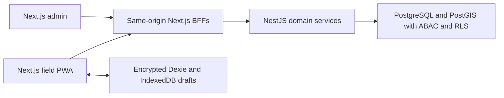

# Living project delivery and implementation handover

Last reviewed: **16 November 2026**. Feature baseline: explicit provisional enrollment slice (migration 22) on the project/geography scope foundation (migration 21), building on [PR #31](https://github.com/SandaruWithanage/agri-operations-platform/pull/31). See [current enrollment verification](../testing/PROJECT_ENROLLMENT_RESULTS.md) and [scope verification](../testing/PROJECT_SCOPE_RESULTS.md). Historical project-editing merged-main CI [passed](https://github.com/SandaruWithanage/agri-operations-platform/actions/runs/43825806378). Documentation-only revisions do not imply new application functionality.

This is the central working handover: what exists, how it works, evidence, remaining tasks and how to finish them. It follows direct project-owner decisions and reviewed implementation. Uploaded planning packages are references, not an approved final SRS or executable deployment instructions. Provisional pilot rules must not be presented as client-approved requirements.

**The platform is not production-ready.** M0 is complete; substantial security/M2 implementation and a bounded M3 project catalog exist. A provisional explicit enrollment API slice (PRJ-03A) exists without UI/BFF/offline. Enrollment UX, approved eligibility rules, responsibilities, resources/reports, administration/recovery and production acceptance remain. The [engineering estimate](DELIVERY_ESTIMATE.md) is roughly 55% complete, with a broad 50–60% range; it is judgment, not measured requirement coverage or a production-readiness percentage. Do not derive a percentage from test counts, files, PRs or the number of rows below.

## 1. How to maintain this document

For every completed or materially changed pending task, update this document **in the same PR**:

1. Keep its stable task ID. Update status, bounded scope and dependencies; split a task if only one part is complete.
2. Explain what was implemented and how, link the relevant code/guide/ADR and record actual verification with its revision or PR. Distinguish local checks, branch/PR CI, merged-main CI and external acceptance.
3. Record limitations and unresolved decisions. Do not mark a whole domain complete because one endpoint or screen works.
4. Update the remaining task's implementation steps and acceptance criteria, then append a dated completion-log entry. Move the completed bounded item into the delivered register without reusing its ID.
5. Synchronize [delivery status](PHASE_1_STATUS.md), [roadmap](ROADMAP.md), [open decisions](../requirements/OPEN_DECISIONS.md), setup and relevant domain guides when their claims change. Keep historical test reports/ADRs identifiable as snapshots instead of rewriting old results as new evidence.

Status meanings: **Done** = the bounded engineering capability listed is implemented and verified; **Partial** = some prerequisites exist but the listed outcome is incomplete; **Pending** = not implemented; **Conditional** = introduce only after an identified need/decision; **Excluded** = outside current Phase 1. External client/device/operational acceptance is tracked separately. A green CI run never supplies that acceptance automatically.

Use [AGENTS.md](../../AGENTS.md) and [the continuation entry](../CODEX_START_HERE.md) before implementation. The [PR template](../../.github/PULL_REQUEST_TEMPLATE.md) prompts contributors to record task IDs and evidence.

## 2. Current architecture and data flow



- Admin and field apps deploy independently and share presentation, validation, localization and transport packages. Domain services own their contracts/transactions; no organizations, zones, projects or business roles are seeded in code.
- Browser sessions use opaque Secure/HttpOnly/SameSite cookies. BFFs retain short-lived signed API JWTs server-side. NestJS verifies tokens/current sessions/CSRF; PostgreSQL verifies signed transaction actor context and current scopes. JWT role claims and UI capabilities do not grant authority.
- Argon2id, PostgreSQL sessions, revocation, MFA and approved browser-key possession are integrated. The pilot currently conservatively requires MFA and approved devices on its accounts. Actual device/OS security and recovery acceptance remain separate.
- Ten separate restricted LOGIN connections inherit one technical runtime group each: credential reader, MFA verifier, login throttle, session issuer, session executor, session reader, farmer runtime, device verifier, land runtime and project runtime. NOLOGIN function owners/migration identities never become API logins. These are technical database roles, not hardcoded organizational roles.
- PostgreSQL/PostGIS owns records, integrity, permissions, audit and reconciliation. TanStack Query owns isolated online server state; it is not a durable offline queue. Zustand persists locale only. Dexie owns minimal encrypted field drafts/pending mutations. Admin edit/create drafts are tab-memory only. Redis is optional and absent; no general worker/event outbox is implemented.
- GPS is reported identification, not legal boundaries, ownership, verified acreage or proof of containment in the chosen geography.

See [current architecture](../architecture/README.md), [accepted state ADR](../architecture/decisions/ADR-data-state-cache.md), [project context](../PROJECT_CONTEXT.md) and [provisional security/business decisions](../decisions/).

## 3. Delivered engineering register — what and how

These bounded items are **Done**. The remaining register prevents these labels from implying complete IAM, offline GIS, operational domains or production readiness.

| Task ID  | Delivered capability                                            | How it was implemented                                                                                                                                                                                                                                                                                                                                                                                                                                                                                                                       | Evidence / detailed handover                                                                                                                                                                                                                                                  |
| -------- | --------------------------------------------------------------- | -------------------------------------------------------------------------------------------------------------------------------------------------------------------------------------------------------------------------------------------------------------------------------------------------------------------------------------------------------------------------------------------------------------------------------------------------------------------------------------------------------------------------------------------- | ----------------------------------------------------------------------------------------------------------------------------------------------------------------------------------------------------------------------------------------------------------------------------- |
| FND-01   | Monorepo and independent app foundations                        | pnpm workspaces/Turborepo; Next.js admin/PWA, NestJS API; shared UI/tokens/types/validation/i18n/sync packages; TypeScript, lint, formatting, tests, builds, Compose and GitHub Actions                                                                                                                                                                                                                                                                                                                                                      | [README](../../README.md), [M0 results](../testing/M0_RESULTS.md), [PR #1](https://github.com/SandaruWithanage/agri-operations-platform/pull/1)                                                                                                                               |
| SEC-01   | Hybrid pilot authentication runtime                             | Argon2id, encrypted MFA factors, PostgreSQL sessions/revocation/throttling, short-lived validated JWTs, cookie BFF boundary, CSRF and signed database actor context; disabled unless configured                                                                                                                                                                                                                                                                                                                                              | [Runtime setup](PILOT_AUTH_RUNTIME.md), [authentication ADR](../decisions/ADR-0004-pilot-authentication.md), [API auth components](../../apps/api/src/authentication)                                                                                                         |
| SEC-02   | Scoped farmer authorization foundation                          | Current permission/assignment/time/source checks in NestJS and native SQL, dynamic configured organization/geography coverage, compound scope checks, FORCE RLS and restrictive connection identities                                                                                                                                                                                                                                                                                                                                        | [ABAC gate](../security/ABAC_GATE.md), [authorization ADR](../decisions/ADR-0005-provisional-farmer-authorization.md), [native migrations](../../database/migrations)                                                                                                         |
| DEV-01   | Approved browser-key enrollment/proof and operator revocation   | Non-exportable browser keys, public enrollment requests, independent fingerprint checking, single-use signed challenge/session proof and controlled CLI provisioning                                                                                                                                                                                                                                                                                                                                                                         | [Device guide](DEVICE_ENROLLMENT.md), [proof evidence](../testing/DEVICE_PROOF_RESULTS.md), [PR #8](https://github.com/SandaruWithanage/agri-operations-platform/pull/8)                                                                                                      |
| FAR-01   | Minimal field/admin farmer registration                         | Name in either language, authorized configured location and privacy-notice delivery confirmation; generated IDs and trusted creator/source/time; exact replay and duplicate risk without merging; no phone/NIC/land/project prerequisite                                                                                                                                                                                                                                                                                                     | [Pilot rules](../decisions/ADR-0003-provisional-farmer-registration.md), [admin workflow](ADMIN_FARMER_REGISTRATION.md), [PR #28](https://github.com/SandaruWithanage/agri-operations-platform/pull/28)                                                                       |
| OFF-01   | Durable minimal field drafting and synchronization              | Encrypted Dexie incomplete drafts/outbox, account/device partitions, local unlock/lock, prepared public shell, stable entity/mutation IDs, current server authorization and visible saved/pending/syncing/synced/conflict/rejected states                                                                                                                                                                                                                                                                                                    | [Offline guide](OFFLINE_WORKSPACE.md), [session/sync guide](FIELD_SESSION_SYNC.md), [browser results](../testing/OFFLINE_WORKSPACE_RESULTS.md)                                                                                                                                |
| REC-01   | Authenticated archive recovery, bounded normal case             | Versioned encrypted archives restore saved/incomplete versions and stable IDs into an empty same-account approved-device vault; normal prepared-browser restart is tested                                                                                                                                                                                                                                                                                                                                                                    | [Archive decision](../decisions/ADR-0008-authenticated-archive-recovery.md), [recovery results](../testing/ARCHIVE_RECOVERY_RESULTS.md); lost-passphrase/legacy-only recovery is REC-03 below                                                                                 |
| FAR-02   | Farmer registry/detail, review queue and audit view             | Scoped bounded keyset reads, explicit read/audit permissions, status/reviewability filters, microsecond audit cursors and no hidden totals; identity-bound cancellable queries                                                                                                                                                                                                                                                                                                                                                               | [Registry](FARMER_REGISTRY.md), [queue](FARMER_REVIEW_QUEUE.md), [audit](FARMER_AUDIT_HISTORY.md), [PR #13](https://github.com/SandaruWithanage/agri-operations-platform/pull/13) and [#21](https://github.com/SandaruWithanage/agri-operations-platform/pull/21)             |
| FAR-03   | Verification and bounded correction                             | Separate permissions, row versions, atomic audit, original/destination coverage, immutable retries, explicit review and locked tab drafts; actor-bound verification/correction receipts recover server outcomes                                                                                                                                                                                                                                                                                                                              | [Verification](FARMER_VERIFICATION.md), [correction](FARMER_CORRECTION_EDITOR.md), [receipts](FARMER_CORRECTION_RECEIPTS.md), [PR #27](https://github.com/SandaruWithanage/agri-operations-platform/pull/27)                                                                  |
| LAND-01  | Reported PostGIS identification and online GPS capture          | Separate land create/read, optional WGS84 point/accuracy/reported area, geometry checks/GiST index, bounded directory, explicit cancellable browser GPS, private journal/audit and exact retry                                                                                                                                                                                                                                                                                                                                               | [Land API](LAND_IDENTIFICATION.md), [online capture](ONLINE_LAND_CAPTURE.md), [PR #29](https://github.com/SandaruWithanage/agri-operations-platform/pull/29); relationships/offline land remain below                                                                         |
| PRJ-01   | Configurable organization-wide catalog                          | Entered project names and configurable organizations; disabled-by-default catalog flag; separate source-aware create/read grants, FORCE RLS, tenth runtime identity, private replay journal/audit and bilingual create/list/detail                                                                                                                                                                                                                                                                                                           | [Catalog](PROJECT_CATALOG.md), [results](../testing/PROJECT_CATALOG_RESULTS.md), [PR #30](https://github.com/SandaruWithanage/agri-operations-platform/pull/30)                                                                                                               |
| PRJ-02   | Versioned name/catalog-flag editing                             | Separate read/update grants, immutable organization/creator/time, original-version checks, row/mutation locks, private before/after journal and version-linked audit; retained bilingual tab intent and fresh detail reload                                                                                                                                                                                                                                                                                                                  | [Editing](PROJECT_EDITING.md), [results](../testing/PROJECT_EDITING_RESULTS.md), [PR #31](https://github.com/SandaruWithanage/agri-operations-platform/pull/31)                                                                                                               |
| STA-01   | Online state isolation and shared locale                        | Isolated TanStack Query clients/keys, no persistent sensitive cache, abort/clear/late-response protections, explicit network retries; component-local drafts; shared Zustand English/Sinhala preference only                                                                                                                                                                                                                                                                                                                                 | [Online boundaries](PROTECTED_ONLINE_QUERIES.md), [locale](SHARED_LOCALE.md), [PR #16](https://github.com/SandaruWithanage/agri-operations-platform/pull/16), [#19](https://github.com/SandaruWithanage/agri-operations-platform/pull/19)                                     |
| OPS-01   | Migration and readiness tooling                                 | Append-only checksum/history manifest, one transaction per file, concurrent-run lock, refusal of untracked adoption, separated liveness/readiness, bounded primary probes for all ten runtime pools and shutdown hooks                                                                                                                                                                                                                                                                                                                       | [Database guide](../../database/README.md), [readiness](API_READINESS.md), [PR #24](https://github.com/SandaruWithanage/agri-operations-platform/pull/24), tracked rehearsals through entry 21                                                                                |
| MAINT-01 | Stable dependency and CI policy                                 | Exact stable pins, lockfile, strict peers, production/full-tree audit gates, grouped maintenance and documented compiler/tool compatibility; no prerelease promotion as stable                                                                                                                                                                                                                                                                                                                                                               | [Dependency policy](DEPENDENCY_POLICY.md), [toolchain results](../testing/LATEST_STABLE_TOOLCHAIN_RESULTS.md), [PR #25](https://github.com/SandaruWithanage/agri-operations-platform/pull/25) and [#26](https://github.com/SandaruWithanage/agri-operations-platform/pull/26) |
| PRJ-04A  | Project/geography scope prerequisite                            | Typed project grants plus assignments, compound organization FKs, geography/unit AND matching, locked current actor/time checks and internal NestJS transaction policy; no enrollment endpoint or administration                                                                                                                                                                                                                                                                                                                             | [Scope guide](PROJECT_SCOPES.md), [ADR 0018](../decisions/ADR-0018-project-geography-scope-foundation.md), [verification](../testing/PROJECT_SCOPE_RESULTS.md)                                                                                                                |
| PRJ-04B  | Officer A/B enrollment isolation matrix                         | Native two-officer scenarios (own project grant, project/geography assignment and geography-assigned `farmer.read` per officer): all six cross enroll combinations denied without writes, own-rows-only lists and filters, indistinguishable 404 detail, cross-officer withdraw denied and unchanged, another officer's mutation ID unusable, farmer geography move removes access immediately, one officer's session revocation leaves the other unaffected, audit actors correct; mutation-checked (leaking B's scope makes the test fail) | [Results](../testing/PROJECT_ENROLLMENT_RESULTS.md); BFF and admin-shell coverage added (see PRJ-04C); no sync-reauthorization or Chromium coverage yet                                                                                                                       |
| PRJ-04C  | BFF and admin-shell Officer A/B coverage                        | BFF never forwards browser-supplied authorization, source, key, session or actor headers on enrollment routes; two officers' sequential and concurrent requests keep separate server-issued tokens (mutation-checked: a cached token makes the test fail); the admin shell refuses and renders nothing from a list or detail that belongs to another account                                                                                                                                                                                 | [Results](../testing/PROJECT_ENROLLMENT_RESULTS.md); unit/component level, no Chromium shared-profile journey, no sync-reauthorization yet                                                                                                                                    |
| PRJ-03D  | Bilingual enrollment admin screens                              | English/Sinhala "Manage enrollment policy" on project detail, an Enrollments tab (keyset list, detail, withdraw) and an "Enroll in a project" action on farmer detail, all on the existing online-draft boundary (`OnlineCreation`): fresh authorized reads, explicit review, one fixed retry request, no browser persistence of records. The enroll form is opened from a farmer (fixed) and picks from the caller's own bounded project catalog (max 4 pages, refused if larger); list/detail show record references only; component tests | [Enrollment guide](PROJECT_ENROLLMENT.md); **pending:** project-side enroll entry with farmer search, name resolution in the enrollment list, Chromium journey, offline outbox                                                                                                |
| PRJ-03C  | Enrollment/policy BFF routes and typed client transport         | Strict allowlisted `enrollments/enroll`, `enrollments/withdraw`, `enrollment-policies/set` (CSRF, origin, bounded bodies) and reads (`enrollments`, `enrollments/detail`, `enrollment-policies`) that re-validate every response against the request identifiers, filters, limits and versions, plus account/device-bound `PilotClient` methods; extra fields are stripped                                                                                                                                                                   | [Enrollment guide](PROJECT_ENROLLMENT.md); no admin/field screens, no offline outbox                                                                                                                                                                                          |
| PRJ-03B  | Audited enrollment-policy administration (database + API)       | Dedicated organization `enrollment.policy` administrator grant (never implied by `project.update`/enrollment grants), fixed idempotent `set_enrollment_policy` with version/replay/post-wait reauthorization, private change history + audit, transition guard, admin-only RLS read, NestJS `enrollment-policies` endpoints and startup gate                                                                                                                                                                                                 | [Policy guide](PROJECT_ENROLLMENT.md), [ADR 0020](../decisions/ADR-0020-enrollment-policy-administration.md), [results](../testing/PROJECT_ENROLLMENT_RESULTS.md); no BFF/UI, no seeded grant, rules remain DEC-04-provisional                                                |
| PRJ-03A  | Provisional explicit farmer/project enrollment (database + API) | Versioned `operations.enrollment` (FORCE RLS), separate `enrollment.read/create/withdraw` project scopes ANDed with current `farmer.read`, fixed idempotent enroll/withdraw functions with farmer/enrollment locks and post-wait reauthorization, private journal/audit, transition trigger, NestJS service/endpoints and startup privilege gate; defaults labelled provisional                                                                                                                                                              | [Enrollment guide](PROJECT_ENROLLMENT.md), [ADR 0019](../decisions/ADR-0019-provisional-project-enrollment.md), [results](../testing/PROJECT_ENROLLMENT_RESULTS.md); no BFF/UI/offline, no client-approved rules                                                              |
| MAINT-02 | Living delivery/continuation documentation                      | Central stable task register with implementation methods, evidence, remaining steps/acceptance, a completion log and same-PR maintenance instructions in AGENTS/continuation entry/PR template                                                                                                                                                                                                                                                                                                                                               | This document, [AGENTS](../../AGENTS.md), [PR template](../../.github/PULL_REQUEST_TEMPLATE.md) and [file history](https://github.com/SandaruWithanage/agri-operations-platform/commits/main/docs/development/PROJECT_HANDOVER.md); formatting/link checks                    |

## 4. Latest verification and its limits

Current enrollment-slice local gate: **424 tests across 55 files** (PostgreSQL 16/PostGIS locally, lint/format/structure/typecheck and API build passed; Next.js builds/Chromium not rerun, CI not claimed). [Enrollment evidence](../testing/PROJECT_ENROLLMENT_RESULTS.md) records the scenarios and limits.

Previous scope-foundation local gate: **413 tests across 54 files**, production builds and both Chromium scenarios passed. The focused policy/native group passed 54 tests across 3 files. A tracked 20→21 migration rehearsal preserved prior history/timestamps and repeated unchanged; its disposable fixture was cleaned. [Scope evidence](../testing/PROJECT_SCOPE_RESULTS.md) distinguishes this foundation from future enrollment/administration and external acceptance. GitHub CI outcomes belong to the revision workflow history.

Historical project-editing baseline PR #31: **401 tests across 53 files**, production builds and both Chromium scenarios passed locally and in CI. Its merged-main run is linked at the top. The focused edit/contracts/catalog group passed 27 tests; native/migration checks passed 42 tests, including expiry behind row and replay locks. [Detailed evidence](../testing/PROJECT_EDITING_RESULTS.md) records the actual scope.

A separate pristine disposable database rehearsal applied all 20 tracked migrations, repeated with unchanged history/timestamps, checked project FORCE RLS/no direct runtime UPDATE and restored the fixture. An upgrade fixture preserved pre-edit project creation/audit fields. Neither is production backup/restore, manual-schema adoption or real-device certification.

Production dependency audit reported no known findings at this baseline. The full development tree retains one documented unpatched low-severity `deepmerge` advisory; it is not suppressed. TypeScript 7 project checks coexist with a TS 6 tooling API dependency because current tools require it. Prisma's Node 26 support-list warning remains documented. PostgreSQL/PostGIS are pinned at the tested 17/3.5 baseline; a major upgrade requires OPS-03, not a volume-destructive image replacement. Audits/version availability must be checked again when dependencies change.

Passing tests establishes the tested behaviors, not client requirements acceptance, complete role administration, legal/privacy approval, physical-device encryption, operating capacity or production readiness.

## 5. Remaining task register and implementation plan

Order work by dependencies and the next safe vertical workflow. Each item below states how to finish it and what evidence is required. Engineering can prepare configurable contracts while client decisions are pending, but must label defaults provisional rather than invent approved requirements.

### IAM-01 — Configurable role/permission/assignment administration — Partial

Existing direct account grants, organization/geography records and scoped checks are foundations, not complete configurable-role administration. Add typed person/account separation, configurable role/permission catalogs and scoped role bindings; preserve dynamic hierarchy and explicit validity windows. Build restricted native mutation/read contracts and audited NestJS/BFF administration before screens. Never expose an owner/provisioner connection through the API or infer access from a coordinator position.

**Dependencies:** SEC-01/02 and the client permission matrix. **Done when:** authorized admins can manage permitted scopes without self-escalation, cross-organization leakage or Zone OR Project broadening; direct restricted SQL, source/expiry/revocation, version/idempotency and audit rollback tests pass. Role names/counts stay database-configurable.

**Design (17 Nov 2026):** [ADR 0022](../decisions/ADR-0022-dynamic-role-and-assignment-administration.md) proposes roles as versioned data that materialize into the existing grant tables, delegation ceilings, no self-grant and dual approval for high-risk changes. It is a design proposal only: nothing is implemented, no role or grant is seeded, and implementation needs independent security review (G1) and the DEC-02 decisions.

### IAM-02 — Account and MFA enrollment/recovery administration — Pending

Use the existing authentication interfaces to implement controlled account/MFA enrollment, privileged-account requirements, factor recovery and session revocation with audit. Define identity-proof/recovery procedures before granting reset authority; retain stable account identity referenced by records. Add bilingual administration and failure/recovery states. Do not introduce an external IdP by default or store browser JWT/session/refresh secrets.

**Dependencies:** IAM-01 and recovery/operating policy. **Done when:** unauthorized resets are denied, factor/session revocation takes effect, replay/rate-limit/concurrent recovery cases pass, and operators can rehearse the approved recovery procedure without losing unsynchronized work.

### IAM-03 — Approved-device administration and deauthorization — Partial

The CLI/proof path exists. Add scoped device approval/revocation/history screens with independent key-fingerprint verification and audited authority. Connect deauthorization to local locking and an approved recovery/erasure process. Preserve unsynchronized data through explicit recovery or data-loss safeguards; successful synchronization/removal must be distinguishable from unsent work.

**Dependencies:** IAM-01/02, REC-03 and pilot-device policy. **Done when:** wrong-account/device approval fails, revoked devices cannot sync/sign in, synchronized cleanup works, and pending drafts have a tested recovery/retention path rather than silent deletion.

### FAR-04 — Optional fields and configurable forms — Pending

Add approved optional identity/contact/address/DOB/language/CBO/document fields with strict core validation, field-level access and retention rules. Keep NIC, phone, land and project enrollment optional for farmer creation. Add versioned optional form definitions where useful; do not replace typed core identity/FKs with arbitrary JSON or SQL policy text. Extend duplicate risk using permitted identifiers without automatic merging or leaking hidden records.

**Dependencies:** privacy/field definitions and IAM-01. **Done when:** minimal registration still works, unauthorized sensitive fields are absent from API/database projections, schema/form migrations preserve old records, and duplicate checks disclose only allowed information.

### FAR-05 — Full farmer lifecycle and reassignment — Partial

Draft/pending-review/verified/inactive storage and bounded correction/verification exist. Implement agreed lifecycle/reassignment commands with explicit permissions, original/destination coverage, original versions and atomic audit. Keep responsibility separate from creation; a registering officer does not permanently own the farmer. Add review UX for duplicate risks and approved verification criteria.

**Dependencies:** IAM-01, OPS-02 and client review rules. **Done when:** concurrent/stale/revoked changes fail safely, reassignment cannot broaden access, histories preserve attribution, and transitions/review procedures pass client UAT without making optional fields mandatory.

### REC-02 — Durable online drafts and outcome discovery — Partial

Admin creation/correction/edit values survive locking only in the current tab. Add a separately reviewed minimal encrypted/server-side recovery design consistent with the accepted state ADR; do not introduce a query persister as a second durable queue. Preserve original entity/mutation IDs and versions. Farmer receipts exist; project own-edit/registration outcome discovery still needs current/historical scope checks and metadata-only responses. Missing receipts never prove failure.

**Dependencies:** privacy/retention policy and current domain contracts. **Done when:** tab/browser termination, interrupted writes, wrong account/device, permission changes and uncertain server commits recover without duplicate intent, unauthorized disclosure, silent overwrite or discarded unsent data.

### REC-03 — Legacy-only/lost-passphrase archive recovery — Partial

Normal encrypted restart and authenticated empty-vault archive recovery are delivered as REC-01. Decide recovery-key/wrapping/escrow and lost-passphrase policy explicitly, then implement versioned recovery/migration without weakening encryption or replacing an account's stable IDs. Preserve original archives and incomplete versions through failed restore.

**Dependencies:** IAM-02/03 and approved key custody. **Done when:** legacy-only, corrupted/partial archive, lost unlock, account/device mismatch, interrupted upgrade and failed-write recovery cases are rehearsed with documented operator/data-loss safeguards.

### OFF-02 — Conflict/rejection review and recovery UX — Partial

Visible states and safe replay exist. Complete per-record review for conflicts/rejections, fresh authorization/reference checks and explicit new-intent creation only after outcome review. Preserve the original queued payload/IDs until reconciliation/recovery is explicit; never silently change a retry into another mutation or overwrite newer records. Keep online status in TanStack and durable work in Dexie.

**Dependencies:** domain conflict rules and REC-02/03. **Done when:** interruption/restart, scope revocation, changed required fields, duplicate risks, manual Sync Now and repeated reconnects leave every pending item recoverable and correctly classified.

### LAND-02 — Configurable farmer/land relationships — Pending

Agree ownership/tenant/cultivator/manager semantics, cardinalities and evidence requirements, then model typed configurable relationships with organization-consistent FKs and explicit permissions on both ends. Farmer/land creation remains independent and does not infer legal ownership. Implement versioned/audited APIs and bilingual workflows before offline expansion.

**Dependencies:** land relationship decisions, IAM-01 and FAR-05. **Done when:** shared/multiple parcels work according to approved rules, wrong-organization/unauthorized links fail, and concurrent updates/reassignment retain integrity without survey/title claims.

### LAND-03 — Authorized maps and spatial search — Pending

Choose an approved map/boundary-data/hosting approach. Add bounded viewport/search contracts over PostGIS, current scoped point/field visibility and query cancellation. Apply the same authorization to map features and aggregates; do not download all farmers/points or expose hidden totals. Treat point accuracy and reported area as reported metadata, not surveyed acreage.

**Dependencies:** map/data-egress decisions and current land scopes; relationships where needed. **Done when:** bounded queries/index use, pan/zoom cancellation, wrong-scope points/counts and provider/privacy behavior are tested, including authorized/no-coordinate records.

### OFF-04 — Offline enrollment queue — Pending (design reviewed; provisional owner policy recorded; implementation not authorized)

[ADR 0021](../decisions/ADR-0021-offline-enrollment-design.md) is the architecture-reviewed direction: queue enrollment intents (IDs only) in the existing encrypted account/device vault; no second database, Redux, Redis or sync engine; eligibility and policy stay server-authoritative. On 16 Nov 2026 the owner recorded a **provisional** Phase 1 pilot policy (DEC-12: explicit scoped grants, offline queueing on approved devices, administrator-only withdrawal, no per-enrollment approval, server-confirmed farmers only, generic officer refusals, queue limit 100 / warn 7 days / escalate 30 days / never auto-delete). It is **not** final client policy and is subject to client confirmation and independent security review. The ADR is **not Accepted**: steps A1–A4 (client confirmation, independent review, prerequisite designs, owner status change) are listed in ADR section 9. No code, flag or environment enables offline enrollment for real officers.

Implementation sequence after acceptance (each its own PR with independent evidence; see ADR section 10 for acceptance criteria): prerequisites **ENR-AUTH-01** (administrator-only withdrawal enforced in PostgreSQL), **ENR-AUDIT-01** (administrator-visible refusal reasons and attempt history surviving rolled-back transactions) and **IAM-01** or an audited provisioning procedure; then **OFF-04A** encrypted store/R1 release (flag off), **OFF-04B** sync classification, **OFF-04C** review/recovery UI and archive v3, **OFF-04D** BFF/browser A/B, Chromium journeys and evidence; then Gate E (independent implementation review, real-device acceptance under DEC-07, recorded owner enablement). Preconditions delivered: PRJ-04B/04C Officer A/B coverage. Still required: Chromium shared-profile coverage and sync reauthorization tests.

### ENR-AUTH-01 — Administrator-only enrollment withdrawal — Pending

Enforce in PostgreSQL that `enrollment.withdraw` grants and withdrawal calls require the administrator source (today a field-officer-source grant would be accepted). Depends on ADR 0021 prerequisite approval; no grant is seeded meanwhile.

### ENR-AUDIT-01 — Administrator-visible refusal reasons and attempt history — Pending

Durable, scoped server-side record of refused enrollment attempts (reason code, actor, mutation ID, time) that survives the rolled-back transaction, with a retention statement and an administrator-only endpoint under its own permission; officer responses stay generic. Needs a short design addendum before implementation.

### OFF-03 — Durable offline land/GPS workflow — Pending

Expand the minimal farmer-only dataset only after device/data-security and recovery review. Version encrypted Dexie records/outbox for necessary GPS/land/link fields; preserve legacy farmer drafts and IDs. Design farmer/land/relationship sync ordering and idempotent recovery after partial success. Reauthorize every server action; no expired/offline JWT bypass or second queue.

**Dependencies:** approved devices/storage policy, LAND-02 and REC-03/OFF-02. **Done when:** actual pilot-device process/OS restart, low storage/eviction, schema upgrades, partial sync, revoked assignments and conflict recovery work without downloading the whole database or silently losing drafts. Exclude unnecessary scans/documents.

### PRJ-03 — Explicit farmer/project enrollment — Partial

PRJ-03A delivered the database/API slice with **provisional** rules (default-deny per-project enrollment policy with eligible farmer statuses and stored policy version, active project, one current row per farmer/project, withdrawal as history, re-enrollment as a new row). Remaining: project-side enrollment entry, name resolution, Chromium journey and offline outbox (PRJ-03B delivered the audited API, PRJ-03C the BFF/client transport and PRJ-03D the policy and list/detail/withdraw screens), client-approved eligibility/cycles/effective dates/coexistence/transition rules, bilingual BFF/admin UI, field/offline behaviour and approval/closure workflows. Original scope: agree eligibility, cycles, effective dates, coexistence and transition rules. Implement typed farmer/project/cycle links and explicit enroll/withdraw commands with current permissions, versions, idempotency and atomic audit. Do not auto-enroll during farmer creation, assume one project per farmer or invent an approved verified-farmer prerequisite. A catalog-enabled flag alone is not authorization.

**Dependencies:** PRJ-04 (remaining), IAM-01 and approved enrollment rules (DEC-04). **Done when:** authorized users explicitly enroll valid targets; cross-organization, stale, duplicate-intent, disabled/ineligible cases follow agreed policy; multiple parcels/projects/cycles and partial failures are tested without silently changing existing enrollment.

### PRJ-04 — Project-specific and compound scope enforcement — Partial

PRJ-04A provides typed project grants/assignments, same-organization FKs, geography/unit intersections and current actor/expiry locking in PostgreSQL, plus an internal NestJS policy. PRJ-03A now applies it to enrollment records (RLS, native commands, farmer-visibility intersection, `enrollment.withdraw`). There is still no scope-management interface. Complete direct relationships for other records, a multi-account Officer A/B enrollment matrix, audited scope administration and synchronization reauthorization. Existing organization-wide catalog grants must not become enrollment, farmer or land access. Never interpret Zone + Project as Zone OR Project, or a narrower grant as organization-wide authority.

**Dependencies:** IAM-01 and the permission matrix. **Done when:** direct restricted SQL and API tests prove Officer A cannot access Officer B's project/scope, missing context fails closed, and expiry/revocation/combined constraints remain effective across sync and administrative edits.

### OPS-02 — Officer responsibilities, CBOs and contacts — Pending

Model people/positions/CBO membership separately from login accounts and explicit application grants. Add scoped, time-bounded responsibility/assignment administration and history with typed FKs, versions and audit. Keep geography and management hierarchy separate; no fixed zone/CBO/role list and no creator-derived permanent ownership.

**Dependencies:** IAM-01, FAR-05, PRJ-04 and organizational decisions. **Done when:** non-login coordinators remain contacts, authorized assignments/reassignments work, and expired/cross-scope/unapproved position changes confer no access.

### RES-01 — Initial resource records and distributions — Pending

Confirm Phase 1 resource/unit, allocation, stock/movement and adjustment rules. Build configurable catalogs and a transactional movement/distribution record tied to authorized project/farmer scopes. Use appropriate numeric precision, stable mutations, versions and audit; introduce balances/limits only with agreed semantics. Do not add financial/procurement/insurance engines.

**Dependencies:** PRJ-03/04, IAM-01 and resource rules. **Done when:** parallel issues/returns/adjustments reconcile correctly, retries cannot duplicate movements, disallowed scope/quantity/transition cases fail, and authorized users can review the resulting records.

### DOC-01 — Supporting documents/basic agreements — Pending

Confirm which optional evidence/project agreement records belong in Phase 1. Implement scoped metadata/object storage, bounded validated uploads, authorized short-lived download access, retention and audit. Avoid public buckets or predictable personal-information object names. Exclude unnecessary identity scans and medical documents from offline storage; keep advanced legal/financial agreement workflows out of scope.

**Dependencies:** privacy/retention, storage/provider and project/land evidence decisions. **Done when:** wrong scope, replaced content, expired download authority, unsafe/oversized uploads and retention/removal cases are tested; documents never become universal farmer-registration prerequisites.

### RPT-01 — Scoped dashboard, reports and exports — Pending

Agree initial operational questions, measures and fields, then implement bounded server-side reports/exports over authorized records. Recheck aggregate/map/field-level permissions and audit sensitive exports. Do not calculate global totals from privileged queries or client caches and then hide rows afterwards.

**Dependencies:** approved measures and the relevant FAR/LAND/PRJ/RES records. **Done when:** counts, pagination, exports and concurrent permission changes cannot reveal hidden records/locations; results reconcile with the authorized source data and capacity limits are measured.

### SEC-03 — Key/credential rotation and security recovery — Pending

Implement and rehearse managed rotation for JWT keys/kids, session/CSRF/device-challenge material, MFA encryption, actor-context/MAC keys and database credentials. Existing journals use retained MACs: changing a single current key without a retained-key/version plan can break safe replay. Define custody/backup/retention and test migrations across old/new keys without logging secrets or losing unsynchronized work.

**Dependencies:** IAM-02/03, REC-03 and operating ownership. **Done when:** approved old/new validity windows, revocation, restart, restore and failed rotation cases reconcile correctly, with a usable runbook and independent review.

### SEC-04 — Trusted proxy identity and throttle hardening — Pending

Complete hosting/proxy decisions, then derive client identity only through the approved trusted hop chain/internal metadata. Preserve PostgreSQL shared throttling until a measured replacement is approved. Do not trust arbitrary browser forwarding headers or replace current session/permission authority with Redis.

**Dependencies:** OPS-04. **Done when:** direct/spoofed forwarded requests cannot change identity/budget, legitimate proxy paths work, and measured rate limits/recovery preserve availability without account enumeration.

### DATA-01 — Privacy, field policy and audit retention — Pending

Approve the actual bilingual collection notice, optional-field purposes, access/redaction, retention and recovery/removal procedures. The existing checkbox records notice delivery; it is not an invented legal-consent approval. Implement field-specific protections and audited retention administration without erasing required attribution or unsynchronized work silently.

**Dependencies:** client/legal policy and relevant IAM/REC/document work. **Done when:** approved notices and retention/redaction behavior are reviewed, sensitive reads/exports are scoped, and removal/recovery procedures are testable and documented.

### OPS-03 — Database modernization, backup/restore and adoption — Pending

Select a verified stable PostgreSQL/PostGIS upgrade target under the dependency policy; rehearse extensions, data-preserving volume transition, roles, all migrations and RLS. Rehearse encrypted backups/restores with keys, retention and client-approved recovery objectives. Manually migrated databases need a reviewed adoption path; never fabricate history, remove a volume or rewrite applied SQL to bypass checks.

**Dependencies:** operating ownership, SEC-03 and actual target version/provider. **Done when:** fresh and restored/upgraded realistic fixtures retain records, journals, roles/scopes and replay behavior; operators can demonstrate recovery time/data-loss objectives. The clean migration rehearsal already performed is only one prerequisite.

### OPS-04 — Production deployment and release/rollback — Pending

Choose hosting, region, domains, secret manager, operating owners and support model. Build reviewed deployment/IaC with HTTPS BFFs, verified PostgreSQL TLS, internal API isolation, ten separated runtime logins, durable storage and controlled migration-before-app rollout. Verify liveness/readiness routing, release artifacts, forward fixes/rollback compatibility and production dependency boundaries.

**Dependencies:** client/provider choices, SEC-03/04, OPS-03. **Done when:** deployment and failure/rollback rehearsals pass in the actual target environment; migrations/keys/volumes survive restart, secrets stay server-side, and named operators own access and incident response. No hosting/domain/production credentials have been supplied or validated by current CI.

### OPS-05 — Monitoring, capacity and operating runbooks — Partial

Liveness/readiness/shutdown code exists. Deploy request/error/latency/database/sync monitoring and alerts with non-sensitive structured logs and documented escalation. Measure pool limits, permission-lock contention, login/sync load, backup restoration and rollout behavior; tune from evidence. Readiness is a bounded connectivity probe, not a full migration/business/security certification.

**Dependencies:** OPS-04 and target pilot workload. **Done when:** operators can detect/recover dependency, storage, synchronization and capacity failures without exposing secrets or hidden data through diagnostics; alert and recovery drills produce recorded evidence.

### ACC-01 — Independent security/access review — Pending

Review actual deployment, migrations/functions/grants, account/device lifecycle, CSRF/JWT/session enforcement, privacy boundaries and recovery procedures. Exercise direct restricted database access and malicious/cross-scope requests, not only frontend visibility. Resolve findings or record an explicitly accepted disposition with an accountable owner.

**Dependencies:** deployed configuration and IAM/REC/SEC work. **Done when:** the independent review and negative/concurrency tests cover the delivered workflows and target configuration, with no unsupported production-ready claim based only on CI/audits.

### ACC-02 — Sinhala, accessibility, outdoor and device acceptance — Pending

Have fluent domain users review English/Sinhala terminology, errors and the approved privacy notice. Test keyboard/screen-reader flows, contrast, touch targets, outdoor use and real GPS behavior. Validate approved pilot OS/browser/device encryption, authentication/inactivity lock, offline restart/eviction, key protection, synchronization and recovery/deauthorization.

**Dependencies:** approved target devices, language reviewers and stable workflows. **Done when:** recorded device/user acceptance covers normal and failure cases; synthetic Chromium permission fixtures are not substituted for actual device-security evidence.

### ACC-03 — Client decisions, source reconciliation and UAT — Pending

Close the [decision register](../requirements/OPEN_DECISIONS.md), including organization naming, coverage/approval matrix, land/enrollment/resource rules, actual device/hosting ownership and source-plan count discrepancy. Run end-to-end UAT against agreed acceptance cases. Use synthetic data until an authorized import process/retention policy exists; never commit real farmer information or secrets.

**Done when:** an accountable client/organization representative accepts the agreed Phase 1 workflows and operating/recovery procedures. Provisional implementation decisions remain labelled until then.

### FUT-01 — Redis/workers and scale infrastructure — Conditional

Introduce only for a measured reference-cache, aggregate, rate-limit or worker need. Design scope/version keys, TTL/invalidation and ordinary-cache PostgreSQL fallback; security-critical failures need their own fail-closed policy. Important worker events must first commit to a PostgreSQL business-event outbox before delivery. Current mutation journals/Dexie are not that relay. Require outage/retry/idempotent-delivery tests; do not install optional infrastructure merely to mark this item done.

### EXC-01 — Excluded from current Phase 1

Farmer self-service is Phase 2. Advanced financial settlement, harvest procurement/transport, insurance and legal land-survey/polygon/payment-grade acreage workflows are not authorized Phase 1 scope. They are not pending tasks to implement under a broad “finish everything” instruction without an explicit scope change.

## 6. Recommended next sequence

1. Preserve the completed catalog/editing/enrollment-API boundaries. Obtain DEC-04 answers, then add the BFF routes and bilingual admin enrollment screens on the delivered PRJ-03A API (retained tab intent, fresh reload, conflict/denial states). Extend IAM-01 where scopes require role/binding administration.
2. PRJ-04B delivered the database/API Officer A/B enrollment matrix. Before any offline enrollment, add BFF/browser-level A/B coverage and sync reauthorization, and write an offline-enrollment design (encrypted vault reuse, conflict outcomes when policy/eligibility changes while offline, recovery) for approval. Keep registration independent and avoid guessed eligibility rules.
3. Complete LAND-02 relationship rules and the IAM/REC/device safeguards required for OFF-03; expand offline land only after policy/device validation. In parallel, engineering can prepare bounded administration/recovery screens and contracts without pretending external acceptance is complete.
4. Add scoped responsibilities, initial resource records and reports using the same integrity/authorization patterns. Keep optional advanced infrastructure conditional.
5. Rehearse actual upgrades/restores and deployment, rotation, monitoring and failure recovery; complete independent review, native-speaker/device acceptance and client UAT before production claims.

Reorder when confirmed dependencies, failures or client priorities justify it; record the reason and affected task IDs. Do not wait for a whole milestone to update completed bounded work.

## 7. Developer/operator entry points

Start with [installation/commands](../../README.md), [runtime provisioning](PILOT_AUTH_RUNTIME.md), [migration operations](../../database/README.md), [device enrollment](DEVICE_ENROLLMENT.md) and the relevant domain guide in section 3. Authentication is disabled by default. Current enabled deployment needs migrations **through entry 22**, the ten isolated runtime URLs and independently provisioned server keys/accounts/MFA/devices/grants. Migrations 20–22 require no additional connection or secret; the scope and enrollment owners are NOLOGIN and never API identities. Never place server keys in `NEXT_PUBLIC_` settings.

Use the pinned Node/pnpm versions in the repository and frozen lockfile, then run:

```sh
pnpm install --frozen-lockfile
pnpm peers check
pnpm audit --prod --audit-level low
pnpm audit --audit-level high
pnpm check:structure
pnpm lint
pnpm format:check
pnpm typecheck
# Set DATABASE_TEST_URL to a dedicated disposable database named agri_test.
pnpm test
# Provide the documented DATABASE_URL for Prisma/build configuration.
pnpm build
pnpm exec playwright install --with-deps chromium
pnpm test:browser
```

Without `DATABASE_TEST_URL`, database suites are skipped; that is not evidence that the full database gate passed. Build/schema validation does not establish a production database connection or deployment. The native migration runner uses separately supplied `MIGRATION_DATABASE_URL` and exact `MIGRATION_DATABASE_NAME`; it does not automatically load `.env` or provision production credentials. Follow its guide rather than copying a privileged bootstrap connection into the API.

Current local ports: admin 3000, field 3001, API 4000. `/health` is liveness; `/ready` is dependency readiness and is 503 when the pilot runtime is disabled. Local Compose is not production infrastructure. `db:down` retains local volumes. The workspace's special flattened-image test workaround is evidence from a constrained test environment, not a production deployment recipe.

## 8. Completion log

Preserve these historical entries. Add a row for each newly completed task with how/evidence, then update the task register and remaining plan above.

| Revision / PR                             | Completed work and method                                                                                                                                                                                                                                                                                                                                                                                                                                                                                                                       | Verification reference                                                                                                                                                                 |
| ----------------------------------------- | ----------------------------------------------------------------------------------------------------------------------------------------------------------------------------------------------------------------------------------------------------------------------------------------------------------------------------------------------------------------------------------------------------------------------------------------------------------------------------------------------------------------------------------------------- | -------------------------------------------------------------------------------------------------------------------------------------------------------------------------------------- |
| PR #1 and early security PRs #3–8         | M0 foundation, provisional farmer/session/login/RLS integration, BFF runtime and approved browser-key proof, delivered incrementally on feature branches                                                                                                                                                                                                                                                                                                                                                                                        | [M0](../testing/M0_RESULTS.md), [pilot runtime](PILOT_AUTH_RUNTIME.md), [device evidence](../testing/DEVICE_PROOF_RESULTS.md)                                                          |
| PRs #11–13, #16–23                        | Scoped farmer registry/audit, isolated online reads, field sync progress, shared locale, verification/review queue and bounded correction choices/receipts                                                                                                                                                                                                                                                                                                                                                                                      | Domain guides/results linked in section 3; merge history is the source for individual PR scope                                                                                         |
| PRs #24–26                                | Dependency readiness, stable toolchain/security gates and compiler-tool compatibility maintenance                                                                                                                                                                                                                                                                                                                                                                                                                                               | [Readiness evidence](../testing/API_READINESS_RESULTS.md), [toolchain evidence](../testing/LATEST_STABLE_TOOLCHAIN_RESULTS.md)                                                         |
| PR #27                                    | FAR-03 bounded online correction editor: source/version-bound intent, tab locking and explicit idempotent retry                                                                                                                                                                                                                                                                                                                                                                                                                                 | [Correction results](../testing/FARMER_CORRECTION_EDITOR_RESULTS.md)                                                                                                                   |
| PR #28                                    | FAR-01 admin registration: shared core form, current create coverage, exact retry and no implied read/ownership/enrollment                                                                                                                                                                                                                                                                                                                                                                                                                      | [Admin registration results](../testing/ADMIN_REGISTRATION_RESULTS.md)                                                                                                                 |
| PR #29                                    | LAND-01 online reported GPS capture: optional explicit location, independent land permissions and exact retry                                                                                                                                                                                                                                                                                                                                                                                                                                   | [Capture results](../testing/ONLINE_LAND_CAPTURE_RESULTS.md)                                                                                                                           |
| PR #30                                    | PRJ-01 configurable organization-wide catalog with private native journal/audit and ten-role runtime                                                                                                                                                                                                                                                                                                                                                                                                                                            | [Catalog results](../testing/PROJECT_CATALOG_RESULTS.md)                                                                                                                               |
| PR #31 — 16 Nov 2026                      | PRJ-02 versioned metadata editing with read/update RLS, immutable identity, after-wait reauthorization and atomic before/after audit                                                                                                                                                                                                                                                                                                                                                                                                            | [Editing results](../testing/PROJECT_EDITING_RESULTS.md), 401 tests/53 files, builds/Chromium and merged-main CI passed                                                                |
| Documentation revision — 16 Nov 2026      | MAINT-02 centralizes completed/how/remaining/how-to records and adds mandatory same-PR maintenance guidance. Current readiness/capture summaries and the decision register are reconciled without rewriting historical test evidence.                                                                                                                                                                                                                                                                                                           | Markdown formatting, local-link/unique-task-ID checks; no application/runtime change                                                                                                   |
| Documentation clarification — 16 Nov 2026 | MAINT-02 corrects the supporting-document guidance to explicitly exclude unnecessary identity scans and medical documents from offline storage, matching the provisional pilot rules.                                                                                                                                                                                                                                                                                                                                                           | Formatting/diff checks; no application/runtime or task-status change                                                                                                                   |
| Project scope foundation — 16 Nov 2026    | PRJ-04A adds separate typed project permission/assignment prerequisites, geography/unit AND constraints, current signed actor/time checks after waits and a transaction-bound NestJS wrapper. PRJ-04 remains partial; enrollment and authorization administration are not delivered.                                                                                                                                                                                                                                                            | [Scope verification](../testing/PROJECT_SCOPE_RESULTS.md); no production/device/client acceptance implied                                                                              |
| Phase 1 baseline audit — 16 Nov 2026      | P1-PR01 records the lean-P1 gap matrix, UAT-01…16 mapping and quality-gate results in the [execution board](PHASE_1_EXECUTION_BOARD.md), adds the proposed [lean scope](../requirements/PHASE_1_LEAN_SCOPE_PROPOSED.md) and corrects the stale `ABAC_GATE.md` status. Docs only; no stable task changes status; no approval recorded.                                                                                                                                                                                                           | Local gates run on Node 22 / PostgreSQL 16; turbo-driven `typecheck`/`build` fail locally (environmental) and CI is authoritative; Chromium suite and field build not run in the audit |
| Staff Phase 1 scope reset — 17 Nov 2026   | P1-00 adds the owner's [staff Phase 1 guide](PHASE_1_COMPLETE_ADMIN_FIELD_AGENT_GUIDE.md), a [proposed staff scope](../requirements/PHASE_1_STAFF_SCOPE_PROPOSED.md), a [living staff execution board](PHASE_1_STAFF_EXECUTION_BOARD.md) and a [source/decision conflict register](../requirements/PHASE_1_SOURCE_CONFLICTS.md); the lean plan, board and scope files are marked superseded as a scope proposal and kept as historical evidence. Docs only; no stable task changes status; no approval recorded; ADR 0021 remains NOT Accepted. | Planning documents; the SRS v0.9, architecture v0.9 and 71-decision register files are not in the repository (SC-07)                                                                   |
| IAM design — 17 Nov 2026                  | P1-03 design: ADR 0022 proposes versioned roles that materialize into the existing grant tables, delegation ceilings, no self-grant and dual approval for high-risk changes. Design only; nothing implemented; needs G1 review and DEC-02.                                                                                                                                                                                                                                                                                                      | Docs only; not reviewed or approved                                                                                                                                                    |
| Enrollment screens — 16 Nov 2026          | PRJ-03D adds the bilingual policy editor, Enrollments tab with list/detail/withdraw and an enroll form opened from farmer detail (13 component tests, incl. a fix so a first policy saves without editing a field); admin-web production build passed locally; Chromium journeys not run; CI pending for the latest commit.                                                                                                                                                                                                                     | [Enrollment results](../testing/PROJECT_ENROLLMENT_RESULTS.md)                                                                                                                         |
| Enrollment BFF — 16 Nov 2026              | PRJ-03C adds strict BFF routes and `PilotClient` methods for enrollment and policy administration with response-binding checks and 12 new tests. PRJ-03 stays partial; no UI/offline; CI result pending for this commit.                                                                                                                                                                                                                                                                                                                        | [Enrollment results](../testing/PROJECT_ENROLLMENT_RESULTS.md)                                                                                                                         |
| Policy administration — 16 Nov 2026       | PRJ-03B adds migration 23: separate `enrollment.policy` organization grant, audited versioned `set_enrollment_policy`, admin-only policy reads, NestJS endpoints. PRJ-03 stays partial; DEC-04 unresolved; no BFF/UI.                                                                                                                                                                                                                                                                                                                           | [Enrollment results](../testing/PROJECT_ENROLLMENT_RESULTS.md); local only until CI passes                                                                                             |
| Enrollment slice — 16 Nov 2026            | PRJ-03A adds provisional explicit enrollment: migration 22, `enrollment.withdraw` scope, FORCE-RLS reads combining project scope and `farmer.read`, idempotent audited enroll/withdraw functions, NestJS endpoints and startup gate. PRJ-03/PRJ-04 remain partial; DEC-04 unresolved; no BFF/UI/offline.                                                                                                                                                                                                                                        | [Enrollment results](../testing/PROJECT_ENROLLMENT_RESULTS.md); local only, CI/device/client acceptance not claimed                                                                    |
