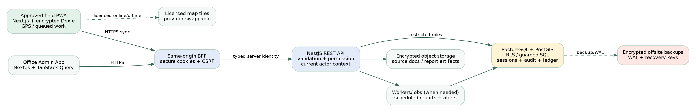
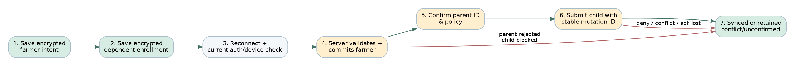
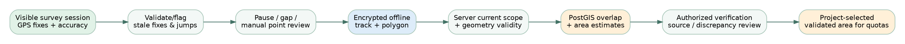

# TECHNICAL ARCHITECTURE AND DESIGN SPECIFICATION

## Agricultural Operations Management Platform — Comprehensive Proposed First Release

**Document ID:** AOP-ARCH-001  
**Version:** 0.9 — security/engineering review draft  
**Prepared:** 16 November 2026  
**Status:** **PROPOSED / NOT ACCEPTED / NOT PRODUCTION READY**  
**Companion:** `AOP_SRS_v0.9_REVIEW.md`; provisional owner Q1–Q71 register; GitHub reconciliation  
**Codebase:** [`SandaruWithanage/agri-operations-platform`](https://github.com/SandaruWithanage/agri-operations-platform)

> **Authority boundary:** The accepted data/state/cache ADR remains authoritative: PostgreSQL/PostGIS for business authority, TanStack Query for online state, Zustand only for approved non-sensitive UI state, encrypted Dexie for durable authorized field work, and optional Redis only when measured. The diagram and designs below are _proposed extensions_, not a statement that all modules are implemented. ADR-0021 (offline enrollment) remains **NOT Accepted**, and the proposed Q3 same-session dependency is an **explicit incompatible change** to its current rule requiring server-confirmed farmers.

## Executive architecture position

The solution is a single-operating-organization modular monolith: independent **Next.js administration and field PWA** applications, a **NestJS REST API** behind a typed same-origin BFF, and **PostgreSQL 17/PostGIS 3.5** as the source of truth. Critical authorization and transaction invariants are enforced under signed transaction-local actor context, non-owner restricted PostgreSQL roles, **FORCE RLS**, foreign keys, state-transition constraints and guarded functions. The field PWA is intermittently connected; client state is explicitly _provisional_ until server acceptance.

**First-release scope:** end-to-end farmer, configurable organizational/project/permission administration, land tenure and full GIS, foreground GPS walk-the-boundary surveying, offline geometry/enrollment/stock intents, accurate stock ledger and comprehensive reporting. The expanded GIS/reporting scope must be re-estimated; the earlier 55% completion percentage applies to an older and narrower baseline, not this scope.

**High-risk findings (summary):**

1. A foreground/visible PWA can use Geolocation `watchPosition()`, but it cannot promise continuous GPS recording after screen lock or background suspension. A real-device feasibility gate or a separate native app design is required before a contractual guarantee.
2. Mobile GPS perimeter area is an _estimate_, not legal title or a professionally surveyed polygon. Source, reported accuracy, validation, discrepancy and authorized verification must be explicit.
3. Browser vault recovery can preserve encryption if escrow/recovery material is configured in advance, but a forgotten passphrase plus unavailable recovery material can make unsynced data permanently inaccessible. There is no secure generic admin reset/decryption bypass.
4. Seven-day offline authoring and revoked-device controls are partially best-effort in an uncontrolled BYOD browser, especially against clock manipulation, compromised OS or a disconnected lost phone. Security acceptance must record that residual risk.
5. Offline stock/distribution and dependent enrollment must treat each local item as an **intent**, not an authoritative ledger entry/enrollment. Server idempotency, current RBAC+ABAC and reconciliation are mandatory.
6. Public OSM Foundation tile servers explicitly prohibit bulk prefetch/offline tile packages. A properly licensed provider or self-hosted tile archive is a hard prerequisite for offline basemap functionality.

## 1. Architecture goals, sources and boundaries

### 1.1 Quality attributes

- **Confidentiality:** deny-by-default data minimization, least privilege, private audit and no unauthorized map/report aggregates.
- **Integrity:** versioned relational state, immutable stock ledger, idempotent mutation journal, transactional provenance, verified geometry.
- **Availability:** durable offline drafts despite network interruption; backup/WAL recovery with owner-proposed (not proven) one-hour RPO / eight-hour RTO.
- **Portability:** Docker+VPS baseline, no embedded cloud-specific authorization; replaceable map/notification/offsite provider adapters.
- **Usability:** English and Sinhala, accessible GIS editing alternatives, outdoor-readable controls, visible local/pending/synced distinctions.
- **Extensibility:** project-specific forms and policy data versioned without application source hardcoding of roles, projects or organizational units.

### 1.2 Non-negotiable inherited constraints

- This release is **one managing organization, not an arbitrary multi-tenant SaaS**. External partners are records/relationships, not their own tenants by default.
- Browser-facing credentials: secure HttpOnly session cookies at the BFF and server-side JWT handling; never persist JWTs/refresh tokens in Dexie, localStorage, Zustand or service worker caches.
- Server DB connections use restricted identities, not migrations, SUPERUSER or BYPASSRLS credentials. No browser JWT or project-role trust.
- Persistent offline records live in the **existing** account/device-partitioned encrypted Dexie vault, not a parallel PWA database or new sync engine.
- Redis is optional only for an observed cache/worker requirement; it never decides current authentication, permission or stock state.
- A received WebCrypto browser-profile possession proof is **not physical-device attestation**, screen-lock proof or a remote-wipe guarantee.
- Older source packet SQL is **design reference**, not an executable approved migration; use the repo's verified versioned migration runner and reviewed native SQL.

### 1.3 Sources and precedence

| Source                                                          | Role in this design                                              | Approval significance                                                 |
| --------------------------------------------------------------- | ---------------------------------------------------------------- | --------------------------------------------------------------------- |
| 71 provisional owner questions                                  | Proposed functional policy choices Q1–Q71                        | **Not yet client approved**                                           |
| 14 November `REQUIREMENTS_BASELINE_v1.md` and Architecture V2.1 | Original domain and design rationale; older GIS scope point-only | Working source, not signed requirement                                |
| GitHub `ADR-data-state-cache.md`                                | Approved authoritative technical owners                          | Accepted architecture; amendments require ADR review                  |
| GitHub ADRs 0004–0021                                           | Implemented or proposed feature contracts and gaps               | Each retains its own current status; especially ADR 0021 NOT Accepted |
| GitHub `PHASE_1_STATUS`, `ROADMAP`, handover                    | Existing implementation evidence and uncompleted work            | No claim of comprehensive first-release completion                    |
| OpenStreetMap/W3C/PostGIS/OWASP/WCAG/DPA primary sources        | Technology and security/legal interpretation references          | Engineering reference; contract/legal sign-off separate               |

## 2. End-to-end logical view



### 2.1 Runtime components

| Component                           | Responsibilities                                                                                                                                                          | Explicitly NOT responsible for                                                                     |
| ----------------------------------- | ------------------------------------------------------------------------------------------------------------------------------------------------------------------------- | -------------------------------------------------------------------------------------------------- |
| Next.js **admin**                   | Authorized search, reviews, configuration, reports, GIS visualization, audit, stock management; TanStack Query online fetch                                               | Determining authorization, durable sensitive client cache or direct DB connections                 |
| Next.js **field PWA**               | Offline-authoring UI, accessible survey controls, WebCrypto vault unlock, minimal approved references, queue presentation; TanStack Query for online reads when connected | Treating offline intent as accepted, storing server tokens, making final eligibility decisions     |
| **Same-origin BFF**                 | Cookie/CSRF isolation, validated request/response allowlists, server-held short JWT and typed transport                                                                   | Accepting browser-supplied identities/roles or bypassing NestJS/DB checks                          |
| **NestJS API**                      | Commands, auth/session/device checks, schema validation, permission policy invocation, file/report orchestration, rate limits                                             | Being the only authorization barrier or accepting arbitrary client SQL                             |
| **PostgreSQL + PostGIS**            | Signed actor context, current security facts, RLS, guarded state transitions, durable identifiers, auditable stock/events and spatial calculations                        | Trusting a UI-filtered result, accepting direct unrestricted runtime updates                       |
| **Dexie + WebCrypto**               | Encrypted authorized offline snapshots, drafts, mutation metadata, dependent queue, private survey evidence and archives                                                  | Storing whole organization database, unrestricted personal fields, legal verification              |
| **Worker/job runner (when needed)** | Approved report schedules, delivery, alert dispatch, export expiry, data retention, authorized outbox dispatch                                                            | Bypassing purpose/scope or becoming authoritative database                                         |
| **Document storage**                | Encrypted evidence, generated exports, backup artifacts under secure opaque object references                                                                             | Public unscoped URLs or default NIC/document prefetch                                              |
| **Licensed map data adapter**       | Replaceable basemap provider and approved offline region packages                                                                                                         | Scraping `tile.openstreetmap.org` or exposing private locations to third-party tile URL parameters |
| **Observability**                   | VPS/API/DB/backup/sync alert metrics, sanitized incident events                                                                                                           | Logging full raw GPS tracks, secrets or unrestricted personal data                                 |

### 2.2 Trust boundaries and data flows

1. Public network → Next.js HTTPS terminator: enforce TLS, secure cookie, HSTS plan, origin/CSRF checks and WAF/rate-limits as justified.
2. Next.js BFF → NestJS private application network: assign verified user/session/device context at server, never accept spoofed actor headers from browser.
3. NestJS → PostgreSQL: restricted runtime identity and signed, transaction-local actor context. RLS and guarded functions are final enforcement; direct unsafe writes denied.
4. PWA → local IndexedDB: application-layer authenticated encryption, per-account/device partition, local inactivity lock; decrypted material only in active memory while authorized/unlocked.
5. NestJS → documents/reports/external provider: independent permission and purpose checks, encryption, time-bound delivery, no unchecked full-record transfer.
6. DB → backup store: encrypted offsite snapshots/WAL, separate custody for decryption keys, recovery rehearsals; avoid API-visible backup credentials.
7. Map frontend → map tile service: choose licensed source and ensure no farmer ID/coordinates embedded in provider URL or analytics beyond approved policy.

### 2.3 Deployment form

A pragmatic first pilot may run a separate reverse proxy, admin/field Next.js containers, NestJS API container, private PostgreSQL/PostGIS storage and appropriately isolated job runner on one VPS. **Single VPS is a single point of failure**, so offsite backup/restore testing is mandatory, and backup availability is not the same as high availability. No claim of uptime SLA is made without redundancy and measured evidence. Object storage for sensitive documents should be private and access mediated. Separate deployment environments need isolated databases, secrets and device approvals.

## 3. Data model, relational authority and migrations

### 3.1 Core identity and domain partitioning

Retain the original four-identity distinction:

- **Person** is human identity.
- **Account** is an optional authenticated identity linked to a person.
- **Farmer** is a business registration linked to a person; not every person has farmer status, and farmers have no default portal in Phase 1.
- **Position assignment** is an effective-dated relation of a person to organizational unit/position, independent of account access.

Suggested logical domains/schemas below are _design names_, not a claim every named table currently exists. Migrate by reviewing the actual repository schema rather than blindly creating duplicate structures.

| Domain                             | Aggregates/entities                                                                                                    | Invariants                                                                        |
| ---------------------------------- | ---------------------------------------------------------------------------------------------------------------------- | --------------------------------------------------------------------------------- |
| `core`                             | people, farmers, profile attributes, source/duplicate links                                                            | One stable identity; optional protected identifiers; status/version               |
| `org`, `geo`                       | organization, units, unit closure, administrative areas, CBOs, position/coverage assignments                           | Distinct hierarchy/geography; no cycles; effective grants                         |
| `iam` / `authz`                    | accounts, role catalog, permission, role/grant bindings, approved devices, sessions, MFA approvals                     | Current authorization; temporal validity; two-person high-risk grants             |
| `projects` / existing `operations` | projects, cycles, enrollment policy/version, enrollments, benefit holds                                                | Farmer status/current project geography checked at server, no implicit enrollment |
| `land`                             | parcels, plots, person relations, boundary surveys/versions, area measurements, overlap/disputes                       | Multi-person tenure, verified provenance, geometry version checks                 |
| `inventory`                        | resource catalog, units/factors, location, allocations, receipt, transfer, stock movements/ledger, lot, quota policies | Immutable ledger, exact numeric quantities and two-sided transfers                |
| `forms`, `documents`               | form definitions/submissions, evidence metadata and file versions, notices and consent                                 | Versioned schema, purpose, access/retention independent of farmer.read            |
| `reporting`, `planning`            | measure definitions, dashboards, scheduled runs, exports, plan targets/versions                                        | Current scope/authorized recipients; no promotion of disputed plan totals         |
| `sync`                             | server mutation journal, receipts, conflict reconciliation, optional push reference data                               | Idempotent requests, current actor permission, no hidden cross-device state       |
| `audit`, `security`                | append-oriented change/permission/access/denial and incident records                                                   | Protected access, tamper evidence, retention and sanctioned reconciliation        |

### 3.2 Normalization and versioning

- Use stable UUIDs for people, farmer, parcel, project, cycle, enrollment, geometry, resource, movement and device; source-record reference is separate from canonical identity.
- Store organizational hierarchy/area relationships with typed constraints and closure structures where needed; validate effective assignments after lock acquisition.
- `farmer_parcel_relationship` is many-to-many with relationship kind, start/end date, evidence status and current version. No owner relationship is created automatically by registering a parcel.
- `parcel_boundary_version` is append-oriented or immutable-after-verification: `boundary_id`, `parcel_id`, source enum/version, geometry, `geometry_valid`, area_m2, raw_track_id, capture_method, accuracy summary, verification state, review actor/time, effective dates and supersession reference.
- `parcel_area_measurement` keeps **reported**, **surveyed** and **GIS computed** sources separately. The program policy specifies eligible source types, verification and area version at time of quota calculation.
- `project_cycle` supports continuous and seasonal cycles, with explicit approval/version/closure policy; existing provisional unique enrollment constraints may need a reviewed migration to include cycle interpretation and coexistence rules.
- Inventory uses **NUMERIC**, checked base unit and conversion-version snapshot; stock ledger events are immutable and reversals are compensating transactions. A receipt/transfer's confirmed status changes only through permitted transitions.
- All source-form templates and localized privacy notices must be versioned. Store foreign keys to template/policy versions, not only current definitions.

### 3.3 Migration rules

1. Inspect existing repo-native SQL and actual deployed schema; allocate new migration numbers through the checksum-controlled migration manifest.
2. Prefer additive columns/tables, new functions and narrowly granted capabilities; avoid editing historical migrations or globally widening existing runtime roles.
3. For geometry, create a new versioned boundary model without silently rewriting existing `land` point/area records as validated polygons.
4. For same-session enrollment, amend ADR 0021 first; preserve its denial outcome semantics and archive compatibility. Use schema upgrade R1 (additive/flag off) followed by R2 (limited enablement) as reviewed.
5. Build reversibility plans for schema changes that cannot be rolled back after client data writes. Distinguish app rollback from database restore.
6. Every migration requires disposable database rehearsal, checked role grants, RLS negative tests, retained audit/receipt history and controlled staging/production approval.

## 4. Authentication, authorization and separation of duties

### 4.1 Authentication architecture

The inherited hybrid design uses `Argon2id` password verification, PostgreSQL-backed hashed/opaque sessions, secure HttpOnly cookies at the BFF, server-held short-lived JWT for API transport, CSRF for state-changing requests, current session and device revocation checks, and TOTP/MFA for privileged accounts. Keep browser/field vault credentials distinct from online tokens. An optional external identity provider is **not** implied for the pilot.

**Proposed policy adaptation Q66:** privilege-based MFA mandatory, other users by risk and step-up operations. The current pilot code/docs conservatively require MFA and approved device for all accounts; **do not weaken current controls simply because owner selected risk-based policy**. Do a reviewed migration and security acceptance with explicit client access matrix.

### 4.2 RBAC + ABAC model

The effective request must satisfy all of: authenticated active user; authorized device and session; explicit action permission; current organization scope; current project and geographical scope if applicable; resource-specific relationship/ownership; purpose/sensitivity policy; approval/step-up where high risk; expected version/business-policy constraints.

**Algebra:** A role binding's scope clauses combine using AND. Independently valid bindings may provide alternatives (OR) only when each binding independently satisfies all required clauses; do not merge Zone and Project clauses from unrelated grants into broad accidental access. For sensitive exports and GPS history, authorization must be tested at **row**, **aggregate**, **tile/map**, **export artifact**, **download**, and **replay** boundaries, not just page visibility.

**Examples of action categories:**

| Domain          | Read actions                                   | State-changing/high-risk actions                                                         |
| --------------- | ---------------------------------------------- | ---------------------------------------------------------------------------------------- |
| Farmer          | `farmer.read`, optional sensitive-field reveal | `farmer.create`, `farmer.update`, `farmer.verify`, contact/identity reveal               |
| Land            | `land.read`, authorized boundary/history       | `land.create`, `land.boundary.edit`, `land.verify`, `land.dispute.resolve`               |
| Project         | `project.read`, `enrollment.read`              | `project.update`, `enrollment.create`, `enrollment.withdraw`, policy/closure approve     |
| Stock           | `inventory.view`, preallocation read           | `inventory.receive`, `inventory.transfer`, `inventory.issue`, adjustment approve         |
| Reports         | `dashboard.view`, `report.view`                | `report.export`, `report.schedule`, `report.sensitive.export`                            |
| Device/security | `device.view`, review grant                    | `device.approve`, `device.revoke`, `role.create`, `permission.grant`, high-risk approval |

The precise action names beyond already implemented contracts are **proposal identifiers** subject to type/DB/ADR review, not claims of current endpoints.

### 4.3 Privileged grant workflow

- Normal changes: authorized admin, scope- and delegation-limited, audited.
- High risk: distinct requester and two distinct authorized approvers, risk classification locked against unilateral downgrade, approval receipt before effective grant.
- Temporary: validity period, reasons, explicit expiration enforced at DB evaluation, reviewer reminders, no stale cached grant.
- Emergency: narrow just-in-time elevation, stronger MFA, timebound, independently reviewed; bypass of two-person rule only under separately approved policy.
- Staff lifecycle: stable account identity, updated current assignments, revoke affected sessions, preserve historical actor; offline local access restriction best effort and cannot promise remote erase.
- Periodic reviews: proposed privileged quarterly, ordinary six-monthly, plus transfer/incident triggers; record retain/modify/revoke decisions.

### 4.4 Database execution control

- Service runtime connections use a small, least-privilege set of LOGIN roles and guarded NOLOGIN function-owner roles, following repo-specific grouping; no API login is a function owner or migration identity.
- Apply signed/verified current actor context within the same transaction as every protected query and mutation; fail closed if missing, malformed, mismatched, revoked or expired.
- RLS `USING` + `WITH CHECK` where appropriate; `FORCE ROW LEVEL SECURITY` on protected tables; privilege prohibitions on direct stock ledger, grant and audit manipulation.
- Protected functions recheck actor/grant after acquiring relevant locks to prevent race-based privilege changes.
- Per-action audit must be committed atomically with accepted mutation where feasible. For _denied_ attempts whose transaction rolls back, design an independently protected durable denial-event path; ADR 0021 explicitly flags this as prerequisite ENR-AUDIT-01.
- Negative tests run using restricted runtime credentials, not a privileged connection that would accidentally bypass RLS.

## 5. Encrypted offline vault and dependent mutation system

### 5.1 Current baseline and proposed expansion

The repo's approved offline pattern uses per-account/device Dexie databases with browser-key possession proof, a passphrase-derived local vault encryption key, AES-256-GCM authenticated ciphertext, stable mutation IDs, local locking, encrypted archive recovery and a public static offline shell. Browser tokens are never persisted. Existing implementation primarily covers minimal farmer drafts; enrollment, offline GIS and inventory are proposed **extensions** and are not production-ready.

The existing ADR 0007 indicates `PILOT_OFFLINE_SECONDS` initially defaults to 3,600 seconds and is capped at 86,400 seconds. **Q38 proposes 604,800 seconds (7 days)**. This is not a safe one-line constant change; assess stolen/unlocked devices, wall clock tampering, API clock/server-issued expiry, backwards time jumps, out-of-date reference data, storage eviction and revocation latency.

### 5.2 Offline data classification and vault policy

| Category                                                      | Default on approved offline device    | Condition                                                                             |
| ------------------------------------------------------------- | ------------------------------------- | ------------------------------------------------------------------------------------- |
| New farmer minimal identity/name + local UUID + configured GN | Allowed if explicitly authorized      | Encrypted, purpose/expiry scope controlled                                            |
| Eligible project reference (id/name and necessary flags)      | Allowed if authorized                 | Server-issued bounded list; no secret eligibility policies                            |
| Pending enrollment intent with dependencies                   | Allowed **only after ADR enablement** | Encrypted, max 100 unresolved, warns 80 and at 7/30 days                              |
| New GPS survey raw points and candidate polygon               | Allowed if separately authorized      | Encrypted, recorded only during explicit survey, short configured raw-track retention |
| Existing parcel/land subset                                   | Conditional minimum                   | Only current assigned subset, never bulk farmer geo database                          |
| Approved preallocated stock and pending issue                 | Conditional                           | Never local authoritative stock total                                                 |
| NIC, bank details, sensitive documents, broad identity index  | **Not cached by default**             | Explicit future reviewed policy only                                                  |
| JWT, refresh token, session cookie/password                   | **Forbidden**                         | BFF/server boundary only                                                              |

### 5.3 Proposed vault crypto/key hierarchy — requires security design review

1. On registration, a device browser profile creates a non-exportable P-256 possession key for challenge signing if supported; server approval binds public-key fingerprint to account/browser origin/device. This **does not prove hardware-backed security**.
2. Separate local vault encryption must derive a strong key-encryption key (KEK) from officer passphrase and random high-entropy salt using reviewed KDF parameters; the existing PBKDF2 implementation is the compatibility starting point, not a new unsupported promise of memory-hard KDF. A randomly generated data-encryption key (DEK) per vault (or reviewed equivalent) protects records via AES-GCM, with unique nonces and authenticated associated data (AAD) binding account, device, record type, record UUID, revision and schema version.
3. Store only versioned ciphertext wrappers, salts, KDF parameters and non-secret metadata outside encryption. Clear decrypted buffers as far as JS allows on lock/logout and avoid sensitive logs/localStorage/telemetry. Web JS cannot guarantee all secrets are erased from memory or disk swap on a compromised OS.
4. **Recovery option Q40:** optionally wrap a vault DEK in a separately protected recovery envelope at initial setup, never post-loss. The recovery private material may be a client-controlled offline escrow/public-key arrangement with dual approval, or an independently managed server-supported encrypted envelope; the precise mechanism, trusted parties and ability to restore to _another device_ are open design decisions.
5. An admin password reset re-enables online identity authentication but cannot decrypt ciphertext without an already provisioned valid recovery key/envelope. Recovery approval alone does not change this cryptographic fact.
6. Encrypted archives must include schema, integrity/authentication, partition/account binding, recovery evidence, dependency graph and compatibility version. Cross-device restores require a separate approved rewrap and owner/device identity policy; existing ADR 0021 explicitly excludes implicit cross-device import.
7. Recovery key material and backup encryption keys must be versioned and escrowed safely; rotating a key must preserve decryption of previous ciphertext/backups until verified re-encryption and archive migration.

**Threat model priorities:** compromised phone/rooted browser, stolen unlocked device, XSS/same-origin malicious script, local IndexedDB inspection/copy, partial journal/tamper, cross-account vault swap, weak offline passphrase, passphrase theft by shoulder surfing, escrow insider abuse, loss of both keys, ransomware/encryption key deletion, and clock manipulation. PWA app-layer encryption does **not** remove all of these risks.

### 5.4 Single outbox mutation shape (illustrative contract)

```json
{
  "schemaVersion": 4,
  "accountPartition": "opaque-account-uuid",
  "devicePartition": "approved-browser-device-uuid",
  "mutationId": "stable-uuid",
  "entityId": "stable-uuid",
  "operation": "enrollment.create",
  "dependencyIds": ["prior-farmer-create-mutation-uuid"],
  "baseVersion": null,
  "observedAtDevice": "2026-11-16T14:00:00+05:30",
  "encryptedPayload": "ciphertext-and-authentication-tag",
  "localStatus": "pending-sync"
}
```

This is _logical illustration_, **not the currently approved HTTP or on-disk schema**. Metadata revealing identity, project/farmer links or attempt history should remain encrypted; do not use the sample's field names as permission to expose them as IndexedDB plaintext columns. The existing ADR 0021 proposes only opaque row id, status enum and salted fingerprint digest outside ciphertext.

### 5.5 Dependency-aware synchronization and reconciliation



**Proposed algorithm:**

1. Discover unlocked approved account/device vault and valid current online session. If offline local window expired, lock editing while preserving ciphertext and allowing only separately authorized recovery/re-authentication flows.
2. Acquire single-leader account/device Web Lock; mark one mutation in a transactional compare-and-set state. Verify encrypted partition binding and all AAD before any send.
3. Topologically sort pending DAG where `farmer.register` is a parent of `enrollment.create`. Reject cycles and orphan dependencies locally with review status, do not delete.
4. Submit parent with immutable IDs/payload hash. On confirmed authorized receipt, record canonical ID and success; never mark success due only to timeout or HTTP 202 not guaranteeing commit.
5. Only when all parents have confirmed commits, send dependent child with original stable ID. Server independently validates current actor/device, farmer status/geography, active project, cycle/eligible policy, read+create scopes, no duplicate enrollment and version. Failure to meet policy yields refusal, not a hidden local override.
6. Distinguish **definite denial**, **business conflict**, **malformed request**, **authentication need**, **unknown outcome**. For _sent once, then access revoked_ the server may have committed and response was lost; mark `unconfirmed` for independent authorized reconciliation rather than exposing a previous success to a now-revoked actor.
7. Use bounded exponential backoff and manual Sync Now. Capacity and age safeguards (100/80/7/30) are owner-proposed and never result in automatic deletion of unsynced work. Fully offline devices cannot notify the server of local queue age unless an independently approved reconnect-time signal is sent.
8. After confirmed sync, retain only approved minimal receipt and scope-appropriate references. No retained local copy grants future read permission. Reconcile duplicates and conflicts with audited review.

**Must-pass adversarial cases:** database commits then network response lost; user/device revoked between attempts; changed project policy while offline; farmer moved GN; two tabs same mutation ID; mismatched encrypted record type; parent farmer conflict while child pending; at least one child sees current token different from parent; interrupted Dexie upgrade; duplicate queue intent and policy reset; no archived child resurrected in different account.

### 5.6 State machine and user language

| Local status             | Meaning                                                                        | Safe next step                                           |
| ------------------------ | ------------------------------------------------------------------------------ | -------------------------------------------------------- |
| `saved-on-device`        | Encrypted draft exists locally only                                            | Review and submit when ready                             |
| `pending-sync`           | Durable unsynchronized intent                                                  | Automatic/manual sync when authorized                    |
| `needs-sign-in`          | Current server session no longer valid                                         | Online sign-in for the **same** account/device           |
| `syncing`                | Network attempt in flight, not authoritative success                           | Retain idempotency ID until confirmed                    |
| `synced`                 | Server accepted this mutation at known time                                    | Show receipt; later policy/state may change              |
| `rejected`               | Definitive validation/authorization refusal                                    | Review; never auto-retry under new identity              |
| `conflict`               | Business/version/duplicate constraint refused                                  | Authorized conflict workflow, no silent overwrite        |
| `unconfirmed`            | Outcome may have committed but cannot be safely recovered under revoked access | Authorized administrator reconciles opaque stable ID     |
| `blocked-dependency`     | Parent item unresolved or rejected                                             | Do not submit child; review parent safely                |
| `expired-offline-access` | New offline authoring cannot proceed                                           | Preserve ciphertext; reconnect and reauthenticate/review |

The actual encrypted/plaintext representation of these statuses requires ADR and migration review. `blocked-dependency` is a new proposed state not yet in ADR 0021.

## 6. Full GIS design and walk-the-boundary accuracy



### 6.1 Geospatial technology decisions

- **System of record:** PostgreSQL/PostGIS for parcel relationships, boundary versions, validated area and spatial comparisons. Read layers must be filtered by current actor and permission; do not rely on frontend clipping for security.
- **Frontend:** provider-independent open-source map rendering layer (e.g., MapLibre GL JS or equivalent after compatibility assessment) for vector/raster tiles, polygons, topology/area overlays and accessibility controls. The provider name is a candidate, not a finalized dependency.
- **Coordinate capture:** browser Geolocation API in HTTPS context, explicit user permission, visible document and foreground capture; store actual source and reported horizontal accuracy. GPS/network origin of a fix is not guaranteed by API. Geolocation specification imposes visibility/fully-active restrictions.
- **Geometry reference:** WGS84 longitude/latitude SRID 4326 for submitted GPS; `ST_Area(geom::geography)` on reviewed polygon for geodesic m² measurements; store round/display values derived from canonical m². Never apply naive latitude/longitude-degree area arithmetic.
- **Geometry validation:** coordinate range and plausible GN/area envelope, minimum distinct vertices, closed rings, positive area, non-self-intersection (`ST_IsValid`), valid ring orientation/holes and approved maximum extent/complexity. `ST_MakeValid` can modify topology; **do not silently repair accepted legal/operational geometry** without user review.
- **Overlap:** prefilter using GiST bounding boxes and apply `ST_Intersects` / `ST_Intersection` with permissions and geometry validity. Keep overlap metrics as estimates and avoid exposing unauthorized neighbor identities. Project quota rules must not sum unresolved double-counted boundaries.
- **Area confidence:** reported accuracy is a per-fix horizontal accuracy indicator, not survey certification or land-area confidence by itself. Compare repeated walks, reference surveyed parcels and controlled synthetic geospatial fixtures before setting a client-accepted threshold.

### 6.2 GPS session capture protocol

1. Operator explicitly selects parcel and starts survey. Show privacy purpose, GPS permission state, active tracking indicator and accurate elapsed session state.
2. Use `watchPosition({enableHighAccuracy:true, maximumAge:...})` with test-proven options, but do **not** promise provider-chosen sampling intervals. Capture fix timestamp, latitude, longitude, reported accuracy, optional speed and heading, plus sequence/order while visible.
3. Apply configurable validation and _flag_ low-accuracy, stale or physically implausible jumps. Prefer non-destructive filtering: raw evidence retained for authorized review rather than deleting untrusted points before audit.
4. Persist encrypted point batches atomically and periodically, within bounded local storage and per-session limits. If ciphertext write/storage quota fails, warn immediately; do not keep claiming the session is safely saved.
5. Pause when user requests, permissions are removed, app becomes background/invisible, OS suspends updates, or fix freshness exceeds approved threshold. `visibilitychange` and resume detection are helpful but cannot guarantee receiving a background event.
6. Resume with a **gap marker** and explicit user review; never draw a straight line across inaccessible terrain and label it a physically walked boundary without user disclosure. Support manual fill with source `digitized adjustment` and reason.
7. Review closure, distinct vertices, any holes/multiple rings, area estimates, survey date and uncertainty before saving candidate geometry. Warn if endpoint separation exceeds proposed threshold, but no universal threshold before real-device tests.
8. Locally save as provisional and queue with stable IDs. On server sync, geometry, scope, overlap, revision and project area authority validations run again. Verified survey status requires separate explicit authorization and evidence.
9. Officer cannot continue recording in background as a guaranteed property of browser Geolocation, even if PWA icon is installed. To require guaranteed screen-off or long-running background recording, investigate a dedicated native mobile component and new security/data custody review.

### 6.3 Illustrative PostGIS queries for review

```sql
-- Illustrative only: apply only inside reviewed restricted functions
-- after current signed actor-context verification and RLS policy checks.
SELECT
  ST_IsValid(boundary_wgs84) AS valid_polygon,
  ST_Area(boundary_wgs84::geography) AS area_m2,
  ST_Area(boundary_wgs84::geography) / 10000.0 AS area_ha,
  ST_Area(boundary_wgs84::geography) / 4046.8564224 AS area_acres
FROM land.boundary_version
WHERE id = :authorized_boundary_version_id;

-- Overlap calculation must not disclose unauthorized neighbor records.
SELECT other.id,
       ST_Area(ST_Intersection(candidate.geom_wgs84,
                               other.geom_wgs84)::geography) AS overlap_m2
FROM land.boundary_version AS candidate
JOIN land.boundary_version AS other
  ON other.parcel_id <> candidate.parcel_id
 AND other.geom_wgs84 && candidate.geom_wgs84
 AND ST_Intersects(other.geom_wgs84, candidate.geom_wgs84)
WHERE candidate.id = :authorized_candidate
  AND ...; -- reviewed effective/scope/version filters
```

**Caution:** real overlap handling of mixed Polygon/MultiPolygon/GeometryCollection outputs, antimeridian/poles (unlikely but still validation), holes, invalid geometry, tolerance slivers, topological edges and exact geodesic measurements requires reviewed functions and reproducible test fixtures. The SQL is explanatory, not a migration or approved endpoint; don't run it with privileged bypass-RLS identities.

### 6.4 Accuracy validation matrix (values to agree with client)

| Condition                        | Test setup                                                                       | What can be claimed                                                             |
| -------------------------------- | -------------------------------------------------------------------------------- | ------------------------------------------------------------------------------- |
| Open field, good sky             | Repeated walking loops around a reference polygon; known area and control points | Measured distribution of position error, closed-ring variance, area deviation   |
| Tree canopy / coconut plantation | Repeat same reference path under canopy and with different devices               | Observed loss, jumps and variance; no universal threshold                       |
| Narrow/bent field                | Complex corners/obstructions, GPS multipath and manual corrections               | Ability to retain provenance and avoid invalid self-intersecting rings          |
| Background/screen lock           | Android versions and PWA browsers, device lock/battery saver, reopen             | Whether session pauses/loses points; no hidden tracking guarantee               |
| Fully offline                    | No map/network, only prelicensed package, forced app restart mid-walk            | Local queue persists track/gaps; map rights and data custody preserved          |
| Area conflicts                   | 2.0-acre record, 2.3-acre GPS, surveyed reference                                | Policy-selected **validated** area used for quota; discrepant candidate flagged |
| Overlap and shared rights        | Intentional overlaps, duplicated drawing, legitimate multi-cultivator plot       | Reviewable provisional state and permitted sharing, no false fraud claim        |

**Release blocker until specified:** the organization must define acceptable use of GPS estimates, max deviation/tolerance per use (e.g. informational vs allocation-sensitive), verified survey source hierarchy and authorized approver. No percentage or meter threshold is asserted as a signed requirement in this draft.

### 6.5 Tile provider and offline licensing

OpenStreetMap **data** and the OpenStreetMap Foundation's **public tile service** are distinct. The standard tile service prohibits bulk prefetching and offline map downloads. Implementation options:

1. **Preferred**: provider contract explicitly allowing bounded offline area packages, cached vector tiles, attribution, versioning, bandwidth limits and local-device retention.
2. Self-host or licensed third-party **offline-ready tiles** under appropriate data/attribution rights; estimate storage, update/copyright obligations and VPS/CDN costs separately.
3. If no permitted tiles for a selected area, still allow coordinate/track/polygon capture against a blank or previously licensed locally cached canvas, but **do not claim the user has a complete offline basemap**.

Package manifest shall include provider, license, attribution, geographic bounding area, zoom levels, edition, size, integrity hash, expiry and approved-account/device. Map requests must never carry farmer PII in query parameters to third parties.

## 7. Inventory ledger, areas and enrollment policy design

### 7.1 Inventory and two-party transfer

Use one authoritative `stock_movement` ledger per organization/resource/lot/location with append-only entries and audited reversals. Domain events include receipt, transfer dispatched, transfer received, issue, return accepted, loss/damage, correction/adjustment. `confirmed_quantity` and `in_transit_quantity` are derived with guarded materialized summary or bounded projection; ledger is the source, not cached totals. Reserve/allocate stock to a particular officer/device or field operating area only after confirmed receipt. The _receiver_ independently verifies stock with partial receipt and discrepancy event.

A candidate stock-posting transaction should lock the affected approved allocation, current resource/lot/location, quota policy and ledger reconciliation anchor, verify authorized actor/recipient, validate exact normalized numeric quantity and prevent invalid negative balance. Idempotent retries use stable mutation ID and canonical payload fingerprint. A loss/correction must be its own approved compensating record and must not erase a past movement. Resource conversions are versioned, captured per movement, and may have indivisible-integer or decimal precision rules.

### 7.2 Quotas, authoritative area and benefits

Quota policy is versioned by project, cycle, farmer segment/category, resource type and validated area measurement. Do not use an unverified phone boundary or disputed overlap to increase entitlement. A policy may set a hold when farmer status or coverage becomes ineligible, without automatically withdrawing enrollment. Offline UI shows a _provisional_ remaining allocation based on last synchronized data; only the server can determine final issuance by considering prior accepted distributions across other devices.

### 7.3 Project enrollment state and seasonality

Separate explicit enrollment from farmer registration, land rights, agreement signing and stock delivery. The pilot default is server-validation-to-immediate-enrolled, with project-specific approval workflow available when configured. Project type may be seasonal or continuous; seasonal renewal creates a new enrollment record and preserves history. Withdrawal is a separately authorized event with reason. Ineligibility triggers review/benefit restrictions, not automatic deletion. Official date policy defaults to server-confirmed time, while the original field-event time is retained for audit. Farmer geography move recomputes access and coverage flags but does not silently withdraw.

Existing repo ADR 0019/0020 schemas intentionally omit cycle/effective-date and approval fields; these must be extended in new versioned migrations and tests rather than pretending they're implemented now. Requirement to support multiple simultaneous projects does not imply duplicate enrollment within one project/cycle policy is allowed.

## 8. Reporting, analytics, scheduling and data exports

**Proposed first-release analytics** include farmer coverage, registration trends/verification backlog, project enrollment by cycle/region, land total by measurement status, disputed area/overlaps, field sync health, stock receipts/transfers/distribution balances and quota compliance, lot traceability and requested target-versus-actual measures. Every KPI needs an approved definition with source, filter, time basis, unit, state exclusions and geographic rules; no hardcoded plan target or silent 2,700/2,760 correction.

Suggested pipeline:

- **Read:** restricted query views/functions with current actor/scope in one DB transaction; report configuration contains allowlisted dimensions/measures, never free SQL from an end user.
- **Transform:** bounded aggregation against authoritative records; asynchronous jobs for expensive reports, not blocking request/response thread; optional materialization only with permission-aware invalidation.
- **Export:** Excel/CSV/PDF generated in private object storage with maximum row/size limit, sanitization against CSV/Excel formula injection, versioned source query and audit trail.
- **Deliver:** dashboard, notification with metadata-only reference and short-lived authenticated artifact link; **re-authorize at download** and after grant/reassignment change.
- **Schedule:** service identity is not a blanket superuser; each run rechecks run owner's and recipients' current permissions or uses separately approved least-privileged reporting principal and documented distribution purpose.
- **Language:** bilingual labels, formats and units; avoid changing source names and raw third-party documents. Report dates/times include time zone semantics (default user Asia/Colombo unless client chooses otherwise); backend audit persists UTC.

**Privacy and inference:** geographical aggregates or small-cell reports can reveal individual farmers even without names. Apply client-approved suppression/minimum aggregation, permission, sampling/rounding and export approval where necessary; thresholds require privacy review and must not be invented as statutory values.

## 9. Sensitive data, documents, notices and legal responsibilities

### 9.1 Purpose, minimization and category control

A minimal farmer profile is allowed; NIC, banking/financial fields and documents are not mandatory and do not appear in offline default data. Additional project form fields require versioned purpose and legal approval. Sensitive values should use appropriate field encryption or envelope protection where confidentiality warrants it, masked outputs, separate action grants and audited reveal; avoid client-side data in URLs/telemetry. Hash-only searchable identity tokens must be keyed and validated against inference/collision risks where proposed.

Legal roles of controller/processor, notices, consent and transfers must be confirmed with Sri Lankan counsel. The Sri Lanka DPA currently lists the PDPA as amended in 2025, with Gazette 2498/16 scheduling specified key provisions (including Part I and III) to commence **1 January 2027**; avoid claiming every statutory right or duty is already in force in November 2026. Design for forward compliance without hardcoded legal assertions.

### 9.2 Documents and raw survey tracks

- Store file bytes in private encrypted object storage; DB record includes document owner link, purpose, MIME/size/hash, upload/verification date, retention classification and access scope.
- Apply file type/size checks, safe download content headers, malware scan when operationally appropriate and no arbitrary public access path.
- **Signed agreements:** store metadata and approved scanned versions only unless separate approved e-signature/finance workflow is added. Do not infer legal validity from a scanned or captured mark.
- **Raw GPS tracks:** capture only in active survey; separately encrypted and restricted; retain for approved review period; final polygon/area can outlive raw track under category policy; legal hold exceptions recorded.
- **Exports:** security classification and per-recipient re-auth; redact/mask by default; clear local/temp artifacts after configured lifetime.

### 9.3 Client-developer data ownership separation

The developer company operates infrastructure and bills recurring hosting/maintenance; client retains control/ownership of its agricultural business data, with separate software-IP rights negotiated. A proposed **30-day** termination/handover window includes structured export, completeness verification, credentials/service transfer plan, agreed migration support, and compliant deletion or legal hold. This is a contract proposal, not a claim that a 30-day period is already binding.

## 10. VPS infrastructure, backup, secrets, monitoring and release engineering

### 10.1 Environment and networking

- Docker Compose or equivalent initially for staging and production, separately named services and persistent volumes; no unnecessary Kubernetes complexity.
- TLS termination at a reviewed reverse proxy; internal NestJS and PostgreSQL not directly publicly exposed. Database migration identity available only through restricted deployment procedure, not long-lived API container.
- Role- and account-based SSH with MFA/keys where available, least privilege, OS patching, firewall, backups and audited sudo; protect env files outside Git with strict filesystem permissions and process isolation.
- Environment separation: different databases, origins, cookies, device approvals, secrets and notification routing in dev/stage/prod; no real farmer data in test fixtures unless lawful reviewed deidentification.
- Document runtime capacity, storage, monitoring contact and client-approved hosting region; default single VPS cannot meet a redundant-host availability guarantee.

### 10.2 Proposed backup/restore topology

- Daily encrypted offsite base snapshots with PostgreSQL WAL archiving/point-in-time retention where feasible; verify chain consistency, integrity hashes and recoverable decryption keys.
- Use offsite storage physically/logically independent of the production VPS; restricted object/bucket permissions, access logging and lifecycle.
- Rehearse restoration into an isolated new VM: bring schema/manifest to desired point, restore DB + encrypted documents, check audit/ledger integrity, role/context functions, sync idempotency and key versions; prohibit destructive tests against production.
- Owner proposed **RPO = 1 hour, RTO = 8 hours**. Measure actual transaction loss and end-to-end time; adjust infrastructure and contract if target cannot be met.
- Client/category retention for backups and key material are **TBD**. Deleting main-record data does not instantly delete immutable backups; lifecycle/legal policy must address backup expiry and restored-data scrubbing.

### 10.3 VPS environment files plus cron-based automatic rotation

Q46 explicitly selected **protected env files + cron scripts** instead of a dedicated paid secrets manager. Treat as a risk-owned design, not permission to rotate all credentials blindly.

| Secret                                           | Potential rotation approach                                                                     | Required no-data-loss safeguards                                                                 |
| ------------------------------------------------ | ----------------------------------------------------------------------------------------------- | ------------------------------------------------------------------------------------------------ |
| External notification API token                  | Fetch/swap using provider-approved rollout; atomic root-only file update                        | Test notification failure/retry, permission scope, no secret in logs                             |
| Short-lived service credential with overlap      | Maintain old/new temporarily and restart dependent service safely                               | Blue/green or staged reader compatibility, rollback                                              |
| PostgreSQL runtime password                      | Rotate through guarded dual-credential role/config pattern where feasible                       | Connections drained, application restart coordination, DB migration/backup identities unaffected |
| JWT signing key                                  | Use versioned `kid` and verify retained prior signing keys until tokens expire                  | No blanket immediate invalidation unless emergency policy; test revocation                       |
| AES data encryption / vault escrow / backup keys | **Do not auto-rotate solely with cron** without versioned envelope rewrap and verified recovery | Keep historical decryption keys, rewrap jobs, independent approval, backup recovery tests        |
| Offline device possession key                    | Register/revoke/reapprove device-specific key; don't silently replace                           | Preserve existing encrypted vault/archive and authorization history                              |

**Proposed cron hardening:** root-owned script with no command-line secrets, path validation, separate restricted service account, concurrency lock (`flock` or equivalent), atomic `rename` of new env, strict `umask`, secret-in-log suppression, staged health check, rollback to previous signed known-good version, alert on failure. Runbook must define which service/env file, allowed cadence, retention and operator. Test secret exposure through process environment, build logs, crash diagnostics and backup snapshots. Dedicated KMS can later be added only through reviewed change.

### 10.4 Monitoring, alerts and incident handling

Signals: reverse-proxy/API availability and sanitized error rate, DB connectivity/replication/WAL growth and slow queries, disk/memory/CPU, offsite backup/WAL success/lag, certificate expiry, scheduled report failures, sync retry/conflict/unconfirmed counts, queued state **only when device reconnects**, unauthorized access anomalies, device revocation actions, key rotation and policy approvals. Route severity-based alerts to named developer operators, keep incident timeline, escalation, cause and remediation evidence. Do not log decrypted farmer records or raw walking routes.

### 10.5 CI/CD, migration and old-client compatibility

Staging gate → reviewed pull request → CI lint/typecheck/unit/integration/native SQL security tests → disposable migration rehearsal → production deployment approval → backup verification → release → health/synthetic monitoring → post-deployment UAT. Feature flag rollout separate from code merge. Version Next.js PWA service-worker/public shell independently from encrypted Dexie schema; older clients may continue offline up to the **approved** policy window, and must be compatible on next sync or receive a documented safe recovery/update path.

A local schema upgrade can be _forward-only_ for older client builds. Existing ADR 0021 notes Dexie 3→4 `VersionError` risk: staged deployment R1 creates an empty new store (feature off), R2 enables use after browser compatibility/rollback evidence. A rollback to a build that cannot open the newer Dexie version is not a valid data-safe rollback strategy. Once database migration contains new production data, prefer forward-fix or explicitly proven reversible migration; never assume backups can replace all changes since the snapshot without loss.

## 11. High-risk threat model and release gates

### 11.1 Risk scoring and owner review

| Risk ID   | Threat / failure                                            | Impact                                    | Likelihood (qualitative)                 | Mitigation / test evidence                                                                                     | Gate                                    |
| --------- | ----------------------------------------------------------- | ----------------------------------------- | ---------------------------------------- | -------------------------------------------------------------------------------------------------------------- | --------------------------------------- |
| R-GPS-01  | PWA stops receiving GPS on screen lock/background           | Survey incomplete; false boundary         | High on some platforms; device-dependent | Pause/gap markers, foreground-only UX, real-device test; native alternative if continuous background mandatory | **Block promised uninterrupted survey** |
| R-GPS-02  | Tree-cover/multipath GPS errors distort area                | Wrong quota/land report                   | Medium-high in plantations               | Accuracy capture, repeat walks, manual review, verified source selection, discrepancy threshold approved       | **Block area-authoritative policy**     |
| R-GPS-03  | Self-intersection/invalid ring/multi-geometry               | Crash, wrong overlap/area                 | Medium                                   | Server `ST_IsValid`, guarded topology, geometry limits, tests                                                  | Block verified geometry                 |
| R-GPS-04  | Parcel overlap reveals another farmer or double-counts land | Privacy + allocation fraud/error          | Medium                                   | Scoped overlap views, no unauthorized neighbor details, disputed area excluded from approved quota             | Block spatial report/quotas             |
| R-GPS-05  | Offline tile provider license violated                      | Provider cutoff/legal issue               | High if public OSM used                  | Contracted offline-licensed source/self-hosting, attribution, package manifest                                 | Block offline-basemap claim             |
| R-KEY-01  | Forgotten vault passphrase, no recovery material            | Permanent loss of unsynced data           | Medium                                   | Preconfigured approved recovery envelope, archive, user training, explicit unrecoverability warning            | Block recovery promises                 |
| R-KEY-02  | Browser-origin XSS can use unlocked local keys              | Farmer/GPS data disclosure                | Medium                                   | Strict CSP, dependency review, XSS mitigation, short unlock, no third-party script, pentest                    | Block real-data use if critical         |
| R-KEY-03  | Insider abuse of escrow or env file                         | Mass data disclosure                      | Medium                                   | Scoped key custody, two-person high-risk approval, process isolation and audit; independent review             | Block sensitive data                    |
| R-KEY-04  | Cron rotates keys without version overlap                   | Lost access to DB/backups/data            | Medium-high if poorly engineered         | Per-secret matrix, stage/rollback, retained old keys, restore drill                                            | Block production cron                   |
| R-OFF-01  | Clock rollback extends offline access past seven days       | Unapproved local authoring after expiry   | Medium                                   | Monotonic elapsed-time heuristics, signed server expiry, resume checks; document inability to guarantee        | Risk acceptance required                |
| R-OFF-02  | Lost revoked phone stays disconnected                       | Cached data remains available             | High as inherent model                   | Device encryption/lock, minimization, local expiry, reporting, no remote wipe guarantee                        | Client/device risk acceptance           |
| R-OFF-03  | Parent farmer fails but child enrollment auto-sends         | Orphan/misassigned enrollment             | Medium                                   | DAG sequencing, explicit blocked-dependency, idempotency, deny by DB FK                                        | Block OFF-04 enablement                 |
| R-OFF-04  | Lost response + revoked actor gives false result            | Duplicate or information leak             | Medium                                   | `unconfirmed` state, admin reconciliation, never reveal to revoked actor                                       | Block OFF-04 enablement                 |
| R-OFF-05  | Multiple tabs or Dexie version mismatch corrupt queue       | Lost pending work                         | Medium                                   | Exclusive Web Lock, CAS, archive-version tests, staged upgrade                                                 | Block PWA release                       |
| R-STK-01  | Two offline officers spend same stock allocation            | Negative ledger or missing resource       | Medium                                   | Server guarded allocation balance, ledger locks, idempotent refusal/reconciliation                             | Block inventory offline issue           |
| R-AUTH-01 | Role AND/OR error broadens geography/project scope          | Cross-farmer disclosure                   | High impact                              | DB-level scope property tests; least privilege; bounded aggregates/maps/export tests                           | Block production                        |
| R-DATA-01 | Retention/import/source mistakes                            | Unlawful retention/inaccurate plan/report | Medium                                   | Versioned source and data policy, legal review, 2,700/2,760 hold                                               | Block affected report import            |
| R-OPS-01  | Single VPS loss without tested offsite recovery             | Extended outage/data loss                 | Medium                                   | Backup/WAL+key restore rehearsal, observed RPO/RTO, alerts                                                     | Block service SLA                       |

Likelihood values are a _qualitative engineering prioritization_, not an empirical probability estimate. Client and independent reviewer must validate and approve residual risk and which risks are unacceptable for real-data use.

### 11.2 Independent security review checklist

**Identity/authorization:** current auth sessions, MFA, CSRF/BFF, privilege delegation, double approval, source impersonation, row/column/aggregate leakage, JWT BFF trust, scoped revocation, direct SQL/owner-role escape, side-channel row counts.

**Offline device/vault:** BYOD and organization models, browser key cryptography, AES-GCM nonce/AAD uniqueness, KDF strength, cross-partition swaps, archive/ciphertext tamper, Web Lock/multi-tab race, device theft, logout/expiry, browser storage eviction, XSS, escrow recovery, brute-force and rate limit, versioned rewrap and loss-of-key drills.

**GPS/GIS:** permission flow, foreground visibility, data minimization/retention, accuracy claim, coordinate validation, invalid polygons, server polygon patch authorization, overlap-to-unauthorized-disclosure, area-policy trace, tile provider rights, denial and offline conflict resolution.

**Inventory/reporting:** race/negative stock, wrong quantity conversion, transfer dual confirmation, impersonated farmer acknowledgment, inconsistent quota basis, injection (including CSV formulas), scheduled exports/recipient current rights, cached dashboard leakage, large-query DoS.

**Operational:** VPS env handling and cron, root privileges, container secrets/environment, offsite access, restoration and key custody, patching, code signing/update process, CI scanning, incident response, real-device physical checklist, UAT approvals and signed privacy policy.

Recommended verification reference: **OWASP ASVS 5.0.0**, with a project-specific mapping to each applicable verification control. A statement of alignment is not a certification; failed or not-applicable cases require evidence and reviewer signature.

### 11.3 Explicit ADR 0021 approval chain (preserve verbatim status meaning)

- **A1:** Client confirmation of provisional field-officer enrollment authority and affected enrollment lifecycle decisions, named client approver/date.
- **A2:** Independent security _design_ review of encrypted store, replays/outcomes, partition binding, archive/version and Q3 dependency proposal.
- **A3:** Prerequisite ENR-AUTH-01 (scope/withdrawal model) and ENR-AUDIT-01 (durable refusal events) reviewed/approved.
- **A4:** Explicit owner-reviewed ADR status change to **Accepted**, with evidence/dates. Until then no OFF-04A–D implementation authorization from ADR 0021.
- **OFF-04A–D:** staged implementation, tests, English/Sinhala review UI, archive, mutation-checked A/B, interruption and real-browser test evidence; new `blocked-dependency` extension needs amended tests/ADR.
- **Gate E:** separately recorded enablement for specifically approved real field officers only after implementation security review, actual device acceptance and verified provisioning, with feature flag default off until then.

These gates are **not complete** by creating this document.

## 12. Detailed validation plans

### 12.1 Real-device GPS field trial

**Preconditions:** authorized test parcel/landowner consent, known area/reference survey where available, approved Android devices (document make/model/OS), browsers/PWA installation versions, battery saver variations, location source settings, licensed offline map package, synthetic/purpose-limited data, safe outdoor trial.

**Protocol:** (a) open-field perimeter circuit repeated ≥3 times _per tested device_ as an illustrative engineering study plan, (b) canopy/trees circuit and irregular corners, (c) pause/resume at least twice, (d) GPS permission denial mid-walk, (e) app switching/background and screen lock, (f) device reboot/browser crash then resume from encrypted checkpoint, (g) no-network map/package test, (h) review/correction, (i) sync conflict and cross-scope rejection, (j) compare closure gap and area errors against accepted reference. Do not promote sample count or accuracy thresholds to client requirement without sign-off.

**Evidence report:** point counts, accuracy-distribution/time-series, missed intervals, start-end separation, raw vs corrected polygon maps, per-device measured area, uncertainty, failure logs without farmer PII, photo/reference metadata, reviewer signature and decision whether PWA alone is viable.

### 12.2 Crypto and recovery proof

1. Independent threat model covers attacker roles and permitted recovery actors; confirm data categories and whether cross-device recovery is authorized.
2. Generate test vault with known synthetic farmer, survey, pending enrollment and issue; retain a separate reviewed key envelope only where configured.
3. Simulate forgotten passphrase with escrow present; require approved workflow and audit; verify plaintext available only after authenticated authorized recovery, with no logged keys.
4. Repeat with escrow absent/destroyed: system must not fabricate a recovery claim. Verify ciphertext can remain intact for future manual/legal review but is not magically decryptable.
5. Test active-key rotation, rewrap and old archive; restore from offsite using retained key version. Deny wrong account/device or unauthorized recovery approver.
6. Tamper with nonce/tag, AAD, record type, account/device ID, revision, archive version and key epoch. Every tampered message must fail closed without deleting the original.
7. Rehearse browser update and multi-tab crash; no duplicate server writes and no plaintext leaked to storage.
8. Security reviewer signs accepted algorithms, key derivation parameters, custody, retention and residual PWA-device risk.

### 12.3 GIS area/topology proof

**Data sets:** official survey polygons if licensed/approved, synthetic reference polygons (rectangular, concave, thin corridor, with hole, near-antimeridian not expected but used for robustness), overlapping multi-parcel shapes, invalid self-intersecting bow ties, non-closed tracks, duplicated/jumped GPS points, missing accuracy and extreme extents.

**Comparisons:** cross-check server PostGIS spheroidal area in m² to independent geodesic calculation; record display conversion differences and rounding tolerances (to be specified by client). Test geometry validation, reviewed manual repairs and version provenance. Test overlap reports with both shared-cultivator and disputed boundaries and verify authorization across regions.

**Acceptance outcome:** no unexpected automatic legal verification, no reliance on a raw GPS area for allocation without validated authority, no geometry/topology corruption, no unauthorized leakage through spatial queries or maps, and a signed project-approved measurement tolerance.

### 12.4 Security, offline and restore integrated UAT

Test (i) three distinct geography/project profiles (Officer A, Officer B, admin), (ii) account/device revocation immediately after accepted mutation but before response, (iii) 100 pending enrollment intents and 7/30-day lifecycle, (iv) storage quota exhaustion, (v) two tabs same account/device, (vi) PWA version transition and older offline release, (vii) approved device replacement and encrypted archive restoration, (viii) post-transfer denied reads/exports/maps, (ix) offline distribution race between two officers, (x) encrypted backup + WAL recovery under proposed RPO/RTO, (xi) in-place env cron credential rotation without data decryption loss, (xii) WCAG/English/Sinhala field walks, (xiii) rollback preserving authoritative and unsynced records.

## 13. Delivery work packages, dependency chain and architecture decision log

### 13.1 Logical work packages (for roadmap/quotation preparation, **not time commitments**)

| Work package | Deliverable and dependency                                                                                    | Architecture gate                                      |
| ------------ | ------------------------------------------------------------------------------------------------------------- | ------------------------------------------------------ |
| WP-01        | Signed/reconciled SRS, organization and source-data owners, detailed authorization matrix, privacy notice     | Written client baseline + source correction            |
| WP-02        | Security/data model extensions, role administration, approval/evidence workflows and separated sensitive data | RLS adversarial acceptance                             |
| WP-03        | Farmer/project/cycle/dependent enrollment target flow                                                         | Amended ADR 0021 and A1–A4; later Gate E               |
| WP-04        | Land relations, boundary versions, GIS editor, overlap review and authoritative area                          | Geometry and source/tolerance review                   |
| WP-05        | Foreground walk-the-boundary PWA, raw track, offline tiles, mobile field trial                                | PWA background feasibility and tile license            |
| WP-06        | Extended encrypted offline queue for GIS, inventory and dependent enrollment                                  | Device, key recovery, queue and archive security gates |
| WP-07        | Resource/stock ledger, receipts, transfers, offline issues, quota reconciliation                              | Concurrency/ledger integrity tests                     |
| WP-08        | Reporting engine, KPI catalog, schedules, exports and notification delivery                                   | Scoped aggregation/export review and verified measures |
| WP-09        | Import, notices, documents, retention, source lineage and privacy                                             | Legal/data stewardship approval                        |
| WP-10        | VPS production, secrets/cron, backups/WAL, monitoring, CI/CD and DR                                           | Real restore/RPO/RTO, rotation and incident drills     |
| WP-11        | Accessibility, bilingual content, developer-led training and controlled pilot/UAT                             | Formal client acceptance and rollout gates             |

A realistic quotation and critical-path schedule require staff assumptions, scope dependencies, device/map provider trial results, client availability, supported data volume and signed acceptance definitions. **No LKR amount or fixed delivery week is derivable from the 71 decisions.** The original estimated LKR 200,000–400,000 cannot be treated as a valid quote for the expanded full-GIS/comprehensive-reporting scope.

### 13.2 Architecture decision change candidates

| Candidate ADR                   | Why needed                                                                            | Current conflict/approval state                                       |
| ------------------------------- | ------------------------------------------------------------------------------------- | --------------------------------------------------------------------- |
| ADR 0021 **amendment**          | Q3 dependent offline farmer enrollment; Q4 safe reasons; new blocked-dependency state | **NOT Accepted**, keep existing gates until reviewed                  |
| Offline duration/device posture | Q37 BYOD + Q38 seven-day hard offline limit vs current 24h cap                        | Requires security test and policy change, not only config edit        |
| Offline crypto recovery         | Q40 optional approved recovery envelope, key custody and cross-device rewrap          | Independent crypto and privacy review before enablement               |
| GIS geometry and area authority | Q48 full GIS + Q49–55 sources/tracks/overlaps and quotas                              | New target domain/migration/API, not merely map UI                    |
| Offline map provider            | Q51 license and package format/storage                                                | Provider contract + approved data egress; no public OSM scraping      |
| Inventory authoritative ledger  | Q21–28 stock transfer/distribution/units                                              | New DB and concurrency/security design                                |
| Reports and scheduled export    | Q29–31 comprehensive reporting and privacy                                            | KPI authorization and leakage model                                   |
| VPS cron key rotation           | Q46 explicit owner choice and risk acceptance                                         | Distinguish rotatable service credentials from encryption master keys |

## 14. Documentation, sign-off and handover

This architecture document must be reviewed with the SRS, requirements-to-test matrix, decision register, reconciliation report, threat model, device compatibility matrix, GPS feasibility report, crypto recovery ADR, scoped SQL negative-test evidence, backup restoration drill, tile licensing and a module-by-module quotation/roadmap and Sinhala client proposal.

| Sign-off                                | Named reviewer | Required approval evidence                                                         | Status      |
| --------------------------------------- | -------------- | ---------------------------------------------------------------------------------- | ----------- |
| Client business scope and GIS authority | TBD            | Signed v0.x SRS, pilot measurements/policy, project rules                          | **Pending** |
| Client legal/privacy                    | TBD            | Notices, retention, data roles, provider contracts, applicable PDPA implementation | **Pending** |
| Engineering architecture                | TBD            | Updated accepted ADRs, dependency/migration designs, load profile                  | **Pending** |
| Independent security                    | TBD            | Crypto, device, RLS and offline ADR design/implementation review                   | **Pending** |
| GIS survey specialist/client field lead | TBD            | Reference measured-device report, source hierarchy, error tolerance                | **Pending** |
| Client UAT lead                         | TBD            | Signed blocked/conditional/passed test matrix                                      | **Pending** |
| DevOps/support operator                 | TBD            | Backup/restore, incident, key rotation and exit runbooks                           | **Pending** |

**GitHub has not been modified by the preparation of this document.** No source file, permission grant, feature flag or ADR status should be changed without the explicit reviewed development instruction and corresponding approval evidence.

## References

1. Repo source: https://github.com/SandaruWithanage/agri-operations-platform — `docs/requirements/OPEN_DECISIONS.md`, `docs/PROJECT_CONTEXT.md`, `docs/development/ROADMAP.md`, `PHASE_1_STATUS.md`, `docs/decisions/ADR-0004`–`ADR-0021`, accepted `docs/architecture/decisions/ADR-data-state-cache.md`.
2. Master working package 2026-11-14: `REQUIREMENTS_BASELINE_v1.md`, `Architecture_V2_1.md`, `UX_Decision_Handoff.md`.
3. W3C Geolocation (5 November 2026 Candidate Recommendation draft): https://www.w3.org/TR/geolocation/
4. MDN `watchPosition()`: https://developer.mozilla.org/en-US/docs/Web/API/Geolocation/watchPosition
5. PostGIS `ST_Area`: https://www.postgis.net/docs/ST_Area.html
6. OpenStreetMap Foundation tile policy: https://operations.osmfoundation.org/policies/tiles/
7. OWASP Application Security Verification Standard 5.0.0: https://asvs.owasp.org/
8. W3C WCAG 2.2: https://www.w3.org/TR/WCAG22/
9. Sri Lanka DPA official laws, amendments and gazettes: https://www.dpa.gov.lk/guidelines and https://www.dpa.gov.lk/privacy-notice

**END OF PROPOSED ARCHITECTURE — not client-approved or production-certified.**
